# 个人成长档案系统（Personal Growth OS）数据模型设计

**版本** V1.0　|　**对应需求文档** 《个人成长档案系统需求文档 V1.0》　|　**状态** 待评审

---

## 0. 这份文档是什么

本文档是需求文档第 7 章所列交付物「完整的数据模型和字段说明」的正文部分，回答一个问题：**需求文档里描述的所有能力和原则，具体落到哪些数据表、哪些字段、哪些约束上。**

配套文件：

| 文件 | 作用 | 谁改它 |
| --- | --- | --- |
| `schema/model.core.json` | 模型骨架：分层、通用字段组、枚举、实体登记、需求覆盖矩阵 | 人工维护 |
| `schema/parts/*.entities.json` | 各层业务字段补全 | 按层分工维护 |
| `schema/rules.json` | 数据规则（可校验、可落到应用层） | 人工维护 |
| `schema/model.json` | **合并后的完整模型，唯一事实来源** | 由脚本生成，禁止手改 |
| `schema/schema.sql` | 参考 DDL | 由脚本生成，禁止手改 |
| `tools/build_model.py` | 合并、校验、生成下游交付物 | 人工维护 |

改字段的流程是「改 JSON → 跑 `python tools/build_model.py` → 文档与 DDL 自动更新」，避免文档与实现各写一遍后逐渐对不上。

## 1. 设计目标如何变成数据结构

需求文档 1.4 的八条设计原则是硬约束，不是口号。下面说明每一条**在数据结构上用什么机制兑现**——如果某条原则找不到对应机制，说明模型有问题。

| 原则 | 数据结构上的兑现方式 |
| --- | --- |
| ① 原始资料与整理结果分离，原始内容不得被 AI 覆盖 | 原始资料独立成层（`source_document`、`source_fragment`），正文类字段标记为写入后不可修改；整理结果表只通过 `provenance_link` 引用片段，不复制正文。 |
| ② 结构化档案独立于 Agent，不绑定某模型/工具 | 全部档案存于自有数据库，AI 只通过 `ai_job` + `change_proposal` 参与；`prompt_template`、`agent_workflow`、`agent_credential` 单独成表，换模型/换 Agent 不影响档案。 |
| ③ 重要数据必须保留来源和关联关系 | `provenance_link`（记录 → 原文片段）与 `entity_relation`（记录 → 记录）两张关系表贯穿所有层；关键字段可精确到字段级来源。 |
| ④ AI 只提建议，用户确认才改正式档案 | 正式档案表没有 AI 的写入口；AI 的产出落在 `change_proposal`，用户确认后才由应用层写入正式表并记 `audit_log`。唯一例外是 `material`（材料是生成产物而非档案事实）：AI 可直接写为 `status = draft`，用户确认后才可 `confirmed` / 导出。 |
| ⑤ 事实、推断、评价必须区分 | 内容型记录带 `origin`（用户录入 / AI 生成 / 导入 / 系统生成）标明来源，带 `is_fact` + `fact_basis` 标明这条内容是原文事实还是含推断；评价结论只落在 `evidence_evaluation`（能力维度评价）与 `self_assessment`（自我评价），两者分表存放，不与事实字段混写；`review_status` 标注确认状态。 |
| ⑥ 能力判断必须有工作证据，不能凭 AI 主观评分 | 能力结论只能由 `capability_evidence`（证据指向具体事项/成果）加 `evidence_evaluation`（四维度等级 + 依据）构成，两者都有非空约束。 |
| ⑦ 允许用户随时修正归属、贡献、能力判断、画像 | 所有归属与判断类字段都是普通可编辑字段并留 `audit_log`；被否定的特征、建议保留历史（软删除 + 状态字段）而非物理删除。 |
| ⑧ 正式数据支持导出和迁移 | 主键为与业务无关的 UUID，关联关系通过 ID 而非名称建立；`backup_record` 记录导出/恢复过程，导出格式不依赖具体数据库。 |

## 2. 数据分层总览

模型沿用需求文档第 5 章的 05 层划分，并额外拆出一层 **00 基础与横切机制**（这些表不属于任何单一业务层，但被所有层依赖）。

- 实体：**44** 个
- 字段：**911** 个
- 枚举：**51** 组
- 外键关系：**65** 条
- 需求覆盖项：**68** 条

**基础与横切机制**（10 个实体）

| 实体 | 中文名 | 优先级 | 字段数 | 职责 |
|---|---|---|---|---|
| `user_profile` | 用户档案 | P1 | 17 | 保存材料生成所需的基本职业信息，是简历/述职等材料的抬头数据来源。 |
| `attachment` | 附件 | P0 | 17 | 统一管理原始资料文件与导出文件，避免文件信息散落在各实体。 |
| `work_domain` | 工作领域 | P1 | 14 | 统一的工作领域词表，支撑“工作领域分布”与跨项目领域分析。 |
| `dictionary` | 字典 | P1 | 13 | 承载用户可扩展的枚举（资料类型、事项类型、角色等），保证命名统一且可自定义。 |
| `dict_item` | 字典项 | P1 | 17 | 字典的具体取值，用户可新增自定义项（如自定义工作事项类型）。 |
| `tag` | 标签 | P2 | 13 | 提供跨实体的自由标记能力，用于临时分类与检索，不替代结构化字段。 |
| `tag_link` | 标签关联 | P2 | 15 | 标签与任意实体的多对多关联。 |
| `provenance_link` | 来源追溯链接 | P0 | 16 | 全系统统一的来源追溯机制：把任何结论、字段或指标指回原始资料片段。对应需求文档“来源追溯”“重要数据必须保留来源和关联关系”。 |
| `entity_relation` | 实体关联 | P1 | 19 | 跨层、多对多、类型可变的实体关联统一入口（如工作事项↔成果案例↔能力、合并/拆分血缘），落实“建立…之间的关联”。 |
| `audit_log` | 变更历史 | P0 | 17 | 记录所有正式档案的变更前后内容与操作者，支撑“来源与变更历史”“允许用户随时修正”。只追加不修改。 |

**01 原始资料层**（3 个实体）

| 实体 | 中文名 | 优先级 | 字段数 | 职责 |
|---|---|---|---|---|
| `source_document` | 原始资料 | P0 | 28 | 所有 AI 整理结果的唯一事实来源。正文一经入库不可修改，AI 只能读取，保证“原始内容不得被 AI 覆盖”。 |
| `source_fragment` | 来源片段 | P0 | 17 | 来源追溯的最小锚点。所有档案结论通过 provenance_link 指到片段，保证可定位到原文段落。 |
| `import_batch` | 导入批次 | P1 | 17 | 一次批量导入的操作记录，支撑导入结果核对与失败重试。 |

**02 工作经历**（7 个实体）

| 实体 | 中文名 | 优先级 | 字段数 | 职责 |
|---|---|---|---|---|
| `project` | 项目 | P0 | 33 | 工作经历档案的主干，记录项目背景、目标、时间、个人职责与成果，是简历与晋升材料的主要素材。 |
| `business_system` | 系统/产品 | P0 | 29 | 记录参与建设或负责的业务系统与产品，是“系统建设记录”的结构化落点。 |
| `function_module` | 功能模块 | P0 | 27 | 系统下属的功能模块，工作事项挂载的最细粒度载体；支撑“功能模块识别与关联”。 |
| `work_item` | 工作事项 | P0 | 34 | 从周报月报中提取的最小工作事实单元，是能力证据与成果案例的原始素材。 |
| `work_theme` | 持续工作主题 | P1 | 25 | 把跨周报月报反复出现的相关工作归并为持续主题，同时保留原始事项，实现“跨时间工作归并”。 |
| `theme_member` | 主题成员 | P1 | 17 | 主题与工作事项/成果案例/原始资料的多对多关联，支撑“查看该主题下的完整工作时间线、原始资料和阶段性成果”；归并后原始记录完整保留，不因归并而丢失。 |
| `role_record` | 职责与贡献记录 | P1 | 23 | 带时间范围的职责记录，支撑“职责范围在不同阶段的变化”与经历成长曲线。 |

**03 成果沉淀**（7 个实体）

| 实体 | 中文名 | 优先级 | 字段数 | 职责 |
|---|---|---|---|---|
| `achievement_case` | 成果案例 | P0 | 38 | 按“背景与问题 / 行动与解决方案 / 结果与量化指标 / 个人贡献与经验沉淀”四段式沉淀可复用成果，是简历述职的素材库。 |
| `achievement_metric` | 成果量化指标 | P0 | 26 | 成果中的可验证数据。必须给出计算口径或来源片段，落实“不得虚构指标、评分、趋势、统计结果”。 |
| `achievement_item_link` | 成果-事项关联 | P1 | 17 | 把成果案例与其支撑的工作事项关联，保证每个成果都能落到具体工作事实。 |
| `capability_evidence` | 能力证据 | P0 | 24 | 把真实工作实体关联到具体能力，是能力画像的唯一依据；不允许无证据的能力评分。 |
| `evidence_evaluation` | 能力维度评价 | P1 | 22 | 按工作复杂度、独立程度、责任范围、成果质量四个维度评价单条证据，替代笼统的能力打分。 |
| `evaluation_dimension` | 评价维度定义 | P1 | 13 | 能力评价维度的统一定义，避免不同页面口径不一致。 |
| `evaluation_level` | 维度等级标准 | P1 | 13 | 每个维度的 1~5 级判定标准，是“评价有依据、不主观打分”的落地条件。 |

**04 个人画像层**（6 个实体）

| 实体 | 中文名 | 优先级 | 字段数 | 职责 |
|---|---|---|---|---|
| `capability_category` | 能力分类 | P0 | 18 | 能力词典的分类骨架，支撑“建立统一的能力分类”。 |
| `capability` | 能力词典条目 | P0 | 24 | 统一的能力名称、定义与评价参考，保证同一能力不出现多种叫法。 |
| `capability_alias` | 能力别名 | P2 | 16 | 收纳同一能力的历史叫法与 AI 提取出的不同表述，避免能力重复建档。 |
| `personal_trait` | 个人特征 | P1 | 25 | 沉淀相对稳定的工作风格、思维方式、行为习惯与优势待提升方向；AI 判断只是假设，未经确认不作正式结论。 |
| `trait_evidence` | 特征证据与反例 | P1 | 22 | 支撑或反驳某项特征判断的具体案例，按需求要求同时保留不符合判断的反例。 |
| `self_assessment` | 自我评价 | P2 | 18 | 用户主动写下的自我描述，与 AI 分析结论并列存放但不混同，落实“区分用户主动描述和 AI 分析”。 |

**05 成长分析与输出层**（4 个实体）

| 实体 | 中文名 | 优先级 | 字段数 | 职责 |
|---|---|---|---|---|
| `growth_stage` | 成长阶段 | P1 | 27 | 按职责、工作内容、能力表现变化划分的成长阶段，支撑“成长阶段分析”与时间轴。 |
| `growth_snapshot` | 成长分析快照 | P1 | 25 | 某一时间点对指定范围的分析结果留档，使成长曲线与阶段性总结可复现、可追溯。 |
| `material` | 个人材料 | P1 | 25 | 基于已确认档案生成的简历、项目介绍、述职晋升与总结材料，保留版本与引用来源。 |
| `material_citation` | 材料引用来源 | P1 | 19 | 材料中每段内容对应的档案与原始证据，实现“支持查看内容对应的档案和原始证据”。 |

**AI 与数据运维**（7 个实体）

| 实体 | 中文名 | 优先级 | 字段数 | 职责 |
|---|---|---|---|---|
| `ai_job` | AI 作业 | P0 | 25 | 每一次 AI 处理的可追溯记录：用了什么模型、什么提示词、处理了什么、产出了什么。使档案不依赖具体模型。 |
| `change_proposal` | AI 变更建议 | P0 | 24 | AI 对正式档案的每一次新增、修改、合并、拆分建议。正式档案只能由用户确认后写入，这是“AI 提建议、用户做决定”的核心载体。 |
| `proposal_evidence` | 建议证据 | P1 | 11 | AI 提出建议时引用的原始片段原文，让用户在审核界面直接看到出处。 |
| `prompt_template` | 提示词模板 | P1 | 18 | AI 工作流的提示词配置与版本管理，是交付物“Agent 工作流及提示词配置”的落点。 |
| `agent_workflow` | Agent 工作流 | P1 | 17 | 把多步 AI 处理编排为可复用工作流（如导入→提取→关联→生成建议），支撑 Agent 接入与自动处理。 |
| `agent_credential` | Agent 接入凭证 | P2 | 16 | 管理系统对外的 API / MCP / CLI 接入身份与权限范围，支撑“Agent API / MCP / CLI 接入能力”。 |
| `backup_record` | 备份与迁移记录 | P2 | 20 | 记录导出、备份、恢复与迁移操作，落实“数据导出、备份和迁移”“避免长期数据依赖单一 AI 工具”。 |

分层之间的依赖方向是单向的：00 → 01 → 02 → 03 → 04 → 05，06 横切服务于 01–05 的处理过程。**下层不得反向依赖上层**，例如工作事项不引用能力画像，能力画像通过证据间接关联工作事项。

## 3. 通用约定

### 3.1 所有实体自动携带的字段

不管实体属于哪一层，都自动包含以下字段，下文字段表中不再逐个重复说明：

| 字段 | 类型 | 说明 |
| --- | --- | --- |
| `id` | UUID | 主键。建议 UUIDv7，保证时间局部性便于索引与分页。 |
| `created_at` | 时间 | 创建时间，UTC。 |
| `updated_at` | 时间 | 最近一次修改时间，UTC。 |
| `revision` | 整数 | 乐观锁版本号，每次修改自增；提交时需与读取值一致，避免并发覆盖。 |
| `deleted_at` | 时间 | 软删除时间，为空表示有效。被软删除的记录不参与分析、统计与材料生成。 |

**一个例外：`audit_log`（变更历史）使用 `base_append_only` 字段组**，只带 `id` 与 `created_at`。审计日志只允许追加，不允许修改或删除，因此不携带 `updated_at`、`revision`、`deleted_at`；其余 43 个实体均使用上面的 `base` 字段组。

### 3.2 按需附加的字段组

实体通过 `flags` 声明是否附加以下字段组：

- **`origin`（来源字段）**：`origin` 枚举，声明这条记录是怎么来的。所有可能由 AI 产生或由外部导入的实体都必须带。
- **`review`（审核字段）**：`review_status`（取值见第 6 章：`draft` 草稿 / `pending` 待确认 / `confirmed` 已确认 / `rejected` 已拒绝 / `superseded` 已被替代）、`confidence`（AI 置信度，0–1，人工录入时为空）、`reviewed_at`（审核时间）。**只有 `review_status = confirmed` 的记录才参与分析、成长曲线与材料生成。**
- **`fact`（事实与推断字段）**：`is_fact`（布尔，默认为真，表示这条内容是原始资料可直接支持的事实，还是包含 AI 的归纳推断）+ `fact_basis`（`is_fact = false` 时必填，写明推断依据）。挂在事项、项目、系统、模块、主题、成果案例、量化指标、能力证据、个人特征、成长阶段这 10 个内容型实体上，是原则⑤「事实、推断、评价必须区分」在数据结构上的落点：区分不靠一个笼统的来源枚举，而靠「这条内容本身是不是事实」。

### 3.3 字段表使用说明

字段表「类型与约束」列的含义：`枚举 xxx` 表示取值受枚举约束（见第 6 章）；`→ 实体` 表示外键；`必填` 表示不允许为空；`唯一` 表示全局或组合唯一；`索引` 表示需要建立索引；`默认 x` 表示默认值；**`写入后不可修改`** 表示数据库层需要阻止更新（原始资料正文、快照、审计日志等）。实体若声明了组合唯一约束，会在字段表下方单独列出。

### 3.4 多态关联的统一写法

模型中存在两类「指向别的数据」的字段，必须区分清楚，不能混用：

- **外键**（如 `work_item.project_id`）：目标实体已知且在模型里确定，数据库层建真实外键约束。
- **多态引用**（如 `provenance_link.entity_type` + `entity_id`、`capability_evidence.target_type` + `target_id`）：目标实体不确定，由应用层校验类型与存在性。凡是 AI 或用户可能指向多种对象的关联，一律用多态引用，新增实体类型时不需要改表结构。

多态引用列的取值由**自动生成的 `entity_type` 枚举**统一约束（取值就是 44 个实体 id，DDL 中生成 `CHECK (... IN (...))`，见第 6 章）。因为目标实体在编译期不确定，数据库层无法对这些列建真实外键，所以采用「枚举级 CHECK + 应用层存在性校验」的组合；`schema/schema.sql` 会为每对 `xxx_type` + `xxx_id` 自动生成复合索引，保证详情页反查来源时不会全表扫描（见规则 G1）。

### 3.5 命名约定

表名、字段名统一使用小写蛇形命名；枚举取值统一小写蛇形命名；布尔字段统一以 `is_` / `has_` 开头；时间字段按语义分三类——时间点用 `_at` 结尾（如 `occurred_at`），区间端点用 `_start` / `_end` 或 `period_start` / `period_end`，明确只用「日」粒度时用 `_date` 并在说明里写明精度（如 `growth_stage.start_date`）；金额、数量、比率等数值字段在说明中写明单位与计算口径，取值范围由 `min` / `max` 声明并在 DDL 中生成 CHECK 约束。

## 4. 实体关系图

下图由 `schema/model.json` 自动生成，只画确定的外键关系；多态引用（来源追溯、标签、实体关联）在图上省略，它们在实际效果上连通全部实体。

```mermaid
erDiagram
  USER_PROFILE {
    uuid id PK
  }
  ATTACHMENT {
    uuid id PK
  }
  WORK_DOMAIN {
    uuid id PK
    uuid parent_id FK
  }
  DICTIONARY {
    uuid id PK
  }
  DICT_ITEM {
    uuid id PK
    uuid dictionary_id FK
    uuid parent_id FK
    uuid merged_into_id FK
  }
  TAG {
    uuid id PK
    uuid category_item_id FK
  }
  TAG_LINK {
    uuid id PK
    uuid tag_id FK
  }
  PROVENANCE_LINK {
    uuid id PK
    uuid fragment_id FK
  }
  ENTITY_RELATION {
    uuid id PK
  }
  AUDIT_LOG {
    uuid id PK
    uuid proposal_id FK
    uuid job_id FK
    uuid actor_credential_id FK
  }
  SOURCE_DOCUMENT {
    uuid id PK
    uuid attachment_id FK
    uuid import_batch_id FK
    uuid duplicate_of_id FK
  }
  SOURCE_FRAGMENT {
    uuid id PK
    uuid document_id FK
  }
  IMPORT_BATCH {
    uuid id PK
  }
  PROJECT {
    uuid id PK
    uuid domain_id FK
  }
  BUSINESS_SYSTEM {
    uuid id PK
    uuid domain_id FK
  }
  FUNCTION_MODULE {
    uuid id PK
    uuid system_id FK
    uuid parent_module_id FK
  }
  WORK_ITEM {
    uuid id PK
    uuid project_id FK
    uuid system_id FK
    uuid module_id FK
    uuid domain_id FK
    uuid source_document_id FK
  }
  WORK_THEME {
    uuid id PK
    uuid domain_id FK
    uuid project_id FK
  }
  THEME_MEMBER {
    uuid id PK
    uuid theme_id FK
    uuid added_by_job_id FK
    uuid evidence_fragment_id FK
  }
  ROLE_RECORD {
    uuid id PK
    uuid previous_record_id FK
  }
  ACHIEVEMENT_CASE {
    uuid id PK
    uuid project_id FK
    uuid system_id FK
    uuid module_id FK
    uuid domain_id FK
  }
  ACHIEVEMENT_METRIC {
    uuid id PK
    uuid achievement_id FK
  }
  ACHIEVEMENT_ITEM_LINK {
    uuid id PK
    uuid achievement_id FK
    uuid work_item_id FK
    uuid added_by_job_id FK
    uuid evidence_fragment_id FK
  }
  CAPABILITY_EVIDENCE {
    uuid id PK
    uuid capability_id FK
  }
  EVIDENCE_EVALUATION {
    uuid id PK
    uuid evidence_id FK
    uuid capability_id FK
    uuid supersedes_id FK
  }
  EVALUATION_DIMENSION {
    uuid id PK
  }
  EVALUATION_LEVEL {
    uuid id PK
  }
  CAPABILITY_CATEGORY {
    uuid id PK
    uuid parent_id FK
    uuid merged_into_id FK
  }
  CAPABILITY {
    uuid id PK
    uuid category_id FK
  }
  CAPABILITY_ALIAS {
    uuid id PK
    uuid capability_id FK
  }
  PERSONAL_TRAIT {
    uuid id PK
    uuid merged_into_id FK
  }
  TRAIT_EVIDENCE {
    uuid id PK
    uuid trait_id FK
  }
  SELF_ASSESSMENT {
    uuid id PK
    uuid origin_document_id FK
  }
  GROWTH_STAGE {
    uuid id PK
    uuid detected_by_job_id FK
  }
  GROWTH_SNAPSHOT {
    uuid id PK
    uuid generated_by_job_id FK
  }
  MATERIAL {
    uuid id PK
    uuid parent_material_id FK
    uuid job_id FK
  }
  MATERIAL_CITATION {
    uuid id PK
    uuid material_id FK
    uuid fragment_id FK
  }
  AI_JOB {
    uuid id PK
    uuid prompt_template_id FK
    uuid workflow_id FK
    uuid parent_job_id FK
  }
  CHANGE_PROPOSAL {
    uuid id PK
    uuid job_id FK
    uuid superseded_by_id FK
  }
  PROPOSAL_EVIDENCE {
    uuid id PK
    uuid proposal_id FK
    uuid fragment_id FK
  }
  PROMPT_TEMPLATE {
    uuid id PK
    uuid parent_template_id FK
  }
  AGENT_WORKFLOW {
    uuid id PK
    uuid parent_workflow_id FK
    uuid default_prompt_template_id FK
  }
  AGENT_CREDENTIAL {
    uuid id PK
  }
  BACKUP_RECORD {
    uuid id PK
  }
  DICTIONARY ||--o{ DICT_ITEM : "所属字典"
  DICT_ITEM ||--o{ TAG : "标签分类项"
  TAG ||--o{ TAG_LINK : "标签"
  SOURCE_FRAGMENT ||--o{ PROVENANCE_LINK : "来源片段"
  CHANGE_PROPOSAL ||--o{ AUDIT_LOG : "关联审核单"
  AI_JOB ||--o{ AUDIT_LOG : "关联 AI 作业"
  AGENT_CREDENTIAL ||--o{ AUDIT_LOG : "Agent 凭证"
  ATTACHMENT ||--o{ SOURCE_DOCUMENT : "原始文件"
  IMPORT_BATCH ||--o{ SOURCE_DOCUMENT : "导入批次"
  SOURCE_DOCUMENT ||--o{ SOURCE_FRAGMENT : "所属资料"
  WORK_DOMAIN ||--o{ PROJECT : "工作领域"
  WORK_DOMAIN ||--o{ BUSINESS_SYSTEM : "工作领域"
  BUSINESS_SYSTEM ||--o{ FUNCTION_MODULE : "所属系统"
  PROJECT ||--o{ WORK_ITEM : "所属项目"
  BUSINESS_SYSTEM ||--o{ WORK_ITEM : "所属系统"
  FUNCTION_MODULE ||--o{ WORK_ITEM : "所属模块"
  WORK_DOMAIN ||--o{ WORK_ITEM : "工作领域"
  SOURCE_DOCUMENT ||--o{ WORK_ITEM : "来源资料"
  WORK_DOMAIN ||--o{ WORK_THEME : "工作领域"
  PROJECT ||--o{ WORK_THEME : "关联项目"
  WORK_THEME ||--o{ THEME_MEMBER : "主题"
  AI_JOB ||--o{ THEME_MEMBER : "来源作业"
  SOURCE_FRAGMENT ||--o{ THEME_MEMBER : "判定片段"
  PROJECT ||--o{ ACHIEVEMENT_CASE : "所属项目"
  BUSINESS_SYSTEM ||--o{ ACHIEVEMENT_CASE : "所属系统"
  FUNCTION_MODULE ||--o{ ACHIEVEMENT_CASE : "所属模块"
  WORK_DOMAIN ||--o{ ACHIEVEMENT_CASE : "工作领域"
  ACHIEVEMENT_CASE ||--o{ ACHIEVEMENT_METRIC : "所属成果"
  ACHIEVEMENT_CASE ||--o{ ACHIEVEMENT_ITEM_LINK : "成果"
  WORK_ITEM ||--o{ ACHIEVEMENT_ITEM_LINK : "工作事项"
  AI_JOB ||--o{ ACHIEVEMENT_ITEM_LINK : "来源作业"
  SOURCE_FRAGMENT ||--o{ ACHIEVEMENT_ITEM_LINK : "佐证片段"
  CAPABILITY ||--o{ CAPABILITY_EVIDENCE : "能力"
  CAPABILITY_EVIDENCE ||--o{ EVIDENCE_EVALUATION : "能力证据"
  CAPABILITY ||--o{ EVIDENCE_EVALUATION : "被评价能力"
  CAPABILITY_CATEGORY ||--o{ CAPABILITY : "所属分类"
  CAPABILITY ||--o{ CAPABILITY_ALIAS : "能力"
  PERSONAL_TRAIT ||--o{ TRAIT_EVIDENCE : "个人特征"
  SOURCE_DOCUMENT ||--o{ SELF_ASSESSMENT : "来源资料"
  AI_JOB ||--o{ GROWTH_STAGE : "划分作业"
  AI_JOB ||--o{ GROWTH_SNAPSHOT : "生成作业"
  AI_JOB ||--o{ MATERIAL : "生成作业"
  MATERIAL ||--o{ MATERIAL_CITATION : "所属材料"
  SOURCE_FRAGMENT ||--o{ MATERIAL_CITATION : "原始片段"
  PROMPT_TEMPLATE ||--o{ AI_JOB : "提示词模板"
  AGENT_WORKFLOW ||--o{ AI_JOB : "工作流"
  AI_JOB ||--o{ CHANGE_PROPOSAL : "来源作业"
  CHANGE_PROPOSAL ||--o{ PROPOSAL_EVIDENCE : "变更建议"
  SOURCE_FRAGMENT ||--o{ PROPOSAL_EVIDENCE : "来源片段"
  PROMPT_TEMPLATE ||--o{ AGENT_WORKFLOW : "默认提示词模板"
```

## 5. 实体与字段说明

以下按层列出全部实体的字段。第 3.1 节的通用字段已在各实体中一并列出，便于实现时直接对应建表。

### 基础与横切机制

#### `user_profile` 用户档案　P1　·　含来源字段

保存材料生成所需的基本职业信息，是简历/述职等材料的抬头数据来源。

| 字段 | 中文名 | 类型与约束 | 说明（来源 / 规则 / 用途） |
|---|---|---|---|
| `id` | 主键 | uuid / 必填 | UUIDv7；客户端可离线生成，按时间有序 |
| `display_name` | 姓名/称呼 | string / 必填 | 材料抬头使用 |
| `current_title` | 当前职位 | string | 用于材料与画像的当前定位 |
| `work_start_date` | 参加工作日期 | date | 用于计算工作年限，需标注是否用户填写 |
| `summary` | 个人简介 | longtext | 用户自述的概述，属于事实/自述，不得由 AI 直接改写正式版本 |
| `email` | 联系邮箱 | string / 索引 | 用户可能填写的联系邮箱，用于材料抬头与导出文件的著作者信息；与登录凭证无关，不在本字段存密码或令牌。 |
| `phone` | 联系电话 | string | 用户可能填写的联系电话，仅用于简历等材料抬头；可为空，导出对外材料时默认不输出。 |
| `current_company` | 当前任职公司 | string | 用户填写的当前雇主名称，用于简历与述职材料的「现任职」表述；不得由 AI 依据资料推断后直接写入。 |
| `current_title_start_date` | 当前职位起始日期 | date | 用户填入当前职位的起始日期，用于计算当前职位任职时长；只精确到月时按当月首日存储。 |
| `target_position` | 目标岗位 | string | 用户填写的求职或晋升目标岗位，供材料生成选择重点方向使用；属于用户意图，不得由 AI 代填。 |
| `location_city` | 常驻城市 | string | 用户工作所在城市，用于简历基本信息与异地经历说明；用户未填写时保持为空而不猜测。 |
| `industry` | 所属行业 | string | 用户主要从业行业，用于材料中的行业背景描述；可由用户从字典选择或自行填写。 |
| `origin` | 数据来源 | 枚举 `origin` / 必填 | 区分用户主动录入与 AI 推断，是事实/推断区分的载体 |
| `created_at` | 创建时间 | datetime / 必填 | 记录首次写入时间（UTC） |
| `updated_at` | 更新时间 | datetime / 必填 | 最后一次正式变更时间，同步冲突判定依据 |
| `revision` | 版本号 | integer / 必填 / 默认 1 | 每次正式变更 +1；材料与档案的版本回溯依据 |
| `deleted_at` | 删除时间 | datetime | 软删除标记；非空即视为已删除，历史保留在 audit_log |

约束规则：

- `current_title_start_date` 早于 `work_start_date` 时校验失败。
- `current_title` 非空时 `current_company` 应有值，避免出现没有雇主的当前职位。

> 本表是单用户系统的单例表，全库只应存在一行；因此不需要「归属用户」外键，也不应出现在列表型导出中。
> `summary` 只允许用户本人编辑；AI 想改写必须走 change_proposal（需求 6.5 与原则 ④），通用字段组的 origin/review_status 已能表达这一点。
> 需求未包含教育经历、证书、语言能力等实体，V1.0 不建；如后续需要，应各自独立成实体而不是往 user_profile 堆字段。

#### `attachment` 附件　P0　·　含来源字段

统一管理原始资料文件与导出文件，避免文件信息散落在各实体。

| 字段 | 中文名 | 类型与约束 | 说明（来源 / 规则 / 用途） |
|---|---|---|---|
| `id` | 主键 | uuid / 必填 | UUIDv7；客户端可离线生成，按时间有序 |
| `owner_type` | 归属对象类型 | 任意实体类型 / 必填 / 索引 | 附件所属实体类型 |
| `owner_id` | 归属对象 | uuid / 必填 / 索引 | 附件所属实体主键 |
| `file_name` | 文件名 | string / 必填 | 原始文件名，保留以便追溯 |
| `storage_path` | 存储位置 | file / 必填 | 本地路径或对象存储 key |
| `content_hash` | 内容哈希 | string / 索引 | SHA-256，用于去重与导入校验 |
| `mime_type` | 媒体类型 | string | 由上传时探测得到的 MIME 类型（如 application/pdf），决定解析器选择与前端预览方式。 |
| `file_size` | 文件大小 | integer / 不小于 0 | 单位为字节的原始文件大小，用于导入前预估解析耗时与展示存储占用。 |
| `page_count` | 页数 | integer / 不小于 0 | PDF、PPT、Word 的页数，用于资料列表展示与碎片定位的页码换算；无法取得时为空。 |
| `storage_backend` | 存储后端 | string | 文件实际存放位置类型（如 local、s3、webdav），配合 `storage_path` 才能还原完整定位，迁移环境时必须同步更新。 |
| `thumbnail_path` | 缩略图路径 | file | 系统为图片或文档首页生成的缩略图路径，仅用于列表预览；生成失败时为空，不影响原始文件可用性。 |
| `file_modified_at` | 文件最后修改时间 | datetime | 来自文件系统或上传方给出的原始修改时间，用于判断资料新旧；不得用上传时间代替。 |
| `origin` | 数据来源 | 枚举 `origin` / 必填 | 区分用户主动录入与 AI 推断，是事实/推断区分的载体 |
| `created_at` | 创建时间 | datetime / 必填 | 记录首次写入时间（UTC） |
| `updated_at` | 更新时间 | datetime / 必填 | 最后一次正式变更时间，同步冲突判定依据 |
| `revision` | 版本号 | integer / 必填 / 默认 1 | 每次正式变更 +1；材料与档案的版本回溯依据 |
| `deleted_at` | 删除时间 | datetime | 软删除标记；非空即视为已删除，历史保留在 audit_log |

约束规则：

- `file_size` 为 0 的附件视为空文件，不允许成为 `source_document.attachment_id` 的来源。
- `storage_path` + `storage_backend` 必须能唯一定位一份文件；同一组合不得指向不同内容哈希。

> `attachment.owner_type/owner_id` 与 `source_document.attachment_id` 对同一文件存在双向引用，实现时须约定以 source_document 侧为准，否则一次上传会产生两条附件记录。
> core 的 `content_hash` 未标唯一，跨设备同步后可能出现同一文件多行，去重需应用层按 (content_hash, file_size) 处理。
> 本表未带 origin 通用字段组：附件始终是用户上传或系统导入的物理文件，不存在 AI 生成附件的场景，因此不需要 origin。

#### `work_domain` 工作领域　P1　·　含来源字段

统一的工作领域词表，支撑“工作领域分布”与跨项目领域分析。

| 字段 | 中文名 | 类型与约束 | 说明（来源 / 规则 / 用途） |
|---|---|---|---|
| `id` | 主键 | uuid / 必填 | UUIDv7；客户端可离线生成，按时间有序 |
| `name` | 领域名称 | string / 必填 / 唯一 | 如：供应链、会员、支付 |
| `parent_id` | 上级领域 | `work_domain` | 支持领域层级 |
| `description` | 领域说明 | text | 界定边界，避免不同人理解不一致 |
| `code` | 领域编码 | string / 唯一 | 稳定不变的领域标识，用于导入匹配与统计聚合；系统内置领域使用固定编码，用户自建领域可自动生成。 |
| `is_system` | 系统内置 | boolean / 默认 false | 标记随系统预置的领域；内置项的编码不可修改，名称与说明可由用户本地化调整。 |
| `is_active` | 是否启用 | boolean / 默认 true | 停用后不再出现在新增工作事项的领域选择器中，历史归属关系保留不受影响。 |
| `sort_order` | 排序 | integer / 不小于 0 / 默认 0 | 同级领域在界面上的展示顺序，数值小的排在前面；相同值按名称排序兜底。 |
| `aliases` | 领域别名 | string | 用分号分隔的其他叫法，供 AI 在资料中匹配同一领域时使用，避免同一领域被重复建档。 |
| `origin` | 数据来源 | 枚举 `origin` / 必填 | 区分用户主动录入与 AI 推断，是事实/推断区分的载体 |
| `created_at` | 创建时间 | datetime / 必填 | 记录首次写入时间（UTC） |
| `updated_at` | 更新时间 | datetime / 必填 | 最后一次正式变更时间，同步冲突判定依据 |
| `revision` | 版本号 | integer / 必填 / 默认 1 | 每次正式变更 +1；材料与档案的版本回溯依据 |
| `deleted_at` | 删除时间 | datetime | 软删除标记；非空即视为已删除，历史保留在 audit_log |

约束规则：

- `parent_id` 不得指向自身，领域树不得成环。
- `is_system = true` 时 `code` 不可修改，仅可调整 `name`、`description` 与 `is_active`。

> 需求 6.6 的「工作领域分布」按领域聚合，建议在查询时统计而不是在本表存计数字段，避免计数与 work_item/project 的归属不一致。
> 领域被停用或合并时，历史归属不应改写；确需合并应通过 entity_relation 的 merged_into 表达并保留被合并领域。

#### `dictionary` 字典　P1

承载用户可扩展的枚举（资料类型、事项类型、角色等），保证命名统一且可自定义。

| 字段 | 中文名 | 类型与约束 | 说明（来源 / 规则 / 用途） |
|---|---|---|---|
| `id` | 主键 | uuid / 必填 | UUIDv7；客户端可离线生成，按时间有序 |
| `code` | 字典编码 | string / 必填 / 唯一 | 与系统内置枚举 code 对齐，如 document_type |
| `name` | 字典名称 | string / 必填 | 界面展示名称 |
| `is_system` | 系统内置 | boolean / 必填 / 默认 false | 系统内置字典的 code 不可修改 |
| `description` | 字典说明 | text | 说明该字典约束哪些字段、由谁维护，供实现者判断新增取值应登记到此处还是代码枚举。 |
| `scope` | 适用范围 | string | 可用该字典的实体或模块范围（如 capability、material），防止同一个字典被不相关模块误用。 |
| `is_active` | 是否启用 | boolean / 默认 true | 停用后其下字典项不再出现在选择器，但已引用的历史数据保留可读。 |
| `sort_order` | 排序 | integer / 不小于 0 / 默认 0 | 字典在管理列表中的展示顺序；字典项之间另有 dict_item.sort_order 控制。 |
| `is_ai_extendable` | 允许 AI 扩展 | boolean / 默认 false | 为真时 dictionary_build 作业可对该字典提出新词条建议（仍须用户确认后入库），为假时只允许用户手工新增。 |
| `created_at` | 创建时间 | datetime / 必填 | 记录首次写入时间（UTC） |
| `updated_at` | 更新时间 | datetime / 必填 | 最后一次正式变更时间，同步冲突判定依据 |
| `revision` | 版本号 | integer / 必填 / 默认 1 | 每次正式变更 +1；材料与档案的版本回溯依据 |
| `deleted_at` | 删除时间 | datetime | 软删除标记；非空即视为已删除，历史保留在 audit_log |

约束规则：

- `is_system = true` 时 `code` 不可修改，仅可调整展示名称与说明。
- `is_ai_extendable = true` 的字典，其 AI 新增词条必须先形成 change_proposal，不得直接写入 dict_item。

> 系统内置字典的 `code` 与 enums 同名（core 已如此）：实现时以代码常量为取值真源，字典表只负责展示名与启停，避免枚举与字典各改一半。
> 字典本身未带 origin 通用字段组；若允许 AI 新建整本字典，需补 origin/review_status，当前按用户维护处理。

#### `dict_item` 字典项　P1　·　含来源字段

字典的具体取值，用户可新增自定义项（如自定义工作事项类型）。

| 字段 | 中文名 | 类型与约束 | 说明（来源 / 规则 / 用途） |
|---|---|---|---|
| `id` | 主键 | uuid / 必填 | UUIDv7；客户端可离线生成，按时间有序 |
| `dictionary_id` | 所属字典 | `dictionary` / 必填 / 索引 | 所属字典 |
| `code` | 取值编码 | string / 必填 | 同一字典内唯一 |
| `name` | 显示名称 | string / 必填 | 界面展示名称 |
| `parent_id` | 上级字典项 | `dict_item` | 支持两级分类 |
| `sort_order` | 排序 | integer / 不小于 0 / 默认 0 | 展示顺序 |
| `is_active` | 是否启用 | boolean / 必填 / 默认 true | 停用后不再出现在选择器，历史数据保留 |
| `description` | 词条说明 | text | 该取值的定义与使用场景说明，例如能力词条的表现描述；供材料生成与用户理解词条差异。 |
| `aliases` | 同义词 | string | 用分号分隔的同义叫法，供导入与 AI 归并时把不同写法映射到同一词条。 |
| `is_default` | 是否默认值 | boolean / 默认 false | 为真时该字典项作为新建记录的默认取值；同一字典下只应有一项为真。 |
| `merged_into_id` | 归并目标 | `dict_item` | 同义项被归并后指向保留词条；非空表示该词条已弃用但历史引用仍需可解释。 |
| `external_ref` | 外部编码 | string | 来自其他系统的原始编码，用于数据迁移与多环境对齐，不参与界面展示。 |
| `origin` | 数据来源 | 枚举 `origin` / 必填 | 区分用户主动录入与 AI 推断，是事实/推断区分的载体 |
| `created_at` | 创建时间 | datetime / 必填 | 记录首次写入时间（UTC） |
| `updated_at` | 更新时间 | datetime / 必填 | 最后一次正式变更时间，同步冲突判定依据 |
| `revision` | 版本号 | integer / 必填 / 默认 1 | 每次正式变更 +1；材料与档案的版本回溯依据 |
| `deleted_at` | 删除时间 | datetime | 软删除标记；非空即视为已删除，历史保留在 audit_log |

组合唯一约束：（`dictionary_id`、`code`）。

约束规则：

- 同一 `dictionary_id` 下 `code` 唯一（core 未加唯一约束，需应用层或联合唯一索引保证）。
- 同一 `dictionary_id` 下 `is_default = true` 的记录至多一条。
- `merged_into_id` 不得指向自身，也不得指向另一条同样被归并的词条，避免归并链成环。
- `merged_into_id` 非空的词条不再出现在选择器中，但历史数据仍按原 code 可读。

> 能力词典的同义词归并由 capability_alias 承担，本表的 `aliases` 只服务普通字典项，两者不要混用。
> 本实体没有 origin 通用字段组，而 dictionary_build 作业会提议新能力词条：建议给 dict_item 补 origin/review_status（或在 change_proposal 侧保留建议来源），否则 AI 提出的词条无法在记录本身区分来源。
> `sort_order` 在 core 已存在，本层不重复定义。

#### `tag` 标签　P2　·　含来源字段

提供跨实体的自由标记能力，用于临时分类与检索，不替代结构化字段。

| 字段 | 中文名 | 类型与约束 | 说明（来源 / 规则 / 用途） |
|---|---|---|---|
| `id` | 主键 | uuid / 必填 | UUIDv7；客户端可离线生成，按时间有序 |
| `name` | 标签名 | string / 必填 / 唯一 | 标签唯一名称 |
| `category_item_id` | 标签分类项 | `dict_item` / 索引 | 指向 dictionary.code = tag_category 下的 dict_item：分类取值必须是已登记的字典项，不得自由填写或在代码里硬编码；新增分类先加字典项再使用。 |
| `description` | 标签说明 | text | 说明该标签的判定口径，避免不同用户对同一标签理解不一致导致标注漂移。 |
| `is_active` | 是否启用 | boolean / 默认 true | 停用后不再出现在打标选择器与 AI 候选集中，已有 tag_link 保留以便历史材料可解释。 |
| `sort_order` | 排序 | integer / 不小于 0 / 默认 0 | 标签在候选列表中的展示顺序，常用于把高频或重点标签排前。 |
| `applicable_entity_types` | 适用对象类型 | json | 允许打该标签的实体类型数组（如 ["project","work_item"]）；为空表示不限制，由界面据此过滤候选标签。 |
| `aliases` | 标签别名 | string | 用分号分隔的别名，导入资料时用于把已有叫法归一到本标签，减少重复标签。 |
| `origin` | 数据来源 | 枚举 `origin` / 必填 | 区分用户主动录入与 AI 推断，是事实/推断区分的载体 |
| `created_at` | 创建时间 | datetime / 必填 | 记录首次写入时间（UTC） |
| `updated_at` | 更新时间 | datetime / 必填 | 最后一次正式变更时间，同步冲突判定依据 |
| `revision` | 版本号 | integer / 必填 / 默认 1 | 每次正式变更 +1；材料与档案的版本回溯依据 |
| `deleted_at` | 删除时间 | datetime | 软删除标记；非空即视为已删除，历史保留在 audit_log |

约束规则：

- `is_active = false` 的标签不允许新增 tag_link，但已存在的关联不受影响。

> core 的 `category` 是自由文本，与 J8「可配置分类」相悖；建议后续将其替换为对 dict_item 的引用，本层不新增枚举也不新造 category 表。
> `applicable_entity_types` 使用 json 而非多个布尔位，是为了随实体清单变化自动兼容；校验留在应用层。

#### `tag_link` 标签关联　P2　·　含来源字段　·　含审核状态字段

标签与任意实体的多对多关联。

| 字段 | 中文名 | 类型与约束 | 说明（来源 / 规则 / 用途） |
|---|---|---|---|
| `id` | 主键 | uuid / 必填 | UUIDv7；客户端可离线生成，按时间有序 |
| `tag_id` | 标签 | `tag` / 必填 / 索引 | 标签 |
| `entity_type` | 对象类型 | 任意实体类型 / 必填 / 索引 | 被标记实体类型 |
| `entity_id` | 对象主键 | uuid / 必填 / 索引 | 被标记实体主键 |
| `link_source` | 打标来源 | 枚举 `origin` / 默认 user | 区分用户手工打标、AI 建议打标、导入匹配或系统规则生成，决定是否需要在界面提示。 |
| `is_primary` | 是否主标签 | boolean / 默认 false | 同一对象上用于列表与卡片首屏展示的主标签；同一 entity_type + entity_id 下至多一个为真。 |
| `reason` | 打标理由 | string | AI 或用户给出的打标依据摘要；用户手工打标时可为空，便于之后复核为何打上该标签。 |
| `origin` | 数据来源 | 枚举 `origin` / 必填 | 区分用户主动录入与 AI 推断，是事实/推断区分的载体 |
| `review_status` | 审核状态 | 枚举 `review_status` / 必填 / 默认 confirmed | 仅 confirmed 参与分析、画像与材料生成；AI 新建默认为 pending |
| `confidence` | AI 置信度 | decimal / 取值 0~1 | 0~1，仅 origin=ai_agent 时有意义，不得作为正式结论强度展示 |
| `reviewed_at` | 审核时间 | datetime | 用户确认或拒绝该记录的时间 |
| `created_at` | 创建时间 | datetime / 必填 | 记录首次写入时间（UTC） |
| `updated_at` | 更新时间 | datetime / 必填 | 最后一次正式变更时间，同步冲突判定依据 |
| `revision` | 版本号 | integer / 必填 / 默认 1 | 每次正式变更 +1；材料与档案的版本回溯依据 |
| `deleted_at` | 删除时间 | datetime | 软删除标记；非空即视为已删除，历史保留在 audit_log |

组合唯一约束：（`tag_id`、`entity_type`、`entity_id`）。

约束规则：

- 同一 (`tag_id`, `entity_type`, `entity_id`) 组合不得重复（core 未加唯一约束，需联合唯一索引）。
- 同一 (`entity_type`, `entity_id`) 下 `is_primary = true` 的记录至多一条。
- `link_source = ai_agent` 且 `is_user_confirmed = false` 的标签不参与统计与画像，仅作建议展示。

> 本实体没有 origin/review_status 通用字段组，因此新增 `link_source`/`is_user_confirmed` 表达 AI 建议；若后续统一通用字段组，应改为复用 `origin`，避免两套语义并存。

#### `provenance_link` 来源追溯链接　P0　·　含来源字段　·　含审核状态字段

全系统统一的来源追溯机制：把任何结论、字段或指标指回原始资料片段。对应需求文档“来源追溯”“重要数据必须保留来源和关联关系”。

| 字段 | 中文名 | 类型与约束 | 说明（来源 / 规则 / 用途） |
|---|---|---|---|
| `id` | 主键 | uuid / 必填 | UUIDv7；客户端可离线生成，按时间有序 |
| `entity_type` | 对象类型 | 任意实体类型 / 必填 / 索引 | 被追溯的实体类型 |
| `entity_id` | 对象主键 | uuid / 必填 / 索引 | 被追溯的实体主键 |
| `field_name` | 字段名 | string | 为空表示整条记录；填字段名表示该字段的出处（如 result、metric_value） |
| `fragment_id` | 来源片段 | `source_fragment` / 必填 / 索引 | 原始资料片段，追溯的终点 |
| `relation_type` | 来源关系 | 枚举 `provenance_relation` / 必填 / 默认 primary_source | 区分主要来源、佐证、推断与反证；反证必须保留 |
| `quote_text` | 摘录文本 | text / 写入后不可修改 | 从 fragment_id 所指片段中自动截取的支撑原文，写入后锁定，用于列表直接展示出处，不接受手工填写 |
| `match_method` | 匹配方式 | string | 链接如何建立：user_manual、ai_semantic、string_match；非 user_manual 的链接不得单独作为已确认结论的依据 |
| `origin` | 数据来源 | 枚举 `origin` / 必填 | 区分用户主动录入与 AI 推断，是事实/推断区分的载体 |
| `review_status` | 审核状态 | 枚举 `review_status` / 必填 / 默认 confirmed | 仅 confirmed 参与分析、画像与材料生成；AI 新建默认为 pending |
| `confidence` | AI 置信度 | decimal / 取值 0~1 | 0~1，仅 origin=ai_agent 时有意义，不得作为正式结论强度展示 |
| `reviewed_at` | 审核时间 | datetime | 用户确认或拒绝该记录的时间 |
| `created_at` | 创建时间 | datetime / 必填 | 记录首次写入时间（UTC） |
| `updated_at` | 更新时间 | datetime / 必填 | 最后一次正式变更时间，同步冲突判定依据 |
| `revision` | 版本号 | integer / 必填 / 默认 1 | 每次正式变更 +1；材料与档案的版本回溯依据 |
| `deleted_at` | 删除时间 | datetime | 软删除标记；非空即视为已删除，历史保留在 audit_log |

约束规则：

- `quote_text` 必须是 `fragment_id` 对应 `source_fragment.text` 的连续子串，由系统自动摘录，不接受手工填写。
- `match_method` 非 user_manual 时，该链接不得单独作为结论进入已确认档案的依据。
- `fragment_id` 指向的片段被软删除时，必须先校验反向引用或提示用户确认连带影响（G2）。

> `quote_text` 必须是 `fragment_id` 对应 `source_fragment.text` 的连续子串，由系统自动摘录，不接受手工填写。
> `match_method` 非 user_manual 时，该链接不得单独作为结论进入已确认档案的依据。
> `fragment_id` 指向的片段被软删除时，必须先校验反向引用或提示用户确认连带影响（G2）。
> 本实体现已挂 origin + review 两个通用字段组：审核状态用 `review_status`（pending 待确认 / confirmed 已确认），置信度用 `confidence`，审核时间用 `reviewed_at`；不再另立 is_user_confirmed 等字段。
> `provenance_relation` 已新增 `inferred`（有原文但结论属归纳）取值；完全没有原文支撑的推断不建 provenance_link，改用 `origin = ai_agent` + `is_fact = 0` 表达（规则 B2）。因此 `fragment_id` 保持必填。

#### `entity_relation` 实体关联　P1　·　含来源字段　·　含审核状态字段

跨层、多对多、类型可变的实体关联统一入口（如工作事项↔成果案例↔能力、合并/拆分血缘），落实“建立…之间的关联”。

| 字段 | 中文名 | 类型与约束 | 说明（来源 / 规则 / 用途） |
|---|---|---|---|
| `id` | 主键 | uuid / 必填 | UUIDv7；客户端可离线生成，按时间有序 |
| `from_type` | 起始对象类型 | 任意实体类型 / 必填 / 索引 | 关联起点类型 |
| `from_id` | 起始对象主键 | uuid / 必填 / 索引 | 关联起点主键 |
| `to_type` | 目标对象类型 | 任意实体类型 / 必填 / 索引 | 关联终点类型 |
| `to_id` | 目标对象主键 | uuid / 必填 / 索引 | 关联终点主键 |
| `relation_type` | 关联类型 | 枚举 `entity_relation_type` / 必填 | 关系语义 |
| `strength` | 关联强度 | decimal / 取值 0~1 | 0~1 的关联紧密程度，用于主题归并与画像统计时按强度加权；用户手工建立的关联默认 1.0。 |
| `is_active` | 是否生效 | boolean / 默认 true | 记录该关联的最终结论：被用户否定或已被新关联取代的置为 false，false 的关联不参与归并与统计。 |
| `basis_text` | 判定依据 | text | 建立该关联的事实依据摘要（如两处资料同时提到同一项目名），是用户复核关联建议的主要材料。 |
| `valid_from` | 生效起始 | date | 该关联成立的起始时间，例如个人开始参与某项目的月份；为空表示不限起点。 |
| `valid_to` | 生效结束 | date | 该关联失效的时间；为空表示仍然有效，用于区分历史归属与当前归属。 |
| `origin` | 数据来源 | 枚举 `origin` / 必填 | 区分用户主动录入与 AI 推断，是事实/推断区分的载体 |
| `review_status` | 审核状态 | 枚举 `review_status` / 必填 / 默认 confirmed | 仅 confirmed 参与分析、画像与材料生成；AI 新建默认为 pending |
| `confidence` | AI 置信度 | decimal / 取值 0~1 | 0~1，仅 origin=ai_agent 时有意义，不得作为正式结论强度展示 |
| `reviewed_at` | 审核时间 | datetime | 用户确认或拒绝该记录的时间 |
| `created_at` | 创建时间 | datetime / 必填 | 记录首次写入时间（UTC） |
| `updated_at` | 更新时间 | datetime / 必填 | 最后一次正式变更时间，同步冲突判定依据 |
| `revision` | 版本号 | integer / 必填 / 默认 1 | 每次正式变更 +1；材料与档案的版本回溯依据 |
| `deleted_at` | 删除时间 | datetime | 软删除标记；非空即视为已删除，历史保留在 audit_log |

组合唯一约束：（`from_type`、`from_id`、`to_type`、`to_id`、`relation_type`）。

约束规则：

- `valid_to` 早于 `valid_from` 时校验失败；两者同时可空表示长期有效。
- 禁止 `from_type` + `from_id` 与 `to_type` + `to_id` 完全相同的自反关联。
- `is_active = false` 的关联不参与主题归并、时间线与画像统计。
- `origin = ai_agent` 的关联在 `is_active` 置为 true 前必须经过用户确认。

> core 未对 (`from_type`,`from_id`,`to_type`,`to_id`,`relation_type`) 加唯一约束，AI 关联建议容易产生重复边，需应用层去重或建联合唯一索引。
> G3 要求归并保留被归并方标识与历史：建议统一用 merged_into 关系表达，并把被归并记录置为 review_status = superseded（通用字段组已提供），不要物理删除。
> 多态外键的引用完整性由应用层保证，本表不建数据库外键。

#### `audit_log` 变更历史　P0

记录所有正式档案的变更前后内容与操作者，支撑“来源与变更历史”“允许用户随时修正”。只追加不修改。

| 字段 | 中文名 | 类型与约束 | 说明（来源 / 规则 / 用途） |
|---|---|---|---|
| `id` | 主键 | uuid / 必填 | UUIDv7；客户端可离线生成，按时间有序 |
| `entity_type` | 对象类型 | 任意实体类型 / 必填 / 索引 | 变更对象类型 |
| `entity_id` | 对象主键 | uuid / 必填 / 索引 | 变更对象主键 |
| `action` | 变更动作 | 枚举 `audit_action` / 必填 | 本次动作 |
| `before_payload` | 变更前内容 | json | 仅记录被修改的字段，避免冗余 |
| `after_payload` | 变更后内容 | json | 变更后的字段值 |
| `actor_type` | 操作者类型 | 枚举 `actor_type` / 必填 | 区分用户操作与 AI 写入 |
| `proposal_id` | 关联审核单 | `change_proposal` | 由哪条 AI 建议触发 |
| `job_id` | 关联 AI 作业 | `ai_job` | 由哪次 AI 作业产生 |
| `occurred_at` | 发生时间 | datetime / 必填 / 索引 | 变更发生时间，倒序展示近期动态 |
| `client_type` | 接入类型 | 枚举 `client_type` / 写入后不可修改 / 索引 | 本次变更从哪种入口发起（Web、MCP、CLI、REST），用于区分用户界面操作与 Agent 接口写入。 |
| `client_ip` | 来源 IP | string / 写入后不可修改 | 发起操作的对端 IP，用于异常写入排查；属个人信息，对外导出时需评估脱敏。 |
| `client_agent` | 客户端标识 | string / 写入后不可修改 | User-Agent 或 CLI/Agent 客户端版本标识，用于定位某次异常写入来自哪个工具版本。 |
| `batch_id` | 批次标识 | uuid / 写入后不可修改 / 索引 | 同一次批量操作（批量导入、批量确认建议）共享同一批次号，便于整体回溯与按批次撤销评估。 |
| `actor_credential_id` | Agent 凭证 | `agent_credential` / 写入后不可修改 | 当 actor_type 为 ai_agent 时记录具体凭证，用于区分是哪一个 Agent 或以何种权限范围发起的写入。 |
| `remark` | 操作备注 | text / 写入后不可修改 | 记录用户填写的变更原因或系统补充说明，例如拒绝 AI 建议的理由，用于事后审计解释。 |
| `created_at` | 创建时间 | datetime / 必填 | 记录首次写入时间（UTC） |

约束规则：

- `actor_type = ai_agent` 时 `actor_credential_id` 应有值，用于定位发起写入的 Agent 凭证。
- 审计日志只增不改不删：本表所有业务字段（含本层新增字段）写入后禁止更新。
- `before_payload` 与 `after_payload` 必须为被改字段的最小差集，不得整行快照，避免日志膨胀。

> 通用字段组给 audit_log 带入了 `updated_at`、`revision`、`deleted_at`，与 J4「只增不改不删」冲突：实现时应忽略这三个字段，或用触发器禁止对 audit_log 的 UPDATE/DELETE。
> core 缺少「变更原因码」枚举，`remark` 目前只能承载自由文本；若要按原因统计拒绝率，需要登记枚举。

### 01 原始资料层

#### `source_document` 原始资料　P0　·　含来源字段

所有 AI 整理结果的唯一事实来源。正文一经入库不可修改，AI 只能读取，保证“原始内容不得被 AI 覆盖”。

| 字段 | 中文名 | 类型与约束 | 说明（来源 / 规则 / 用途） |
|---|---|---|---|
| `id` | 主键 | uuid / 必填 | UUIDv7；客户端可离线生成，按时间有序 |
| `title` | 资料标题 | string / 必填 | 默认为文件名或前若干字符 |
| `doc_type` | 资料类型 | 枚举 `document_type` / 必填 / 索引 | 周报/月报/项目资料等 |
| `source_channel` | 导入渠道 | 枚举 `source_channel` / 必填 | 资料如何进入系统 |
| `period_start` | 覆盖起始 | date | 周报/月报覆盖的起始时间 |
| `period_end` | 覆盖结束 | date | 周报/月报覆盖的结束时间 |
| `raw_text` | 原始正文 | longtext / 必填 / 写入后不可修改 | 解析后的纯文本，写入后不可修改 |
| `content_hash` | 内容哈希 | string / 索引 | SHA-256，重复导入提醒依据 |
| `attachment_id` | 原始文件 | `attachment` | 上传文件时关联 |
| `import_batch_id` | 导入批次 | `import_batch` | 所属批量导入 |
| `processing_status` | 处理状态 | 枚举 `processing_status` / 必填 / 索引 / 默认 pending | 驱动资料列表的状态展示与重试 |
| `duplicate_handling` | 重复处理方式 | 枚举 `duplicate_handling` | 导入时命中 content_hash 重复，用户选择的处理方式，用于复盘资料为何存在相似版本 |
| `external_id` | 外部对象标识 | string / 索引 | 外部系统（如飞书）中的文档 token，用于判断同一篇外部文档是否已导入、是否发生更新 |
| `external_url` | 原文链接 | string | 外部系统里该文档的访问链接，便于回原文核对 |
| `external_updated_at` | 外部修改时间 | datetime | 外部系统记录的最后修改时间（UTC），用于判断资料是否有更新版本 |
| `summary` | 内容摘要 | string | 资料内容摘要，解析完成后由系统或 AI 生成，用于列表预览与检索；属规则 A2 允许变更的白名单字段。 |
| `word_count` | 字数 | integer / 不小于 0 | 解析后正文的字数统计，用于资料体量展示与「资料数量不等于能力成长」的覆盖率说明；口径按 raw_text 去除首尾空白后的字符数。 |
| `language` | 正文语言 | string | 正文主要语言编码（如 zh、en），决定 AI 提取提示词与摘要质量，中英混排时取占比更高者。 |
| `source_created_at` | 资料原始时间 | datetime / 索引 | 资料本身产生的时间（如周报提交时间、文件修改时间），与入库时间区分，用于工作动态时间线排序。 |
| `duplicate_of_id` | 重复来源资料 | `source_document` / 索引 | 内容哈希命中已有资料时指向被重复的那一份，落实规则 A3 的重复检测；为空表示非重复资料。 |
| `version_no` | 版本号 | integer / 不小于 1 / 默认 1 | 同一来源资料被作为新版本重新导入时的序号，从 1 递增；用于把修订稿与原稿串成一族。 |
| `processing_error` | 解析失败原因 | text | processing_status = failed 时记录解析器返回的错误摘要，供用户判断是重试还是改用其他格式导入。 |
| `archive_note` | 归档说明 | string | 用户对该资料的归档备注，例如说明它属于哪一阶段或为何保留；属 A2 允许变更的归档信息。 |
| `origin` | 数据来源 | 枚举 `origin` / 必填 | 区分用户主动录入与 AI 推断，是事实/推断区分的载体 |
| `created_at` | 创建时间 | datetime / 必填 | 记录首次写入时间（UTC） |
| `updated_at` | 更新时间 | datetime / 必填 | 最后一次正式变更时间，同步冲突判定依据 |
| `revision` | 版本号 | integer / 必填 / 默认 1 | 每次正式变更 +1；材料与档案的版本回溯依据 |
| `deleted_at` | 删除时间 | datetime | 软删除标记；非空即视为已删除，历史保留在 audit_log |

约束规则：

- `summary`、`word_count` 由系统在解析完成后写入，属 A2 白名单字段；`raw_text`、`content_hash` 写入后不得被任何角色修改。
- `period_end` 早于 `period_start` 时校验失败。
- `duplicate_of_id` 指向的资料不得再反向指回本条，避免重复链成环。
- `processing_status = failed` 时 `processing_error` 应有值。

> A2 白名单中的 `deleted_at` 由通用字段组提供，part 层不重复定义。
> core 没有「重复导入处理方式（跳过 / 作为新版本 / 仍要导入）」的枚举，A3 的三种选择目前只能落在 `duplicate_of_id` + `version_no` 上，动作本身无处记录，建议登记枚举。
> `summary` 按任务要求为 string（约 255 字符），长资料摘要可能超长；若实现选 VARCHAR(255) 需截断，建议实际落库放宽为 text。
> core 缺少资料「归档/已处理」的显式状态位，本层用 processing_status + archive_note 近似表达，未新增枚举。

#### `source_fragment` 来源片段　P0

来源追溯的最小锚点。所有档案结论通过 provenance_link 指到片段，保证可定位到原文段落。

| 字段 | 中文名 | 类型与约束 | 说明（来源 / 规则 / 用途） |
|---|---|---|---|
| `id` | 主键 | uuid / 必填 | UUIDv7；客户端可离线生成，按时间有序 |
| `document_id` | 所属资料 | `source_document` / 必填 / 索引 | 所属原始资料 |
| `order_index` | 顺序号 | integer / 不小于 0 / 必填 | 在资料中的自然顺序 |
| `fragment_type` | 片段类型 | 枚举 `fragment_type` / 必填 | 标题/段落/列表项等 |
| `heading_path` | 章节路径 | string | 如“本周工作 > 项目A”，用于界面定位上下文 |
| `text` | 片段正文 | longtext / 必填 / 写入后不可修改 | 原始片段内容，写入后不可修改 |
| `char_start` | 起始偏移 | integer / 必填 | 在原始正文中的字符位置，用于高亮回原文 |
| `char_end` | 结束偏移 | integer / 不小于 1 / 必填 | 字符结束位置，必须大于 char_start |
| `parse_confidence` | 切分置信度 | decimal / 取值 0~1 | 0~1 的片段切分质量评分，由解析器给出；低于阈值时界面提示该片段定位可能不准，供人工修正。 |
| `page_no` | 页码 | integer / 不小于 1 | 片段在原始 PDF/Word 中的页码，从 1 开始；纯文本或无法定位时为空，用于回原文跳页。 |
| `anchor_selector` | 定位选择器 | string | 界面一键跳转并高亮该片段所需的选择器（如标题路径 + 段落序号），在字符偏移不可用时作为兜底定位（G4）。 |
| `text_hash` | 片段文本哈希 | string / 写入后不可修改 / 索引 | 片段文本的 SHA-256，用于校验片段自入库后未被篡改，是 A1 不可变性的技术保障。 |
| `heading_level` | 标题层级 | integer / 不小于 1 | fragment_type = heading 时的标题层级（1 为一级标题）；非标题片段为空，用于在目录树中还原结构。 |
| `created_at` | 创建时间 | datetime / 必填 | 记录首次写入时间（UTC） |
| `updated_at` | 更新时间 | datetime / 必填 | 最后一次正式变更时间，同步冲突判定依据 |
| `revision` | 版本号 | integer / 必填 / 默认 1 | 每次正式变更 +1；材料与档案的版本回溯依据 |
| `deleted_at` | 删除时间 | datetime | 软删除标记；非空即视为已删除，历史保留在 audit_log |

约束规则：

- 同一 `document_id` 内 `order_index` 唯一，且相邻片段的 `char_start`/`char_end` 不得重叠（core 未加约束，需应用层或检查约束保证）。
- `char_start`、`char_end` 必须落在 `source_document.raw_text` 的长度范围内；两者为空表示无法定位到字符偏移，此时必须提供 `anchor_selector`。
- `fragment_type = heading` 时 `heading_level` 应有值，其余片段类型应为空。

> core 中 `char_start`/`char_end` 非必填，与 A4 的「区间不得越界」校验存在语义空白：需明确 NULL 与 0 的含义（建议 NULL 表示不可定位）。
> `heading_path` 是写入时的字符串快照，标题后续变化不会同步；它只作展示，定位真源应是 anchor_selector 或字符区间。
> 本实体没有 origin 通用字段组：片段全部由解析器产生，不存在用户手工新建片段，因此不需要 origin。

#### `import_batch` 导入批次　P1

一次批量导入的操作记录，支撑导入结果核对与失败重试。

| 字段 | 中文名 | 类型与约束 | 说明（来源 / 规则 / 用途） |
|---|---|---|---|
| `id` | 主键 | uuid / 必填 | UUIDv7；客户端可离线生成，按时间有序 |
| `source_channel` | 导入渠道 | 枚举 `source_channel` / 必填 | 本次导入渠道 |
| `file_count` | 文件数 | integer / 不小于 0 / 默认 0 | 本次导入文件数量 |
| `success_count` | 成功数 | integer / 不小于 0 / 默认 0 | 成功入库数量 |
| `failed_count` | 失败数 | integer / 不小于 0 / 默认 0 | 失败数量 |
| `status` | 批次状态 | 枚举 `job_status` / 必填 / 默认 queued | 复用作业状态语义 |
| `initiated_by` | 发起者类型 | 枚举 `actor_type` / 默认 user | 本次导入由用户界面、AI Agent 接口还是系统自动任务发起，用于排查批量写入来源。 |
| `started_at` | 开始时间 | datetime | 批次开始处理的时间，用于计算导入耗时与定位卡住的批次；排队中时为空。 |
| `finished_at` | 结束时间 | datetime | 批次进入成功/失败/取消终态的时间；未结束时为空，与 started_at 共同给出处理时长。 |
| `failure_reason` | 失败原因 | text | 批次失败或部分失败时的汇总原因（如文件格式不支持、编码无法识别），供用户决定重试或换格式。 |
| `duplicate_count` | 重复命中数 | integer / 不小于 0 / 默认 0 | 本次导入中内容哈希命中已有资料的条数，落实 A3 的重复提示；这些文件不重复入库。 |
| `total_size_bytes` | 总字节数 | integer / 不小于 0 / 默认 0 | 本次导入全部文件的字节总量（单位字节），用于容量统计与导入前配额判断。 |
| `batch_label` | 批次名称 | string | 便于用户识别的批次名称，默认由渠道加时间生成，例如「10月周报批量导入」，可在列表中修改。 |
| `created_at` | 创建时间 | datetime / 必填 | 记录首次写入时间（UTC） |
| `updated_at` | 更新时间 | datetime / 必填 | 最后一次正式变更时间，同步冲突判定依据 |
| `revision` | 版本号 | integer / 必填 / 默认 1 | 每次正式变更 +1；材料与档案的版本回溯依据 |
| `deleted_at` | 删除时间 | datetime | 软删除标记；非空即视为已删除，历史保留在 audit_log |

约束规则：

- `finished_at` 早于 `started_at` 时校验失败。
- `success_count + failed_count + duplicate_count <= file_count`，超出即校验失败。
- `status` 进入 succeeded / failed / cancelled 终态时 `finished_at` 必须有值。
- `failed_count > 0` 时 `failure_reason` 应有值。

> `status` 复用 job_status，没有「部分成功」状态；需要区分时只能用 `failure_reason` 与 `failed_count` 说明。
> A3 要求重复导入必须让用户选择跳过/新版本/仍要导入，本表只统计重复数量，逐文件的选择结果落在 source_document 的 duplicate_of_id 与 version_no 上。
> 本表未带 origin 通用字段组：批次的来源渠道由 source_channel 表达，且批次不是 AI 生成内容，无需 origin。

### 02 工作经历

#### `project` 项目　P0　·　含来源字段　·　含审核状态字段

工作经历档案的主干，记录项目背景、目标、时间、个人职责与成果，是简历与晋升材料的主要素材。

| 字段 | 中文名 | 类型与约束 | 说明（来源 / 规则 / 用途） |
|---|---|---|---|
| `id` | 主键 | uuid / 必填 | UUIDv7；客户端可离线生成，按时间有序 |
| `name` | 项目名称 | string / 必填 / 索引 | 正式名称 |
| `alias_names` | 别名 | json | 历史叫法，用于 AI 归并匹配，避免同一项目重复建档 |
| `background` | 项目背景 | longtext | 业务背景与由来 |
| `goal` | 项目目标 | longtext | 目标与预期收益 |
| `status` | 项目状态 | 枚举 `project_status` / 必填 / 默认 unknown | 项目所处阶段 |
| `project_type` | 项目类型 | 枚举 `project_type` / 索引 | 支撑需求 6.6“经历成长曲线”中的项目类型变化；与工作领域是两个维度，不要用领域代替类型 |
| `start_date` | 开始时间 | date | 参与起始时间 |
| `end_date` | 结束时间 | date | 为空表示仍在参与 |
| `domain_id` | 工作领域 | `work_domain` / 索引 | 支撑工作领域分布分析 |
| `my_role` | 我的角色 | 枚举 `role_type` | 主导/负责/参与/协助 |
| `responsibility_scope` | 个人职责范围 | longtext | 明确个人负责的部分，避免把团队成果写成个人成果 |
| `contribution_summary` | 个人贡献 | longtext | 实际贡献描述 |
| `outcome_summary` | 项目成果 | longtext | 项目层面的结果 |
| `importance_level` | 重要程度 | integer / 取值 1~5 | 1~5，用户评定，用于选取代表性项目 |
| `project_code` | 项目代号 | string / 索引 | 内部简称或立项编号（如 XM-2024-018），用于列表快速识别与跨资料归并匹配；无正式编号时留空，不做唯一约束。 |
| `external_refs` | 外部单号与链接 | json | 外部系统标识数组，元素形如 {"type":"需求单|工单|代码库|文档","id":"...","url":"..."}，用于从档案一键回跳原系统核对事实。 |
| `team_size` | 参与人数 | integer / 不小于 1 | 项目团队总人数（人），不含外部协作方；用于评估项目规模与个人在团队中的位置，资料未给出时留空而非估算。 |
| `milestones` | 关键里程碑 | json | 里程碑数组，元素形如 {"name":"一期上线","date":"2024-06","date_precision":"month","status":"done"}；用于展示项目阶段，补足只有起止时间的表达。 |
| `tech_stack` | 技术栈与业务关键词 | json | 技术栈与业务关键词字符串数组，供检索和材料生成时选词；分类标签仍走 tag / tag_link，不在此硬编码分类字符串。 |
| `is_representative` | 是否代表性经历 | boolean / 必填 / 索引 / 默认 false | 用户显式选定是否作为代表性项目经历；总览页与简历选材只读取该标记，使入选理由可解释、可撤销。 |
| `merged_from_ids` | 被归并档案 | json | 被并入本记录的重复项目 id 数组，用于归并后在界面说明历史；正式血缘仍以 entity_relation 的 merged_into 为准。 |
| `consolidation_note` | 归并判定说明 | text | 记录归并或拆分时的判定依据（名称、别名、时间重叠、来源片段）与人工确认情况，供后续复核与撤销归并。 |
| `origin` | 数据来源 | 枚举 `origin` / 必填 | 区分用户主动录入与 AI 推断，是事实/推断区分的载体 |
| `review_status` | 审核状态 | 枚举 `review_status` / 必填 / 默认 confirmed | 仅 confirmed 参与分析、画像与材料生成；AI 新建默认为 pending |
| `confidence` | AI 置信度 | decimal / 取值 0~1 | 0~1，仅 origin=ai_agent 时有意义，不得作为正式结论强度展示 |
| `reviewed_at` | 审核时间 | datetime | 用户确认或拒绝该记录的时间 |
| `is_fact` | 是否事实 | boolean / 必填 / 索引 / 默认 true | 内容是否直接来自事实（原文摘录或用户确认）。false 表示含 AI 推断成分，展示与分析时必须标注，不得当作事实陈述 |
| `fact_basis` | 事实依据 | text | 判定为事实或推断的依据：来源片段、用户确认记录或推断链条说明；is_fact=false 时必填 |
| `created_at` | 创建时间 | datetime / 必填 | 记录首次写入时间（UTC） |
| `updated_at` | 更新时间 | datetime / 必填 | 最后一次正式变更时间，同步冲突判定依据 |
| `revision` | 版本号 | integer / 必填 / 默认 1 | 每次正式变更 +1；材料与档案的版本回溯依据 |
| `deleted_at` | 删除时间 | datetime | 软删除标记；非空即视为已删除，历史保留在 audit_log |

约束规则：

- `is_representative = true` 时必须已填写 `importance_level` 与 `outcome_summary`，否则总览页无法解释它为什么是代表性项目。
- `milestones` 中每个里程碑日期必须落在 `start_date` 与 `end_date` 之间；`end_date` 为空时以当前时间作为上界校验。
- `merged_from_ids` 不得包含本记录自身，且被归并记录必须软删除保留，禁止物理删除。

> core 已有 `importance_level`（1~5 连续评分）与 `alias_names`；再增加 `is_representative` 是刻意把「评分」与「是否入选展示」分离，避免用户为了入选而抬高分数。
> `alias_names` 无唯一性约束，同一别名可同时挂在多个项目上；归并判定必须结合 entity_relation 与来源片段，不能只做别名字符串相等匹配。

#### `business_system` 系统/产品　P0　·　含来源字段　·　含审核状态字段

记录参与建设或负责的业务系统与产品，是“系统建设记录”的结构化落点。

| 字段 | 中文名 | 类型与约束 | 说明（来源 / 规则 / 用途） |
|---|---|---|---|
| `id` | 主键 | uuid / 必填 | UUIDv7；客户端可离线生成，按时间有序 |
| `name` | 系统名称 | string / 必填 / 索引 | 系统或产品名称 |
| `alias_names` | 别名 | json | 用于跨资料归并匹配 |
| `system_type` | 系统类型 | 枚举 `system_type` / 必填 / 默认 business_system | 系统分类 |
| `description` | 系统说明 | longtext | 系统定位与业务范围 |
| `domain_id` | 工作领域 | `work_domain` / 索引 | 所属业务领域 |
| `status` | 状态 | 枚举 `system_status` / 默认 unknown | 系统/产品自身生命周期，与项目阶段区分 |
| `start_date` | 开始时间 | date | 参与起始时间 |
| `end_date` | 结束时间 | date | 为空表示仍在参与 |
| `my_role` | 我的角色 | 枚举 `role_type` | 对该系统的角色 |
| `responsibility_scope` | 职责范围 | longtext | 负责的系统范围 |
| `system_code` | 系统代号 | string / 索引 | 系统内部编号或英文简称，用于列表识别与跨资料匹配；无编号时留空，不做唯一约束。 |
| `external_refs` | 外部入口与链接 | json | 系统访问入口、文档库、代码库、监控面板等链接数组，用于核对系统事实与整理材料时引用。 |
| `user_scale` | 用户与业务规模 | json | 系统体量描述，形如 {"user_count":12000,"unit":"人","period":"2024-12","note":"月活"}；规模数字必须标注口径与统计时点。 |
| `milestones` | 关键里程碑 | json | 系统建设阶段数组（立项、一期上线、重构、下线等），元素含 name/date/date_precision/status，用于展示系统的阶段演进。 |
| `tech_stack` | 技术栈与业务关键词 | json | 技术栈与业务关键词字符串数组，供检索与能力证据关联时辅助匹配；分类标签统一走 tag / tag_link。 |
| `is_representative` | 是否代表性经历 | boolean / 必填 / 索引 / 默认 false | 用户标记该系统是否作为代表性经历对外展示，供总览与材料生成筛选，含义与 project.is_representative 一致。 |
| `merged_from_ids` | 被归并档案 | json | 被并入本记录的重复系统 id 数组，保证同一系统不重复建档（规则 G3），历史血缘以 entity_relation 为准。 |
| `consolidation_note` | 归并判定说明 | text | 记录系统归并或改名的判定依据与人工确认情况，例如「周报中的『订单中心 v2』确认为本系统二期」。 |
| `origin` | 数据来源 | 枚举 `origin` / 必填 | 区分用户主动录入与 AI 推断，是事实/推断区分的载体 |
| `review_status` | 审核状态 | 枚举 `review_status` / 必填 / 默认 confirmed | 仅 confirmed 参与分析、画像与材料生成；AI 新建默认为 pending |
| `confidence` | AI 置信度 | decimal / 取值 0~1 | 0~1，仅 origin=ai_agent 时有意义，不得作为正式结论强度展示 |
| `reviewed_at` | 审核时间 | datetime | 用户确认或拒绝该记录的时间 |
| `is_fact` | 是否事实 | boolean / 必填 / 索引 / 默认 true | 内容是否直接来自事实（原文摘录或用户确认）。false 表示含 AI 推断成分，展示与分析时必须标注，不得当作事实陈述 |
| `fact_basis` | 事实依据 | text | 判定为事实或推断的依据：来源片段、用户确认记录或推断链条说明；is_fact=false 时必填 |
| `created_at` | 创建时间 | datetime / 必填 | 记录首次写入时间（UTC） |
| `updated_at` | 更新时间 | datetime / 必填 | 最后一次正式变更时间，同步冲突判定依据 |
| `revision` | 版本号 | integer / 必填 / 默认 1 | 每次正式变更 +1；材料与档案的版本回溯依据 |
| `deleted_at` | 删除时间 | datetime | 软删除标记；非空即视为已删除，历史保留在 audit_log |

约束规则：

- `milestones` 中每个里程碑日期必须落在 `start_date` 与 `end_date` 之间；`end_date` 为空时以当前时间作为上界校验。
- `user_scale` 为 json，其中数值必须带 `unit` 与统计时点，缺少口径的规模数字不得用于对外材料。
- `merged_from_ids` 中的系统必须已软删除且其 `entity_relation` 存在 merged_into 指向本记录。

> core 的 `business_system.status` 复用 `project_status` 枚举（含 planning / launched 等），对系统而言这些取值语义偏项目化，建议后续登记独立的系统生命周期枚举；本次不新增枚举，仅在界面文案上按「建设中 / 运行中 / 维护中 / 已下线」映射。
> 系统与项目是多对多关系，core 已用 entity_relation 表达；本表不加 project_id 外键，避免与 G3 的关联策略冲突。

#### `function_module` 功能模块　P0　·　含来源字段　·　含审核状态字段

系统下属的功能模块，工作事项挂载的最细粒度载体；支撑“功能模块识别与关联”。

| 字段 | 中文名 | 类型与约束 | 说明（来源 / 规则 / 用途） |
|---|---|---|---|
| `id` | 主键 | uuid / 必填 | UUIDv7；客户端可离线生成，按时间有序 |
| `name` | 模块名称 | string / 必填 / 索引 | 模块名称 |
| `system_id` | 所属系统 | `business_system` / 必填 / 索引 | 模块属于哪个系统 |
| `parent_module_id` | 上级模块 | `function_module` | 支持模块树形结构 |
| `module_type` | 模块类型 | 枚举 `module_type` / 默认 business | 模块分类 |
| `description` | 模块说明 | text | 模块职责与边界 |
| `my_role` | 我的角色 | 枚举 `role_type` | 对该模块的角色 |
| `start_date` | 开始时间 | date | 参与起始时间 |
| `end_date` | 结束时间 | date | 为空表示仍在参与 |
| `module_code` | 模块代号 | string / 索引 | 模块的英文简称或功能编号，用于跨资料匹配与接口/文档引用；无编号时留空。 |
| `alias_names` | 模块别名 | json | 模块历史叫法或俗称数组，用于跨周报月报归并匹配；core 未为模块提供别名字段，故在此补齐。 |
| `external_refs` | 外部链接 | json | 模块的需求文档、设计稿、代码目录、配置入口等链接数组，便于从模块档案回跳原始材料核对。 |
| `scale_note` | 模块规模说明 | text | 描述模块体量，如页面数、接口数、覆盖端、日均调用量级；用于区分「小需求改动」与「完整模块建设」。 |
| `milestones` | 关键里程碑 | json | 模块级阶段数组（设计定稿、首版上线、重构等），元素含 name/date/date_precision/status；支撑模块经历的阶段展示。 |
| `tech_stack` | 技术栈与业务关键词 | json | 模块涉及的技术栈与业务关键词数组，供检索与能力证据匹配；分类标签仍走 tag / tag_link。 |
| `is_representative` | 是否代表性经历 | boolean / 必填 / 索引 / 默认 false | 用户标记该模块是否作为代表性经历展示；含义与 project.is_representative 保持一致，便于统一筛选。 |
| `merged_from_ids` | 被归并档案 | json | 被合并进来的重复模块 id 数组；模块树调整或改名时保留历史标识，避免工作事项挂载丢失（规则 G3、J7）。 |
| `origin` | 数据来源 | 枚举 `origin` / 必填 | 区分用户主动录入与 AI 推断，是事实/推断区分的载体 |
| `review_status` | 审核状态 | 枚举 `review_status` / 必填 / 默认 confirmed | 仅 confirmed 参与分析、画像与材料生成；AI 新建默认为 pending |
| `confidence` | AI 置信度 | decimal / 取值 0~1 | 0~1，仅 origin=ai_agent 时有意义，不得作为正式结论强度展示 |
| `reviewed_at` | 审核时间 | datetime | 用户确认或拒绝该记录的时间 |
| `is_fact` | 是否事实 | boolean / 必填 / 索引 / 默认 true | 内容是否直接来自事实（原文摘录或用户确认）。false 表示含 AI 推断成分，展示与分析时必须标注，不得当作事实陈述 |
| `fact_basis` | 事实依据 | text | 判定为事实或推断的依据：来源片段、用户确认记录或推断链条说明；is_fact=false 时必填 |
| `created_at` | 创建时间 | datetime / 必填 | 记录首次写入时间（UTC） |
| `updated_at` | 更新时间 | datetime / 必填 | 最后一次正式变更时间，同步冲突判定依据 |
| `revision` | 版本号 | integer / 必填 / 默认 1 | 每次正式变更 +1；材料与档案的版本回溯依据 |
| `deleted_at` | 删除时间 | datetime | 软删除标记；非空即视为已删除，历史保留在 audit_log |

约束规则：

- `milestones` 中每个里程碑日期必须落在 `start_date` 与 `end_date` 之间；`end_date` 为空时以当前时间作为上界校验。
- 归并模块时工作事项的 `module_id` 必须一并改挂到存活模块，并在 `merged_from_ids` 与 audit_log 中留痕。

> core 的 `function_module` 没有 `alias_names`，而模块改名（如「订单管理」改「交易履约」）在周报里很常见；本 part 补齐该字段，AI 归并匹配时同样不能只靠别名相等。
> 模块与系统的归属是强外键（`system_id`），跨系统的同一功能不应建成同一模块；跨系统共性能力用 entity_relation 表达。

#### `work_item` 工作事项　P0　·　含来源字段　·　含审核状态字段

从周报月报中提取的最小工作事实单元，是能力证据与成果案例的原始素材。

| 字段 | 中文名 | 类型与约束 | 说明（来源 / 规则 / 用途） |
|---|---|---|---|
| `id` | 主键 | uuid / 必填 | UUIDv7；客户端可离线生成，按时间有序 |
| `title` | 事项标题 | string / 必填 | 一句话概括 |
| `item_type` | 事项类型 | 枚举 `work_item_type` / 必填 / 索引 | 事项性质分类 |
| `content` | 工作内容 | longtext / 必填 | 具体做了什么 |
| `problem_background` | 问题背景 | longtext | 为什么要做 |
| `process` | 处理过程 | longtext | 如何做的 |
| `result` | 最终结果 | longtext | 做完的结果，未产出结论时留空，不得编造 |
| `my_role` | 我的角色 | 枚举 `role_type` | 在该事项中的角色 |
| `complexity_level` | 复杂度 | integer / 取值 1~5 | 1~5，用户或 AI 建议；能力评价不以数量论，复杂度是重要输入 |
| `is_routine` | 例行工作 | boolean / 必填 / 默认 false | 例行事务单独标记，避免用事项数量虚增能力表现 |
| `occurred_at` | 发生时间 | date / 必填 / 索引 | 驱动时间线与成长曲线 |
| `date_precision` | 时间精度 | 枚举 `date_precision` / 必填 / 默认 day | 周报来源的事项按周或月标注，避免伪精确 |
| `project_id` | 所属项目 | `project` / 索引 | 关联项目 |
| `system_id` | 所属系统 | `business_system` / 索引 | 关联系统 |
| `module_id` | 所属模块 | `function_module` / 索引 | 关联功能模块 |
| `domain_id` | 工作领域 | `work_domain` / 索引 | 支撑领域分布 |
| `source_document_id` | 来源资料 | `source_document` / 索引 | 冗余字段，便于按资料查看提取结果；完整来源见 provenance_link |
| `effort_hours` | 投入工时 | decimal / 不小于 0 | 该事项的个人实际投入工时（小时，保留 1 位小数），用于评估投入规模与工作负载分布；无法估算时留空，禁止按事项数量反推。 |
| `deliverables` | 产出物与交付件 | json | 交付物数组，元素形如 {"name":"接口文档","type":"document|code|release|report","ref_id":"...","url":"..."}，用于说明事项的实际产出。 |
| `complexity_basis` | 复杂度依据 | text | 说明 `complexity_level` 为何是该等级（技术难度、不确定性、影响面、涉及方数量），使复杂度评分可复核而非主观打分。 |
| `collaborators` | 协作对象 | json | 协作方数组，以角色或团队表述（如「后端组」「业务方」「外部供应商」），避免写入他人姓名等个人信息。 |
| `is_follow_up_needed` | 是否需要跟进 | boolean / 必填 / 索引 / 默认 false | 标记该事项是否仍有后续动作（待上线、待复盘、待确认效果）；用于生成待办视图，不代表事项未完成。 |
| `follow_up_note` | 跟进说明 | text | 记录跟进内容与结论；跟进完成后保留原文作为闭环记录，不因状态置为 false 而清空。 |
| `follow_up_at` | 计划跟进时间 | date | 计划复查或跟进的日期；未约定具体日期时留空，不填入臆测时间（对应 date_precision 的精度要求）。 |
| `origin` | 数据来源 | 枚举 `origin` / 必填 | 区分用户主动录入与 AI 推断，是事实/推断区分的载体 |
| `review_status` | 审核状态 | 枚举 `review_status` / 必填 / 默认 confirmed | 仅 confirmed 参与分析、画像与材料生成；AI 新建默认为 pending |
| `confidence` | AI 置信度 | decimal / 取值 0~1 | 0~1，仅 origin=ai_agent 时有意义，不得作为正式结论强度展示 |
| `reviewed_at` | 审核时间 | datetime | 用户确认或拒绝该记录的时间 |
| `is_fact` | 是否事实 | boolean / 必填 / 索引 / 默认 true | 内容是否直接来自事实（原文摘录或用户确认）。false 表示含 AI 推断成分，展示与分析时必须标注，不得当作事实陈述 |
| `fact_basis` | 事实依据 | text | 判定为事实或推断的依据：来源片段、用户确认记录或推断链条说明；is_fact=false 时必填 |
| `created_at` | 创建时间 | datetime / 必填 | 记录首次写入时间（UTC） |
| `updated_at` | 更新时间 | datetime / 必填 | 最后一次正式变更时间，同步冲突判定依据 |
| `revision` | 版本号 | integer / 必填 / 默认 1 | 每次正式变更 +1；材料与档案的版本回溯依据 |
| `deleted_at` | 删除时间 | datetime | 软删除标记；非空即视为已删除，历史保留在 audit_log |

约束规则：

- `is_follow_up_needed = true` 时必须填写 `follow_up_note`；`follow_up_at` 若填写则不得早于 `occurred_at`。
- `complexity_level` 非空时必须给出 `complexity_basis`，否则该复杂度按 AI 推断值展示（`origin` 为 ai_agent 时界面须标注为建议）。
- `effort_hours` 填写时必须为正数；同一事项跨月重复出现时应通过 work_theme / theme_member 归并，而不是新建多条事项累加工时。

> core 的 `work_item` 没有耗时与交付物字段，事项只能表达「做了什么」而无法表达「投入多少、产出什么」；补充后 `is_routine` 的虚增抑制才有量化对照。
> 「同一项目跨月重复出现应关联而非新建」的判断结果不落在 work_item 上：work_item 保持最小事实单元一次一记，归并由 work_theme + theme_member 承担。

#### `work_theme` 持续工作主题　P1　·　含来源字段　·　含审核状态字段

把跨周报月报反复出现的相关工作归并为持续主题，同时保留原始事项，实现“跨时间工作归并”。

| 字段 | 中文名 | 类型与约束 | 说明（来源 / 规则 / 用途） |
|---|---|---|---|
| `id` | 主键 | uuid / 必填 | UUIDv7；客户端可离线生成，按时间有序 |
| `name` | 主题名称 | string / 必填 / 索引 | 主题名称 |
| `theme_type` | 主题类型 | 枚举 `theme_type` / 必填 / 默认 system_building | 主题性质 |
| `description` | 主题说明 | text | 主题范围界定 |
| `domain_id` | 工作领域 | `work_domain` / 索引 | 所属领域 |
| `project_id` | 关联项目 | `project` | 主题对应的项目（可空） |
| `status` | 主题状态 | 枚举 `theme_status` / 默认 active | 主题是否仍在持续；结束不代表没有成果 |
| `first_seen_at` | 首次出现 | date | 该主题最早出现时间 |
| `last_seen_at` | 最近出现 | date | 该主题最近一次出现时间 |
| `summary` | 阶段进展总结 | longtext | 跨资料的阶段性进展归纳 |
| `merge_similarity` | 归并相似度 | decimal / 取值 0~1 | AI 计算的主题聚合相似度（0~1），仅在 `origin = ai_agent` 时有意义，供审核排序参考，不得作为结论强度展示。 |
| `merge_method` | 归并判定方式 | text | 说明用什么依据把这些事项判为同一主题（项目名、系统、关键词共现、时间连续性），使归并结果可复核、可复现。 |
| `merge_candidate_items` | 待归并候选 | json | 候选事项数组，元素形如 {"work_item_id":"...","score":0.82}，供审核界面展示 AI 建议归入本主题但尚未确认的事项。 |
| `merge_rejected_items` | 已否定归并 | json | 被用户否定的事项数组，元素含 work_item_id 与 reason；用于避免同一条被拒事项反复弹窗（规则 C3）。 |
| `key_evidence_ids` | 代表性事项 | json | 支撑该主题的关键 work_item id 数组，由用户挑选，用于主题详情页摘要与材料生成取例，不复制事项正文。 |
| `origin` | 数据来源 | 枚举 `origin` / 必填 | 区分用户主动录入与 AI 推断，是事实/推断区分的载体 |
| `review_status` | 审核状态 | 枚举 `review_status` / 必填 / 默认 confirmed | 仅 confirmed 参与分析、画像与材料生成；AI 新建默认为 pending |
| `confidence` | AI 置信度 | decimal / 取值 0~1 | 0~1，仅 origin=ai_agent 时有意义，不得作为正式结论强度展示 |
| `reviewed_at` | 审核时间 | datetime | 用户确认或拒绝该记录的时间 |
| `is_fact` | 是否事实 | boolean / 必填 / 索引 / 默认 true | 内容是否直接来自事实（原文摘录或用户确认）。false 表示含 AI 推断成分，展示与分析时必须标注，不得当作事实陈述 |
| `fact_basis` | 事实依据 | text | 判定为事实或推断的依据：来源片段、用户确认记录或推断链条说明；is_fact=false 时必填 |
| `created_at` | 创建时间 | datetime / 必填 | 记录首次写入时间（UTC） |
| `updated_at` | 更新时间 | datetime / 必填 | 最后一次正式变更时间，同步冲突判定依据 |
| `revision` | 版本号 | integer / 必填 / 默认 1 | 每次正式变更 +1；材料与档案的版本回溯依据 |
| `deleted_at` | 删除时间 | datetime | 软删除标记；非空即视为已删除，历史保留在 audit_log |

约束规则：

- `is_user_confirmed = false` 的主题 `review_status` 必须为 pending，且不得参与画像结论与材料生成。
- `merge_similarity` 手工创建的主题必须留空；不得为人工主题补写相似度以使结果看起来客观。
- `key_evidence_ids` 中的事项必须已通过 theme_member 归入本主题，禁止引用未归入的事项充当代表。

> core 的 `work_theme.status` 复用 `project_status` 枚举，但主题实际只需要「活跃 / 暂停 / 已结束」；`planning`、`launched` 等取值对主题无意义，建议后续登记独立的主题状态枚举。
> 相似度算法与阈值由 ai_job 的 prompt_template 版本决定，主题记录只保存结果与判定说明；算法升级后不回溯改写历史 `merge_similarity`。

#### `theme_member` 主题成员　P1　·　含来源字段　·　含审核状态字段

主题与工作事项/成果案例/原始资料的多对多关联，支撑“查看该主题下的完整工作时间线、原始资料和阶段性成果”；归并后原始记录完整保留，不因归并而丢失。

| 字段 | 中文名 | 类型与约束 | 说明（来源 / 规则 / 用途） |
|---|---|---|---|
| `id` | 主键 | uuid / 必填 | UUIDv7；客户端可离线生成，按时间有序 |
| `theme_id` | 主题 | `work_theme` / 必填 / 索引 | 所属主题 |
| `member_type` | 成员类型 | 枚举 `theme_member_type` / 必填 / 索引 | 成员是工作事项、成果案例还是原始资料，决定 member_id 的解释方式 |
| `member_id` | 成员主键 | uuid / 必填 / 索引 | 成员记录主键，按 member_type 解释；多态引用，存在性由应用层校验 |
| `relation_type` | 归属关系 | 枚举 `theme_member_relation` / 必填 / 默认 primary | 主要/次要归属 |
| `similarity_score` | 匹配相似度 | decimal / 取值 0~1 | 该事项与本主题的匹配相似度（0~1）；AI 归并时写入，手工归入时留空，供人工按分值高低优先复核。 |
| `match_reason` | 归入依据 | text | 逐条说明该事项因哪些名称、关键词、时间或项目归属被归入此主题，是人工复核与撤销归并的直接依据。 |
| `added_by_job_id` | 来源作业 | `ai_job` | 产生该归属建议的 AI 作业 id，便于按作业批次回滚或复核归并结果；手工归入时留空。 |
| `evidence_fragment_id` | 判定片段 | `source_fragment` | 支撑归并判定的原文片段（如两期周报中同时出现该主题的段落），用于一键跳回原始资料复核。 |
| `origin` | 数据来源 | 枚举 `origin` / 必填 | 区分用户主动录入与 AI 推断，是事实/推断区分的载体 |
| `review_status` | 审核状态 | 枚举 `review_status` / 必填 / 默认 confirmed | 仅 confirmed 参与分析、画像与材料生成；AI 新建默认为 pending |
| `confidence` | AI 置信度 | decimal / 取值 0~1 | 0~1，仅 origin=ai_agent 时有意义，不得作为正式结论强度展示 |
| `reviewed_at` | 审核时间 | datetime | 用户确认或拒绝该记录的时间 |
| `created_at` | 创建时间 | datetime / 必填 | 记录首次写入时间（UTC） |
| `updated_at` | 更新时间 | datetime / 必填 | 最后一次正式变更时间，同步冲突判定依据 |
| `revision` | 版本号 | integer / 必填 / 默认 1 | 每次正式变更 +1；材料与档案的版本回溯依据 |
| `deleted_at` | 删除时间 | datetime | 软删除标记；非空即视为已删除，历史保留在 audit_log |

组合唯一约束：（`theme_id`、`member_type`、`member_id`）。

约束规则：

- 同一 `theme_id` 与 `work_item_id` 组合唯一；重复归并必须合并为一条并保留依据，禁止产生重复成员行。
- `is_user_confirmed = true` 时 `confirmed_at` 必须填写；`is_user_confirmed = false` 时 `confirmed_at` 必须为空。

> theme_member 的通用字段组只有 `origin`，缺少 `review_status` / `reviewed_at`；这是 AI 归并建议最需要审核状态的表，本 part 用 `is_user_confirmed` + `confirmed_at` 兜底，建议 core 为其补挂 review 字段组。
> `relation_type` 只有 primary / secondary 两个取值，无法表达「曾经归入、后被移出」；移出记录通过软删除 + audit_log 保留，必要时用 entity_relation 补充血缘。

#### `role_record` 职责与贡献记录　P1　·　含来源字段　·　含审核状态字段

带时间范围的职责记录，支撑“职责范围在不同阶段的变化”与经历成长曲线。

| 字段 | 中文名 | 类型与约束 | 说明（来源 / 规则 / 用途） |
|---|---|---|---|
| `id` | 主键 | uuid / 必填 | UUIDv7；客户端可离线生成，按时间有序 |
| `target_type` | 对象类型 | 任意实体类型 / 必填 / 索引 | 职责所依附的项目/系统/模块/主题/领域 |
| `target_id` | 对象主键 | uuid / 必填 / 索引 | 职责所依附的对象 |
| `role` | 角色 | 枚举 `role_type` / 必填 | 主导/负责/参与/协助 |
| `responsibility_scope` | 职责范围 | longtext | 承担的具体职责 |
| `contribution_description` | 实际贡献 | longtext | 个人实际贡献，需与团队成果区分 |
| `start_date` | 开始时间 | date / 必填 | 该职责起始时间 |
| `end_date` | 结束时间 | date | 为空表示仍在承担 |
| `date_precision` | 时间精度 | 枚举 `date_precision` / 默认 month | 职责变化通常只精确到月 |
| `contribution_evidence` | 贡献佐证说明 | text | 说明该职责与实际贡献的依据（支撑的工作事项、成果案例或他人评价出处）；无佐证的贡献不得用于述职与晋升材料。 |
| `role_change_reason` | 角色变化原因 | text | 解释与上一条职责记录相比角色或职责范围为何变化（晋升、转岗、项目阶段切换、团队调整），支撑经历成长曲线的可解释性。 |
| `is_ongoing` | 是否仍在持续 | boolean / 必填 / 索引 / 默认 false | 该职责当前是否仍在承担；为 true 时 `end_date` 必须为空，避免出现「仍在持续却已填结束时间」的矛盾数据。 |
| `previous_record_id` | 上一条职责记录 | `role_record` | 同一对象上的前一条职责记录，用于串成职责变化链；与 `role_change_reason` 配合说明变化过程。 |
| `is_primary_role` | 是否主职责 | boolean / 必填 / 索引 / 默认 false | 同一对象同一时间存在多条职责记录时，标记哪条是主职责；用于统计占用时间与展示主角色。 |
| `target_label` | 对象名称快照 | string | 职责对象（项目/系统/模块/主题/领域）在写入时的名称快照；对象改名或被归并后，职责历史仍能正确展示（规则 G3）。 |
| `origin` | 数据来源 | 枚举 `origin` / 必填 | 区分用户主动录入与 AI 推断，是事实/推断区分的载体 |
| `review_status` | 审核状态 | 枚举 `review_status` / 必填 / 默认 confirmed | 仅 confirmed 参与分析、画像与材料生成；AI 新建默认为 pending |
| `confidence` | AI 置信度 | decimal / 取值 0~1 | 0~1，仅 origin=ai_agent 时有意义，不得作为正式结论强度展示 |
| `reviewed_at` | 审核时间 | datetime | 用户确认或拒绝该记录的时间 |
| `created_at` | 创建时间 | datetime / 必填 | 记录首次写入时间（UTC） |
| `updated_at` | 更新时间 | datetime / 必填 | 最后一次正式变更时间，同步冲突判定依据 |
| `revision` | 版本号 | integer / 必填 / 默认 1 | 每次正式变更 +1；材料与档案的版本回溯依据 |
| `deleted_at` | 删除时间 | datetime | 软删除标记；非空即视为已删除，历史保留在 audit_log |

约束规则：

- `is_ongoing = true` 时 `end_date` 必须为空；`is_ongoing = false` 时 `end_date` 必填且不得早于 `start_date`。
- `previous_record_id` 不得指向自身，同一对象上的职责链不得成环。
- `target_type` 与 `target_id` 由应用层保证引用有效（多态外键无数据库约束）；对象被软删除后职责记录保留并依赖 `target_label` 展示。

> core 的 `role_record` 用 `target_type` + `target_id` 多态引用，数据库层无法建立外键，因此对象改名或被归并后可能丢失可读性；`target_label` 是名称快照兜底，不是关联关系的替代。
> `date_precision` 默认 month 合理：职责变化通常来自月报口径，界面不得把月度职责渲染成具体某一天。

### 03 成果沉淀

#### `achievement_case` 成果案例　P0　·　含来源字段　·　含审核状态字段

按“背景与问题 / 行动与解决方案 / 结果与量化指标 / 个人贡献与经验沉淀”四段式沉淀可复用成果，是简历述职的素材库。

| 字段 | 中文名 | 类型与约束 | 说明（来源 / 规则 / 用途） |
|---|---|---|---|
| `id` | 主键 | uuid / 必填 | UUIDv7；客户端可离线生成，按时间有序 |
| `title` | 案例标题 | string / 必填 | 成果一句话标题 |
| `case_type` | 成果类型 | 枚举 `case_type` / 必填 / 索引 | 成果分类 |
| `background` | 业务背景 | longtext | 成果产生的业务背景 |
| `problem` | 原始问题与挑战 | longtext | 要解决的问题与难点 |
| `action` | 行动与解决思路 | longtext | 个人采取的行动与思路 |
| `implementation` | 实施过程 | longtext | 实施步骤与关键决策 |
| `result` | 实际结果 | longtext | 实际产出，未验证的内容不得写入 |
| `business_impact` | 业务影响 | longtext | 对业务的实际影响 |
| `personal_contribution` | 个人贡献 | longtext | 明确个人贡献部分 |
| `my_role` | 个人角色 | 枚举 `role_type` / 必填 / 索引 / 默认 participant | 主导/负责/参与/协助，用于区分个人与团队贡献 |
| `team_contribution` | 团队成果说明 | longtext | 区分团队整体成果，避免冒领 |
| `experience_summary` | 可复用经验 | longtext | 沉淀的方法论 |
| `project_id` | 所属项目 | `project` / 索引 | 来源项目 |
| `system_id` | 所属系统 | `business_system` / 索引 | 来源系统 |
| `module_id` | 所属模块 | `function_module` | 来源模块 |
| `domain_id` | 工作领域 | `work_domain` / 索引 | 所属领域 |
| `occurred_at` | 发生时间 | date / 必填 / 索引 | 成果产生时间，驱动时间线 |
| `date_precision` | 时间精度 | 枚举 `date_precision` / 必填 / 默认 month | 成果时间通常到月 |
| `value_level` | 成果重要度 | integer / 取值 1~5 | 1~5，用于筛选代表性成果 |
| `is_resume_ready` | 可用于简历 | boolean / 必填 / 默认 false | 用户标记为可直接复用的素材 |
| `highlight` | 亮点提炼 | text | 一句话亮点（动作 + 可验证结果），用于总览卡片与材料摘要；必须由 `result` / `achievement_metric` 支撑，不得出现未证实的形容词。 |
| `applicable_scenarios` | 适用场景 | json | 该案例适合使用的场景数组（如面试项目介绍、晋升答辩、内部复盘、对外分享），供材料中心按用途筛选素材。 |
| `is_disclosable` | 是否可对外披露 | boolean / 必填 / 索引 / 默认 false | 标记该案例是否可对外披露（简历、面试、对外分享）；为 false 时材料生成仅允许内部述职使用，与 is_resume_ready 含义不同。 |
| `disclosure_note` | 披露限制说明 | text | 写明披露限制与脱敏要求（客户名称、金额、系统数据需去除或替换）；`is_disclosable = false` 时必填。 |
| `limitations` | 局限与未验证部分 | text | 记录该成果中尚未验证、依赖他人或外部条件才成立的部分，防止材料生成时把推断写成事实。 |
| `is_result_verified` | 结果是否已核实 | boolean / 必填 / 索引 / 默认 false | 成果结果是否经用户或业务方核实；为 false 时案例可作为待补充素材保留，但不得进入对外材料。 |
| `reuse_notes` | 复用注意事项 | text | 复用该案例改写时需注意的口径问题（角色表述、指标口径、不可夸大的边界），供材料生成与人工改写参考。 |
| `origin` | 数据来源 | 枚举 `origin` / 必填 | 区分用户主动录入与 AI 推断，是事实/推断区分的载体 |
| `review_status` | 审核状态 | 枚举 `review_status` / 必填 / 默认 confirmed | 仅 confirmed 参与分析、画像与材料生成；AI 新建默认为 pending |
| `confidence` | AI 置信度 | decimal / 取值 0~1 | 0~1，仅 origin=ai_agent 时有意义，不得作为正式结论强度展示 |
| `reviewed_at` | 审核时间 | datetime | 用户确认或拒绝该记录的时间 |
| `is_fact` | 是否事实 | boolean / 必填 / 索引 / 默认 true | 内容是否直接来自事实（原文摘录或用户确认）。false 表示含 AI 推断成分，展示与分析时必须标注，不得当作事实陈述 |
| `fact_basis` | 事实依据 | text | 判定为事实或推断的依据：来源片段、用户确认记录或推断链条说明；is_fact=false 时必填 |
| `created_at` | 创建时间 | datetime / 必填 | 记录首次写入时间（UTC） |
| `updated_at` | 更新时间 | datetime / 必填 | 最后一次正式变更时间，同步冲突判定依据 |
| `revision` | 版本号 | integer / 必填 / 默认 1 | 每次正式变更 +1；材料与档案的版本回溯依据 |
| `deleted_at` | 删除时间 | datetime | 软删除标记；非空即视为已删除，历史保留在 audit_log |

约束规则：

- `is_disclosable = false` 时 `disclosure_note` 必填，说明脱敏要求或不可披露的原因。
- `is_result_verified = false` 时 `is_resume_ready` 不得为 true，材料生成不得引用其 `result` 与 `highlight`。
- `highlight` 中出现的任何数字必须能在该案例的 `achievement_metric` 或 `result` 中找到对应表述。

> core 已有 `is_resume_ready`（素材是否可直接复用）与 `experience_summary`（可复用经验），本 part 不重复定义；`is_disclosable` 解决的是「能不能对外说」，两者是不同维度的开关。
> core 缺失「对外可披露级别」枚举（公开 / 脱敏 / 内部 / 机密）；本次用 `is_disclosable` + `disclosure_note` 表达，建议后续登记枚举以支持更细的合规拦截。
> `limitations` 与 `experience_summary` 都涉及经验沉淀，但前者记录的是边界与风险，后者记录的是方法，不能相互替代。

#### `achievement_metric` 成果量化指标　P0　·　含来源字段　·　含审核状态字段

成果中的可验证数据。必须给出计算口径或来源片段，落实“不得虚构指标、评分、趋势、统计结果”。

| 字段 | 中文名 | 类型与约束 | 说明（来源 / 规则 / 用途） |
|---|---|---|---|
| `id` | 主键 | uuid / 必填 | UUIDv7；客户端可离线生成，按时间有序 |
| `achievement_id` | 所属成果 | `achievement_case` / 必填 / 索引 | 所属成果案例 |
| `metric_name` | 指标名称 | string / 必填 | 如：订单处理时长、缺陷率 |
| `metric_value` | 指标值 | string / 必填 | 保留原始表述，如“从 2h 降到 40min” |
| `unit` | 单位 | string | 如：%、小时、万元 |
| `baseline_value` | 对比基线 | string | 优化前的值，缺基线时留空而非编造 |
| `measurement_method` | 计算口径 | text | 数据如何统计与计算；与来源片段二者至少有一 |
| `is_verified` | 是否已核实 | boolean / 必填 / 默认 false | 未核实指标不得写入对外材料 |
| `stat_period_start` | 统计周期起 | date | 该指标取数区间的起始日期；无明确区间时留空，禁止用成果发生时间顶替统计周期。 |
| `stat_period_end` | 统计周期止 | date | 该指标取数区间的结束日期；与 `stat_period_start` 共同说明「这个数字统计的是哪段时间」。 |
| `data_source` | 数据来源 | text | 指标的取数出处（系统报表名、工单系统、监控看板、业务方口头提供），并注明是否为估算；文本说明不能替代 provenance_link。 |
| `verified_by` | 核实人 | string | 核实该指标值的人或来源（用户本人、直属上级、业务方、系统报表自动导出）；`is_verified = true` 时必填。 |
| `verified_at` | 核实时间 | datetime | 完成核实的时间（UTC）；`is_verified = true` 时必填，用于判断指标口径是否仍然有效。 |
| `baseline_period` | 基线统计周期 | string | 对比基线所在周期（如「2024Q1 月均」「上线前 3 个月」），说明 `baseline_value` 是哪段时间的数值。 |
| `baseline_type` | 基线类型 | string | 说明对比方式：环比、同比、目标值或改造前基线；缺此说明时不得把两个不同口径的数字直接相减。 |
| `is_estimate` | 是否为估算值 | boolean / 必填 / 索引 / 默认 false | 标记指标是否来自估算或口头回忆；为 true 时即使 `is_verified` 也不得进入简历、晋升等对外材料。 |
| `origin` | 数据来源 | 枚举 `origin` / 必填 | 区分用户主动录入与 AI 推断，是事实/推断区分的载体 |
| `review_status` | 审核状态 | 枚举 `review_status` / 必填 / 默认 confirmed | 仅 confirmed 参与分析、画像与材料生成；AI 新建默认为 pending |
| `confidence` | AI 置信度 | decimal / 取值 0~1 | 0~1，仅 origin=ai_agent 时有意义，不得作为正式结论强度展示 |
| `reviewed_at` | 审核时间 | datetime | 用户确认或拒绝该记录的时间 |
| `is_fact` | 是否事实 | boolean / 必填 / 索引 / 默认 true | 内容是否直接来自事实（原文摘录或用户确认）。false 表示含 AI 推断成分，展示与分析时必须标注，不得当作事实陈述 |
| `fact_basis` | 事实依据 | text | 判定为事实或推断的依据：来源片段、用户确认记录或推断链条说明；is_fact=false 时必填 |
| `created_at` | 创建时间 | datetime / 必填 | 记录首次写入时间（UTC） |
| `updated_at` | 更新时间 | datetime / 必填 | 最后一次正式变更时间，同步冲突判定依据 |
| `revision` | 版本号 | integer / 必填 / 默认 1 | 每次正式变更 +1；材料与档案的版本回溯依据 |
| `deleted_at` | 删除时间 | datetime | 软删除标记；非空即视为已删除，历史保留在 audit_log |

约束规则：

- `stat_period_start` 不得晚于 `stat_period_end`；两者要么都填，要么都不填。
- `is_verified = true` 时 `verified_by` 与 `verified_at` 必填；`is_estimate = true` 时 `is_verified` 不得为 true。
- 填写 `baseline_value` 时必须同时给出 `baseline_type`，避免把目标值与实际基线混用。

> core 规则 F1 要求 `measurement_method` 或来源片段二者至少其一；`data_source` 只是可读的出处说明，真正可追溯的来源仍必须通过 provenance_link 指向 source_fragment，二者不可互相顶替。
> core 的 `baseline_value` 是字符串，可表达「从 2h 降到 40min」这类口语化对比；新增的结构化周期与类型字段只用于解释，不改变原始表述。

#### `achievement_item_link` 成果-事项关联　P1　·　含来源字段　·　含审核状态字段

把成果案例与其支撑的工作事项关联，保证每个成果都能落到具体工作事实。

| 字段 | 中文名 | 类型与约束 | 说明（来源 / 规则 / 用途） |
|---|---|---|---|
| `id` | 主键 | uuid / 必填 | UUIDv7；客户端可离线生成，按时间有序 |
| `achievement_id` | 成果 | `achievement_case` / 必填 / 索引 | 成果案例 |
| `work_item_id` | 工作事项 | `work_item` / 必填 / 索引 | 支撑该成果的事项 |
| `relation_type` | 关系类型 | 枚举 `achievement_link_relation` / 必填 / 默认 evidence | 证据或来源 |
| `link_reason` | 关联依据 | text | 说明为何判定该事项支撑该成果（原文出处或归纳过程），使成果到事项的关联可复核，而不是凭印象挂接。 |
| `similarity_score` | 匹配相似度 | decimal / 取值 0~1 | AI 匹配该事项与成果的相似度（0~1），仅在建议由 AI 生成时写入，供人工按分值优先审核。 |
| `added_by_job_id` | 来源作业 | `ai_job` | 产生该关联建议的 AI 作业 id，便于按批次复核或回滚；用户手工关联时留空。 |
| `contribution_weight` | 贡献权重 | decimal / 取值 0~1 | 该事项对成果的贡献占比（0~1，同一成果下各事项权重之和不超过 1），由用户填写，仅用于排序取例，不参与能力评分。 |
| `evidence_fragment_id` | 佐证片段 | `source_fragment` | 支撑该关联判定的原文片段，供详情页一键跳转到原始资料（规则 G4），人工关联时留空。 |
| `origin` | 数据来源 | 枚举 `origin` / 必填 | 区分用户主动录入与 AI 推断，是事实/推断区分的载体 |
| `review_status` | 审核状态 | 枚举 `review_status` / 必填 / 默认 confirmed | 仅 confirmed 参与分析、画像与材料生成；AI 新建默认为 pending |
| `confidence` | AI 置信度 | decimal / 取值 0~1 | 0~1，仅 origin=ai_agent 时有意义，不得作为正式结论强度展示 |
| `reviewed_at` | 审核时间 | datetime | 用户确认或拒绝该记录的时间 |
| `created_at` | 创建时间 | datetime / 必填 | 记录首次写入时间（UTC） |
| `updated_at` | 更新时间 | datetime / 必填 | 最后一次正式变更时间，同步冲突判定依据 |
| `revision` | 版本号 | integer / 必填 / 默认 1 | 每次正式变更 +1；材料与档案的版本回溯依据 |
| `deleted_at` | 删除时间 | datetime | 软删除标记；非空即视为已删除，历史保留在 audit_log |

组合唯一约束：（`achievement_id`、`work_item_id`、`relation_type`）。

约束规则：

- 同一 `achievement_id` 与 `work_item_id` 组合唯一；重复关联必须合并为一条并保留最新依据。
- `contribution_weight` 填写时必须落在 0~1，且同一成果下所有关联的权重之和不得超过 1。
- `relation_type = derived_from` 的关联至少保留一条，否则该成果没有可追溯的归纳来源。

> achievement_item_link 的通用字段组只有 `origin`，缺少 review 字段；AI 建议的关联与用户确认的关联因此无法用统一字段区分，本 part 用 `is_user_confirmed` 兜底，建议 core 为其补挂 review 字段组。
> `contribution_weight` 是排序用的经验值而非统计结果，界面不得把它呈现成精确的量化贡献占比。

#### `capability_evidence` 能力证据　P0　·　含来源字段　·　含审核状态字段

把真实工作实体关联到具体能力，是能力画像的唯一依据；不允许无证据的能力评分。

| 字段 | 中文名 | 类型与约束 | 说明（来源 / 规则 / 用途） |
|---|---|---|---|
| `id` | 主键 | uuid / 必填 | UUIDv7；客户端可离线生成，按时间有序 |
| `capability_id` | 能力 | `capability` / 必填 / 索引 | 被证明的能力 |
| `evidence_type` | 证据类型 | 枚举 `evidence_type` / 必填 | 职责/表现/复杂度/贡献 |
| `target_type` | 证据对象类型 | 枚举 `evidence_target_type` / 必填 / 索引 | 证据指向的工作实体类型 |
| `target_id` | 证据对象主键 | uuid / 必填 / 索引 | 证据指向的具体工作实体，不能为空 |
| `statement` | 证据描述 | longtext / 必填 | 该工作如何体现这项能力 |
| `occurred_at` | 发生时间 | date / 必填 / 索引 | 继承证据对象时间，驱动能力成长曲线 |
| `strength` | 支撑强度 | integer / 取值 1~5 | 1~5，证据对能力的支撑程度 |
| `strength_basis` | 强度判据 | text | 说明 `strength` 为何是该分值（工作复杂度、独立承担程度、影响范围、结果质量），使支撑强度可复核而非凭感觉打分。 |
| `aspect_focus` | 能力侧重面 | text | 该证据侧重体现能力的哪个方面（如架构设计、落地推进、跨方沟通、风险预判），用于区分同一能力下的不同表现。 |
| `is_supplement_needed` | 是否需要补充材料 | boolean / 必填 / 索引 / 默认 false | 标记该证据是否不足以单独支撑结论、需补充其他材料；为 true 的证据不得单独作为能力等级依据。 |
| `supplement_note` | 补充材料说明 | text | 写明缺什么证据、建议补充哪类材料（数据、他人评价、成果案例）；`is_supplement_needed = true` 时必填。 |
| `confirmation_note` | 确认与修正说明 | text | 用户确认或修正该证据时的补充说明；确认状态本身由 core 通用字段 `review_status` / `reviewed_at` 表达，不在此重复。 |
| `counter_note` | 反例说明 | text | 与该证据结论相悖的表现或情形，必须与支持证据同等保留、同等可见，避免只呈现有利证据（对应反例保留原则）。 |
| `origin` | 数据来源 | 枚举 `origin` / 必填 | 区分用户主动录入与 AI 推断，是事实/推断区分的载体 |
| `review_status` | 审核状态 | 枚举 `review_status` / 必填 / 默认 confirmed | 仅 confirmed 参与分析、画像与材料生成；AI 新建默认为 pending |
| `confidence` | AI 置信度 | decimal / 取值 0~1 | 0~1，仅 origin=ai_agent 时有意义，不得作为正式结论强度展示 |
| `reviewed_at` | 审核时间 | datetime | 用户确认或拒绝该记录的时间 |
| `is_fact` | 是否事实 | boolean / 必填 / 索引 / 默认 true | 内容是否直接来自事实（原文摘录或用户确认）。false 表示含 AI 推断成分，展示与分析时必须标注，不得当作事实陈述 |
| `fact_basis` | 事实依据 | text | 判定为事实或推断的依据：来源片段、用户确认记录或推断链条说明；is_fact=false 时必填 |
| `created_at` | 创建时间 | datetime / 必填 | 记录首次写入时间（UTC） |
| `updated_at` | 更新时间 | datetime / 必填 | 最后一次正式变更时间，同步冲突判定依据 |
| `revision` | 版本号 | integer / 必填 / 默认 1 | 每次正式变更 +1；材料与档案的版本回溯依据 |
| `deleted_at` | 删除时间 | datetime | 软删除标记；非空即视为已删除，历史保留在 audit_log |

约束规则：

- `is_supplement_needed = true` 时 `supplement_note` 必填，且该证据不得作为 `evidence_evaluation` 等级的唯一依据。
- `strength` 非空时必须给出 `strength_basis`；`is_fact = false` 的证据其 `strength` 仅作参考，不得用于对外结论。

> core 的 `evidence_type`（职责/表现/复杂度/贡献）与 `evidence_evaluation.dimension_code`（复杂度/独立程度/责任范围/成果质量）在「复杂度、贡献」两项上语义重叠但粒度不同，报表口径必须区分「证据类型」与「评价维度」，不能合并统计。
> core 的 `target_type` 使用 `evidence_target_type` 枚举（已为 enum 类型而非 ref），不含 achievement_metric；量化指标无法直接作为能力证据对象，需要时只能挂在 achievement_case 上。
> 用户确认状态直接复用 core 的 review 字段组，`confirmation_note` 只保存说明文本。

#### `evidence_evaluation` 能力维度评价　P1　·　含来源字段　·　含审核状态字段

按工作复杂度、独立程度、责任范围、成果质量四个维度评价单条证据，替代笼统的能力打分。

| 字段 | 中文名 | 类型与约束 | 说明（来源 / 规则 / 用途） |
|---|---|---|---|
| `id` | 主键 | uuid / 必填 | UUIDv7；客户端可离线生成，按时间有序 |
| `evidence_id` | 能力证据 | `capability_evidence` / 索引 | 单条证据级评价时必填；能力级整体评价（is_aggregate=true）可空，但必须同时给出 capability_id 与 covered_evidence_ids |
| `dimension_code` | 评价维度 | 枚举 `evaluation_dimension` / 必填 | 复杂度/独立程度/责任范围/成果质量 |
| `level_value` | 等级 | integer / 取值 1~5 / 必填 | 1~5，等级标准见 evaluation_level |
| `basis_text` | 判断依据 | text / 必填 | 为什么给这个等级，必须写出依据 |
| `evaluated_by` | 评价主体 | 枚举 `evaluated_by` / 必填 / 默认 ai | AI 建议或用户确认后的评价 |
| `capability_id` | 被评价能力 | `capability` / 索引 | 本条评价所针对的能力；单条证据评价时可由 `evidence_id` 推导，表达能力整体等级时必须显式填写。 |
| `is_aggregate` | 是否整体等级 | boolean / 必填 / 索引 / 默认 false | 标记本条是「单条证据评价」还是「某能力在一段时间内的整体等级」，避免两种口径混在一张表里无法区分。 |
| `period_start` | 评价区间起 | date | 整体等级所覆盖时间区间的起始日期；`is_aggregate = false` 时留空，不得用 `evidence_id` 的发生时间顶替。 |
| `period_end` | 评价区间止 | date | 整体等级所覆盖时间区间的结束日期；与 `period_start` 共同说明「这个等级评价的是哪一段时间」。 |
| `covered_evidence_ids` | 纳入评价的证据 | json / 写入后不可修改 | 生成该整体等级时纳入计算的 capability_evidence id 数组快照；写入后不可修改，保证历史等级可复现。 |
| `data_coverage_note` | 数据覆盖度说明 | text | 说明该区间证据是否充分、样本量与资料覆盖情况；样本不足时等级仅作参考，避免把资料变多误读为能力提升。 |
| `is_stale` | 是否需重新评价 | boolean / 必填 / 索引 / 默认 false | 所依赖证据被删除或降级时置为 true，界面必须隐藏或标注该等级，不得保留无证据支撑的历史结论（规则 D5）。 |
| `supersedes_id` | 取代的评价 | `evidence_evaluation` | 本条评价取代的旧评价 id；旧记录保留但不再展示，形成可追溯的等级修订链。 |
| `origin` | 数据来源 | 枚举 `origin` / 必填 | 区分用户主动录入与 AI 推断，是事实/推断区分的载体 |
| `review_status` | 审核状态 | 枚举 `review_status` / 必填 / 默认 confirmed | 仅 confirmed 参与分析、画像与材料生成；AI 新建默认为 pending |
| `confidence` | AI 置信度 | decimal / 取值 0~1 | 0~1，仅 origin=ai_agent 时有意义，不得作为正式结论强度展示 |
| `reviewed_at` | 审核时间 | datetime | 用户确认或拒绝该记录的时间 |
| `created_at` | 创建时间 | datetime / 必填 | 记录首次写入时间（UTC） |
| `updated_at` | 更新时间 | datetime / 必填 | 最后一次正式变更时间，同步冲突判定依据 |
| `revision` | 版本号 | integer / 必填 / 默认 1 | 每次正式变更 +1；材料与档案的版本回溯依据 |
| `deleted_at` | 删除时间 | datetime | 软删除标记；非空即视为已删除，历史保留在 audit_log |

组合唯一约束：（`evidence_id`、`dimension_code`）。

约束规则：

- `is_aggregate = true` 时 `capability_id`、`period_start`、`period_end`、`covered_evidence_ids` 必填，且 `basis_text` 必须写明聚合口径（纳入哪些证据、如何取等级）。
- `is_aggregate = false` 时 `period_start`、`period_end`、`covered_evidence_ids` 必须留空，`capability_id` 应与 `evidence_id` 指向证据的 `capability_id` 一致。
- `period_start` 不得晚于 `period_end`；`supersedes_id` 不得指向自身且不得成环。
- `is_stale = true` 的评价不得参与能力概览、成长曲线与材料生成。

> 【取舍】core 的 `evidence_id` 是必填外键（规则 D3 也要求每条评价必须有被评价证据），因此「同一能力在一段时间内的整体等级」无法用一条纯聚合记录表达。本 part 的处理是：整体等级仍挂在一条代表性证据上，聚合范围由 `capability_id` + `period_start/period_end` + `covered_evidence_ids` + `is_aggregate` 显式声明，并在 `basis_text` 说明取舍。
> 【建议】更干净的做法是允许 `evidence_id` 可空，或新增 `capability_evaluation`（能力级评价）实体承载整体等级；本次不新增实体，故登记于此由 design 决定。
> 整体等级的 `evaluated_by` 为 ai 时必须经用户确认（review_status 从 pending 转 confirmed）才生效，避免 AI 直接产出能力结论。

#### `evaluation_dimension` 评价维度定义　P1

能力评价维度的统一定义，避免不同页面口径不一致。

| 字段 | 中文名 | 类型与约束 | 说明（来源 / 规则 / 用途） |
|---|---|---|---|
| `id` | 主键 | uuid / 必填 | UUIDv7；客户端可离线生成，按时间有序 |
| `code` | 维度编码 | 枚举 `evaluation_dimension` / 必填 / 唯一 | 与 evaluation_dimension 枚举一致 |
| `name` | 维度名称 | string / 必填 | 展示名称 |
| `definition` | 维度定义 | text / 必填 | 说明该维度衡量什么 |
| `sort_order` | 排序 | integer / 不小于 0 / 默认 0 | 展示顺序 |
| `applies_to` | 适用能力范围 | json | 该维度适用的能力范围（capability_category id 或 capability code 数组）；为空表示全部能力通用，避免把所有维度机械套用到所有能力上。 |
| `scoring_guidance` | 打分指引 | text | 同一等级在不同能力上的判读要点与常见误区说明，减少不同时间、不同评价人造成的口径漂移。 |
| `is_active` | 是否启用 | boolean / 必填 / 索引 / 默认 true | 维度是否参与新增评价；停用后历史评价保留并仍可解释，但不得再新增该维度的评价记录。 |
| `source_reference` | 维度依据来源 | text | 该维度划分的依据出处（外部能力模型、行业标准或内部共识文档），便于解释为什么用这四个维度而不是主观自定义。 |
| `created_at` | 创建时间 | datetime / 必填 | 记录首次写入时间（UTC） |
| `updated_at` | 更新时间 | datetime / 必填 | 最后一次正式变更时间，同步冲突判定依据 |
| `revision` | 版本号 | integer / 必填 / 默认 1 | 每次正式变更 +1；材料与档案的版本回溯依据 |
| `deleted_at` | 删除时间 | datetime | 软删除标记；非空即视为已删除，历史保留在 audit_log |

约束规则：

- `is_active = false` 的维度不得新增 `evidence_evaluation`；历史评价保留并在界面标注为「已停用维度的历史口径」。
- `code` 取值必须来自 `evaluation_dimension` 枚举，`sort_order` 决定四维度在评价界面的固定顺序。

> core 已用 `sort_order` 固定展示顺序；`applies_to` 与 `scoring_guidance` 用于解决「同一维度在不同能力上标准不同」导致的口径漂移问题。

#### `evaluation_level` 维度等级标准　P1

每个维度的 1~5 级判定标准，是“评价有依据、不主观打分”的落地条件。

| 字段 | 中文名 | 类型与约束 | 说明（来源 / 规则 / 用途） |
|---|---|---|---|
| `id` | 主键 | uuid / 必填 | UUIDv7；客户端可离线生成，按时间有序 |
| `dimension_code` | 维度 | 枚举 `evaluation_dimension` / 必填 / 索引 | 所属维度 |
| `level_value` | 等级 | integer / 取值 1~5 / 必填 | 1~5 |
| `label` | 等级名称 | string / 必填 | 如：独立完成、能主导跨团队 |
| `criteria` | 判定标准 | text / 必填 | 达到该等级的可观察标准 |
| `examples` | 典型表现示例 | json | 达到该等级的典型表现示例数组，来自真实工作场景（脱敏后的匿名描述），用于让用户与 AI 对齐同一等级的理解。 |
| `counter_examples` | 不属于该等级的表现 | json | 容易被误判为该等级、但实际不足的典型表现数组，用于抑制等级上调，与 `examples` 成对维护。 |
| `is_active` | 是否启用 | boolean / 必填 / 索引 / 默认 true | 该等级标准是否当前生效；停用后不得用于新评价，历史评价按当时标准解释。 |
| `effective_from` | 标准生效时间 | date | 该等级标准开始生效的日期；标准修订后按时间点解释历史评价，避免用新标准回改旧结论。 |
| `created_at` | 创建时间 | datetime / 必填 | 记录首次写入时间（UTC） |
| `updated_at` | 更新时间 | datetime / 必填 | 最后一次正式变更时间，同步冲突判定依据 |
| `revision` | 版本号 | integer / 必填 / 默认 1 | 每次正式变更 +1；材料与档案的版本回溯依据 |
| `deleted_at` | 删除时间 | datetime | 软删除标记；非空即视为已删除，历史保留在 audit_log |

组合唯一约束：（`dimension_code`、`level_value`）。

约束规则：

- 同一 `dimension_code` 下 `level_value` 组合唯一，且 `level_value` 必须落在 1~5。
- `effective_from` 之后产生的 `evidence_evaluation` 必须按该时点生效的标准版本解释；修订标准不得回写已有评价。

> core 的 `evaluation_level` 没有版本与生效时间字段，标准一旦修改就无法解释历史评价是按哪一版标准给出的；`effective_from` + `is_active` 是轻量兜底，完整的标准版本链需要新增实体或版本号字段。

### 04 个人画像层

#### `capability_category` 能力分类　P0　·　含来源字段　·　含审核状态字段

能力词典的分类骨架，支撑“建立统一的能力分类”。

| 字段 | 中文名 | 类型与约束 | 说明（来源 / 规则 / 用途） |
|---|---|---|---|
| `id` | 主键 | uuid / 必填 | UUIDv7；客户端可离线生成，按时间有序 |
| `name` | 分类名称 | string / 必填 / 唯一 | 如：业务能力、技术能力、通用能力 |
| `parent_id` | 上级分类 | `capability_category` | 支持两级分类 |
| `description` | 分类说明 | text | 分类边界说明 |
| `sort_order` | 排序 | integer / 不小于 0 / 默认 0 | 展示顺序 |
| `category_path` | 分类路径 | string / 索引 | 从根分类到本分类的名称路径（如「技术能力/后端工程」），由 parent_id 链派生并冗余存储，供列表展示与重复分类识别；父分类改名时需批量重建。 |
| `level_depth` | 分类层级深度 | integer / 不小于 1 | 分类层级深度，根分类为 1、其子为 2；由 parent_id 派生，用于校验当前只支持两级分类并支持按层检索。 |
| `is_assignable` | 可挂载能力 | boolean / 默认 true | 是否允许能力词条直接挂到本分类；纯分组用的父分类置 false，避免能力挂在不该挂的层级上。 |
| `merged_into_id` | 归并后指向 | `capability_category` | 本分类被归并后指向保留下来的分类；非空表示该分类已弃用，历史能力词条按此跳转，不再新建关联。 |
| `category_boundary_note` | 分类边界说明 | text | 写明哪些能力属于本类、哪些看似相近但不属于，供 AI 归类与人工复核对齐口径，减少同一能力被归到多类。 |
| `origin` | 数据来源 | 枚举 `origin` / 必填 | 区分用户主动录入与 AI 推断，是事实/推断区分的载体 |
| `review_status` | 审核状态 | 枚举 `review_status` / 必填 / 默认 confirmed | 仅 confirmed 参与分析、画像与材料生成；AI 新建默认为 pending |
| `confidence` | AI 置信度 | decimal / 取值 0~1 | 0~1，仅 origin=ai_agent 时有意义，不得作为正式结论强度展示 |
| `reviewed_at` | 审核时间 | datetime | 用户确认或拒绝该记录的时间 |
| `created_at` | 创建时间 | datetime / 必填 | 记录首次写入时间（UTC） |
| `updated_at` | 更新时间 | datetime / 必填 | 最后一次正式变更时间，同步冲突判定依据 |
| `revision` | 版本号 | integer / 必填 / 默认 1 | 每次正式变更 +1；材料与档案的版本回溯依据 |
| `deleted_at` | 删除时间 | datetime | 软删除标记；非空即视为已删除，历史保留在 audit_log |

约束规则：

- `parent_id` 不得指向自身，且沿 `parent_id` 上溯不得成环（对应 J7）。
- `level_depth` 由 `parent_id` 派生，写入时必须与实际层级一致，不得手工指定与父分类不符的值。
- `is_assignable = false` 的分类下不得存在 active 的能力词条。

> 需求只要求支持两级分类，`level_depth` 因此按 1/2 校验；若后续放开三级，只改校验规则、不删字段。

#### `capability` 能力词典条目　P0　·　含来源字段　·　含审核状态字段

统一的能力名称、定义与评价参考，保证同一能力不出现多种叫法。

| 字段 | 中文名 | 类型与约束 | 说明（来源 / 规则 / 用途） |
|---|---|---|---|
| `id` | 主键 | uuid / 必填 | UUIDv7；客户端可离线生成，按时间有序 |
| `code` | 能力编码 | string / 必填 / 唯一 | 稳定标识，便于导出与迁移 |
| `name` | 能力名称 | string / 必填 / 索引 | 统一定名，全局唯一叫法 |
| `category_id` | 所属分类 | `capability_category` / 必填 / 索引 | 所属分类 |
| `definition` | 能力定义 | text / 必填 | 说明该能力包含什么行为表现 |
| `evaluation_reference` | 评价参考 | text | 什么算做得好，供证据评价参照 |
| `level_scale_note` | 等级说明 | text | 该能力的等级划分说明 |
| `source_type` | 词条来源 | 枚举 `capability_source` / 必填 / 默认 builtin | 内置/用户自建/AI 建议 |
| `status` | 词条状态 | 枚举 `capability_status` / 必填 / 默认 active | 停用后不再新增关联 |
| `is_core` | 当前主要能力 | boolean / 必填 / 索引 / 默认 false | 成长总览“核心能力概览”的取数标记；只能由用户看过证据后确认（规则 J13），不得按证据数量自动置位 |
| `framework_name` | 所属能力体系 | string | 该词条归属的能力体系名称（如「研发职级能力体系 2024 版」），用于多套体系并存时区分同名能力。 |
| `capability_level_rank` | 能力层级序号 | integer / 取值 1~5 | 该能力在所属体系中的层级序号 1~5（1 为最基础、数字越大越综合），用于词典分层展示与筛选；具体等级含义见 level_scale_note。 |
| `typical_behavior` | 典型行为描述 | text | 能体现该能力的典型行为清单，供 AI 从工作事项与成果中匹配证据，避免只凭关键词命中。 |
| `misuse_boundary_note` | 误用与边界说明 | text | 常见误用（如把「会用某工具」当成「具备该能力」）与能力边界说明，用于审核 AI 提取结果时判断证据是否越界。 |
| `job_role_relation_note` | 岗位职责关系 | text | 该能力通常对应哪些岗位、职责范围或职级要求，用于画像与目标岗位匹配时说明能力与岗位的关联。 |
| `status_changed_at` | 状态变更时间 | datetime | 词条启用/停用状态最近一次变更时间（对应 status 由 active 切到 deprecated），用于解释某能力近期为何没有新增证据。 |
| `origin` | 数据来源 | 枚举 `origin` / 必填 | 区分用户主动录入与 AI 推断，是事实/推断区分的载体 |
| `review_status` | 审核状态 | 枚举 `review_status` / 必填 / 默认 confirmed | 仅 confirmed 参与分析、画像与材料生成；AI 新建默认为 pending |
| `confidence` | AI 置信度 | decimal / 取值 0~1 | 0~1，仅 origin=ai_agent 时有意义，不得作为正式结论强度展示 |
| `reviewed_at` | 审核时间 | datetime | 用户确认或拒绝该记录的时间 |
| `created_at` | 创建时间 | datetime / 必填 | 记录首次写入时间（UTC） |
| `updated_at` | 更新时间 | datetime / 必填 | 最后一次正式变更时间，同步冲突判定依据 |
| `revision` | 版本号 | integer / 必填 / 默认 1 | 每次正式变更 +1；材料与档案的版本回溯依据 |
| `deleted_at` | 删除时间 | datetime | 软删除标记；非空即视为已删除，历史保留在 audit_log |

约束规则：

- `status = active` 且 `evaluation_reference` 为空的词条不得作为能力结论的判据，生成画像时只能展示原始证据（对应 D4）。
- `status = deprecated` 后不得新增能力证据关联，历史关联保留；切换时写入 `status_changed_at`。
- `framework_name` 与 `name` 均相同的词条判定为重复，必须通过归并处理而不是并存。

> 「是否启用」由 core 已有 `status`（capability_status：active/deprecated）表达，本 part 不重复定义布尔字段以免同一语义两处维护；`status_changed_at` 只补充状态变更时间。
> 缺少按层级取值的枚举，`capability_level_rank` 暂用整数表达层级；建议在 core 登记能力层级枚举后改为枚举字段。

#### `capability_alias` 能力别名　P2　·　含来源字段　·　含审核状态字段

收纳同一能力的历史叫法与 AI 提取出的不同表述，避免能力重复建档。

| 字段 | 中文名 | 类型与约束 | 说明（来源 / 规则 / 用途） |
|---|---|---|---|
| `id` | 主键 | uuid / 必填 | UUIDv7；客户端可离线生成，按时间有序 |
| `capability_id` | 能力 | `capability` / 必填 / 索引 | 所属能力 |
| `alias` | 别名 | string / 必填 | 同一能力的其他叫法 |
| `normalized_alias` | 归一化别名 | string / 索引 | 别名归一化结果：去空格、统一大小写与全半角后的小写形式，供 AI 提取时匹配去重，避免「React」与「react 」生成两条别名。 |
| `language` | 别名形态 | string | 别名形态，取值 zh / en / abbr 之一（中文叫法、英文叫法、缩写），用于按资料语言选择匹配策略。 |
| `usage_count` | 命中次数 | integer / 不小于 0 / 默认 0 | 该别名在已确认资料中被命中的累计次数，用于判断它是常用叫法还是偶发笔误，为归并提供依据。 |
| `last_matched_at` | 最近命中时间 | datetime | 最近一次通过该别名匹配到本能力的时刻，用于清理长期未命中的别名，避免词典无限膨胀。 |
| `is_preferred` | 首选名称 | boolean / 默认 false | 是否为该能力对外展示的首选名称；同一能力下最多一条为真，导出与材料生成优先使用它。 |
| `origin` | 数据来源 | 枚举 `origin` / 必填 | 区分用户主动录入与 AI 推断，是事实/推断区分的载体 |
| `review_status` | 审核状态 | 枚举 `review_status` / 必填 / 默认 confirmed | 仅 confirmed 参与分析、画像与材料生成；AI 新建默认为 pending |
| `confidence` | AI 置信度 | decimal / 取值 0~1 | 0~1，仅 origin=ai_agent 时有意义，不得作为正式结论强度展示 |
| `reviewed_at` | 审核时间 | datetime | 用户确认或拒绝该记录的时间 |
| `created_at` | 创建时间 | datetime / 必填 | 记录首次写入时间（UTC） |
| `updated_at` | 更新时间 | datetime / 必填 | 最后一次正式变更时间，同步冲突判定依据 |
| `revision` | 版本号 | integer / 必填 / 默认 1 | 每次正式变更 +1；材料与档案的版本回溯依据 |
| `deleted_at` | 删除时间 | datetime | 软删除标记；非空即视为已删除，历史保留在 audit_log |

组合唯一约束：（`capability_id`、`alias`）。

约束规则：

- 同一 `capability_id` 下 `normalized_alias` 不得重复；`normalized_alias` 与任一能力 `name` 的归一化值相同时应提示归并，而不是新增别名。
- `is_preferred` 在同一 `capability_id` 下至多一条为真，且其值不得与该能力的 `name` 冲突。

> `capability_alias` 的 flags 只有 `origin`，没有 `review_status`/`confidence`：AI 从资料中提出的别名（origin=ai_agent）无法标记「待审核/已确认」，只能靠 origin 区分来源。建议为该实体补 review 字段组，或明确别名一律随能力词条一起审核。

#### `personal_trait` 个人特征　P1　·　含来源字段　·　含审核状态字段

沉淀相对稳定的工作风格、思维方式、行为习惯与优势待提升方向；AI 判断只是假设，未经确认不作正式结论。

| 字段 | 中文名 | 类型与约束 | 说明（来源 / 规则 / 用途） |
|---|---|---|---|
| `id` | 主键 | uuid / 必填 | UUIDv7；客户端可离线生成，按时间有序 |
| `name` | 特征名称 | string / 必填 / 索引 | 如：结构化拆解问题、沟通推动力强 |
| `trait_type` | 特征类型 | 枚举 `trait_type` / 必填 / 索引 | 工作风格/思维方式/行为习惯/兴趣/优势/待发展 |
| `description` | 特征描述 | longtext | 特征的具体表现描述 |
| `polarity` | 特征倾向 | 枚举 `trait_polarity` / 必填 / 默认 neutral | 优势/中性/待提升 |
| `support_count` | 支持证据数 | integer / 不小于 0 / 默认 0 | 派生统计，展示证据积累程度 |
| `counter_count` | 反例数 | integer / 不小于 0 / 默认 0 | 必须允许存在反例，展示时不得隐藏 |
| `first_observed_at` | 首次观察到 | date | 最早支持证据时间 |
| `last_observed_at` | 最近观察到 | date | 最近支持证据时间 |
| `user_note` | 用户说明 | text | 用户对该特征的确认或否定理由 |
| `applicable_context` | 适用情境 | text | 该特征典型出现的工作情境（如需求不明确时的拆解、跨团队推进受阻时），用于区分稳定特征与特定情境下的临时表现。 |
| `risk_note` | 风险提示 | text | 特征被过度放大时可能带来的风险（如过度结构化导致响应变慢）；仅作提示，界面不得渲染成缺点或评价标签（对应 E3）。 |
| `observation_span_months` | 观察跨度月数 | integer / 不小于 0 | 观察时间跨度（月），由最近观察时间与首次观察时间派生；不足 3 个月的特征默认不作为正式画像结论。 |
| `display_order` | 展示排序 | integer / 不小于 0 / 默认 0 | 画像页展示排序序号，由用户调整；取值小于等于 0 时表示由系统按证据数量自动排序。 |
| `merged_into_id` | 归并后指向 | `personal_trait` | 该特征被归并到哪条特征；非空表示本条已弃用，历史证据按此跳转，避免同一特征重复建档。 |
| `origin` | 数据来源 | 枚举 `origin` / 必填 | 区分用户主动录入与 AI 推断，是事实/推断区分的载体 |
| `review_status` | 审核状态 | 枚举 `review_status` / 必填 / 默认 confirmed | 仅 confirmed 参与分析、画像与材料生成；AI 新建默认为 pending |
| `confidence` | AI 置信度 | decimal / 取值 0~1 | 0~1，仅 origin=ai_agent 时有意义，不得作为正式结论强度展示 |
| `reviewed_at` | 审核时间 | datetime | 用户确认或拒绝该记录的时间 |
| `is_fact` | 是否事实 | boolean / 必填 / 索引 / 默认 true | 内容是否直接来自事实（原文摘录或用户确认）。false 表示含 AI 推断成分，展示与分析时必须标注，不得当作事实陈述 |
| `fact_basis` | 事实依据 | text | 判定为事实或推断的依据：来源片段、用户确认记录或推断链条说明；is_fact=false 时必填 |
| `created_at` | 创建时间 | datetime / 必填 | 记录首次写入时间（UTC） |
| `updated_at` | 更新时间 | datetime / 必填 | 最后一次正式变更时间，同步冲突判定依据 |
| `revision` | 版本号 | integer / 必填 / 默认 1 | 每次正式变更 +1；材料与档案的版本回溯依据 |
| `deleted_at` | 删除时间 | datetime | 软删除标记；非空即视为已删除，历史保留在 audit_log |

约束规则：

- `support_count` 与 `counter_count` 必须由 `trait_evidence` 按 `direction` 实时统计得出，禁止手工写入与证据不一致的值（对应 E2）。
- `observation_span_months` 由 `first_observed_at` 与 `last_observed_at` 派生；两者为空时本字段为空，不得臆测。
- `status = rejected` 的特征不得出现在画像展示与材料生成上下文中，但证据与历史必须保留（对应 E4）。

> core 用 `review_status` 枚举承载特征状态（候选=pending、已确认=confirmed、已否定=rejected、已废弃=superseded），与规则 E1「候选/已确认/已否定/已废弃」四态并非逐一对应，界面文案需自行映射，避免直接暴露枚举英文名。

#### `trait_evidence` 特征证据与反例　P1　·　含来源字段　·　含审核状态字段

支撑或反驳某项特征判断的具体案例，按需求要求同时保留不符合判断的反例。

| 字段 | 中文名 | 类型与约束 | 说明（来源 / 规则 / 用途） |
|---|---|---|---|
| `id` | 主键 | uuid / 必填 | UUIDv7；客户端可离线生成，按时间有序 |
| `trait_id` | 个人特征 | `personal_trait` / 必填 / 索引 | 所属特征 |
| `direction` | 证据方向 | 枚举 `trait_direction` / 必填 | 支持或反例，反例不得被过滤 |
| `target_type` | 证据对象类型 | 枚举 `evidence_target_type` / 必填 / 索引 | 证据指向的工作实体；限定取值，禁止指向特征自身形成自证闭环 |
| `target_id` | 证据对象主键 | uuid / 必填 / 索引 | 证据指向的工作实体 |
| `statement` | 证据描述 | text / 必填 | 该案例如何支持或反驳该特征 |
| `weight` | 证据权重 | integer / 取值 1~5 | 1~5，用于区分代表性案例 |
| `occurred_at` | 发生时间 | date | 案例发生时间 |
| `recorded_by` | 记录人类型 | 枚举 `actor_type` / 必填 / 默认 user | 该条证据的录入者类型（用户 / AI Agent / 系统），用于在画像页区分用户亲述的事实与 AI 从资料提取的结论。 |
| `is_adopted` | 是否采纳 | boolean / 默认 false | 该条证据是否被用户采纳；未采纳的证据不计入 support_count / counter_count，也不进入画像与材料生成。 |
| `adopted_at` | 采纳时间 | datetime | 用户采纳该证据的时间；驳回时为空，与 is_adopted 配合还原证据的审核过程。 |
| `reject_reason` | 未采纳原因 | text | 用户未采纳该证据的原因（如事实有误、与特征无关、情境不可迁移），用于避免同一证据被反复推送。 |
| `observation_context` | 证据情境 | text | 证据发生时的工作情境（项目阶段、团队规模、时间压力等），用于判断该表现能否迁移到其他场景。 |
| `weight_basis` | 权重判定依据 | text | 证据权重 weight 的判定依据：为何赋予该代表性等级，落实「评价必须有据」的要求（对应 B4）。 |
| `origin` | 数据来源 | 枚举 `origin` / 必填 | 区分用户主动录入与 AI 推断，是事实/推断区分的载体 |
| `review_status` | 审核状态 | 枚举 `review_status` / 必填 / 默认 confirmed | 仅 confirmed 参与分析、画像与材料生成；AI 新建默认为 pending |
| `confidence` | AI 置信度 | decimal / 取值 0~1 | 0~1，仅 origin=ai_agent 时有意义，不得作为正式结论强度展示 |
| `reviewed_at` | 审核时间 | datetime | 用户确认或拒绝该记录的时间 |
| `created_at` | 创建时间 | datetime / 必填 | 记录首次写入时间（UTC） |
| `updated_at` | 更新时间 | datetime / 必填 | 最后一次正式变更时间，同步冲突判定依据 |
| `revision` | 版本号 | integer / 必填 / 默认 1 | 每次正式变更 +1；材料与档案的版本回溯依据 |
| `deleted_at` | 删除时间 | datetime | 软删除标记；非空即视为已删除，历史保留在 audit_log |

约束规则：

- `weight` 取值 1~5，且 `weight_basis` 非空时才允许 `is_adopted = true`。
- `direction = counter` 的证据必须与 support 证据同等展示，不得因方向为负或未采纳而被过滤（对应 E2）。
- `is_adopted = true` 时 `adopted_at` 必填；`is_adopted = false` 时为 `reject_reason` 必填。

> 「证据强度」沿用 core 已有 `weight`（1~5 代表性权重），本 part 补充 `weight_basis` 记录判定依据，不再另立强度字段以免同一语义两处维护。
> `target_type` 使用 ENTITY_TYPE 多态引用且未限制取值，理论上可指向 `personal_trait` 自身形成自证；建议应用层限定为工作实体类型（或改用已有的 `evidence_target_type` 枚举）。

#### `self_assessment` 自我评价　P2　·　含来源字段　·　含审核状态字段

用户主动写下的自我描述，与 AI 分析结论并列存放但不混同，落实“区分用户主动描述和 AI 分析”。

| 字段 | 中文名 | 类型与约束 | 说明（来源 / 规则 / 用途） |
|---|---|---|---|
| `id` | 主键 | uuid / 必填 | UUIDv7；客户端可离线生成，按时间有序 |
| `scope` | 评价范围 | 枚举 `self_assessment_scope` / 必填 | 整体/能力/特征/阶段 |
| `target_id` | 对象主键 | uuid | scope 非整体时指向具体对象 |
| `content` | 评价内容 | longtext / 必填 | 用户自述原文 |
| `assessment_source` | 评价来源 | 枚举 `annotation_source` / 必填 / 默认 user | 用户自述或 AI 草稿 |
| `trigger_context` | 自述场景 | text | 写下这段自述的场景（如季度复盘、晋升准备、被要求填写），用于理解评价的主观背景与时效。 |
| `is_portrait_visible` | 画像页可见 | boolean / 默认 true | 是否在画像页展示该自述；关闭后仍保留记录、仅不参与展示，便于用户区分私密备注与对外画像。 |
| `follow_up_note` | 后续补充说明 | text | 用户后续的补充说明或修正意见；原自述 content 不可修改，只能通过本字段与新增记录演进。 |
| `origin_document_id` | 来源资料 | `source_document` | 自述来源资料（如导入的个人总结文档）；在系统内手工输入时为空，用于自述内容的来源追溯。 |
| `self_rating` | 自评等级 | integer / 取值 1~5 | 用户自评等级 1~5，仅代表用户主观感受；必须与 AI 评价分区展示，禁止混算为综合评分（对应 B5）。 |
| `origin` | 数据来源 | 枚举 `origin` / 必填 | 区分用户主动录入与 AI 推断，是事实/推断区分的载体 |
| `review_status` | 审核状态 | 枚举 `review_status` / 必填 / 默认 confirmed | 仅 confirmed 参与分析、画像与材料生成；AI 新建默认为 pending |
| `confidence` | AI 置信度 | decimal / 取值 0~1 | 0~1，仅 origin=ai_agent 时有意义，不得作为正式结论强度展示 |
| `reviewed_at` | 审核时间 | datetime | 用户确认或拒绝该记录的时间 |
| `created_at` | 创建时间 | datetime / 必填 | 记录首次写入时间（UTC） |
| `updated_at` | 更新时间 | datetime / 必填 | 最后一次正式变更时间，同步冲突判定依据 |
| `revision` | 版本号 | integer / 必填 / 默认 1 | 每次正式变更 +1；材料与档案的版本回溯依据 |
| `deleted_at` | 删除时间 | datetime | 软删除标记；非空即视为已删除，历史保留在 audit_log |

约束规则：

- `assessment_source = ai_draft` 的记录在 `review_status = confirmed` 前不得展示在画像页，也不得作为材料生成中的自我评价素材。
- `scope` 非 `overall` 时 `target_id` 不得为空；`scope = capability/trait/growth_stage` 时 `target_id` 必须指向对应实体。

> 自述原文按「原始内容不可修改」原则处理：编辑只能新增记录或写 `follow_up_note`，不建议开放 content 的原地覆盖。

### 05 成长分析与输出层

#### `growth_stage` 成长阶段　P1　·　含来源字段　·　含审核状态字段

按职责、工作内容、能力表现变化划分的成长阶段，支撑“成长阶段分析”与时间轴。

| 字段 | 中文名 | 类型与约束 | 说明（来源 / 规则 / 用途） |
|---|---|---|---|
| `id` | 主键 | uuid / 必填 | UUIDv7；客户端可离线生成，按时间有序 |
| `name` | 阶段名称 | string / 必填 | 如：业务需求承接期 |
| `stage_index` | 阶段序号 | integer / 不小于 1 / 必填 | 从 1 开始的先后顺序 |
| `stage_type` | 阶段类型 | 枚举 `growth_stage_type` / 必填 / 默认 other | 划分依据类型 |
| `start_date` | 开始时间 | date / 必填 / 索引 | 阶段起始 |
| `end_date` | 结束时间 | date | 为空表示当前阶段 |
| `date_precision` | 时间精度 | 枚举 `date_precision` / 默认 month | 阶段边界通常到月 |
| `description` | 阶段说明 | longtext | 该阶段的主要特征 |
| `responsibility_summary` | 职责概况 | longtext | 该阶段承担的职责 |
| `capability_summary` | 能力概况 | longtext | 该阶段体现的能力 |
| `division_basis` | 划分依据 | text / 必填 | 为何如此划分，依据哪些档案事实 |
| `auto_detected` | 系统自动识别 | boolean / 必填 / 默认 false | AI 建议划分还是用户手工划分 |
| `theme_summary` | 阶段主题 | text | 阶段主题的一句话概括（如「从执行到独立负责模块」），用于时间轴标签与成长摘要取材，由用户或 AI 归纳后确认。 |
| `key_project_ids` | 代表性项目 | json | 该阶段代表性项目的 id 列表；写入时校验每个项目起止时间与阶段区间有交集，用于阶段说明与材料取材。 |
| `key_achievement_ids` | 代表性成果 | json | 该阶段代表性成果案例的 id 列表，供述职与阶段总结按阶段取材，避免跨阶段混用成果。 |
| `work_domain_ids` | 主要工作领域 | json | 该阶段主要工作领域的 id 列表，用于领域分布与经历曲线；取值须为 review_status=confirmed 的领域。 |
| `detected_by_job_id` | 划分作业 | `ai_job` | 自动划分阶段时的 AI 作业，支撑「为何这样分阶段」的回溯；用户手工划分时为空。 |
| `origin` | 数据来源 | 枚举 `origin` / 必填 | 区分用户主动录入与 AI 推断，是事实/推断区分的载体 |
| `review_status` | 审核状态 | 枚举 `review_status` / 必填 / 默认 confirmed | 仅 confirmed 参与分析、画像与材料生成；AI 新建默认为 pending |
| `confidence` | AI 置信度 | decimal / 取值 0~1 | 0~1，仅 origin=ai_agent 时有意义，不得作为正式结论强度展示 |
| `reviewed_at` | 审核时间 | datetime | 用户确认或拒绝该记录的时间 |
| `is_fact` | 是否事实 | boolean / 必填 / 索引 / 默认 true | 内容是否直接来自事实（原文摘录或用户确认）。false 表示含 AI 推断成分，展示与分析时必须标注，不得当作事实陈述 |
| `fact_basis` | 事实依据 | text | 判定为事实或推断的依据：来源片段、用户确认记录或推断链条说明；is_fact=false 时必填 |
| `created_at` | 创建时间 | datetime / 必填 | 记录首次写入时间（UTC） |
| `updated_at` | 更新时间 | datetime / 必填 | 最后一次正式变更时间，同步冲突判定依据 |
| `revision` | 版本号 | integer / 必填 / 默认 1 | 每次正式变更 +1；材料与档案的版本回溯依据 |
| `deleted_at` | 删除时间 | datetime | 软删除标记；非空即视为已删除，历史保留在 audit_log |

约束规则：

- `auto_detected = true` 时必须能通过 `detected_by_job_id` 或 `division_basis` 说明划分依据，二者皆空时不得保存。
- 同一用户的阶段区间不得重叠，`stage_index` 必须按 `start_date` 升序连续递增。
- `key_project_ids` 中任一项目的起止时间与阶段区间 `[start_date, end_date]` 无交集时校验失败，并提示用户调整。

> core 只有 `auto_detected` 布尔，没有指向生成作业的外键，AI 自动划分的阶段无法回溯到具体作业；本 part 用 `detected_by_job_id` 补齐。

#### `growth_snapshot` 成长分析快照　P1　·　含来源字段　·　含审核状态字段

某一时间点对指定范围的分析结果留档，使成长曲线与阶段性总结可复现、可追溯。

| 字段 | 中文名 | 类型与约束 | 说明（来源 / 规则 / 用途） |
|---|---|---|---|
| `id` | 主键 | uuid / 必填 | UUIDv7；客户端可离线生成，按时间有序 |
| `scope_type` | 分析范围 | 枚举 `snapshot_scope` / 必填 / 默认 global | 全局/时间段/能力/领域/项目/成长阶段 |
| `scope_id` | 范围对象 | uuid | scope_type 非全局时指向具体对象 |
| `period_start` | 统计起始 | date / 必填 | 分析覆盖的起始时间 |
| `period_end` | 统计结束 | date / 必填 | 分析覆盖的结束时间 |
| `snapshot_at` | 生成时间 | datetime / 必填 / 写入后不可修改 / 索引 | 快照生成时刻，写入后不可修改 |
| `metrics` | 指标集合 | json / 必填 / 写入后不可修改 | 结构化指标：各能力证据数/强度、领域分布、职责变化等，键名固定以便对比；写入后不可修改 |
| `data_coverage` | 数据覆盖度 | json / 必填 / 写入后不可修改 | 期间资料数、事项数、有证据的能力比例；用于区分“资料变多”和“能力提升”；写入后不可修改 |
| `metric_definitions` | 指标口径 | json / 必填 / 写入后不可修改 | metrics 中每个指标的 code、名称、单位、计算口径与统计时间范围；图表的标题、图例与单位由此渲染，避免展示没有口径的数字；写入后不可修改 |
| `summary_text` | 阶段总结 | longtext | 文字总结，结论必须能回溯到档案 |
| `analysis_note` | 分析说明 | text | 说明本次分析的口径与局限，避免把数据量增长解读为能力成长 |
| `generation_trigger` | 生成方式 | 枚举 `job_trigger` / 必填 / 写入后不可修改 / 默认 manual | 快照生成方式（用户手动 / 定时 / Agent 调用 / 系统规则），用于区分人工分析与自动任务产出，需与 generated_by_job_id 一致。 |
| `sample_basis` | 样本量口径 | json / 写入后不可修改 | 纳入统计的资料、事项、证据的过滤条件（时间区间、review_status、实体类型、软删除排除等），使快照可复现、可解释。 |
| `dimension_distribution` | 能力维度分布 | json / 写入后不可修改 | 按复杂度、独立程度、责任范围、成果质量四维聚合的等级分布，区别于 metrics 里的计数指标。 |
| `is_public` | 对外可见 | boolean / 默认 false | 是否允许该快照作为对外材料（简历、述职、晋升）的取材来源；默认 false，需用户显式开启。 |
| `generated_by_job_id` | 生成作业 | `ai_job` / 写入后不可修改 | 生成该快照的 AI 作业；规则计算或手工创建时为空，此时 generation_trigger 应为 manual 或 system。 |
| `metrics_version` | 指标口径版本 | string / 写入后不可修改 / 默认 v1 | 指标键名口径版本（如 v1）；metrics 结构变更时递增，保证旧快照仍能按当时口径解释。 |
| `origin` | 数据来源 | 枚举 `origin` / 必填 | 区分用户主动录入与 AI 推断，是事实/推断区分的载体 |
| `review_status` | 审核状态 | 枚举 `review_status` / 必填 / 默认 confirmed | 仅 confirmed 参与分析、画像与材料生成；AI 新建默认为 pending |
| `confidence` | AI 置信度 | decimal / 取值 0~1 | 0~1，仅 origin=ai_agent 时有意义，不得作为正式结论强度展示 |
| `reviewed_at` | 审核时间 | datetime | 用户确认或拒绝该记录的时间 |
| `created_at` | 创建时间 | datetime / 必填 | 记录首次写入时间（UTC） |
| `updated_at` | 更新时间 | datetime / 必填 | 最后一次正式变更时间，同步冲突判定依据 |
| `revision` | 版本号 | integer / 必填 / 默认 1 | 每次正式变更 +1；材料与档案的版本回溯依据 |
| `deleted_at` | 删除时间 | datetime | 软删除标记；非空即视为已删除，历史保留在 audit_log |

约束规则：

- `metrics` 与 `data_coverage` 必须同时非空，只有数值、没有覆盖度说明的快照不得保存（对应 I1）。
- 快照写入后 `metrics`/`data_coverage`/`sample_basis`/`dimension_distribution`/`metrics_version` 不可修改；修正历史结论只能新增快照并指向被修正的快照（对应 I3）。
- `is_public = true` 要求 `review_status = confirmed`；未确认的快照不得进入材料生成上下文。

> core 已声明快照生成后不可修改（I3），但未在任何字段上标 `imm`；本 part 对自己新增的快照字段标了 `imm`，建议同时为 core 的 `metrics`/`data_coverage`/`snapshot_at` 补上不可修改标记。

#### `material` 个人材料　P1　·　含来源字段

基于已确认档案生成的简历、项目介绍、述职晋升与总结材料，保留版本与引用来源。

| 字段 | 中文名 | 类型与约束 | 说明（来源 / 规则 / 用途） |
|---|---|---|---|
| `id` | 主键 | uuid / 必填 | UUIDv7；客户端可离线生成，按时间有序 |
| `title` | 材料标题 | string / 必填 | 材料名称 |
| `material_type` | 材料类型 | 枚举 `material_type` / 必填 / 索引 | 简历/项目介绍/述职/晋升/年度总结 |
| `target_position` | 目标岗位 | string | 生成简历时的目标岗位 |
| `period_start` | 时间范围起始 | date | 取材时间范围 |
| `period_end` | 时间范围结束 | date | 取材时间范围 |
| `focus_direction` | 重点方向 | text | 用户指定的重点，如突出技术深度 |
| `content` | 材料内容 | longtext | 材料正文或结构化内容，仅能取材自已确认档案 |
| `content_format` | 内容格式 | string / 默认 markdown | markdown/json 等 |
| `version_no` | 版本号 | integer / 不小于 1 / 必填 / 默认 1 | 同一材料的版本序号 |
| `parent_material_id` | 上一版本 | `material` | 版本链，保留历史版本 |
| `status` | 材料状态 | 枚举 `material_status` / 必填 / 索引 / 默认 draft | 草稿/待确认/已确认/已导出/已归档 |
| `job_id` | 生成作业 | `ai_job` | 由哪次 AI 作业生成 |
| `intended_usage` | 具体用途 | text | 材料的具体用途（如「投递某公司后端岗」「Q3 部门述职」），比 material_type 更具体，决定取材侧重点与行文语气。 |
| `format_requirement` | 篇幅格式要求 | text | 篇幅与格式要求（字数上限、页数、标题层级、是否含表格），生成时作为硬约束写入提示词并用于成稿校验。 |
| `word_limit` | 字数上限 | integer / 不小于 0 / 默认 0 | 正文字数上限，按中文字符数统计；0 表示不限，超出上限时应提示精简而不是静默截断。 |
| `data_scope_snapshot` | 取材范围快照 | json / 写入后不可修改 | 生成时实际取材的数据范围（实体类型、时间段、引用的实体 id 清单与过滤条件），用于解释「为什么没写某段经历」并支持复现。 |
| `is_manually_edited` | 人工修订标记 | boolean / 默认 false | 生成后是否被用户人工修订过；为真时重新生成只产生新版本，不得静默覆盖用户改动（对应 H2）。 |
| `edited_sections` | 人工修订段落 | json | 被人工修订的章节与字段清单，用于对比 AI 原稿与人工稿，并作为提示词优化的输入。 |
| `export_records` | 导出记录 | json | 导出记录：每次导出的格式、文件位置、时间与导出人（用户或 Agent），支撑 H3 的导出与迁移要求。 |
| `origin` | 数据来源 | 枚举 `origin` / 必填 | 区分用户主动录入与 AI 推断，是事实/推断区分的载体 |
| `created_at` | 创建时间 | datetime / 必填 | 记录首次写入时间（UTC） |
| `updated_at` | 更新时间 | datetime / 必填 | 最后一次正式变更时间，同步冲突判定依据 |
| `revision` | 版本号 | integer / 必填 / 默认 1 | 每次正式变更 +1；材料与档案的版本回溯依据 |
| `deleted_at` | 删除时间 | datetime | 软删除标记；非空即视为已删除，历史保留在 audit_log |

约束规则：

- `parent_material_id` 非空时 `version_no` 必须等于父版本 + 1，且父版本状态需为 confirmed/exported/archived 之一。
- `is_manually_edited = true` 的材料重新生成时必须新建版本，禁止在同一记录上覆盖 `content`（对应 H2）。
- `data_scope_snapshot` 必须列出取材实体与过滤条件；材料引用了该范围之外的实体时校验失败（对应 H1）。
- `word_limit > 0` 且 `content` 超出上限时，确认动作应被拦截并提示精简。

> 「目标岗位/用途」拆成 core 的 `target_position`（岗位）与本 part 的 `intended_usage`（具体用途），两者语义不同，不合并。
> core 没有导出次数与最近导出时间字段，导出历史暂以 `export_records` JSON 承载；若需要按导出频次统计，建议再登记 `last_exported_at`。

#### `material_citation` 材料引用来源　P1　·　含来源字段　·　含审核状态字段

材料中每段内容对应的档案与原始证据，实现“支持查看内容对应的档案和原始证据”。

| 字段 | 中文名 | 类型与约束 | 说明（来源 / 规则 / 用途） |
|---|---|---|---|
| `id` | 主键 | uuid / 必填 | UUIDv7；客户端可离线生成，按时间有序 |
| `material_id` | 所属材料 | `material` / 必填 / 索引 | 所属材料 |
| `section_key` | 章节位置 | string / 必填 / 索引 / 默认 body | 材料中的章节或段落标识，对应材料模板的 section_key；没有章节结构的材料统一填 body。它是组合唯一约束的一部分，不允许为空。 |
| `snippet` | 内容片段 | text | 材料中的对应文字，便于定位 |
| `cited_entity_type` | 引用对象类型 | 任意实体类型 / 必填 / 索引 | 引用的档案实体类型 |
| `cited_entity_id` | 引用对象主键 | uuid / 必填 / 索引 | 引用的档案实体 |
| `fragment_id` | 原始片段 | `source_fragment` | 最终溯源到的原始资料片段 |
| `citation_type` | 引用类型 | 枚举 `citation_type` / 必填 | 工作经历/能力/成果/指标/特征/基本信息 |
| `paragraph_index` | 正文段落序号 | integer / 不小于 1 | 引用对应的正文段落序号（从 1 开始）；section_key 只到章节时用本字段定位到段，实现点击跳转（对应 G4）。 |
| `is_source_verified` | 来源已核实 | boolean / 写入后不可修改 | 取材时被引记录是否已确认（review_status=confirmed，量化指标还需 is_verified），由生成程序写入，用于事后校验材料合规性（对应 F2）。 |
| `verification_note` | 核对说明 | text | 核对说明或差异记录（如「原文为提升 12%，材料写成 20%」），保留发现问题但尚未修正的线索。 |
| `origin` | 数据来源 | 枚举 `origin` / 必填 | 区分用户主动录入与 AI 推断，是事实/推断区分的载体 |
| `review_status` | 审核状态 | 枚举 `review_status` / 必填 / 默认 confirmed | 仅 confirmed 参与分析、画像与材料生成；AI 新建默认为 pending |
| `confidence` | AI 置信度 | decimal / 取值 0~1 | 0~1，仅 origin=ai_agent 时有意义，不得作为正式结论强度展示 |
| `reviewed_at` | 审核时间 | datetime | 用户确认或拒绝该记录的时间 |
| `created_at` | 创建时间 | datetime / 必填 | 记录首次写入时间（UTC） |
| `updated_at` | 更新时间 | datetime / 必填 | 最后一次正式变更时间，同步冲突判定依据 |
| `revision` | 版本号 | integer / 必填 / 默认 1 | 每次正式变更 +1；材料与档案的版本回溯依据 |
| `deleted_at` | 删除时间 | datetime | 软删除标记；非空即视为已删除，历史保留在 audit_log |

组合唯一约束：（`material_id`、`section_key`、`cited_entity_type`、`cited_entity_id`）。

约束规则：

- `is_source_verified = false` 的引用不得出现在简历、述职、晋升类材料的最终版本中，导出前校验拦截（对应 F2）。
- `citation_type = metric` 时必须能通过 `cited_entity_id` 找到已核实的量化指标，否则该引用无效。
- `is_user_verified = true` 时 `verified_at` 必填。

> `material_citation` 没有 origin/review 字段组，无法用通用字段表达「这条引用是否经用户核对」；本 part 用 `is_user_verified` + `verified_at` 补足，建议后续为该实体补 review 字段组。

### AI 与数据运维

#### `ai_job` AI 作业　P0

每一次 AI 处理的可追溯记录：用了什么模型、什么提示词、处理了什么、产出了什么。使档案不依赖具体模型。

| 字段 | 中文名 | 类型与约束 | 说明（来源 / 规则 / 用途） |
|---|---|---|---|
| `id` | 主键 | uuid / 必填 | UUIDv7；客户端可离线生成，按时间有序 |
| `job_type` | 作业类型 | 枚举 `job_type` / 必填 / 索引 | 提取/关联/归并/成果/证据/画像/成长/材料/词典 |
| `trigger_type` | 触发方式 | 枚举 `job_trigger` / 必填 / 默认 manual | 谁触发 |
| `input_scope` | 输入范围 | json / 必填 | 本次处理的资料或实体范围 |
| `model_provider` | 模型提供方 | string | 模型来源，体现模型可替换 |
| `model_name` | 模型名称 | string | 使用的具体模型 |
| `prompt_template_id` | 提示词模板 | `prompt_template` | 使用的提示词版本 |
| `workflow_id` | 工作流 | `agent_workflow` | 使用的工作流 |
| `status` | 作业状态 | 枚举 `job_status` / 必填 / 索引 / 默认 queued | 执行状态 |
| `started_at` | 开始时间 | datetime | 开始执行时间 |
| `finished_at` | 结束时间 | datetime | 结束时间 |
| `error_message` | 失败原因 | text | 失败时的错误信息，便于重试 |
| `result_summary` | 结果摘要 | text | 产出条数与要点，避免打开详情才能判断 |
| `duration_ms` | 耗时毫秒 | integer / 不小于 0 / 写入后不可修改 | 作业耗时（毫秒），由执行引擎实测写入并包含排队与模型调用时间，不是 finished_at 与 started_at 的简单推算。 |
| `token_usage` | token 用量 | json / 写入后不可修改 | token 用量：input / output / total 三段及计价单价口径，供成本核算与模型对比；未统计时为 null。 |
| `cost_amount` | 折算成本 | decimal / 不小于 0 / 写入后不可修改 / 默认 0 | 本次作业折算成本，单位：元，按 token_usage 与模型单价计算；无计价配置时写 0，不得估算。 |
| `input_fragment_count` | 输入片段数 | integer / 不小于 0 / 写入后不可修改 | 本次作业实际送入模型的 source_fragment 条数，用于解释产出规模与费用，并判断输入是否被截断。 |
| `proposal_count` | 产出建议数 | integer / 不小于 0 / 默认 0 | 本次作业产出的 change_proposal 条数（不含被去重的候选），用于衡量产出质量与用户审核负担。 |
| `retry_count` | 重试次数 | integer / 不小于 0 / 默认 0 | 自动与手动重试的累计次数；大于 0 时需结合 error_code 分析失败模式，同一输入重试不得重复产生建议。 |
| `error_code` | 失败分类码 | 枚举 `job_error_code` | 失败原因细化分类码，取值如 timeout / rate_limit / schema_invalid / content_filter / model_error；成功时为空，供聚合统计与重试策略。 |
| `parent_job_id` | 原作业 | `ai_job` / 写入后不可修改 | 重试或拆分时指向原作业，形成作业链，避免丢失失败尝试的上下文与已发生费用。 |
| `created_at` | 创建时间 | datetime / 必填 | 记录首次写入时间（UTC） |
| `updated_at` | 更新时间 | datetime / 必填 | 最后一次正式变更时间，同步冲突判定依据 |
| `revision` | 版本号 | integer / 必填 / 默认 1 | 每次正式变更 +1；材料与档案的版本回溯依据 |
| `deleted_at` | 删除时间 | datetime | 软删除标记；非空即视为已删除，历史保留在 audit_log |

约束规则：

- `status` 为 succeeded/failed/cancelled 时 `duration_ms` 必须非空，且与 `finished_at - started_at` 的偏差不得超过 5%（差额为排队时间）。
- `proposal_count` 必须与实际关联的 `change_proposal` 条数一致，作业结束后不允许手工修改。
- `retry_count > 0` 时 `parent_job_id` 必须指向被重试的作业，且 `error_code` 非空。

> core 的 `error_message` 是自由文本、无法聚合统计；本 part 增加 `error_code` 作为可控分类码，其取值表建议像 job_status 一样登记为枚举（当前缺该枚举）。

#### `change_proposal` AI 变更建议　P0

AI 对正式档案的每一次新增、修改、合并、拆分建议。正式档案只能由用户确认后写入，这是“AI 提建议、用户做决定”的核心载体。

| 字段 | 中文名 | 类型与约束 | 说明（来源 / 规则 / 用途） |
|---|---|---|---|
| `id` | 主键 | uuid / 必填 | UUIDv7；客户端可离线生成，按时间有序 |
| `job_id` | 来源作业 | `ai_job` / 索引 | 由哪次 AI 作业产生 |
| `batch_id` | 建议批次 | uuid / 索引 | 同一次分析产出的建议归为一批，支持批量审核 |
| `change_type` | 变更类型 | 枚举 `proposal_change_type` / 必填 / 索引 | 新增/修改/合并/拆分/删除/关联/取消关联 |
| `target_entity_type` | 目标对象类型 | 任意实体类型 / 必填 / 索引 | 建议作用的实体类型 |
| `target_entity_id` | 目标对象主键 | uuid | 修改/合并/删除时指向既有记录；新增时为空 |
| `proposed_payload` | 建议内容 | json / 必填 | 建议写入的字段值 |
| `base_payload` | 变更前内容 | json | 修改类建议必须记录原值，供用户对比 |
| `diff_summary` | 变更摘要 | text / 必填 | 给用户看的一句话说明：要做什么、依据是什么 |
| `reason` | 判断依据 | text | AI 的判断理由，用户据此判断是否合理 |
| `status` | 建议状态 | 枚举 `proposal_status` / 必填 / 索引 / 默认 pending | 审核状态 |
| `reviewer_note` | 审核说明 | text | 用户确认或拒绝时的补充说明 |
| `applied_entity_id` | 写入记录 | uuid | 确认后真正写入或更新的记录主键 |
| `applied_at` | 写入时间 | datetime | 确认写入正式档案的时间 |
| `priority` | 建议优先级 | integer / 取值 1~5 / 索引 / 默认 3 | 建议优先级 1~5（1 最高），由 AI 按影响面与确定性给出、用户可调整；审核队列按本字段升序排列。 |
| `impact_scope` | 影响面评估 | json / 写入后不可修改 | 确认后会被连带影响的实体与下游产物（关联证据、画像、快照、已生成材料），用于审核页提前提示后果。 |
| `final_payload` | 最终写入值 | json | 用户修改后实际写入正式档案的最终值；status=modified 时必填，status=confirmed 时等于 proposed_payload，便于对比 AI 原建议与用户改动（对应 C3）。 |
| `reviewed_at` | 审核时间 | datetime | 用户处理该建议的时间（接受、修改、拒绝均记录）；与 applied_at 的区别是拒绝时只写本字段。 |
| `review_duration_ms` | 审核耗时 | integer / 不小于 0 | 审核耗时（毫秒），从建议创建到用户处理完成；用于评估审核负担与建议的可用性。 |
| `superseded_by_id` | 被替代建议 | `change_proposal` | 本建议被哪条新建议取代；status=superseded 时必填，避免用户在过期建议上做决定（对应 C5）。 |
| `created_at` | 创建时间 | datetime / 必填 | 记录首次写入时间（UTC） |
| `updated_at` | 更新时间 | datetime / 必填 | 最后一次正式变更时间，同步冲突判定依据 |
| `revision` | 版本号 | integer / 必填 / 默认 1 | 每次正式变更 +1；材料与档案的版本回溯依据 |
| `deleted_at` | 删除时间 | datetime | 软删除标记；非空即视为已删除，历史保留在 audit_log |

约束规则：

- `status = modified` 时 `final_payload` 必填且必须与 `proposed_payload` 存在差异；`status = confirmed` 时 `final_payload` 应等于 `proposed_payload`（对应 C3）。
- 同一 `target_entity_type` + `target_entity_id` 上已有 pending 建议时，新建议必须建立 `superseded_by_id` 关系并把旧建议置为 superseded（对应 C5）。
- `status` 进入 confirmed/modified/rejected/superseded/expired 后不得回退为 pending（对应 C2）。
- `status` 离开 pending 后 `reviewed_at` 必须非空，`review_duration_ms` 必须与创建时间一致。

> core 规则 C2 写的是 `pending → accepted / modified / rejected / superseded`，但枚举 `proposal_status` 的确认态取值是 `confirmed` 而不是 `accepted`；规则文本与枚举不一致，建议以枚举为准并修订规则文本。
> 规则 C1 未把 `material` 列为 ai_job 可写目标，但 `job_type` 已含 `material_generate`、`material.job_id` 也指向 ai_job；材料属产出物而非正式档案，建议在规则中显式豁免 material，仅受 H2 版本链与 material_status 约束。

#### `proposal_evidence` 建议证据　P1

AI 提出建议时引用的原始片段原文，让用户在审核界面直接看到出处。

| 字段 | 中文名 | 类型与约束 | 说明（来源 / 规则 / 用途） |
|---|---|---|---|
| `id` | 主键 | uuid / 必填 | UUIDv7；客户端可离线生成，按时间有序 |
| `proposal_id` | 变更建议 | `change_proposal` / 必填 / 索引 | 所属建议 |
| `fragment_id` | 来源片段 | `source_fragment` / 必填 / 索引 | 引用的原始片段 |
| `quote` | 引用原文 | text / 必填 | 片段中的关键原文，审核时直接展示 |
| `relevance_type` | 与建议的关系 | 枚举 `relevance_type` / 必填 / 默认 primary_source | 该片段对建议的作用：主要来源 primary_source、佐证 supporting、反证 contradicting、背景 context；反证必须与支持证据同等展示（对应 C4 与事实/推断分离）。 |
| `quote_char_start` | 原文起始下标 | integer / 不小于 0 | 引用原文在 source_fragment 中的起始字符下标（从 0 开始），用于审核界面高亮定位并一键跳回原文（对应 G4）。 |
| `quote_char_end` | 原文结束下标 | integer / 不小于 0 | 引用原文在 source_fragment 中的结束字符下标（不含），与 quote_char_start 一起构成高亮区间。 |
| `created_at` | 创建时间 | datetime / 必填 | 记录首次写入时间（UTC） |
| `updated_at` | 更新时间 | datetime / 必填 | 最后一次正式变更时间，同步冲突判定依据 |
| `revision` | 版本号 | integer / 必填 / 默认 1 | 每次正式变更 +1；材料与档案的版本回溯依据 |
| `deleted_at` | 删除时间 | datetime | 软删除标记；非空即视为已删除，历史保留在 audit_log |

约束规则：

- `quote_char_end` 必须大于 `quote_char_start`，且区间不得超出所引 `source_fragment` 的字符范围（对应 A4）。
- `quote` 必须与 `fragment_id` 所指片段对应字符区间的内容一致，禁止改写或概括原文（对应 A5）。

> core 没有字段区分「支持建议的片段」与「反证片段」，审核界面容易只呈现有利证据；本 part 用 `relevance_type` 复用 provenance_relation 枚举补足。

#### `prompt_template` 提示词模板　P1

AI 工作流的提示词配置与版本管理，是交付物“Agent 工作流及提示词配置”的落点。

| 字段 | 中文名 | 类型与约束 | 说明（来源 / 规则 / 用途） |
|---|---|---|---|
| `id` | 主键 | uuid / 必填 | UUIDv7；客户端可离线生成，按时间有序 |
| `name` | 模板名称 | string / 必填 | 模板用途名称 |
| `job_type` | 适用作业类型 | 枚举 `job_type` / 必填 / 索引 | 该模板用于哪类作业 |
| `version` | 版本 | integer / 不小于 1 / 必填 / 默认 1 | 模板版本，历史作业可追溯使用的版本 |
| `system_prompt` | 系统提示词 | longtext / 必填 | 约束模型角色的提示词 |
| `user_prompt_template` | 用户提示词模板 | longtext / 必填 | 带变量的提示词模板 |
| `variables` | 变量说明 | json | 模板变量及其含义 |
| `output_schema` | 输出结构 | json | 约束模型输出结构的 schema，保证可直接生成建议 |
| `is_active` | 是否启用 | boolean / 必填 / 默认 true | 当前生效版本 |
| `target_models` | 适用模型 | json | 适用模型清单（provider / model 及最低上下文长度要求），空表示通用；用于更换模型时判断模板是否仍然适用。 |
| `output_format_note` | 输出格式约束 | text | 输出格式约束的文字说明（如仅返回 JSON、不得用 Markdown 代码块包裹、字段顺序固定），与 output_schema 配合约束模型输出。 |
| `eval_metrics` | 评测与效果 | json | 评测与历史效果：历史调用次数、成功率、产出建议的平均采纳率、评测集得分；由统计任务定期回写，用于模板选型。 |
| `applies_to_scopes` | 启用范围 | json | 启用范围：适用的资料类型、实体类型或业务领域，空表示全局；同一 job_type 下多模板并存时用于路由选择。 |
| `parent_template_id` | 上一版本 | `prompt_template` | 上一版本模板，形成版本链，便于对比提示词改动对产出质量的影响。 |
| `created_at` | 创建时间 | datetime / 必填 | 记录首次写入时间（UTC） |
| `updated_at` | 更新时间 | datetime / 必填 | 最后一次正式变更时间，同步冲突判定依据 |
| `revision` | 版本号 | integer / 必填 / 默认 1 | 每次正式变更 +1；材料与档案的版本回溯依据 |
| `deleted_at` | 删除时间 | datetime | 软删除标记；非空即视为已删除，历史保留在 audit_log |

约束规则：

- 同一 `job_type` 下 `is_active = true` 且 `applies_to_scopes` 完全相同的模板至多一条，否则校验失败（避免路由歧义）。
- `output_schema` 与 `output_format_note` 不得冲突；schema 存在时以 schema 为准，文字说明只补充 schema 无法表达的部分。

> core 用 `version` 整数表达版本但没有版本链外键，无法直接比较同一模板两版的效果；本 part 用 `parent_template_id` 补齐。
> 缺少「适用模型」「启用范围」的结构化定义（枚举或实体），当前以 JSON 承载；建议约定固定键名（provider / model / min_context 与 document_type / entity_type / domain），否则无法程序化路由。

#### `agent_workflow` Agent 工作流　P1

把多步 AI 处理编排为可复用工作流（如导入→提取→关联→生成建议），支撑 Agent 接入与自动处理。

| 字段 | 中文名 | 类型与约束 | 说明（来源 / 规则 / 用途） |
|---|---|---|---|
| `id` | 主键 | uuid / 必填 | UUIDv7；客户端可离线生成，按时间有序 |
| `name` | 工作流名称 | string / 必填 | 工作流名称 |
| `job_type` | 目标作业类型 | 枚举 `job_type` / 必填 / 索引 | 该工作流服务的作业类型 |
| `description` | 工作流说明 | text | 解决什么问题 |
| `steps` | 步骤定义 | json / 必填 | 步骤、所需工具、提示词模板与产物定义 |
| `version` | 版本 | integer / 不小于 1 / 必填 / 默认 1 | 工作流版本 |
| `is_active` | 是否启用 | boolean / 必填 / 默认 true | 是否可被调度 |
| `target_models` | 适用模型 | json | 工作流适用的模型与能力要求（如需支持 function calling、上下文不少于 32k），空表示不限；用于跨模型迁移时校验可用性。 |
| `output_constraints` | 产出约束 | text | 各步骤产出的格式与校验约束（如最终步骤必须输出 change_proposal 结构、禁止直接写正式档案），供执行器在每步之后校验（对应 C1）。 |
| `eval_metrics` | 运行效果 | json | 历史运行效果：执行次数、成功率、平均耗时、产出建议采纳率、失败步骤分布；由统计任务回写，用于判断工作流是否该淘汰。 |
| `applies_to_scopes` | 启用范围 | json | 启用范围：适用的资料类型、实体类型与触发场景，空表示全局；同一 job_type 多工作流时用于路由。 |
| `parent_workflow_id` | 上一版本 | `agent_workflow` | 上一版本工作流，形成版本链，便于回溯某次作业实际使用的步骤定义。 |
| `default_prompt_template_id` | 默认提示词模板 | `prompt_template` | 默认提示词模板；steps 中未显式指定模板的步骤沿用该模板，避免逐步重复配置。 |
| `created_at` | 创建时间 | datetime / 必填 | 记录首次写入时间（UTC） |
| `updated_at` | 更新时间 | datetime / 必填 | 最后一次正式变更时间，同步冲突判定依据 |
| `revision` | 版本号 | integer / 必填 / 默认 1 | 每次正式变更 +1；材料与档案的版本回溯依据 |
| `deleted_at` | 删除时间 | datetime | 软删除标记；非空即视为已删除，历史保留在 audit_log |

约束规则：

- 同一 `job_type` 下 `is_active = true` 且 `applies_to_scopes` 相同的工作流至多一条。
- `steps` 中出现的 `prompt_template_id` 必须指向 `is_active = true` 的模板，或与该工作流版本一并冻结，否则执行前校验失败。

> core 的 `steps` 是自由 JSON，缺少步骤级校验；建议在 steps 内固定键名（step_key / tool / prompt_template_id / output_key），否则 `output_constraints` 无法程序化校验。

#### `agent_credential` Agent 接入凭证　P2

管理系统对外的 API / MCP / CLI 接入身份与权限范围，支撑“Agent API / MCP / CLI 接入能力”。

| 字段 | 中文名 | 类型与约束 | 说明（来源 / 规则 / 用途） |
|---|---|---|---|
| `id` | 主键 | uuid / 必填 | UUIDv7；客户端可离线生成，按时间有序 |
| `name` | 凭证名称 | string / 必填 | 用途标识，如 本地 CLI |
| `token_hash` | 令牌摘要 | string / 必填 / 唯一 | 仅存哈希，不保存明文令牌 |
| `client_type` | 接入类型 | 枚举 `client_type` / 必填 | MCP/CLI/REST/Web |
| `scopes` | 权限范围 | json / 必填 | 允许的读写范围；默认只能提建议、不能直接写正式档案 |
| `last_used_at` | 最近使用 | datetime | 最近调用时间 |
| `revoked_at` | 吊销时间 | datetime | 非空表示已吊销 |
| `expires_at` | 到期时间 | datetime | 凭证到期时间，到期后自动失效（调用返回未授权）；为空表示不设期限，但建议与 rotation_due_at 配合轮换。 |
| `rate_limit_per_minute` | 每分钟调用上限 | integer / 不小于 0 / 默认 60 | 该凭证每分钟允许的调用次数上限，0 表示不限制；防止 Agent 批量调用把建议队列写爆。 |
| `usage_count` | 累计调用次数 | integer / 不小于 0 / 默认 0 | 该凭证累计成功调用次数，用于识别长期未使用或异常高频的接入方，辅助权限回收决策。 |
| `rotation_due_at` | 建议轮换时间 | datetime | 建议轮换凭证的时间（如签发后 90 天），到期在管理页提示重新签发，避免长期使用同一令牌。 |
| `revoke_reason` | 吊销原因 | text | 吊销原因（如泄露、客户端下线、权限调整）；revoked_at 非空时必填，保留审计线索。 |
| `created_at` | 创建时间 | datetime / 必填 | 记录首次写入时间（UTC） |
| `updated_at` | 更新时间 | datetime / 必填 | 最后一次正式变更时间，同步冲突判定依据 |
| `revision` | 版本号 | integer / 必填 / 默认 1 | 每次正式变更 +1；材料与档案的版本回溯依据 |
| `deleted_at` | 删除时间 | datetime | 软删除标记；非空即视为已删除，历史保留在 audit_log |

约束规则：

- `revoked_at` 非空时 `revoke_reason` 必填，且该凭证不得再触发新的 `ai_job`。
- `expires_at` 必须晚于创建时间；到期凭证等同已吊销，仅保留 `last_used_at` 供审计。

> core 只存令牌哈希（做法正确），但缺少到期与轮换机制；本 part 用 `expires_at` 与 `rotation_due_at` 补齐，密钥明文仍不得落库（对应 C6）。
> 「是否只读」由 `scopes` 表达（C6 默认只读 + 提建议），本 part 不另设布尔字段，避免同一权限语义两处维护。

#### `backup_record` 备份与迁移记录　P2

记录导出、备份、恢复与迁移操作，落实“数据导出、备份和迁移”“避免长期数据依赖单一 AI 工具”。

| 字段 | 中文名 | 类型与约束 | 说明（来源 / 规则 / 用途） |
|---|---|---|---|
| `id` | 主键 | uuid / 必填 | UUIDv7；客户端可离线生成，按时间有序 |
| `operation_type` | 操作类型 | 枚举 `backup_operation` / 必填 / 索引 | 导出/备份/恢复/迁移 |
| `scope` | 范围 | json / 必填 | 涉及实体范围与时间范围 |
| `format` | 格式 | string | 如 json、csv、sqlite、markdown |
| `file_path` | 文件位置 | file | 产物位置 |
| `checksum` | 校验值 | string | 完整性校验，恢复前核对 |
| `status` | 状态 | 枚举 `job_status` / 必填 / 默认 queued | 执行状态 |
| `started_at` | 开始时间 | datetime | 开始时间 |
| `finished_at` | 结束时间 | datetime | 结束时间 |
| `record_count` | 记录总条数 | integer / 不小于 0 / 写入后不可修改 | 本次操作导出的记录总条数（数据量主口径），用于对比两次备份的规模差异与判断数据是否缺失。 |
| `size_bytes` | 产物大小 | integer / 不小于 0 / 写入后不可修改 | 产物大小，单位：字节；用于容量规划与恢复耗时预估。 |
| `duration_ms` | 操作耗时 | integer / 不小于 0 / 写入后不可修改 | 操作耗时（毫秒），由引擎实测写入，用于评估备份窗口与恢复演练可行性。 |
| `entity_counts` | 分实体条数 | json / 写入后不可修改 | 分实体记录条数明细（实体 id → 条数），比总数更能说明数据量与缺失范围，也便于校验备份完整性。 |
| `restore_verification` | 恢复校验结果 | json | 恢复校验结果：校验方式（逐表条数比对、主键抽样、关联抽样）、通过率与失败明细；operation_type=restore 时必填，保证「备份可用」而非只是「备份成功」（对应 J9）。 |
| `is_encrypted` | 是否加密 | boolean / 默认 false | 产物是否加密存储；默认 false，含画像与评价等隐私内容时须为 true 才允许落到共享位置。 |
| `encryption_note` | 加密方式说明 | string | 加密方式说明（算法、密钥标识或 KMS 引用）；只写引用，禁止在本字段保存密钥明文。 |
| `created_at` | 创建时间 | datetime / 必填 | 记录首次写入时间（UTC） |
| `updated_at` | 更新时间 | datetime / 必填 | 最后一次正式变更时间，同步冲突判定依据 |
| `revision` | 版本号 | integer / 必填 / 默认 1 | 每次正式变更 +1；材料与档案的版本回溯依据 |
| `deleted_at` | 删除时间 | datetime | 软删除标记；非空即视为已删除，历史保留在 audit_log |

约束规则：

- `operation_type = restore` 时 `restore_verification` 必填，且 `checksum` 必须与源备份一致，否则 `status` 不得置为成功。
- `record_count` 必须等于 `entity_counts` 各项之和；`size_bytes > 0` 时 `file_path` 不得为空（对应 J9）。
- `is_encrypted = true` 时 `encryption_note` 必填，且内容不得包含密钥明文。

> 「存储位置」由 core 已有 `file_path`（file 类型）表达，本 part 不重复定义位置字段。
> core 未区分「备份产物位置」与「恢复输入来源」，恢复记录里的 file_path 指向被恢复的备份文件；若还需记录恢复后的目标库位置，建议再登记 `target_location`。

## 6. 枚举字典

枚举集中登记，任何模块不得自行扩展或写自由文本；需要新取值时必须回到 `schema/model.core.json` 登记，并保证旧数据可读。

### 6.1 索引

| 枚举名 | 中文名 | 取值数 | 取值示例 |
|---|---|---|---|
| `origin` | 数据来源 | 4 | user, ai_agent, import, system |
| `review_status` | 审核状态 | 5 | draft, pending, confirmed, rejected, superseded |
| `date_precision` | 时间精度 | 6 | day, week, month, quarter, year, unknown |
| `duplicate_handling` | 重复导入处理 | 3 | skip, new_version, import_anyway |
| `system_status` | 系统状态 | 6 | planning, building, online, maintaining, offline, unknown |
| `theme_status` | 主题状态 | 3 | active, paused, ended |
| `job_error_code` | 作业错误码 | 7 | parse_failed, model_error, timeout, rate_limited, invalid_input, conflict … |
| `document_type` | 资料类型 | 11 | weekly_report, monthly_report, work_summary, project_doc, requirement_doc, product_plan … |
| `source_channel` | 导入渠道 | 7 | file_upload, manual_input, paste, agent_api, email, third_party_import … |
| `processing_status` | 资料处理状态 | 6 | pending, extracting, extracted, reviewing, completed, failed |
| `fragment_type` | 片段类型 | 7 | heading, paragraph, list_item, table_row, quote, code … |
| `role_type` | 角色 | 6 | lead, owner, core, participant, support, observer |
| `project_status` | 项目状态 | 7 | planning, active, launched, maintaining, closed, paused … |
| `system_type` | 系统类型 | 7 | business_system, product, platform, middle_platform, tool, data_system … |
| `module_type` | 模块类型 | 6 | core, business, technical, admin, data, other |
| `work_item_type` | 工作事项类型 | 14 | requirement_analysis, solution_design, development, testing, release, operations … |
| `theme_type` | 主题类型 | 5 | system_building, project, domain, role, other |
| `theme_member_relation` | 主题成员关系 | 2 | primary, secondary |
| `case_type` | 成果类型 | 8 | project_delivery, issue_resolution, efficiency_improvement, business_growth, technical_innovation, process_building … |
| `evidence_type` | 能力证据类型 | 4 | responsibility, performance, complexity, contribution |
| `evidence_target_type` | 证据指向对象类型 | 8 | work_item, project, business_system, function_module, achievement_case, role_record … |
| `evaluation_dimension` | 能力评价维度 | 4 | complexity, autonomy, responsibility_scope, outcome_quality |
| `evaluated_by` | 评价主体 | 2 | ai, user |
| `trait_type` | 特征类型 | 8 | work_style, thinking_pattern, behavior_habit, task_handling, communication, problem_solving … |
| `project_type` | 项目类型 | 7 | new_build, enhancement, maintenance, research, process, support … |
| `theme_member_type` | 主题成员类型 | 3 | work_item, achievement_case, source_document |
| `trait_polarity` | 特征倾向 | 3 | strength, neutral, improvement |
| `trait_direction` | 特征证据方向 | 2 | support, counter |
| `capability_source` | 能力词条来源 | 3 | builtin, user, ai_suggested |
| `capability_status` | 能力词条状态 | 2 | active, deprecated |
| `achievement_link_relation` | 成果与事项关系 | 2 | evidence, derived_from |
| `growth_stage_type` | 成长阶段类型 | 6 | role_change, domain_shift, capability_leap, project_phase, organization_change, other |
| `snapshot_scope` | 分析快照范围 | 6 | global, period, capability, domain, project, stage |
| `material_type` | 材料类型 | 7 | resume, project_intro, performance_review, promotion, annual_summary, self_intro … |
| `material_status` | 材料状态 | 5 | draft, pending_review, confirmed, exported, archived |
| `citation_type` | 引用类型 | 6 | work_experience, capability, achievement, metric, trait, basic_info |
| `proposal_change_type` | 建议变更类型 | 7 | create, update, merge, split, delete, link … |
| `proposal_status` | 建议状态 | 6 | pending, confirmed, modified, rejected, superseded, expired |
| `audit_action` | 变更动作 | 10 | create, update, merge, split, delete, confirm … |
| `actor_type` | 操作者类型 | 3 | user, ai_agent, system |
| `job_type` | AI 作业类型 | 9 | document_extract, entity_link, theme_merge, achievement_extract, capability_evidence, portrait_analysis … |
| `job_status` | 作业状态 | 5 | queued, running, succeeded, failed, cancelled |
| `job_trigger` | 触发方式 | 4 | manual, scheduled, agent_api, system |
| `provenance_relation` | 来源关系 | 9 | primary_source, supporting, contradicting, inferred, metric_source, citation … |
| `entity_relation_type` | 实体关联类型 | 9 | contains, belongs_to, relates_to, derived_from, evidences, merged_into … |
| `client_type` | 接入类型 | 4 | mcp, cli, rest_api, web |
| `backup_operation` | 数据操作类型 | 4 | export, backup, restore, migrate |
| `self_assessment_scope` | 自我评价范围 | 4 | overall, capability, trait, growth_stage |
| `annotation_source` | 自我评价来源 | 2 | user, ai_draft |
| `relevance_type` | 证据与建议的关系 | 4 | primary_source, supporting, contradicting, context |
| `entity_type` | 实体类型（多态引用目标，由实体清单自动生成） | 44 | user_profile, attachment, work_domain, dictionary, dict_item, tag … |

### 6.2 取值明细

**`origin` — 数据来源**

| 取值 | 含义 | 说明 |
|---|---|---|
| `user` | 用户录入 | 用户直接创建或编辑 |
| `ai_agent` | AI 生成 | AI 提取/分析产生，需审核 |
| `import` | 导入 | 来自资料导入或外部数据迁移 |
| `system` | 系统生成 | 系统按规则计算或自动创建 |

**`review_status` — 审核状态**

| 取值 | 含义 | 说明 |
|---|---|---|
| `draft` | 草稿 | 尚未提交审核，不参与任何分析 |
| `pending` | 待审核 | AI 建议或导入数据，等待用户确认 |
| `confirmed` | 已确认 | 正式档案，参与分析、画像与材料生成 |
| `rejected` | 已拒绝 | 用户否定，保留记录但不再使用 |
| `superseded` | 已被替代 | 被合并或新版本取代，保留用于追溯 |

**`date_precision` — 时间精度**

| 取值 | 含义 | 说明 |
|---|---|---|
| `day` | 日 | 精确到天 |
| `week` | 周 | 周报级别 |
| `month` | 月 | 月报级别 |
| `quarter` | 季度 | 季度总结级别 |
| `year` | 年 | 年度级别 |
| `unknown` | 未知 | 资料未给出明确时间 |

**`duplicate_handling` — 重复导入处理**

| 取值 | 含义 | 说明 |
|---|---|---|
| `skip` | 跳过 | 不导入，保留原有资料 |
| `new_version` | 作为新版本 | 接在同一资料的版本链上新增一版 |
| `import_anyway` | 仍然导入 | 作为独立资料导入，供人工后续合并 |

**`system_status` — 系统状态**

| 取值 | 含义 | 说明 |
|---|---|---|
| `planning` | 规划中 | 已立项未开始建设 |
| `building` | 建设中 | 正在实施 |
| `online` | 已上线 | 已交付使用 |
| `maintaining` | 维护中 | 上线后持续维护 |
| `offline` | 已下线 | 停止使用 |
| `unknown` | 未知 | 资料未说明 |

**`theme_status` — 主题状态**

| 取值 | 含义 | 说明 |
|---|---|---|
| `active` | 活跃 | 近期仍在发生 |
| `paused` | 暂停 | 暂时中断 |
| `ended` | 已结束 | 不再发生，已沉淀成果保留 |

**`job_error_code` — 作业错误码**

| 取值 | 含义 | 说明 |
|---|---|---|
| `parse_failed` | 解析失败 | 文件无法解析或正文为空 |
| `model_error` | 模型失败 | 模型报错或返回不可用结果 |
| `timeout` | 超时 | 超出执行时限 |
| `rate_limited` | 限流 | 被模型或接口限流 |
| `invalid_input` | 输入不合法 | 缺少必要资料或参数 |
| `conflict` | 数据冲突 | 与现有档案冲突需人工处理 |
| `unknown` | 未知 | 未能归类，需人工查看错误详情 |

**`document_type` — 资料类型**

| 取值 | 含义 | 说明 |
|---|---|---|
| `weekly_report` | 周报 | 按周提交的工作汇报 |
| `monthly_report` | 月报 | 按月提交的工作汇报 |
| `work_summary` | 工作总结 | 阶段/季度/年度工作总结 |
| `project_doc` | 项目资料 | 项目过程与交付文档 |
| `requirement_doc` | 需求文档 | 需求说明与评审材料 |
| `product_plan` | 产品方案 | 产品设计与规划方案 |
| `system_record` | 系统和功能模块建设记录 | 系统、模块的建设过程记录 |
| `work_log` | 日常工作记录 | 零散工作事项记录 |
| `achievement_note` | 成果与经验总结 | 成果、复盘、经验沉淀 |
| `personal_note` | 个人输入 | 用户手动输入的内容 |
| `other` | 其他 | 未分类资料 |

**`source_channel` — 导入渠道**

| 取值 | 含义 | 说明 |
|---|---|---|
| `file_upload` | 文件上传 | 上传 docx/pdf/md/txt 等 |
| `manual_input` | 手动输入 | 在系统内直接书写 |
| `paste` | 粘贴文本 | 从剪贴板粘贴 |
| `agent_api` | Agent 接口 | 通过 API / MCP / CLI 写入 |
| `email` | 邮件 | 邮件导入 |
| `third_party_import` | 外部导入 | 从其他系统迁移 |
| `feishu` | 飞书 | 从飞书云文档 / 知识库按应用身份读取 |

**`processing_status` — 资料处理状态**

| 取值 | 含义 | 说明 |
|---|---|---|
| `pending` | 待处理 | 已入库，尚未解析 |
| `extracting` | 提取中 | AI 正在解析 |
| `extracted` | 已提取 | 已产出建议，待审核 |
| `reviewing` | 审核中 | 用户正在处理建议 |
| `completed` | 已完成 | 建议已全部处理 |
| `failed` | 处理失败 | 解析失败，可重试 |

**`fragment_type` — 片段类型**

| 取值 | 含义 | 说明 |
|---|---|---|
| `heading` | 标题 | 章节标题 |
| `paragraph` | 段落 | 正文段落 |
| `list_item` | 列表项 | 有序/无序列表条目 |
| `table_row` | 表格行 | 表格中的一行 |
| `quote` | 引用 | 引用块 |
| `code` | 代码 | 代码或配置片段 |
| `other` | 其他 | 未归类内容 |

**`role_type` — 角色**

| 取值 | 含义 | 说明 |
|---|---|---|
| `lead` | 主导 | 主导方向与决策 |
| `owner` | 负责 | 对该部分结果负责 |
| `core` | 核心成员 | 承担关键工作 |
| `participant` | 参与 | 参与部分工作 |
| `support` | 协助 | 提供配合与支持 |
| `observer` | 了解 | 仅了解，无实际投入 |

**`project_status` — 项目状态**

| 取值 | 含义 | 说明 |
|---|---|---|
| `planning` | 规划中 | 立项与规划阶段 |
| `active` | 进行中 | 正在推进 |
| `launched` | 已上线 | 已交付上线 |
| `maintaining` | 维护中 | 上线后持续维护 |
| `closed` | 已结束 | 项目结项 |
| `paused` | 暂停 | 暂时中止 |
| `unknown` | 未知 | 资料未说明 |

**`system_type` — 系统类型**

| 取值 | 含义 | 说明 |
|---|---|---|
| `business_system` | 业务系统 | 支撑具体业务的信息系统 |
| `product` | 产品 | 对外或对内的产品 |
| `platform` | 平台 | 支撑多业务的平台 |
| `middle_platform` | 中台 | 共享能力中台 |
| `tool` | 工具 | 提效工具 |
| `data_system` | 数据系统 | 数据采集/分析类系统 |
| `other` | 其他 | 未归类 |

**`module_type` — 模块类型**

| 取值 | 含义 | 说明 |
|---|---|---|
| `core` | 核心模块 | 系统主干能力 |
| `business` | 业务模块 | 面向具体业务 |
| `technical` | 技术模块 | 技术支撑能力 |
| `admin` | 管理模块 | 配置与后台管理 |
| `data` | 数据模块 | 数据相关能力 |
| `other` | 其他 | 未归类 |

**`work_item_type` — 工作事项类型**

| 取值 | 含义 | 说明 |
|---|---|---|
| `requirement_analysis` | 需求分析 | 需求调研与拆解 |
| `solution_design` | 方案设计 | 方案、架构、流程设计 |
| `development` | 开发实现 | 编码与实现 |
| `testing` | 测试验证 | 测试与质量验证 |
| `release` | 发布上线 | 部署与上线 |
| `operations` | 运维保障 | 日常运维与保障 |
| `issue_handling` | 问题处理 | 线上/业务问题排查处理 |
| `communication` | 沟通协调 | 跨方沟通与协调 |
| `documentation` | 文档撰写 | 文档与材料输出 |
| `review` | 评审 | 方案/代码/需求评审 |
| `research` | 调研选型 | 技术调研与选型 |
| `coordination` | 项目管理 | 计划、进度与风险管理 |
| `management` | 团队管理 | 人员与团队管理 |
| `other` | 其他 | 未归类事项 |

**`theme_type` — 主题类型**

| 取值 | 含义 | 说明 |
|---|---|---|
| `system_building` | 系统建设 | 围绕某系统或模块的持续建设 |
| `project` | 项目推进 | 跨周期推进的项目 |
| `domain` | 领域工作 | 某业务领域的持续工作 |
| `role` | 职责演进 | 职责范围变化形成的工作主线 |
| `other` | 其他 | 未归类主题 |

**`theme_member_relation` — 主题成员关系**

| 取值 | 含义 | 说明 |
|---|---|---|
| `primary` | 主要归属 | 该事项的主要归属主题 |
| `secondary` | 次要归属 | 该事项的次要关联主题 |

**`case_type` — 成果类型**

| 取值 | 含义 | 说明 |
|---|---|---|
| `project_delivery` | 项目交付 | 按期按质完成交付 |
| `issue_resolution` | 问题解决 | 解决重要问题或故障 |
| `efficiency_improvement` | 效率提升 | 流程或工具提效 |
| `business_growth` | 业务增长 | 带来业务指标增长 |
| `technical_innovation` | 技术创新 | 技术方案或架构创新 |
| `process_building` | 机制建设 | 建立流程、规范或机制 |
| `cost_reduction` | 成本优化 | 降低资源或人力成本 |
| `other` | 其他 | 未归类成果 |

**`evidence_type` — 能力证据类型**

| 取值 | 含义 | 说明 |
|---|---|---|
| `responsibility` | 职责 | 承担了什么职责 |
| `performance` | 表现 | 实际表现出的能力行为 |
| `complexity` | 复杂度 | 工作本身的难度与复杂度 |
| `contribution` | 贡献 | 产生的实际贡献 |

**`evidence_target_type` — 证据指向对象类型**

| 取值 | 含义 | 说明 |
|---|---|---|
| `work_item` | 工作事项 | 具体工作事项 |
| `project` | 项目 | 项目经历 |
| `business_system` | 系统 | 系统经历 |
| `function_module` | 功能模块 | 模块经历 |
| `achievement_case` | 成果案例 | 成果案例 |
| `role_record` | 职责记录 | 职责与贡献记录 |
| `work_theme` | 工作主题 | 持续工作主题 |
| `achievement_metric` | 量化指标 | 以量化结果作为能力证据 |

**`evaluation_dimension` — 能力评价维度**

| 取值 | 含义 | 说明 |
|---|---|---|
| `complexity` | 工作复杂度 | 任务本身的复杂与不确定程度 |
| `autonomy` | 独立程度 | 独立承担与决策的程度 |
| `responsibility_scope` | 责任范围 | 影响范围与责任边界 |
| `outcome_quality` | 成果质量 | 产出质量与实际效果 |

**`evaluated_by` — 评价主体**

| 取值 | 含义 | 说明 |
|---|---|---|
| `ai` | AI 评价 | AI 依据证据给出的建议评价 |
| `user` | 用户评价 | 用户确认或修改后的评价 |

**`trait_type` — 特征类型**

| 取值 | 含义 | 说明 |
|---|---|---|
| `work_style` | 工作风格 | 整体工作风格与节奏 |
| `thinking_pattern` | 思维方式 | 分析与决策的思维特点 |
| `behavior_habit` | 行为习惯 | 稳定出现的行为习惯 |
| `task_handling` | 任务处理 | 承接、拆解与推进任务的方式 |
| `communication` | 沟通协作 | 信息同步、跨方协作与推动方式 |
| `problem_solving` | 问题解决 | 定位与解决复杂问题的方式 |
| `decision_making` | 决策方式 | 在不确定条件下做取舍的方式 |
| `interest` | 兴趣倾向 | 偏好的工作内容与方向 |

**`project_type` — 项目类型**

| 取值 | 含义 | 说明 |
|---|---|---|
| `new_build` | 新建/建设类 | 从无到有的系统或能力建设 |
| `enhancement` | 优化/改造类 | 在既有基础上做改造提升 |
| `maintenance` | 运维/支持类 | 保障既有系统稳定运行 |
| `research` | 研究/预研类 | 探索性、验证性工作 |
| `process` | 流程/制度类 | 流程、规范、制度建设 |
| `support` | 支撑/协调类 | 跨团队支撑与协调 |
| `other` | 其他 | 无法归入以上类型 |

**`theme_member_type` — 主题成员类型**

| 取值 | 含义 | 说明 |
|---|---|---|
| `work_item` | 工作事项 | 归入主题的工作事项，构成时间线 |
| `achievement_case` | 成果案例 | 该主题下的阶段性成果 |
| `source_document` | 原始资料 | 支撑该主题的原始资料 |

**`trait_polarity` — 特征倾向**

| 取值 | 含义 | 说明 |
|---|---|---|
| `strength` | 优势 | 正向特征 |
| `neutral` | 中性 | 无明显倾向 |
| `improvement` | 待提升 | 需要改进的方向 |

**`trait_direction` — 特征证据方向**

| 取值 | 含义 | 说明 |
|---|---|---|
| `support` | 支持证据 | 支持该特征判断的案例 |
| `counter` | 反例 | 不符合该特征判断的案例，必须保留 |

**`capability_source` — 能力词条来源**

| 取值 | 含义 | 说明 |
|---|---|---|
| `builtin` | 内置词典 | 系统预置能力词条 |
| `user` | 用户自建 | 用户新增的能力词条 |
| `ai_suggested` | AI 建议 | AI 从资料中提出、需用户确认的能力词条 |

**`capability_status` — 能力词条状态**

| 取值 | 含义 | 说明 |
|---|---|---|
| `active` | 启用 | 可用于能力证据关联 |
| `deprecated` | 停用 | 不再用于新增关联，历史保留 |

**`achievement_link_relation` — 成果与事项关系**

| 取值 | 含义 | 说明 |
|---|---|---|
| `evidence` | 证据 | 该事项是成果的证据之一 |
| `derived_from` | 来源 | 成果由该事项归纳而来 |

**`growth_stage_type` — 成长阶段类型**

| 取值 | 含义 | 说明 |
|---|---|---|
| `role_change` | 职责变化 | 职责范围发生明显变化 |
| `domain_shift` | 领域转移 | 工作领域发生转移 |
| `capability_leap` | 能力跃升 | 能力证据强度明显提升 |
| `project_phase` | 项目阶段 | 以重大项目划分阶段 |
| `organization_change` | 组织变化 | 团队或岗位变化 |
| `other` | 其他 | 其他划分依据 |

**`snapshot_scope` — 分析快照范围**

| 取值 | 含义 | 说明 |
|---|---|---|
| `global` | 全局 | 全部档案范围 |
| `period` | 时间段 | 指定时间区间 |
| `capability` | 单项能力 | 针对某项能力 |
| `domain` | 工作领域 | 针对某业务领域 |
| `project` | 项目 | 针对某个项目 |
| `stage` | 成长阶段 | 针对某个成长阶段 |

**`material_type` — 材料类型**

| 取值 | 含义 | 说明 |
|---|---|---|
| `resume` | 简历 | 面向目标岗位的简历 |
| `project_intro` | 项目经历介绍 | 用于简历或面试的项目描述 |
| `performance_review` | 述职材料 | 周期性述职 |
| `promotion` | 晋升材料 | 晋升答辩材料 |
| `annual_summary` | 年度工作总结 | 年度工作汇总 |
| `self_intro` | 个人介绍 | 通用个人介绍 |
| `other` | 其他 | 其他材料 |

**`material_status` — 材料状态**

| 取值 | 含义 | 说明 |
|---|---|---|
| `draft` | 草稿 | 生成或编辑中的材料 |
| `pending_review` | 待确认 | 等待用户确认内容与引用 |
| `confirmed` | 已确认 | 内容与引用均已确认 |
| `exported` | 已导出 | 已导出为外部文件 |
| `archived` | 已归档 | 历史版本，不再修改 |

**`citation_type` — 引用类型**

| 取值 | 含义 | 说明 |
|---|---|---|
| `work_experience` | 工作经历 | 引用项目/系统/模块/事项 |
| `capability` | 能力 | 引用能力与证据 |
| `achievement` | 成果 | 引用成果案例 |
| `metric` | 量化指标 | 引用可验证指标 |
| `trait` | 个人特征 | 引用个人特征与证据 |
| `basic_info` | 基本信息 | 引用用户基本资料 |

**`proposal_change_type` — 建议变更类型**

| 取值 | 含义 | 说明 |
|---|---|---|
| `create` | 新增 | 建议新建档案记录 |
| `update` | 修改 | 建议修改已有记录字段 |
| `merge` | 合并 | 建议多条记录合并为一条 |
| `split` | 拆分 | 建议一条记录拆为多条 |
| `delete` | 删除 | 建议删除记录 |
| `link` | 关联 | 建议建立实体间关联 |
| `unlink` | 取消关联 | 建议解除已有错误关联 |

**`proposal_status` — 建议状态**

| 取值 | 含义 | 说明 |
|---|---|---|
| `pending` | 待审核 | 等待用户处理 |
| `confirmed` | 已确认 | 用户确认并已写入正式档案 |
| `modified` | 已修改后确认 | 用户修改内容后确认 |
| `rejected` | 已拒绝 | 用户拒绝该建议 |
| `superseded` | 已被替代 | 被后续建议取代 |
| `expired` | 已失效 | 目标记录已变化，建议不再适用 |

**`audit_action` — 变更动作**

| 取值 | 含义 | 说明 |
|---|---|---|
| `create` | 新增 | 新建记录 |
| `update` | 修改 | 修改字段 |
| `merge` | 合并 | 多条合并 |
| `split` | 拆分 | 一条拆分 |
| `delete` | 删除 | 软删除 |
| `confirm` | 确认 | 确认 AI 建议 |
| `reject` | 拒绝 | 拒绝 AI 建议 |
| `export` | 导出 | 导出数据或材料 |
| `import` | 导入 | 导入数据 |
| `restore` | 恢复 | 从备份恢复 |

**`actor_type` — 操作者类型**

| 取值 | 含义 | 说明 |
|---|---|---|
| `user` | 用户 | 用户本人操作 |
| `ai_agent` | AI Agent | 通过 Agent 或系统内 AI 执行 |
| `system` | 系统 | 系统自动规则执行 |

**`job_type` — AI 作业类型**

| 取值 | 含义 | 说明 |
|---|---|---|
| `document_extract` | 资料内容提取 | 从原始资料提取工作事项、项目、职责、问题、行动与成果 |
| `entity_link` | 智能关联 | 匹配已有项目、系统、模块、主题 |
| `theme_merge` | 主题归并 | 将跨资料相关工作归纳为持续主题 |
| `achievement_extract` | 成果提炼 | 从事项与项目中识别成果案例 |
| `capability_evidence` | 能力证据识别 | 将事项与成果关联到能力并给出维度评价 |
| `portrait_analysis` | 画像分析 | 生成个人特征假设与证据/反例 |
| `growth_analysis` | 成长分析 | 生成阶段划分与成长快照 |
| `material_generate` | 材料生成 | 生成简历、述职、晋升等材料 |
| `dictionary_build` | 能力词典构建 | 从资料提出新能力词条并归并同义项 |

**`job_status` — 作业状态**

| 取值 | 含义 | 说明 |
|---|---|---|
| `queued` | 排队中 | 已创建未开始 |
| `running` | 执行中 | 正在调用模型处理 |
| `succeeded` | 成功 | 已完成并产出建议或结果 |
| `failed` | 失败 | 执行失败可重试 |
| `cancelled` | 已取消 | 用户取消 |

**`job_trigger` — 触发方式**

| 取值 | 含义 | 说明 |
|---|---|---|
| `manual` | 用户手动 | 用户在界面触发 |
| `scheduled` | 定时 | 按计划自动执行 |
| `agent_api` | Agent 调用 | 通过 API / MCP / CLI 触发 |
| `system` | 系统自动 | 由系统规则触发 |

**`provenance_relation` — 来源关系**

| 取值 | 含义 | 说明 |
|---|---|---|
| `primary_source` | 主要来源 | 该结论的主要出处 |
| `supporting` | 佐证 | 支持该记录的补充出处 |
| `contradicting` | 反证 | 与该记录不一致的出处，必须保留 |
| `inferred` | 推断 | AI 基于多条原文归纳出的结论，须用户确认 |
| `metric_source` | 指标来源 | 量化指标的计算或采集出处 |
| `citation` | 引用 | 材料或总结对档案的引用 |
| `merged_from` | 由…合并 | 合并前来源 |
| `split_from` | 由…拆分 | 拆分前来源 |
| `imported_from` | 由…导入 | 导入来源记录 |

**`entity_relation_type` — 实体关联类型**

| 取值 | 含义 | 说明 |
|---|---|---|
| `contains` | 包含 | 整体与部分 |
| `belongs_to` | 属于 | 部分归属整体 |
| `relates_to` | 相关 | 一般相关 |
| `derived_from` | 来源于 | 派生关系 |
| `evidences` | 作为证据 | 证据支撑关系 |
| `merged_into` | 合并到 | 归并后指向 |
| `split_from` | 拆分自 | 拆分后指向 |
| `duplicate_of` | 重复于 | 疑似重复 |
| `replaced_by` | 被替代 | 版本替代关系 |

**`client_type` — 接入类型**

| 取值 | 含义 | 说明 |
|---|---|---|
| `mcp` | MCP | Model Context Protocol 接入 |
| `cli` | CLI | 命令行接入 |
| `rest_api` | REST API | HTTP 接口接入 |
| `web` | Web 界面 | 浏览器界面操作 |

**`backup_operation` — 数据操作类型**

| 取值 | 含义 | 说明 |
|---|---|---|
| `export` | 导出 | 导出为可读格式 |
| `backup` | 备份 | 生成完整备份包 |
| `restore` | 恢复 | 从备份恢复 |
| `migrate` | 迁移 | 迁移到其他存储或工具 |

**`self_assessment_scope` — 自我评价范围**

| 取值 | 含义 | 说明 |
|---|---|---|
| `overall` | 整体 | 对自身整体的评价 |
| `capability` | 能力 | 对某项能力的评价 |
| `trait` | 特征 | 对某项个人特征的评价 |
| `growth_stage` | 成长阶段 | 对某阶段的评价 |

**`annotation_source` — 自我评价来源**

| 取值 | 含义 | 说明 |
|---|---|---|
| `user` | 用户自述 | 用户主动写下的评价 |
| `ai_draft` | AI 草稿 | AI 依据资料生成、待用户确认 |

**`relevance_type` — 证据与建议的关系**

| 取值 | 含义 | 说明 |
|---|---|---|
| `primary_source` | 主要来源 | 建议主要依据的原文 |
| `supporting` | 佐证 | 支持建议的补充原文 |
| `contradicting` | 反证 | 与建议冲突、必须同等展示的原文 |
| `context` | 背景 | 帮助理解但不直接支持或反驳的原文 |

## 7. 数据规则

以下规则是模型的约束清单，也是验收时的检查项。规则分为两类：**数据库层可直接约束的**（非空、唯一、外键、枚举 CHECK、不可修改）和**需要应用层保证的**（跨表校验、状态机、多态引用有效性）。

**A 原始资料不可变更（对应设计原则 ①）**

| 编号 | 规则 | 落点 |
|---|---|---|
| A1 | `source_document` 与 `source_fragment` 的正文、片段文本、字符区间、内容哈希在写入后不可被任何角色（含 AI、含管理员）修改，数据库层用触发器或不可变表实现；修正只能通过新增一份资料并标注取代关系。 | `source_document`、`source_fragment`、`source_document.raw_text`、`source_fragment.text`、`source_fragment.char_start`、`source_fragment.char_end`、`source_document.content_hash` |
| A2 | 原始资料只允许变更处理态与归档信息，允许变更的字段白名单：`source_document.processing_status`、`source_document.summary`、`source_document.word_count`、`source_document.attachment_id`、`source_document.import_batch_id`、`source_document.deleted_at`。 | `source_document.processing_status`、`source_document.summary`、`source_document.word_count`、`source_document.attachment_id`、`source_document.import_batch_id`、`source_document.deleted_at` |
| A3 | 同一来源渠道下 `source_document.content_hash` 重复时判定为重复导入，必须提示用户选择「跳过 / 作为新版本 / 仍要导入」，不得静默产生第二份完全相同的原始资料，所选处理方式写入 `source_document.duplicate_handling` 以便复盘。 | `source_document.content_hash`、`source_document.source_channel`、`source_document.duplicate_handling`、`import_batch` |
| A4 | `source_fragment` 必须属于同一 `source_document`，且片段字符区间不得越界、同一文档内 `order_index` 唯一、相邻片段不重叠。 | `source_fragment.document_id`、`source_fragment.order_index`、`source_fragment.char_start`、`source_fragment.char_end` |
| A5 | 整理结果（工作事项、成果案例、能力证据等）与原始资料物理分离存放：整理结果只允许通过 `provenance_link` 引用片段，禁止把原文整段复制进整理结果字段。 | `provenance_link`、`source_fragment` |

**B 事实 / 推断 / 评价分离（对应设计原则 ⑤⑥、8.4）**

| 编号 | 规则 | 落点 |
|---|---|---|
| B1 | 每条记录通过 `origin` 声明产生方式：`user` 用户手工录入、`import` 外部导入、`ai_agent` 由 AI 产生、`system` 系统计算。`ai_agent` 的记录还需用 `is_fact` 等字段进一步区分「自原文提取」与「推断」，不能只凭 `origin` 判定。 | `origin`、`review_status`、`provenance_link` |
| B2 | 声称来自原文的 AI 记录必须至少存在一条指向 `source_fragment` 且 `relation_type = primary_source` 的 `provenance_link`，否则校验失败；纯 AI 归纳得出的内容不建 `provenance_link`（没有可指认的片段），改用 `origin = ai_agent` + `is_fact = 0` 标记为推断并要求用户确认；若片段存在但结论属归纳，`relation_type` 取 `inferred`（枚举已登记），用户可一键否定。 | `origin`、`provenance_link`、`provenance_link.relation_type`、`source_fragment`、`provenance_relation` |
| B3 | 界面与导出必须按 `origin` 与 `review_status` 做视觉区分，禁止把 AI 推断以客观事实的呈现方式展示；`capability_evidence.is_fact = 0` 的证据不得作为能力等级的唯一依据。 | `origin`、`review_status`、`capability_evidence.is_fact` |
| B4 | 任何评分、等级、趋势、统计值必须可回溯到具体记录集合与计算规则，禁止写入人工编造的分数；`evidence_evaluation` 必须记录 `evaluated_by` 与判断依据 `basis_text`。 | `evidence_evaluation`、`evidence_evaluation.evaluated_by`、`evidence_evaluation.basis_text` |
| B5 | `self_assessment` 与 AI 分析结果分区存放，用 `assessment_source` 标明来源；二者不得写入同一字段而靠文案区分。 | `self_assessment`、`self_assessment.assessment_source`、`growth_snapshot.analysis_note` |
| B6 | 凡挂 `fact` 字段组的内容型实体（事项、项目、系统、模块、主题、成果案例、量化指标、能力证据、个人特征、成长阶段），必须用 `is_fact` 标明该条内容是原文事实还是含 AI 推断：`is_fact = 0` 时必须填写 `fact_basis` 说明推断依据，界面与导出中不得把它当作事实陈述；事实、推断、评价不得写进同一个字段。 | `work_item.is_fact`、`work_item.fact_basis`、`project.is_fact`、`achievement_case.is_fact`、`achievement_metric.is_fact`、`capability_evidence.is_fact`、`capability_evidence.fact_basis`、`personal_trait.is_fact`、`growth_stage.is_fact` |

**C AI 只提建议、用户确认才生效（对应设计原则 ④、6.9）**

| 编号 | 规则 | 落点 |
|---|---|---|
| C1 | AI 对正式档案的任何写入必须先形成 `change_proposal`，禁止直接 UPDATE/DELETE 正式档案表；`ai_job` 只允许写 `change_proposal`、`proposal_evidence`、`source_document.processing_status` 与 `growth_snapshot`（快照需标注 `analysis_note` 为非正式结论）。`material` 是材料生成产物而非档案本身，允许 `ai_job` 直接写入，但必须以 `status = draft` 落库，经用户确认后才可进入 `confirmed` 与导出。 | `change_proposal`、`ai_job`、`proposal_evidence`、`source_document.processing_status`、`growth_snapshot`、`growth_snapshot.analysis_note`、`material`、`material.status` |
| C2 | `change_proposal.status` 流转固定为 `pending → confirmed / modified / rejected / superseded`，另有 `expired` 表示因目标数据已变化而失效；终态不可回退，`confirmed` 与 `modified` 必须记录 `applied_entity_id` 并写 `audit_log`。 | `change_proposal.status`、`change_proposal.applied_entity_id`、`audit_log` |
| C3 | 确认时允许三种动作：原样接受、修改后接受（`proposed_payload` 被用户编辑，需保留 `base_payload` 以还原 AI 原始建议与用户改动的差异）、拒绝并记录理由；拒绝的建议不得再次以相同内容重复弹出。 | `change_proposal.proposed_payload`、`change_proposal.base_payload`、`change_proposal.diff_summary`、`change_proposal.reason`、`change_proposal.status` |
| C4 | 每条 `change_proposal` 必须携带 `proposal_evidence` 指向来源片段或既有记录；无证据的建议除「补全字段」类外一律不予展示。 | `change_proposal`、`proposal_evidence` |
| C5 | 同一目标实体上存在未处理建议时，新的建议按 `superseded` 处理，避免用户在过期的 `base_payload` 上做决定；应用建议前必须校验目标实体 `revision` 与建建议时一致，不一致则回退为需重新生成。 | `change_proposal.base_payload`、`change_proposal.status`、`revision` |
| C6 | `agent_credential` 只存凭证哈希/引用与权限范围，禁止落库明文密钥；其 `scopes` 决定该 Agent 可读写的实体集合，默认只读 + 提建议。 | `agent_credential`、`agent_credential.scopes` |

**D 能力判断必须有证据（对应设计原则 ⑥、6.4）**

| 编号 | 规则 | 落点 |
|---|---|---|
| D1 | `capability_evidence` 的 `capability_id` 与证据指向对象（`target_type` + `target_id`）均不可为空：没有工作证据的能力结论不允许存在于档案中。 | `capability_evidence.capability_id`、`capability_evidence.target_type`、`capability_evidence.target_id` |
| D2 | 多项证据支撑同一能力时，通过 `evidence_evaluation` 在四个维度（复杂度、独立程度、责任范围、成果质量）上形成评价，禁止用「事项数量」直接换算能力等级。 | `evidence_evaluation`、`evaluation_dimension`、`evaluation_level` |
| D3 | `evidence_evaluation` 必须给出维度 `dimension_code`、等级 `level_value` 与依据说明 `basis_text`，两种口径二选一：单条证据级评价必填 `evidence_id`；能力级整体评价（`is_aggregate = true`）填 `capability_id` 与 `covered_evidence_ids` 且 `evidence_id` 可为空。缺依据的评价视为无效数据并在界面隐藏。 | `evidence_evaluation.evidence_id`、`evidence_evaluation.capability_id`、`evidence_evaluation.is_aggregate`、`evidence_evaluation.covered_evidence_ids`、`evidence_evaluation.dimension_code`、`evidence_evaluation.level_value`、`evidence_evaluation.basis_text` |
| D4 | `capability` 词典条目的 `evaluation_reference` 说明该能力「达到什么算强」，是评价的判据；该字段为空的能力不允许被用于生成能力结论。 | `capability.evaluation_reference`、`capability.status` |
| D5 | 能力证据被删除或降级时，依赖它的评价必须标记为需重新评估，不得保留无证据支撑的历史等级。 | `capability_evidence`、`evidence_evaluation` |
| D6 | 能力证据允许指向量化指标 `achievement_metric`（量化结果同样能证明能力），但该指标必须 `is_verified = 1`；能力级整体评价必须列出 `covered_evidence_ids`，没有证据集合的「整体评分」不得写入档案。 | `evidence_target_type`、`achievement_metric.is_verified`、`evidence_evaluation.covered_evidence_ids`、`evidence_evaluation.capability_id` |
| D7 | 同一能力在同一评价维度、同一统计周期上只允许一条有效的整体评价：`is_aggregate = true` 的记录必须按 `capability_id` + `dimension_code` + `period_start` 去重，由应用层在写入前校验。数据库层因能力级记录的 `evidence_id` 为空，普通唯一约束无法拦截（SQL 中 NULL 互不相等），PostgreSQL 等支持部分索引的库应补 `CREATE UNIQUE INDEX ... WHERE evidence_id IS NULL`；单条证据级评价仍由组合唯一约束 `(evidence_id, dimension_code)` 保证不重复。 | `evidence_evaluation.capability_id`、`evidence_evaluation.dimension_code`、`evidence_evaluation.period_start`、`evidence_evaluation.is_aggregate`、`evidence_evaluation.evidence_id` |

**E 个人特征与反例（对应 6.5 与设计原则 ⑦）**

| 编号 | 规则 | 落点 |
|---|---|---|
| E1 | `personal_trait` 不另立状态字段，直接复用通用审核状态 `review_status`：`pending` 候选、`confirmed` 已确认、`rejected` 已否定、`superseded` 已废弃；AI 提出的特征初始为 `pending`，用户确认后才进入画像展示。 | `personal_trait.review_status`、`review_status`、`personal_trait` |
| E2 | 反例（`trait_evidence.direction = counter`）必须与支持证据同等保留、同等可见；`personal_trait.counter_count` 与 `support_count` 同时展示，禁止只呈现支持证据。 | `trait_evidence.direction`、`personal_trait.counter_count`、`personal_trait.support_count` |
| E3 | 特征的 `polarity`（优势/待发展/中性）代表对成长的影响方向，不代表好坏评价；界面文案不得把「待发展」写成缺点标签。 | `personal_trait.polarity`、`trait_polarity` |
| E4 | 用户否定某特征时写入 `review_status = rejected` 并把理由落 `audit_log`，该特征不再出现在画像与材料生成上下文中，但保留历史以备复盘。 | `personal_trait.review_status`、`personal_trait`、`audit_log` |

**F 成果与量化数据（对应 6.7、8.4）**

| 编号 | 规则 | 落点 |
|---|---|---|
| F1 | `achievement_metric` 必须至少填写 `measurement_method`（怎么算出来的）或指向证据来源之一，二者皆空的量化指标不得进入任何对外材料。 | `achievement_metric.measurement_method`、`achievement_metric.is_verified` |
| F2 | `achievement_metric.is_verified` 表示指标是否经过核实；`is_verified = 0` 的指标在简历、述职、晋升材料中禁用，可通过 `material_citation` 校验拦截。 | `achievement_metric.is_verified`、`material_citation`、`material.material_type` |
| F3 | 成果案例必须区分个人贡献与团队成果：`achievement_case.personal_contribution` 与 `achievement_case.team_contribution` 分字段存放，`my_role` 标明主导/负责/参与/协助。 | `achievement_case.personal_contribution`、`achievement_case.team_contribution`、`achievement_case.my_role` |
| F4 | 成果案例与工作事项通过 `achievement_item_link` 多对多关联，`relation_type` 取 `derived_from`（成果由该事项提炼）或 `evidence`（该事项作为成果的佐证），避免复制事项内容形成两份事实。 | `achievement_item_link`、`achievement_item_link.relation_type`、`work_item` |

**G 来源追溯完整性（对应设计原则 ③、6.9）**

| 编号 | 规则 | 落点 |
|---|---|---|
| G1 | 任何整理结果中的关键字段（事项内容、成果描述、指标值、能力证据陈述、特征判断）应至少有一条 `provenance_link`，或显式标注为「用户直接录入、无原文来源」。 | `provenance_link`、`provenance_link.field_name`、`provenance_link.fragment_id` |
| G2 | `provenance_link` 采用多态引用（`entity_type` + `entity_id` + 可选 `field_name`），覆盖全部实体；删除片段前必须校验无反向引用，或提示用户确认连带影响。 | `provenance_link.entity_type`、`provenance_link.entity_id`、`provenance_link.field_name` |
| G3 | 跨资料的同一事物（项目、系统、模块、主题）用 `entity_relation` 建立关联，禁止为同一事物重复建档；归并操作必须保留被归并方的标识与历史。 | `entity_relation`、`entity_relation.relation_type`、`work_theme`、`theme_member` |
| G4 | 详情页必须能一键跳转到原始片段（资料 → 定位到段落），这是可追溯性的验收标准。 | `source_fragment`、`provenance_link` |
| G5 | `capability_evidence.evidence_type`（证据类型：职责/表现/复杂度/贡献）与 `evidence_evaluation.dimension_code`（评价维度）粒度不同、来源不同，不可合并统计；任何报表与图表必须显式标明使用哪一种口径，避免同一批证据被双重计数。 | `capability_evidence.evidence_type`、`evidence_evaluation.dimension_code`、`evaluation_dimension` |
| G6 | 材料引用必须同时给出引用方式 `citation_type` 与被引用对象类型 `cited_entity_type`：前者说明这段文字是原文引用、改写还是由多条记录派生，后者说明引用的是哪类对象；两者语义不同，不得互相替代。`citation_type = derived` 的段落不得计入「逐条可回溯原文」的统计口径。 | `material_citation.citation_type`、`material_citation.cited_entity_type`、`material_citation.cited_entity_id`、`material_citation.paragraph_index` |

**H 材料生成与版本（对应 6.8、设计原则 ⑧）**

| 编号 | 规则 | 落点 |
|---|---|---|
| H1 | `material` 生成时禁止引入未在档案中证实的内容：仅允许使用 `review_status = confirmed` 且带来源的记录；生成结果必须写入 `material_citation` 记录每段出处。 | `material`、`material_citation`、`review_status` |
| H2 | `material` 采用版本链（`version_no` + `parent_material_id`），每次生成产生新版本而非覆盖；用户编辑后的内容标记为人工修订，重新生成不得静默覆盖用户改动。 | `material.version_no`、`material.parent_material_id`、`material.status` |
| H3 | 材料必须支持导出与迁移，导出内容包含正文与引用来源清单，格式至少覆盖 Markdown 与 Word/PDF。 | `material`、`material_citation` |

**I 成长趋势的可解释性（对应 6.6）**

| 编号 | 规则 | 落点 |
|---|---|---|
| I1 | `growth_snapshot` 必须同时保存 `metrics`（数值）与 `data_coverage`（该时点的资料覆盖情况与样本量），否则「资料变多」会被误读为「能力提升」。 | `growth_snapshot.metrics`、`growth_snapshot.data_coverage` |
| I2 | 成长曲线必须可下钻到支撑数据点；界面必须区分「记录数量增长」与「能力维度评价变化」两类曲线，不可合并呈现。 | `growth_snapshot`、`evidence_evaluation`、`capability_evidence` |
| I3 | `growth_snapshot` 为时点快照：`snapshot_at` / `metrics` / `data_coverage` 标记为写入后不可修改（`imm`），`scope_type` 标明快照范围；修正历史结论只能通过新增快照实现。 | `growth_snapshot.scope_type`、`growth_snapshot.snapshot_at`、`growth_snapshot.metrics`、`growth_snapshot.data_coverage`、`growth_snapshot` |
| I4 | 生成快照的 AI 作业必须记录 `ai_job` 并可回溯输入范围（用了哪些资料、哪段时间），使曲线上任一点都能回答「这份结论基于什么算出」。 | `growth_snapshot`、`ai_job`、`growth_snapshot.data_coverage` |
| I5 | `growth_snapshot.metric_definitions` 必须覆盖 `metrics` 中出现的每一个指标，逐项写明名称、单位、计算口径与统计时间范围；没有口径定义的指标不得在界面或材料中展示，避免出现无法解释的数字与趋势。 | `growth_snapshot.metric_definitions`、`growth_snapshot.metrics` |

**J 通用数据完整性**

| 编号 | 规则 | 落点 |
|---|---|---|
| J1 | 所有实体主键为 UUID（建议 v7 以利时间局部性）；`created_at` / `updated_at` 统一 UTC 存储，展示时按用户时区换算。 | `created_at`、`updated_at` |
| J2 | 所有删除为软删除（写 `deleted_at`），`deleted_at` 非空的记录不参与分析、统计与材料生成，但保留以便恢复与审计。 | `deleted_at`、`revision` |
| J3 | 并发编辑用 `revision` 乐观锁：提交时 revision 必须与读取时一致，冲突则拒绝并提示。 | `revision` |
| J4 | 所有正式档案的写操作必须落 `audit_log`（含 `entity_type` / `entity_id` / `action` / 变更前后快照 / 操作者类型 / 关联建议或作业），审计日志只增不改不删。 | `audit_log`、`audit_log.before_payload`、`audit_log.after_payload`、`audit_log.actor_type`、`audit_log.proposal_id`、`audit_log.job_id` |
| J5 | 枚举字段一律受 `enums` 定义约束，禁止写自由文本；需要扩展取值时必须显式登记枚举，旧值保留兼容。 | `origin`、`review_status`、`date_precision` |
| J6 | 时间区间字段满足 `start <= end`；`date_precision` 为 `year` / `month` 时，未精确到日的日期以区间或首日表示，禁止用臆测的具体日期。 | `date_precision`、`work_item.occurred_at`、`project.start_date`、`project.end_date` |
| J7 | 树形结构（`function_module`、能力分类、领域）必须无环，且删除父节点前需处理子节点；`parent_id` / `parent_module_id` 不得指向自身。 | `function_module.parent_module_id`、`function_module.system_id`、`capability_category.parent_id`、`work_domain.parent_id` |
| J8 | 字典、标签、工作领域等可配置数据独立成表，供各模块复用，禁止在业务表里硬编码分类字符串。 | `dictionary`、`dict_item`、`tag`、`tag_link`、`work_domain` |
| J9 | 跨设备同步与备份不得改变主键与关联关系；`backup_record` 记录备份范围、格式、校验值与恢复结果，支持一键导出全量数据与迁移到新环境。 | `backup_record`、`backup_record.operation_type` |
| J10 | 分类类字段（如 `tag.category_item_id`、文件类型）取值必须是 `dictionary` 中已登记的 `dict_item.code`，不得自由填写或在代码里硬编码；界面用选择器而非文本输入。 | `tag.category_item_id`、`dictionary`、`dict_item.code` |
| J11 | 同一事物重复出现时，`alias_names` / `aliases` 的匹配结果只能作为候选线索：必须结合时间、领域与上下文给出匹配理由（`theme_member.match_reason`、`work_theme.merge_method`）并由用户确认，禁止仅凭别名字符串相等自动归并。 | `project.alias_names`、`function_module.alias_names`、`capability_alias.alias`、`theme_member.match_reason`、`work_theme.merge_method` |
| J12 | `attachment` 与 `source_document` 的引用方向唯一：`attachment.owner_type` / `owner_id` 表示文件归属，`source_document.attachment_id` 表示该资料实际使用的文件；同一份文件按内容哈希去重，不得重复建档。 | `attachment.owner_type`、`attachment.owner_id`、`attachment.content_hash`、`source_document.attachment_id` |
| J13 | `capability.is_core`（当前主要能力）只能由用户在看过证据后确认置位（`origin = user` 且 `review_status = confirmed`，且该能力至少有一条已确认的能力证据）；禁止按证据数量、事项数量或 AI 评分自动推导，成长总览的「核心能力概览」必须能下钻到证据。 | `capability.is_core`、`capability.review_status`、`capability_evidence.capability_id` |
| J14 | 合并与拆分血缘以 `entity_relation` 为权威记录（`merged_into` / `split_from` / `duplicate_of` / `replaced_by`）；实体上的 `merged_from_ids`、`merged_into_id`、`supersedes_id` 等字段只是便于展示的冗余快照，写入时必须与 `entity_relation` 同时维护，两者不一致时以 `entity_relation` 为准。 | `entity_relation.relation_type`、`project.merged_from_ids`、`business_system.merged_from_ids`、`function_module.merged_from_ids`、`capability_category.merged_into_id` |
| J15 | `theme_member.member_type` 必须显式声明成员是工作事项、成果案例还是原始资料：主题的时间线由成员记录的时间聚合而来，阶段性成果与原始资料同样作为成员登记，不得把成果内容抄进 `work_theme.summary` 充当成员。 | `theme_member.member_type`、`theme_member.member_id`、`work_theme.summary`、`achievement_case` |
| J16 | 角色与贡献的权威记录是 `role_record`（含 `role`、`start_date`、`end_date` 与 `role_change_reason`）；项目、系统、模块、工作事项、成果案例上的 `my_role` 只是该对象当前角色的冗余展示，写入时必须与 `role_record` 同步，两者冲突时以 `role_record` 为准并在审核界面提示差异。职责范围与贡献说明不得只写在项目表上，必须能追溯到具体角色记录。 | `role_record.role`、`role_record.start_date`、`role_record.end_date`、`role_record.role_change_reason`、`role_record.target_type`、`role_record.target_id`、`project.my_role`、`work_item.my_role`、`achievement_case.my_role`、`function_module.my_role` |
| J17 | 成果的项目、系统、模块与领域归属以 `achievement_case` 上的直连字段（`project_id`、`system_id`、`module_id`、`domain_id`）为唯一口径；`achievement_item_link` 只描述成果与具体工作事项之间的贡献关系，不得据此反推出与该直连字段不同的归属。 | `achievement_case.project_id`、`achievement_case.system_id`、`achievement_case.module_id`、`achievement_case.domain_id`、`achievement_item_link.achievement_id`、`achievement_item_link.work_item_id` |
| J18 | 唯一性只在未删除记录之间成立：所有唯一约束以带 `WHERE deleted_at IS NULL` 的部分唯一索引落地，软删除后允许重建同名记录（如删除错误项目后重新录入同名项目）；组合唯一键中含非必填列时，还必须追加该列的 `IS NOT NULL` 条件，否则 NULL 会让约束失效。物理删除不在 V1.0 范围内。 | `project`、`dict_item.code`、`capability.code`、`evidence_evaluation.evidence_id` |
| J19 | 成长阶段必须由用户确认后才生效：`auto_detected = true` 的阶段只是 AI 候选，`review_status` 必须为 `confirmed` 才参与成长分析、时间轴与材料生成；每条阶段必须写明 `division_basis`（为何这样划分、依据哪些档案事实）与 `stage_type`（划分依据类型），AI 由 `detected_by_job_id` 回溯。AI 不得自行切换划分标准，给出候选时必须回显所用的标准。 | `growth_stage.auto_detected`、`growth_stage.review_status`、`growth_stage.division_basis`、`growth_stage.stage_type`、`growth_stage.detected_by_job_id` |
| J20 | 工作领域是**弱分类**：项目、工作事项、成果案例上的 `domain_id` 一律可选（不得设为必填），领域也不得作为能力评价或成长评级的换算口径；停用领域（`is_active = false`）只影响新增选择，不影响历史归属与统计。领域分布仅用于展示与筛选。 | `work_domain`、`work_domain.is_active`、`project.domain_id`、`work_item.domain_id`、`achievement_case.domain_id` |

## 8. 关键流程与数据流向

需求文档 2.1 的目标闭环在数据上体现为下面五条链路。每条链路都遵守「AI 写建议表、用户确认后写正式表」。

**链路一：原始资料导入**
`import_batch` 建立批次 → 写入 `source_document`（正文与 `content_hash` 落库后不可改）→ 切分为 `source_fragment`（记录段落位置，供后续精确定位）→ 附件落 `attachment`。重复导入由 `content_hash` 拦截。

**链路二：AI 提取与归并**
`ai_job`（类型：事项提取 / 项目识别 / 主题归并）读取片段 → 产出 `change_proposal`（新建事项、关联到已有项目、并入已有主题）+ `proposal_evidence`（引用片段与原文摘录）→ 用户在审核中心确认 → 写入 `work_item`、`project`、`business_system`、`function_module`、`work_theme` 并回填 `provenance_link`。「同一项目多月重复出现」由主题归并处理：不新建项目，而是把新事项通过 `theme_member` 或直接外键关联到既有实体。

**链路三：成果与能力沉淀**
从工作事项提炼 `achievement_case`（背景/问题/行动/结果/个人贡献/团队贡献分开存放）→ 量化结果写入 `achievement_metric`（必须能说明怎么算出来的）→ 能力结论写入 `capability_evidence`（指向具体事项或成果）→ 在 `evidence_evaluation` 中按四个维度给出等级与依据。**事项数量不是能力等级**，两者在模型里没有任何直接换算字段。

**链路四：画像与成长分析**
`capability` + `capability_category` 构成能力词典（含能力别名，用于识别同一能力的多种叫法）→ `personal_trait` + `trait_evidence` 构成个人特征画像，支持证据与反例并存 → `growth_snapshot` 按时间点冻结一份成长快照，同时保存数值与「当时的资料覆盖情况」，避免把「记录变多」读成「能力提升」。

**链路五：材料生成**
选择 `material_type`（简历/项目介绍/述职/晋升/年度总结）→ 系统只允许引用 `review_status = confirmed` 且带来源的记录 → 生成 `material` 并逐段写 `material_citation` → 用户编辑后另存新版本（`version_no` + `parent_material_id`），重新生成不覆盖人工改动。

## 9. 需求覆盖矩阵

下表逐条对照需求文档的功能点、场景与原则，说明由哪些实体支撑。**如果某条需求在这里找不到实体，说明模型有缺口**，应当在评审时提出。

**2.1 闭环**

| 需求项 | 支撑实体 | 机制说明 |
|---|---|---|
| 原始资料导入 | `source_document`、`source_fragment`、`attachment`、`import_batch` | 导入即锁定原文，形成可追溯片段 |
| AI 内容提取 | `ai_job`、`change_proposal`、`proposal_evidence`、`prompt_template` | AI 只产出建议，不直接写正式档案 |
| 工作事项整理 | `work_item` | 最小工作事实单元 |
| 项目及模块关联 | `project`、`business_system`、`function_module`、`entity_relation` | 层级用外键，跨层多对多用 entity_relation |
| 成果提炼 | `achievement_case`、`achievement_metric`、`achievement_item_link` | 四段式成果 + 可验证指标 |
| 能力证据关联 | `capability_evidence`、`evidence_evaluation`、`evaluation_level` | 证据必挂真实工作实体 |
| 个人画像生成 | `capability`、`capability_category`、`personal_trait`、`trait_evidence`、`self_assessment` | 画像结论区分用户自述与 AI 假设 |
| 成长趋势分析 | `growth_stage`、`growth_snapshot` | 快照带数据覆盖度，避免数量当能力 |
| 个人材料输出 | `material`、`material_citation` | 材料逐段可回溯到原始证据 |

**6.2 成长总览**

| 需求项 | 支撑实体 | 机制说明 |
|---|---|---|
| 个人成长摘要 | `user_profile`、`growth_snapshot`、`personal_trait` |  |
| 近期工作动态 | `audit_log`、`work_item`、`project`、`achievement_case` | 以 audit_log 的 occurred_at 倒序驱动 |
| 核心能力概览 | `capability`、`capability_evidence` | 展示证据积累情况而非主观评分 |
| 代表项目与成果 | `project`、`achievement_case` | 用 importance_level / value_level 筛选 |
| 成长阶段与趋势 | `growth_stage`、`growth_snapshot` |  |

**6.3 工作经历档案**

| 需求项 | 支撑实体 | 机制说明 |
|---|---|---|
| 项目管理 | `project`、`role_record` | 背景、目标、时间、状态、职责、成果齐备 |
| 系统与功能模块管理 | `business_system`、`function_module` | 系统下可挂树形模块 |
| 工作事项记录 | `work_item` | 含内容、问题背景、处理过程、角色、结果 |
| 持续工作主题归并 | `work_theme`、`theme_member`、`change_proposal` | 归并同时完整保留原始事项 |
| 职责与贡献记录 | `role_record` | 带时间范围，支撑职责变化分析 |

**6.4 职业能力画像**

| 需求项 | 支撑实体 | 机制说明 |
|---|---|---|
| 能力分类与词典 | `capability_category`、`capability`、`capability_alias` | 分类、名称、定义、评价参考 |
| 能力证据管理 | `capability_evidence` | 把事项、项目、成果关联到能力 |
| 能力表现分析 | `capability_evidence`、`provenance_link` | 从真实工作表现推导 |
| 能力维度评价 | `evidence_evaluation`、`evaluation_dimension`、`evaluation_level` | 复杂度/独立程度/责任范围/成果质量，带判断依据 |
| 能力变化趋势 | `capability_evidence`、`growth_snapshot` | 按 occurred_at 聚合，快照保留历史口径 |

**6.5 个人特征画像**

| 需求项 | 支撑实体 | 机制说明 |
|---|---|---|
| 个人特征记录 | `personal_trait` |  |
| 工作习惯与风格 | `personal_trait` | trait_type 已按需求分面为工作风格、思维方式、行为习惯、任务处理、沟通协作、问题解决、决策方式、兴趣倾向，优势/待提升由 trait_polarity 表达 |
| 优势与待发展方向 | `personal_trait` | polarity 区分优势与待提升 |
| 特征证据与反例 | `trait_evidence` | direction=counter 保留反例，不得过滤 |
| 自我评价与 AI 分析 | `self_assessment`、`personal_trait`、`change_proposal` | origin 与 assessment_source 双字段区分 |

**6.6 成长分析**

| 需求项 | 支撑实体 | 机制说明 |
|---|---|---|
| 能力成长曲线 | `capability_evidence`、`evidence_evaluation`、`growth_snapshot` | 证据积累与表现变化两条口径 |
| 经历成长曲线 | `project` | project.project_type 记录项目类型变化，role_record.role 记录职责范围变化，work_item.complexity_level 记录工作复杂度变化，domain_id 记录领域变化 |
| 工作领域分布 | `work_domain`、`work_item`、`project`、`achievement_case` | 统一领域词表保证口径一致 |
| 成长阶段分析 | `growth_stage` | division_basis 强制写明划分依据 |
| 阶段性总结 | `growth_snapshot`、`material` |  |

**6.7 成果案例中心**

| 需求项 | 支撑实体 | 机制说明 |
|---|---|---|
| 成果案例提取 | `achievement_case`、`change_proposal`、`ai_job` | AI 提取后进入审核 |
| 背景与问题 | `achievement_case` | background / problem 字段 |
| 行动与解决方案 | `achievement_case` | action / implementation 字段 |
| 结果与量化指标 | `achievement_metric` | 必须有计算口径或来源，未核实不得用于对外材料 |
| 个人贡献与经验沉淀 | `achievement_case`、`achievement_item_link` | personal_contribution 与 team_contribution 分离 |

**6.8 个人材料中心**

| 需求项 | 支撑实体 | 机制说明 |
|---|---|---|
| 简历生成 | `material`、`material_citation` | 按目标岗位与时间范围取材 |
| 项目经历介绍 | `material`、`project` | 项目档案转面试可用描述 |
| 述职与晋升材料 | `material`、`growth_snapshot`、`achievement_case` |  |
| 年度工作总结 | `material`、`growth_snapshot` |  |
| 材料版本与引用来源 | `material`、`material_citation`、`audit_log` | version_no + parent_material_id 保留版本链 |

**6.9 资料与 AI 管理**

| 需求项 | 支撑实体 | 机制说明 |
|---|---|---|
| 原始资料导入 | `source_document`、`attachment`、`import_batch` | 支持文件、手动记录与 Agent 写入 |
| 资料分类管理 | `source_document`、`dictionary`、`dict_item` | 类型、时间、来源、处理状态 |
| AI 内容提取 | `ai_job`、`change_proposal`、`proposal_evidence` | 提取事项、项目、职责、问题、行动、成果 |
| 智能关联与归并 | `entity_relation`、`work_theme`、`change_proposal` | 提出新增/关联/合并/拆分建议 |
| AI 变更审核 | `change_proposal`、`proposal_evidence`、`audit_log` | 确认、修改、拒绝、补充说明 |
| 数据备份与迁移 | `backup_record`、`attachment` | 全实体可导出，避免绑定单一工具 |

**3 用户场景**

| 需求项 | 支撑实体 | 机制说明 |
|---|---|---|
| 日常资料导入 | `source_document`、`source_fragment`、`change_proposal` | 上传或输入后自动形成待审核建议 |
| 跨时间工作归并 | `work_theme`、`theme_member`、`entity_relation` | 关联到已有项目或主题而非新建 |
| 个人能力分析 | `capability`、`capability_evidence`、`evidence_evaluation`、`provenance_link` | 查看定义、案例、证据、变化与判断依据 |
| 个人特征分析 | `personal_trait`、`trait_evidence`、`change_proposal` | AI 先提假设，用户确认/修改/否定 |
| 成长分析 | `growth_stage`、`growth_snapshot` | 能力、职责、领域、项目经验与代表成果 |
| 个人材料生成 | `material`、`material_citation`、`prompt_template` | 按用途与时间范围生成，保留引用来源 |

**1.4 设计原则**

| 需求项 | 支撑实体 | 机制说明 |
|---|---|---|
| 原始资料与整理结果分离，原始内容不得被 AI 覆盖 | `source_document`、`source_fragment`、`provenance_link` | raw_text 与 fragment.text 标记 imm（写入后不可修改），档案只单向引用 |
| 结构化档案独立于 Agent | `ai_job`、`prompt_template`、`agent_workflow` | 档案实体不依赖任何模型字段；模型信息只存在于作业记录中，可随时更换 |
| 重要数据必须保留来源和关联关系 | `provenance_link`、`entity_relation`、`audit_log` | 统一追溯与关联机制 |
| AI 提建议，用户确认正式变更 | `change_proposal`、`proposal_evidence`、`audit_log` | AI 只能写建议表；唯有建议被确认才写入正式档案，并落 audit_log。确认状态由各正式实体的 review_status 字段承载 |
| 事实、推断和评价必须区分 | `provenance_link`、`capability_evidence`、`self_assessment`、`evidence_evaluation`、`personal_trait`、`trait_evidence` | 统一用 origin 标记记录来源方式（用户录入/AI 生成/导入/系统生成），用 is_fact + fact_basis 区分原文事实与 AI 推断，用 review_status 标记确认状态；评价结论只落在 evidence_evaluation 与 self_assessment，不写进事实字段 |
| 能力判断必须有工作证据支持 | `capability_evidence`、`evidence_evaluation` | evidence 的 target 不可为空，禁止无证据能力评分 |
| 允许用户随时修正归属、贡献、能力判断与画像 | `audit_log`、`change_proposal`、`personal_trait`、`self_assessment` | 通用字段组提供软删除 deleted_at 与乐观锁 revision，配合变更历史，修正全过程可回溯 |
| 正式数据支持导出和迁移 | `backup_record`、`attachment`、`import_batch` | 全模型 UUID 主键 + 稳定业务编码 code，导出不依赖自增主键；导入导出过程由批次与备份记录留痕 |

**8.4 数据真实性与可视化**

| 需求项 | 支撑实体 | 机制说明 |
|---|---|---|
| 不得虚构指标、评分、趋势或统计结果 | `achievement_metric`、`growth_snapshot`、`evaluation_level` | 指标需口径或来源；快照需数据覆盖度；评级需对照标准 |
| 字段必须有明确来源、计算规则或实际用途 | `provenance_link`、`audit_log` | 字段说明中逐项标注来源与规则 |
| 图表应有标题、图例、单位和时间范围 | `growth_snapshot`、`achievement_metric` | growth_snapshot.metric_definitions 逐项记录指标名称、单位、口径与统计时间范围，图表元信息从这里取；achievement_metric 自带单位与统计区间 |
| 区分客观事实、AI 推断和评价结论 | `provenance_link`、`capability_evidence`、`evidence_evaluation`、`self_assessment` | 事实由 provenance_link 指回原文；推断由 is_fact=false + fact_basis 标注；评价只存在于 evidence_evaluation 与 self_assessment，三类数据不混放 |

## 10. 技术中立性与实现建议

### 10.1 为什么用 UUID 而不是自增主键

需求要求跨设备访问与数据迁移。自增主键在多端离线生成、合并、导入导出时极易冲突，UUID 让任何一端都能独立生成主键。

### 10.2 关于数据库选型

本文档的 DDL 以 SQLite 语法书写，原因是它最接近通用 SQL 且便于本地单机起步；模型本身不依赖 SQLite 特性，`schema.sql` 中使用的约束（主键、外键、唯一、CHECK）在 PostgreSQL 中同样成立（差异见 10.6）。选型时注意三点：JSON 字段（`proposed_payload`、`metrics`、`steps` 等）在 PostgreSQL 可用 `jsonb` 获得查询能力；全文检索用各数据库自带能力或独立索引；向量检索如需要，应作为**附加索引**存在，不得成为档案的唯一存储。

建表顺序在 `schema.sql` 中已按外键依赖拓扑排序，但仍有少量互相引用的表（文件头注释列出），移植到强制外键的数据库时应拆成「建表 + 事后 `ALTER TABLE` 加外键」两步。此外，`schema.sql` 中所有 `TEXT` 主键都显式带 `NOT NULL`：SQLite 的 `TEXT PRIMARY KEY` 允许 NULL，不加就会被写进空主键行。

### 10.3 关于 Agent 接入

Agent 通过 API/MCP/CLI 接入时，只能使用 `agent_credential.scopes` 授权的实体集合，默认权限为「读 + 写建议」，不具备直接写正式档案的能力。三条约束需要落到接口层：写操作必须携带 `revision`（乐观锁）；原始资料接口只提供读；批量写入必须走 `ai_job` + `change_proposal`，以便用户整批审核。

### 10.4 关于不可修改字段的落地

「写入后不可修改」由数据库触发器或不可变表实现最可靠。若实现环境不支持触发器，则应用层的仓储层必须拒绝对这些字段的 UPDATE，并在 `audit_log` 中留下尝试记录——但需要在验收时明确这是弱保证。

### 10.5 数据量与索引

个人使用场景下数据量不大（万级记录），但三个地方必须建索引：`provenance_link` 的 `entity_type` + `entity_id`（详情页每次都要反查来源）、`source_fragment.document_id` + `order_index`（定位原文）、`change_proposal.status` + `target_entity_type`（审核中心列表）。这三类索引（多态复合索引、外键索引、状态索引）已由 `schema/schema.sql` 自动生成，其余索引按实际查询再加，避免过度索引。

### 10.6 移植到 PostgreSQL / MySQL 时的差异

`schema/schema.sql` 以 SQLite 为基准，列级约束（`NOT NULL`、`CHECK`、唯一索引）三库通用，但以下 6 点必须按目标库调整，否则约束会静默失效：

1. **外键开关**：SQLite 需要每个连接执行 `PRAGMA foreign_keys = ON;`（默认关闭）；PostgreSQL 默认强制；MySQL 需确认 `FOREIGN_KEY_CHECKS`。文件头的 PRAGMA 已改为注释。
2. **建表顺序**：DDL 已按外键依赖做拓扑排序，但仍有少量表互相引用（文件头注释列出）。PostgreSQL 遇到前向引用会直接建表失败，MySQL 会**静默忽略**内联 `REFERENCES`，因此移植时应先建表、再用 `ALTER TABLE ... ADD CONSTRAINT` 补外键。
3. **类型映射**：`id` 用 `TEXT` 存 UUID，PostgreSQL 应改 `uuid`、MySQL 改 `CHAR(36)`；`date` / `datetime` 在 PostgreSQL 应改 `date` / `timestamptz`（本文档时间一律 UTC），MySQL 改 `DATE` / `DATETIME(6)`；`boolean` 现为 `INTEGER CHECK (x IN (0,1))`，PostgreSQL 改 `boolean`、MySQL 改 `TINYINT(1)`；`json` 字段 PostgreSQL 用 `jsonb`（可查询、可索引）、MySQL 用 `JSON`。
4. **索引长度**：SQLite 无长度限制，MySQL 的 InnoDB 二级索引对长文本列需要指定前缀长度，长文本字段（`raw_text`、`text`、`snippet`）不要直接建索引。
5. **可空列的唯一约束**：SQL 里 NULL 互不相等，本文档已对含非必填列的组合唯一键追加 `IS NOT NULL` 条件；PostgreSQL 15+ 也可以改用 `UNIQUE NULLS NOT DISTINCT`，但部分索引方案在三库语义一致，建议保留。
6. **软删除**：唯一约束统一落成 `WHERE deleted_at IS NULL` 的部分唯一索引。MySQL 不支持部分索引，需要用「软删除时把 `deleted_at` 写进唯一键列」或应用层校验替代。
7. **外键删除行为**：DDL 未声明 `ON DELETE`，即采用默认的 `NO ACTION`。V1.0 不做物理删除，所有删除都走软删除（规则 J18），因此默认行为正是期望语义；若未来引入物理删除（如清理误导入的批次），需要先用应用层事务把子记录一并软删除，再删除父行。

此外，全文检索与向量检索（如需要）应作为**附加索引**存在，不得成为档案的唯一存储——档案的可用性不能被某个检索引擎的可替代性绑架。

## 11. 已知取舍与待确认问题

**取舍一：为什么不做「能力评分」字段。**
需求明确禁止「凭 AI 主观评分」。能力表里刻意不设总分、总评分这类字段，能力强度只能通过四维度等级评价加证据集合表达。如果后续确实需要单一数值用于排序，应当做成**视图或计算结果**而非存储字段，且必须能下钻到证据。

**取舍二：为什么把个人特征与能力分成两套表。**
能力（会做什么）需要证据链和等级评价；特征（是什么风格）需要支持证据与反例的对照。两者的数据结构差异大，强行合并会迫使命中两者的差异中放弃一方。

**取舍三：为什么成长快照要冗余存数值。**
如果成长曲线每次都实时计算，那么随着原始记录被修正，历史曲线会整体变形，用户无法回看「当时我是怎么看自己的」。快照刻意冗余，换取可复盘性。

**取舍四：为什么能力评价标准不做版本链。**
`evaluation_dimension` / `evaluation_level` 带 `applies_to`、`scoring_guidance`、`is_active`、`effective_from`，可以随业务调整等级标准；但历史评价不保存「当时用的那版标准」快照。判断依据仍可从每条评价的 `basis_text` 与覆盖证据回看，标准本身的版本差异只在文档层面说明，避免为个人系统引入过重的配置版本机制。

**取舍五：为什么允许 AI 直接写入 `material`。**
材料是「生成产物」而不是档案事实，它不参与档案分析与成长曲线。因此 `material` 不挂 `review` 字段组，改由 `status` 单一状态字段管理：AI 生成时一律落 `draft`，用户确认后才可 `confirmed` / `exported`。这样避免同一张表上出现两个互相竞争的状态字段。

**取舍六：为什么 `self_assessment.content`、`trait_evidence` 等允许原地改写。**
用户的自我评价和特征判断会反复修正，若在业务表里做多版本会显著增加查询复杂度。这里选择「就地更新 + `audit_log` 兜底」：每次修改都写一条变更历史（含 `before_payload` / `after_payload`），需要复盘时从审计日志还原。

**取舍七：为什么 `backup_record` 不区分备份位置与恢复目标。**
备份与迁移共用一张表和一个 `file_path` 字段，恢复时的目标位置由外部运维流程决定。个人系统的备份路径通常只有一处，为此拆出方向、源、目标三个字段收益有限。

**取舍八：能力级评价的去重只能做到「一半」在数据库层。**
`evidence_evaluation` 支持两种口径：单条证据级（填 `evidence_id`）与能力级整体评价（`is_aggregate = true`，`evidence_id` 为空）。唯一约束已落成部分唯一索引 `(evidence_id, dimension_code) WHERE deleted_at IS NULL AND evidence_id IS NOT NULL`，能拦住单条证据的重复评价；但 `evidence_id` 为空的聚合记录被排除在索引之外，因此拦不住能力级重复——SQL 中 NULL 互不相等。能力级去重落在应用层（`capability_id` + `dimension_code` + `period_start`，见规则 D7），使用 PostgreSQL 时可补一条 `WHERE evidence_id IS NULL AND deleted_at IS NULL` 的部分唯一索引。

**取舍九：V1.0 主动增加、需求未明写的扩展点。**
以下几处是设计时主动加的，不是需求原文要求，实现时可以按成本裁剪，但裁剪后要同步调整对应规则：`tag` / `tag_link`（需求全文没有出现「标签」，人物画像与材料筛选实际需要分类标注）、`work_item` 的 `follow_up_at` / `is_follow_up_needed`（补证据提醒，V1.0 只存标记不主动推送）、`ai_job` 的 `token_usage` / `cost_amount`（成本可观测性）、`audit_log` 的 `client_type` / `client_agent`（Agent 接入后的溯源）、`achievement_case` 的 `is_disclosable` / `disclosure_note`（成果对外披露前的自查）。

**取舍十：三张证据表结构相近，为什么没有合并。**
`capability_evidence`（能力证据）、`trait_evidence`（特征证据与反例）、`proposal_evidence`（AI 建议的依据片段）字段高度相似，合并成一张「证据表」再加 `evidence_kind` 是可行方案。这里选择分表，原因是三者的生命周期和审核语义不同：能力证据要参与维度评价，特征证据必须能正反成对且反例永久保留，建议证据随建议一起过期作废。合并会让外键、审核状态和清理策略都变成条件分支。

**取舍十一：合并血缘存在两处表示。**
`entity_relation`（`merged_into` / `split_from` / `duplicate_of`）是血缘的权威记录，实体上的 `merged_from_ids`、`merged_into_id`、`supersedes_id` 是为列表展示准备的冗余快照。二者必须同时维护（见规则 J14），冲突时以 `entity_relation` 为准。之所以保留冗余字段，是因为「这个项目合并了哪几个前身」在列表页高频展示，每次都走关系表查询成本过高。

**取舍十二：工作领域保持弱分类（已拍板）。**
`work_domain` 只做筛选与分布展示：项目、事项、成果的 `domain_id` 全部可选，不得设为必填，也不作为能力评价或成长评级的换算口径（规则 J20）。之所以不升格为分析主维度，是因为领域归属常随岗位调整而重划，一旦成为必填与分析主线，历史数据会因归类变化而整体失真；能力成长仍以证据与四维度评价为主线。

**取舍十三：成长阶段以用户划分为主（已拍板）。**
自动识别只产出候选：`auto_detected = true` 的阶段必须经用户确认（`review_status = confirmed`）才参与分析与材料生成，且每条阶段必须写明划分依据 `division_basis` 与划分依据类型 `stage_type`（规则 J19）。按时间自动切分虽然规则简单，但与能力变化未必对齐；按职责变化或能力跃迁自动识别容易产生无法解释的阶段，因此把判定权交给用户，AI 只负责找证据、提候选。

**待确认问题（需要产品侧拍板）：**

1. **材料引用的粒度**：`material_citation` 目前支持到段落级（`section_key` + `snippet`）。如果述职材料需要可点击跳转到证据，需要把段落与引用记录的对应关系做得更细。
2. **多人协作被排除在 V1.0 之外**，但 `user_profile` 与 `actor_type` 已经为「操作者不止一人」预留了位置；若未来引入协作，权限模型需要重新设计。
3. **`confidence`（AI 置信度）的用途**：目前仅用于审核排序。如果要用它自动通过高置信度建议，需要先明确阈值与纠错成本，建议 V1.0 不启用自动通过。
