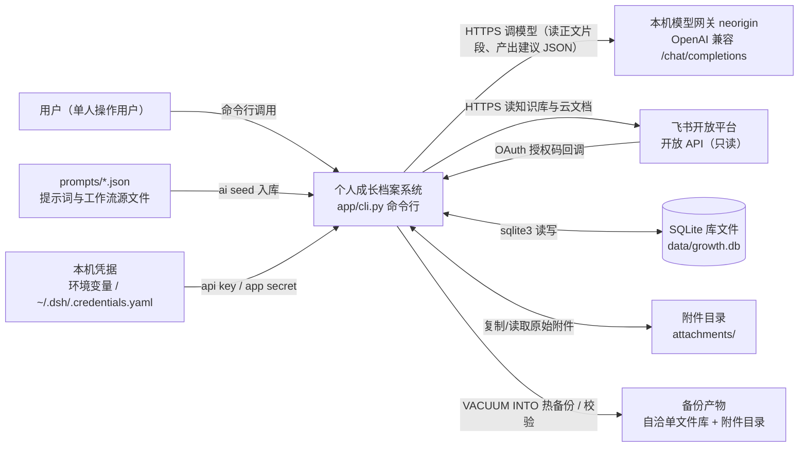
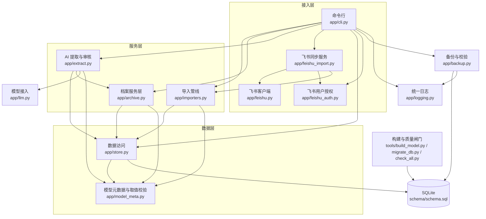
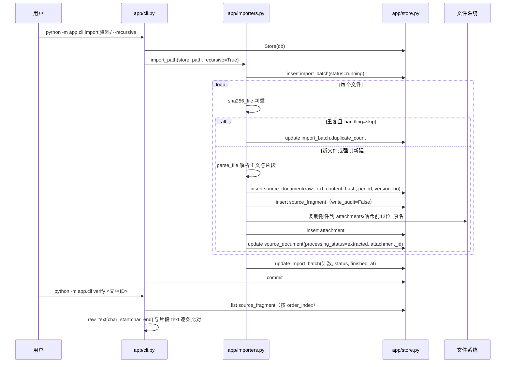
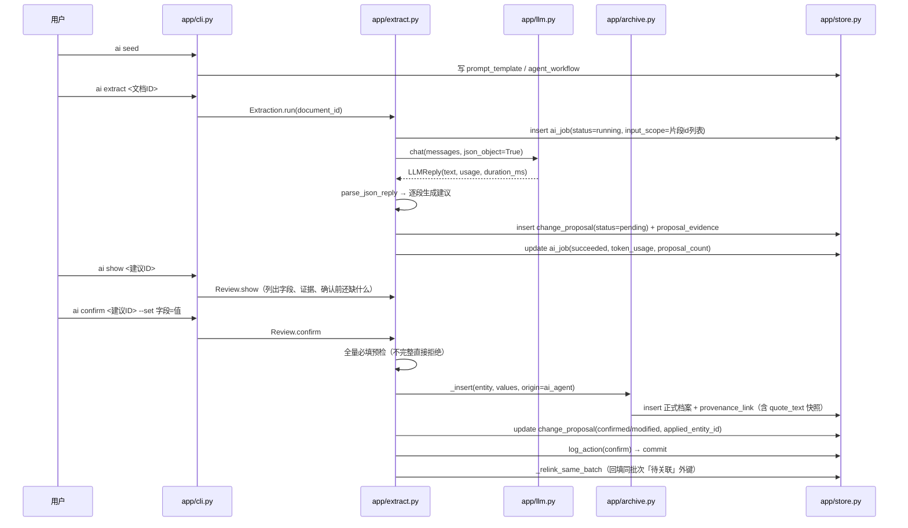
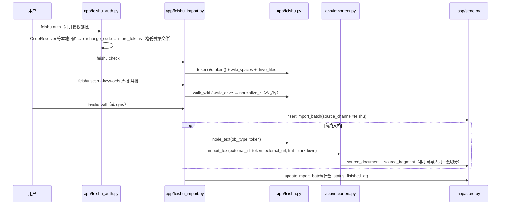
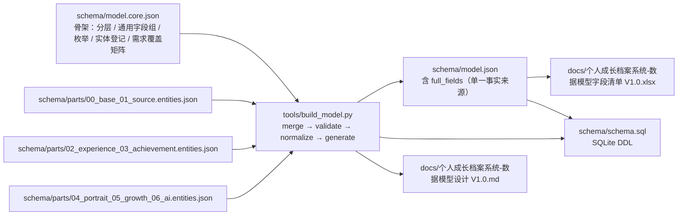

# 个人成长档案系统（Personal Growth OS）架构设计

| 项 | 内容 |
| --- | --- |
| 文档版本 | V1.0 |
| 对应实现 | 需求第 7 章实施顺序的**第 1–4 步**（核心数据模型、原始资料与来源追溯、工作经历档案、AI 提取与审核），另含第 10 步的前置能力「备份与校验」（`app/backup.py`） |
| 文档性质 | 实现快照。只写仓库里真实存在的代码与生成物；没有实现的写「未实现」 |
| 写作骨架 | arc42 裁剪（章节 0–10）+ C4 表达（第 2–4 章为 L1 / L2 / L3） |
| 依据标注 | 正文中的 `相对路径:行号` 指向当前仓库版本，可直接打开核对 |
| 相关文档 | [README.md](../README.md)（安装与操作口径）、[技术选型与决策记录.md](技术选型与决策记录.md)（ADR 正文）、[部署与运维.md](部署与运维.md)（运行与备份）、[个人成长档案系统-数据模型设计 V1.0.md](个人成长档案系统-数据模型设计%20V1.0.md)（由模型生成的 265 KB 字段文档） |

---

## 0 文档目的与读者

**目的**：回答「这套系统现在是怎么搭起来的、为什么这么搭、边界在哪里」。给出可核对的实现依据，作为后续第 5–10 步的起点。

**读者与读法**

- 接手维护者：读第 3、4 章建立模块地图，读第 7 章了解校验与凭据的横切规则。
- 评审者：读第 1、6、9 章，判断需求约束是否真的落到代码上。
- 后续实现者（第 5 步及以后）：读第 5、6、10 章，按既有数据流与生成链扩展。

**边界与约定**

- 本文不重复 README 的操作步骤，不复述 ADR 的论证过程（第 8 章只列标题与结论并给出链接），不重复数据模型的字段清单。
- 「未实现」= 仓库中找不到写入方或入口，不表示设计上不需要。
- 单元测试规模 102 条（`tests/test_feishu_auth.py` 25、`tests/test_feishu_sync.py` 13、`tests/test_step1_import.py` 16、`tests/test_step3_archive.py` 22、`tests/test_step4_extract.py` 21、`tests/test_zip_import.py` 5）。

---

## 1 需求约束与质量目标

### 1.1 需求 1.4 八条产品设计原则对架构的约束

需求原文见 `tools/reqdoc/out/doc_dump.txt:39-46`。下表逐条给出它落到哪个结构上、以及对应的实现证据。

| # | 原则（原文口径） | 架构上的约束 | 落点与证据 | 完成度 |
| --- | --- | --- | --- | --- |
| ① | 原始资料与整理结果分离，原始内容不得被 AI 覆盖 | 原始层（`source_document` / `source_fragment`）与档案层（`project` … `work_item`）是两组表，只在档案层之上做关联；原始字段标记 `imm`，由数据访问层拒绝二次写入 | `schema/model.core.json:2362-2367`（`raw_text` 带 `"imm": true`，说明写「写入后不可修改」）、`:2469-2472`（`source_fragment.text` 同）、`app/store.py:164-169`（`imm` 字段「只允许落一次」）、`app/importers.py:395` 之后一次性写入 | 应用层已实现；数据库层未强制（见第 9 章） |
| ② | 结构化档案独立于 Agent，避免绑定某个模型或工具 | 档案服务层不 import 任何模型/HTTP 代码；AI 与档案之间只有一张契约表 `change_proposal` | `app/archive.py:1-19`（模块声明只做录入/关联/归并/查询）、`app/archive.py` 全文无 `llm`/`urllib` 引用、`app/extract.py:1-22`（数据流向声明） | 已实现 |
| ③ | 重要数据必须保留来源和关联关系 | 任意档案记录都能挂 `provenance_link`；写入时把片段原文快照进 `quote_text`（`imm`），资料后续被替换也能核对当时的依据；实体间关联统一走 `entity_relation` | `app/archive.py:141-165`（`link_fragment` 复制 `quote_text`）、`schema/model.core.json:2159-2162`（`quote_text` 带 `imm`）、`app/archive.py:27-33`（多态引用表清单） | 已实现 |
| ④ | AI 提建议，用户确认才改正式档案 | AI 产物一律先落 `change_proposal`（`status=pending`）+ `proposal_evidence`；写正式表只发生在 `Review.confirm()` 里；AI 写出的结构化记录默认 `review_status=pending` | `prompts/document_extract.v1.json:272`（工作流输出约束：只允许产出建议）、`app/extract.py:673-697`、`app/model_meta.py:199-202`（`origin="ai_agent"` → `pending`） | 已实现 |
| ⑤ | 事实、推断和评价必须区分 | 通用字段组 `fact`（`is_fact` / `fact_basis`）自动注入相关实体；标记为推断时必须写依据，否则拒绝写入；提示词里同样要求把评价性内容与事实分开 | `schema/model.core.json:110-128`、`app/archive.py:90-92`（数据规则 B6 硬校验）、`prompts/document_extract.v1.json:7`（硬性约束第 4、8 条） | 已实现 |
| ⑥ | 能力判断必须有工作证据，不能仅凭 AI 评分 | 能力证据链路要有结构承载：`capability_*`、`evidence_evaluation`、`achievement_metric.is_verified` 等表已在模型中定义 | `schema/model.json:14478-14484`（模型统计含 50 实体 1025 字段）；写入方 `app/capability.py` | **已实现（第 5 步）** |
| ⑦ | 允许用户随时修正项目归属、贡献、能力判断 | 更新走 `update`（乐观锁 + 变更留痕）、删除走软删除、重复记录走 `merge_records`（引用整体转移 + 血缘）；确认 AI 建议时可逐字段覆盖 | `app/store.py:156-192`、`app/store.py:194`、`app/archive.py:335-379`、`app/extract.py:673-679`（`overrides`） | 已实现 |
| ⑧ | 所有正式数据应支持导出和迁移 | 结构从单一事实来源生成，DDL 是独立文件，字段清单可导出 xlsx，已有库用补列工具升级；数据侧支持数据库与附件的成对热备份与校验 | `tools/build_model.py:524`（生成链）、`tools/export_fields_xlsx.py`、`tools/migrate_db.py:52`、`app/backup.py:87`（`VACUUM INTO` 热备份）、`:240`（备份校验） | 结构与备份已实现；**按业务口径导出为通用格式未实现** |

### 1.2 需求 8.4 数据真实性要求对架构的约束

原文见 `tools/reqdoc/out/doc_dump.txt:226-230`。

| 8.4 要求 | 架构约束 | 证据 |
| --- | --- | --- |
| 不得虚构指标、评分、趋势、统计结果 | 模型被要求「只用原文里真实出现的信息，不补充、不猜测、不编造数字」；产出数字若无法核实，只作为建议内容出现，不进入正式档案；引擎自身不生成任何评分 | `prompts/document_extract.v1.json:7`（硬性约束第 2 条）、`:272`、`app/extract.py:673-691`（写库前必填校验） |
| 字段必须有明确的数据来源、计算规则或实际用途 | 字段定义强制写说明：`d` 至少 10 字，要写清来源 / 计算口径 / 用途，禁止「备注」式空话；构建期校验类型、枚举、外键目标是否存在 | `schema/parts/README.md:41`、`tools/build_model.py:86-146`（`validate`） |
| 区分客观事实、AI 推断和评价结论 | 通用字段组 `origin`（用户 / AI / 导入 / 系统）与 `fact`（`is_fact` + `fact_basis`）落在实体上；审核界面展示建议理由与原文证据 | `schema/model.core.json:130-141`、`app/extract.py:626-663`（`Review.show` 返回证据与缺失项）、`app/extract.py:453-460`（时间取自资料期间写进理由） |
| 重要分析应支持来源追溯 | 每个片段记 `heading_path` 与 `char_start` / `char_end`，`verify` 可校验区间仍能原样取回正文 | `app/importers.py:285-301`、`app/cli.py:126-142` |

### 1.3 质量目标

| 目标 | 手段 | 证据 |
| --- | --- | --- |
| 零第三方运行时依赖 | 产品代码只用标准库；`check_all.py` 扫描 `app/` 的 import，「只允许标准库与包内相对导入」 | `tools/check_all.py:11`；`.docx` 也只用标准库 `zipfile` + `xml.etree` 解析 OOXML（`app/importers.py:231-283`） |
| 数据可追溯 | 片段字符区间 + `provenance_link` 快照 + `audit_log` | `app/cli.py:126`、`app/archive.py:171`、`app/store.py:218` |
| 并发安全（单机多进程） | WAL + `busy_timeout` + `revision` 乐观锁 | `app/store.py:34-36`、`app/store.py:160-163` |
| 可迁移（同库换结构） | DDL 单文件生成 + 只增不减的补列补索引工具 | `tools/build_model.py:360`、`tools/migrate_db.py:52-109` |
| 可回归 | 六个测试文件 102 条用例；`check_all.py` 一条命令跑全量质量闸门 | `tools/check_all.py:5-14` |
| 生成物与模型不漂移 | `check_all.py` 对生成物做哈希比对，构建后发生变化即告警 | `tools/check_all.py:34-39`、`:97-111` |

### 1.4 明确不追求的东西

- 不做服务端与多用户（需求 2.2 明确暂不纳入）：没有 HTTP 入站服务，唯一监听端口是飞书 OAuth 的本地一次性回调 `127.0.0.1:8765`（`app/feishu_auth.py:33`、`:280-295`）。
- 不做数据库无关的 ORM：数据访问是手写 SQL + 模型白名单（`app/store.py:85-125`）。
- 不为 AI 做「自动通过」：所有 AI 产出都必须经过 `pending`（`app/model_meta.py:199-202`）。

---

## 2 系统上下文（C4 L1）

| 外部对象 | 交互方向 | 协议 / 载体 | 契约 | 证据 |
| --- | --- | --- | --- | --- |
| 用户 | 单向发起 | 命令行参数与终端输出 | 子命令与退出码（领域错误 2，未预期异常 3） | `app/cli.py:965-1275`、`app/cli.py:1280-1299` |
| 本机模型网关 | 出站 | HTTPS POST `/chat/completions`，OpenAI 兼容；可要求 JSON 对象输出 | 请求体含 `messages` / `max_tokens` / 可选 `response_format`；应答取 `choices[0].message.content` | `app/llm.py:186-243` |
| 飞书开放平台 | 出站（读）+ 本地回调（授权） | HTTPS，`open.feishu.cn`；OAuth 走 `accounts.feishu.cn` | 只调读接口；非 0 `code` 抛 `FeishuError`；授权回调 `http://localhost:8765/callback` | `app/feishu.py:18`、`:184-196`、`app/feishu_auth.py:29-41` |
| 本机凭据 | 入站 | 环境变量、`~/.dsh/.credentials.yaml` 的 `refs` 段、`~/.dsh/profiles/<profile>/cordis.patch.yml`、可选 `config/feishu.json` | 只读键值；写入凭据前先备份；日志只打印掩码 | `app/llm.py:144-169`、`app/feishu.py:93-119`、`app/feishu_auth.py:68-105` |
| SQLite 库文件 | 双向 | 文件 + WAL | 50 张表 / 228 个索引 / 1 个触发器 | `schema/schema.sql`（实测计数见 6.3） |
| 附件目录 | 双向 | 本地文件 | 复制到「数据库同目录 / `attachments` / `<哈希前12位>_<原名>`」 | `app/importers.py:452-470` |
| 备份产物 | 出站 | 本地文件 | `VACUUM INTO` 生成自洽单文件库 + 附件目录拷贝；每次备份在 `backup_record` 留档 | `app/backup.py:87-174` |
| 提示词文件 | 入站 | JSON 文件 → `prompt_template` / `agent_workflow` 表 | 文件名即版本；同名同版本更新 | `app/extract.py:118-181`、`prompts/document_extract.v1.json` |

**边界说明**：系统没有网络入站面（除 OAuth 回调），没有鉴权层，没有后台进程；一次命令 = 一个进程 = 一次事务边界。

---

## 3 容器视图（C4 L2）

| 容器 | 文件 | 职责 | 依赖 | 证据 |
| --- | --- | --- | --- | --- |
| 命令行 | `app/cli.py`（1303 行） | 20 个顶层命令（共 35 个叶命令）；参数解析、结果打印、异常统一转退出码 | 导入管线、档案服务层、AI 提取与审核、飞书同步、备份、store | `app/cli.py:965-1275`、`:1280-1299` |
| 导入管线 | `app/importers.py`（676 行） | 文件/目录/zip → 正文 + 有序片段 + 附件 + 导入批次；判重与版本链 | store、model_meta | `app/importers.py:395`、`:513`、`:615` |
| 档案服务层 | `app/archive.py`（496 行） | 项目/系统/模块/事项/主题/职责的录入与关联；归并；查询与总览 | store、model_meta | `app/archive.py:67-495` |
| AI 提取与审核 | `app/extract.py`（855 行） | 提示词播种、调用模型、产出待审核建议与证据、确认/拒绝落库 | store、archive、llm、model_meta | `app/extract.py:108`、`:598` |
| 模型接入 | `app/llm.py`（249 行） | 凭据解析、HTTP 调用、错误码映射；可注入 transport | 仅标准库 | `app/llm.py:144`、`:178` |
| 飞书客户端 | `app/feishu.py`（300 行） | 只读目录遍历与三类文档取正文；双身份令牌 | 仅标准库 | `app/feishu.py:122`、`:290` |
| 飞书同步服务 | `app/feishu_import.py`（267 行） | 扫描（不写库）与拉取（写库），落导入批次 | feishu、feishu_auth、importers、store | `app/feishu_import.py:148`、`:182` |
| 飞书用户授权 | `app/feishu_auth.py`（365 行） | OAuth 换码、刷新、令牌持久化与本地回调 | feishu（配置与错误类型） | `app/feishu_auth.py:188`、`:301` |
| 数据访问层 | `app/store.py`（250 行） | 模型驱动的 CRUD、审计、乐观锁、软删除、多态白名单校验 | model_meta、SQLite | `app/store.py:27-249` |
| 模型元数据 | `app/model_meta.py`（203 行） | 加载 `schema/model.json`，字段/枚举查询与取值规范化 | 无 | `app/model_meta.py:32-202` |
| 备份与校验 | `app/backup.py`（269 行） | 数据库热备份（`VACUUM INTO`）+ 附件拷贝 + 备份留档 + 备份文件校验 | store、logging | `app/backup.py:87`、`:240` |
| 统一日志 | `app/logging.py`（71 行） | 滚动文件日志，仅用于运行诊断（不记密钥与原文） | 仅标准库 | `app/logging.py:27`、`:36` |
| 数据库 | `schema/schema.sql` → `data/*.db` | 结构与约束 | — | `app/store.py:15`、`:40` |
| 构建工具 | `tools/*.py` | 模型合并与生成、DDL 实跑校验、补列补索引、质量闸门 | 无（开发期） | `tools/build_model.py:524`、`tools/migrate_db.py:52`、`tools/check_all.py:97` |

**依赖方向规则（本项目的硬约束）**

1. 只允许「接入层 → 服务层 → 数据层」单向依赖：`app/llm.py` 与 `app/feishu*.py` 都不 import `app/store.py`；`app/archive.py` 不 import `app/llm.py`。
2. 所有写库动作最终经 `app/store.py`；`archive` 与 `importers` 不自己拼 `INSERT`（裸 SQL 只出现在查询与运维命令里，如 `app/cli.py:155-160`、`app/archive.py:440`）。
3. 校验口径只有一处：字段类型/枚举/必填由 `app/model_meta.py` 决定，业务规则由 `app/archive.py` 决定，AI 建议的「还缺什么」复用同一份元数据（`app/extract.py:553-564`）。

---

## 4 组件视图（C4 L3）

### 4.1 `app/__init__.py`（9 行）

包声明。当前 docstring 只承认第 1–2 步，`__all__` 只有三个模块（`app/__init__.py:4-9`），与实际已实现的 `archive` / `llm` / `extract` / `feishu*` 不一致，属于陈旧信息（见第 9 章）。

### 4.2 `app/ids.py`（43 行）——标识与时间口径

| 组件 | 说明 | 证据 |
| --- | --- | --- |
| `uuid7()` | RFC 9562 UUIDv7：48 位毫秒时间戳 + 随机位，使主键在 B 树上按写入时间局部 | `app/ids.py:9` |
| `now_iso()` | UTC `%Y-%m-%dT%H:%M:%SZ`，全库时间戳统一口径 | `app/ids.py:18` |
| `date_iso` / `month_range` / `quarter_range` / `week_range` | 从文件名推断期间所需的区间计算 | `app/ids.py:23-43` |

### 4.3 `app/model_meta.py`（203 行）——模型元数据与取值校验

| 组件 | 说明 | 证据 |
| --- | --- | --- |
| `Model.load(path=None)` | 路径优先 `GROWTH_MODEL`，否则 `schema/model.json`；把实体、枚举、字段索引装进内存 | `app/model_meta.py:14`、`:42` |
| `Model.entity / fields / field / enum_values / enum_label / ref_targets / base_group` | 查询接口；`ref == "ENTITY_TYPE"` 时返回全部实体名（多态引用取值校验的基础） | `app/model_meta.py:48-85` |
| `validate_values(entity, values, require_all)` | 未知字段直接拒绝；`require_all` 时校验必填；逐字段 `_coerce` 后把问题汇总成 `ValidationError.problems` | `app/model_meta.py:87-120` |
| `_coerce` | boolean→0/1、integer 范围、decimal 范围、enum 命中、date/datetime 格式、json 序列化、ref 指向校验 | `app/model_meta.py:122-185` |
| `defaults_for` | 补模型默认值；**关键行为**：实体带 `review_status` 且未给值时，`origin="ai_agent"` → `pending`，否则 `confirmed` | `app/model_meta.py:194-202` |

### 4.4 `app/store.py`（250 行）——模型驱动的数据访问层

| 组件 | 说明 | 证据 |
| --- | --- | --- |
| `Store.__init__` | `sqlite3` 连接 + `Row` + `PRAGMA foreign_keys=ON`、`journal_mode=WAL`、`busy_timeout=5000` | `app/store.py:28-36` |
| `Store.init` | 用 `schema/schema.sql` 建库（DDL 内不含 PRAGMA） | `app/store.py:40-52` |
| 事务边界 | 上下文管理器：正常退出 commit，异常 rollback | `app/store.py:57-66` |
| `get / find_one / list / count / stats / query` | 读接口；`list` 的 `where` 只支持等值，键先经 `model.field` 白名单；默认按 `id DESC` | `app/store.py:69-127` |
| `insert` | 自动 `id` / `created_at`；`base_group="base"` 时再自动 `updated_at` / `revision=1`；补默认值 → 全量校验 → `IntegrityError` 转 `ModelError` → 写审计 | `app/store.py:129-154` |
| `update` | 乐观锁比对 `expected_revision`；`imm` 字段「只允许落一次」；`UPDATE … WHERE id=? AND revision=? AND deleted_at IS NULL`，`rowcount != 1` 抛 `Conflict` | `app/store.py:156-192` |
| `soft_delete` | 写 `deleted_at` 并自增 `revision`；查询默认过滤 | `app/store.py:194-210` |
| `log_action` / `_write_audit` / `history` | 非增删改动作（confirm / reject / merge / export）也留痕；审计记录写入前后 payload、操作者类型、关联建议与作业 | `app/store.py:211-245` |

### 4.5 `app/importers.py`（676 行）——原始资料导入管线

| 组件 | 说明 | 证据 |
| --- | --- | --- |
| `_Sink` / `count_words` / `detect_language` | 流式收集块并记录 `char_start` / `char_end`；块间补 `\n\n`；字数与语言口径（CJK 按字、其余按词；比例判定语言） | `app/importers.py:41-86` |
| `_parse_markdown` | 代码块、`#` 标题栈 → `heading_path`、引用、列表、表格、段落 | `app/importers.py:88-163` |
| `_parse_docx` | 只用标准库 `zipfile` + `xml.etree` 解析 OOXML（函数 docstring 明示，`:232`）；配合样式表、段落文本、表格行三个辅助函数处理标题/列表/引用与表格 | `app/importers.py:174-283` |
| `_finish_parse` | 补 `order_index` / `text_hash=sha256(text)` / `parse_confidence=1.0`，产出 `(full_text, blocks, meta)` | `app/importers.py:285-301` |
| `infer_doc_type` / `infer_period` / `sha256_file` | 从文件名推断类型与期间（`2024Q1`/`第12周`/`2024年3月`/`2024`），推不出留空 | `app/importers.py:340-393` |
| `import_file` | 判重 → 解析 → 写 `source_document`（含 `raw_text`、`content_hash`、期间、`version_no`）→ 写片段 → 复制附件 → 回写 `processing_status="extracted"` | `app/importers.py:395-485` |
| `_insert_fragments` | 逐块写 `source_fragment`；**`write_audit=False`**（片段量级大，不逐条写审计） | `app/importers.py:487-504` |
| `import_text` | 第三方来源（飞书等）入口：优先按 `external_id` 判重，其次 `content_hash`；写入 `external_url` / `external_updated_at` | `app/importers.py:513-579` |
| `extract_archive` | zip 解包，跳过目录项 / `__MACOSX` / 隐藏文件 / 非支持扩展名；**zip slip 防护**：越界路径直接 `ValueError("压缩包里有越界路径，已拒绝：%s")` | `app/importers.py:581-613` |
| `import_path` | 文件 / 目录 / zip 三分支；目录分支先建 `import_batch`（`status="running"`），逐文件导入，**单文件失败不阻断整批**，末尾汇总计数与 `finished_at` | `app/importers.py:615-676` |

### 4.6 `app/archive.py`（496 行）——档案服务层

| 组件 | 说明 | 证据 |
| --- | --- | --- |
| `precision_from_period` | 由期间跨度判定 `day/week/month/quarter/year/unknown` | `app/archive.py:40-65` |
| `_insert` | 录入唯一入口：默认 `origin="user"`；**数据规则 B6**：`is_fact=false` 且无 `fact_basis` 直接拒绝；写库后关联片段并回填 `source_document_id`，最后 commit | `app/archive.py:85-105` |
| `resolve` / `ensure_domain` | 先按 id 再按名称解析引用，找不到报错而不静默新建；工作领域是弱分类，缺失即新建 | `app/archive.py:107-133` |
| `link_fragment` / `link_fragments` / `provenance` | 写 `provenance_link` 并复制片段原文快照 `quote_text`；五元组相同则复用，不重复写 | `app/archive.py:141-195` |
| `create_project / create_system / create_module` | 模块校验父模块同系统（「父模块属于其他系统，功能模块不能跨系统挂载」） | `app/archive.py:197-215` |
| `_resolve_item_time` | 时间优先级：显式 `--date` → 来源资料期间（含精度）；都缺则报错，不猜时间 | `app/archive.py:217-229` |
| `create_work_item` | 校验 `project_id` / `system_id` / `module_id` / `domain_id` 存在后写入 | `app/archive.py:231-245` |
| `create_theme / add_theme_member / refresh_theme_span` | 主题成员可以是事项、成果案例或原始资料；首次/最近出现时间由成员时间聚合，不手工填 | `app/archive.py:247-294` |
| `create_role_record` | 职责记录（`target_label` 取目标名称），权威职责口径 | `app/archive.py:296-302` |
| `_referencing_fields` / `_unique_with` / `_move_rows` | 归并支撑：扫全模型找出所有指向该实体的字段（含 5 组多态引用）；撞唯一约束时区分「真冲突」与「重复关联」 | `app/archive.py:304-333` |
| `merge_records` | 转移引用 → 写 `entity_relation(merged_into)` → 软删除被并记录 → 回填 `merged_from_ids` / `consolidation_note` → `log_action("merge")`；异常整体回滚 | `app/archive.py:335-379` |
| 查询组件 | `module_tree` / `timeline` / `theme_timeline` / `domain_distribution` / `overview` / `trace` | `app/archive.py:381-495` |

### 4.7 `app/llm.py`（249 行）——模型接入层

| 组件 | 说明 | 证据 |
| --- | --- | --- |
| `LLMConfig` / `LLMReply` / `LLMError` | 配置（含 `key_source`、`masked_key()`）、应答（含 usage 与耗时）、错误（`code` 直接落 `ai_job.error_code`） | `app/llm.py:30-94` |
| `resolve_config` | 凭据顺序：显式参数 → `GROWTH_LLM_*` → `NEORIGIN_API_KEY` → profile 的 `apiKeyEnv` → `~/.dsh/.credentials.yaml`；取第一个非空并记录来源 | `app/llm.py:144-169` |
| `LLMClient.__init__(config=None, transport=None)` | **transport 可注入**，离线测试与假网关替换点 | `app/llm.py:181-184` |
| `chat(...)` | 无 key 抛 `invalid_input`；URL 拼接 `/chat/completions`；错误映射 401/403→`invalid_input`、429→`rate_limited`、408→`timeout`、其他→`model_error`、解析失败→`parse_failed`；空内容（常见于 `max_tokens` 被推理耗光）同样判 `parse_failed` | `app/llm.py:186-244` |
| `health_check` | 连通性自检，供 `ai check` 使用 | `app/llm.py:246-249` |

### 4.8 `app/extract.py`（855 行）——AI 提取与审核

分两个组件：`Extraction`（作业侧）与 `Review`（审核侧）。

**`Extraction`**

| 组件 | 说明 | 证据 |
| --- | --- | --- |
| `SECTION_ENTITY` / `NAME_FIELD` / `FK_ON_ITEM` / `IGNORED_KEYS` / `ENGINE_FIELDS` | 模型输出段落 → 实体的映射；事项外键映射；模型不应回填的键；引擎字段集合（算必填时排除） | `app/extract.py:38-64` |
| `render_prompt` / `parse_json_reply` | 只替换 `{小写标识符}` 变量，缺变量报错；解析容忍代码块包裹与前后杂字 | `app/extract.py:71-106` |
| `seed_config` / `active_template` / `active_workflow` | 把 `prompts/*.json` 写入 `prompt_template` 与 `agent_workflow`；取 `is_active=1` 且版本最大的模板 | `app/extract.py:118-194` |
| `run(...)` | 取片段（最多 2000，按 `order_index`）→ 组装提示词 → `dry_run` 只返回提示词不建作业 → 建 `ai_job(status="running")` → 调模型 → 产出建议 → 回写作业成功信息；**任何异常都把作业标 failed 并写错误码与截断的错误信息** | `app/extract.py:196-285` |
| `_variables` | 注入资料元信息、片段（单条截 1200 字）、已有档案名称、各枚举可选值 | `app/extract.py:336-371` |
| `_proposals_from_reply` | 按 `new_domains → new_systems → new_projects → new_modules → items` 顺序处理，再处理 `link_existing`（跨资料归并补来源） | `app/extract.py:373-418` |
| `_create_proposal` | 同名已有记录**不新建**，转成 link 建议；同批次内新建的外键先记「待关联」标记；事项时间缺省取资料期间并写进理由；缺失必填项写进理由 | `app/extract.py:420-488` |
| `_create_link_proposal` | 模型未给证据时退化为「正文出现该名字的片段」，取前后 40 字作引用，最多 3 条 | `app/extract.py:490-526` |
| `_write_evidences` | 写 `proposal_evidence`，默认引用片段前 200 字，并计算片段内偏移；`relevance_type` 非法回落 `primary_source` | `app/extract.py:528-551` |
| `_problems` / `_coerce_json_fields` | 复用模型元数据算「还缺什么」；把字符串形式的 json 字段解析成结构化值 | `app/extract.py:553-581` |

**`Review`**

| 组件 | 说明 | 证据 |
| --- | --- | --- |
| `list` / `show` / `_payload` | 列建议（多状态逐个查再合并）；`show` 汇总建议、载荷、证据（附资料标题与片段正文）、目标记录与缺失项；`final_payload` 优先于 `proposed_payload` | `app/extract.py:608-671` |
| `confirm` | 状态必须 `pending`；合并 `overrides`；`create/update` 写库前先做全量必填预检；写库异常 → rollback 并抛 `ExtractError("写入正式档案失败：…")`；成功后建议转 `confirmed` / `modified` 并 `log_action("confirm")`；**最后**调用 `_relink_same_batch` 回填同批次外键 | `app/extract.py:673-722` |
| `reject` | 状态转 `rejected` 并留痕，不写正式档案 | `app/extract.py:724-739` |
| `_apply` | create 走 `archive._insert`（复用档案层校验与关联）；update 走 `store.update`；link 只补来源；merge 走 `archive.merge_records(commit=False)`；delete 走软删除；**其他类型（split / unlink）抛「暂不支持」** | `app/extract.py:741-795` |
| `_link_evidences` | 逐条把证据落成 `provenance_link`（`match_method="ai_extract"`、`origin="ai_agent"`），单文档时回填 `source_document_id` | `app/extract.py:797-817` |
| `_relink_same_batch` | 在同批次仍 `pending` 的建议理由里找「待关联 X:name」标记，替换为「已关联」并回填外键 | `app/extract.py:829-853` |

### 4.9 `app/feishu.py`（300 行）——飞书只读客户端

| 组件 | 说明 | 证据 |
| --- | --- | --- |
| `FeishuConfig` / `resolve_feishu_config` | 凭据顺序：显式参数 → `FEISHU_APP_ID`/`FEISHU_APP_SECRET` → 凭据文件 `refs` → `config/feishu.json` | `app/feishu.py:41-119` |
| `dsh_credential_refs` | 解析 `refs:` 段，用 `^[ \t]+` 限定单行匹配，避免跨行误读 | `app/feishu.py:68-86` |
| `FeishuClient` | `transport` 可注入；`token()` 租户令牌缓存并提前 60 秒过期；`utoken()` 走用户令牌；`request` / `paged` 统一处理飞书 `code` 与分页 | `app/feishu.py:122-213` |
| `walk_wiki` / `walk_drive` | 知识库 BFS 遍历（附空间名）；云盘按层级递归，默认深度 3 | `app/feishu.py:215-252` |
| `docx_raw_text` / `doc_raw_text` / `sheet_text` | 三类文档取正文；表格转 Markdown（单元格内 `|` 转义、换行变空格） | `app/feishu.py:254-288` |
| `node_text` | 统一入口；`file/slides/bitable/mindnote/shortcut` 返回「暂不支持的类型…（请导出为 docx/md 后再导入）」 | `app/feishu.py:290-299` |

### 4.10 `app/feishu_import.py`（267 行）——同步服务

| 组件 | 说明 | 证据 |
| --- | --- | --- |
| `normalize_wiki_node` / `normalize_drive_item` | 把两种目录对象归一成同一结构（title / obj_type / token / url / updated_at） | `app/feishu_import.py:43-71` |
| `FeishuSync.__init__` / `_build_client` | `auth` 取 `user` / `tenant` / `auto`，`auto` 优先用户身份；无凭据直接报错并列出三种配置途径 | `app/feishu_import.py:75-106` |
| `check` | 诊断报告：令牌、知识库可见性、云盘可见性、问题清单 | `app/feishu_import.py:109-145` |
| `scan` | **只列不写库**；标题关键词过滤、`(token, title)` 去重、不支持类型打备注 | `app/feishu_import.py:148-179` |
| `pull` | 建 `import_batch(source_channel="feishu")`，逐篇取正文后交给 `import_text`（带 `external_id` / `external_url` / `external_updated_at`）；不支持类型与空正文计 skipped，单篇失败不阻断；末尾汇总写回批次 | `app/feishu_import.py:182-260` |
| `sync` | `scan` + `pull` 的组合入口 | `app/feishu_import.py:262-267` |

### 4.11 `app/feishu_auth.py`（365 行）——用户身份 OAuth

| 组件 | 说明 | 证据 |
| --- | --- | --- |
| 常量与键名 | 授权端点、令牌端点、默认回调 `http://localhost:8765/callback`、默认 scopes（含 `offline_access`）、凭据文件键名 | `app/feishu_auth.py:29-49` |
| `save_refs` / `load_user_tokens` / `clear_user_tokens` | 只原地更新 `refs:` 段；**写入前 `shutil.copy2` 备份为 `<path>.bak-YYYYmmdd-HHMMSS`**；读回不打印内容 | `app/feishu_auth.py:68-126` |
| `authorize_url` / `exchange_code` / `refresh_user_token` / `store_tokens` | OAuth 换码与刷新；`expires_at` 取 `now + max(60, expires_in-120)` 留安全余量 | `app/feishu_auth.py:132-222` |
| `CodeReceiver` | 一次性本地回调服务（`127.0.0.1:8765`），校验 `state`，返回中文提示页，默认 300 秒超时 | `app/feishu_auth.py:228-295` |
| `UserAuth` | 令牌供应器：未过期直接返回，过期用 `refresh_token` 续期并回写凭据文件 | `app/feishu_auth.py:301-342` |
| `user_info` | 读当前授权用户，供 `feishu whoami` 使用 | `app/feishu_auth.py:345-365` |

### 4.12 `app/cli.py`（1303 行）——命令行

| 组件 | 说明 | 证据 |
| --- | --- | --- |
| `build_parser` | 20 个顶层命令（共 35 个叶命令）：`init`/`import`/`docs`/`show`/`fragments`/`verify`/`audit`/`stats`/`trace`、`project`/`system`/`module`/`item`/`theme`/`role`/`link`/`overview`、`ai {seed,check,extract,jobs,proposals,show,confirm,reject}`、`feishu {check,spaces,scan,pull,auth,whoami,logout}`、`backup {create,verify,list}` | `app/cli.py:965-1275` |
| 资料命令 | `_import` 汇总批次结果；`_verify` 用 `raw_text[char_start:char_end]` 与片段文本逐条比对；`_audit` 直查审计表 | `app/cli.py:43-76`、`:126-142`、`:145-169` |
| 档案命令 | 项目/系统/模块/事项/主题/职责/关联/总览的薄封装，负责参数解析与展示 | `app/cli.py:246-548` |
| AI 命令 | `_ai_seed` / `_ai_check` / `_ai_extract` / `_ai_jobs` / `_ai_proposals` / `_ai_show` / `_ai_confirm`（`--set 字段=值`）/ `_ai_reject` | `app/cli.py:550-728` |
| 飞书命令 | `_feishu_check` / `_spaces` / `_scan` / `_pull` / `_auth` / `_whoami` / `_logout` | `app/cli.py:745-895` |
| `main` | 装配日志（`setup_logging`）后执行子命令；领域异常（含 `BackupError`）打印「错误：…」并返回 2；未预期异常打印「内部错误：…」、堆栈写入日志并返回 3 | `app/cli.py:1280-1299` |

### 4.13 `app/logging.py`（71 行）——统一日志

| 组件 | 说明 | 证据 |
| --- | --- | --- |
| `get_logger(name)` | 取 `growth.<name>` 子日志器 | `app/logging.py:27-34` |
| `setup_logging(log_dir, level, to_stderr, force)` | 幂等装配滚动文件日志：默认 `data/logs/app.log`，单文件 2 MB、保留 5 份、UTF-8；重复调用不叠加 handler | `app/logging.py:36-71` |
| 隐私与职责边界 | 模块 docstring 明确「日志只用于运行诊断，不是审计」「不记录密钥与原文」，只记长度、条数、耗时、状态码；谁改了哪条档案由 `audit_log` 负责 | `app/logging.py:1-12` |

### 4.14 `app/backup.py`（269 行）——备份与校验

| 组件 | 说明 | 证据 |
| --- | --- | --- |
| `create_backup(store, out_dir, include_attachments, label, note)` | 用 SQLite `VACUUM INTO` 做热备份（不必停写、自动处理 WAL），默认连附件目录一起拷贝，结束后写一条 `backup_record` 并返回报告 | `app/backup.py:87-174` |
| `sha256_file` / `_entity_counts` / `_dir_size` / `_same_drive` | 备份与校验所需的摘要、各实体条数、目录体积、跨盘判断 | `app/backup.py:45-85`、`:177-183` |
| `verify_database` / `verify_backup_file` / `_check_columns` | 校验备份文件：完整性、表结构、可读性、各实体条数 | `app/backup.py:184-269` |
| 恢复策略 | docstring 明确「恢复不做自动化」——覆盖数据库文件是破坏性操作，交使用者按文档手工执行，命令只提供校验 | `app/backup.py:13-14` |

### 4.15 提示词配置（`prompts/document_extract.v1.json`，281 行）

- 文件本身是**源**，`Extraction.seed_config()` 把它写进 `prompt_template` / `agent_workflow` 两张表，数据库只是运行态（`app/extract.py:124-181`）。
- `system_prompt` 里写死了九条硬性约束（只输出 JSON、只用原文、每条产出必须带 evidence、推断必须标 `is_fact=false` 并写依据、时间取原文否则用资料期间精度、已有记录用准确名称、不评价用户、事实/推断/评价分开、整体属于已有记录时用 `link_existing`）（`prompts/document_extract.v1.json:7`）。
- `user_prompt_template` 定义变量占位符与输出结构（`prompts/document_extract.v1.json:8`），`variables` 列出 21 个变量及其含义（`:9-94`），`output_schema` 给出结构约束（`:95-235`），`workflow.steps` 记录四步工作流与 `output_constraints`（`:240-279`）。

---

## 5 运行时视图

### 5.1 资料导入与来源追溯

要点：

- 同一份文件重复导入默认跳过；`new_version` 会写下一版本号并记 `duplicate_of_id`（`app/importers.py:395-446`）。
- 片段与正文的对应关系可自证：`verify` 逐条比对字符区间（`app/cli.py:134-139`）。
- 单文件失败只记入批次结果，不阻断整批（`app/importers.py:655`）。

### 5.2 AI 提取 → 待审核建议 → 用户确认写入

要点：

- 失败也留作业：任何异常都把 `ai_job` 标 `failed` 并写 `error_code` / `error_message`，避免留下永远 `running` 的记录（`app/extract.py:260-278`）。
- 「模型永不直接写正式档案」由结构保证：`Extraction` 只写 `ai_job`、`change_proposal`、`proposal_evidence`（`app/extract.py:222-258`、`:420-551`）。
- 确认时若写库失败，先 rollback 再抛错，不产生半成品（`app/extract.py:693-697`）。

### 5.3 飞书同步

要点：同步只是「另一种导入来源」，正文切分与追溯能力和手动上传完全一致（`app/feishu_import.py:1-11`）；重复拉取按 `external_id` 判重（`app/importers.py:530-533`）。

### 5.4 启动与迁移

| 场景 | 步骤 | 证据 |
| --- | --- | --- |
| 首次建库 | `python -m app.cli init` → `Store.init` 执行 `schema/schema.sql` → 打印实体与枚举数量 | `app/cli.py:33-40`、`app/store.py:40-52` |
| 日常启动 | 每个命令自己 `Store(args.db)`（默认 `data/growth.db`），进程结束即关闭；没有常驻服务 | `app/store.py:16`、`app/cli.py:44` 等 |
| 模型升级 | 改 `schema/model.core.json` / `schema/parts/*.entities.json` → `tools/build_model.py` 重新生成 → `tools/migrate_db.py` 给已有库补列补索引（先 `--dry-run`） → `tools/check_all.py` 全量闸门 | `tools/build_model.py:524-570`、`tools/migrate_db.py:52-109`、`tools/check_all.py:5-14` |
| 结构校验 | 生成的 DDL 先灌进内存 SQLite 实跑，失败即非零退出 | `tools/build_model.py:510-521`、`:539-543` |
| 备份与校验 | `backup create`（`VACUUM INTO` + 附件拷贝 + 写 `backup_record`）→ `backup verify` 校验备份文件 → `backup list` 查看历史记录 | `app/backup.py:87`、`:240`、`app/cli.py:899-963` |

### 5.5 失败与回滚路径（汇总）

| 场景 | 行为 | 证据 |
| --- | --- | --- |
| 整批导入的部分失败 | 继续处理其余文件，批次记 `failed_count` 与 `failure_reason` | `app/importers.py:655-676` |
| zip 越界路径 | 拒绝解包，抛 `ValueError` | `app/importers.py:602` |
| AI 作业失败 | 作业标 `failed` + 错误码（`parse_failed` / `unknown`） | `app/extract.py:260-278` |
| 确认写库失败 | rollback 后抛 `ExtractError`，建议保持 `pending` | `app/extract.py:693-697` |
| 归并中途出错 | rollback 后重抛，不留半成品 | `app/archive.py:375-379` |
| 并发修改 | `revision` 不匹配抛 `Conflict`，由调用方重读重试 | `app/store.py:160-163`、`:184-185` |
| 飞书单篇失败或类型不支持 | 记 `failed` / `skipped`，不阻断本批 | `app/feishu_import.py:200-215`、`:233-236` |

---

## 6 数据架构

### 6.1 分层模型与单一事实来源

- 分层顺序固定为 `00_base → 01_source → 02_experience → 03_achievement → 04_portrait → 05_growth → 06_ai`（`tools/build_model.py:46`）。
- part 文件只能补字段，不能新增实体或枚举；违规由 `tools/check_part.py` 与 `build_model.validate` 拦截（`schema/parts/README.md:29-31`、`:54-61`、`tools/build_model.py:86-146`）。
- 通用字段组有 5 个：`base`、`base_append_only`、`fact`、`origin`、`review`（`schema/model.json` 顶层 `standard_field_groups`）；实体通过 `base_group` 引用，字段自动注入（`tools/build_model.py:123-125`、`schema/parts/README.md:61`）。

### 6.2 生成物与一致性

| 生成物 | 生成者 | 一致性校验 |
| --- | --- | --- |
| `schema/model.json`（50 实体 / 1025 字段 / 57 枚举 / 65 关联 / 69 覆盖项） | `tools/build_model.py:524` 合并 part 后写出 | `check_all.py` 第 2、4 步：结构自洽 + 生成物哈希比对（`tools/check_all.py:34-39`、`:97-111`） |
| `schema/schema.sql` | `gen_ddl`（`tools/build_model.py:360`） | 生成后立刻在内存 SQLite 执行并核对表/索引数（`tools/build_model.py:510-521`） |
| `docs/个人成长档案系统-数据模型设计 V1.0.md` | `render_doc`（`tools/build_model.py:454`） | 模板字段引用检查（`tools/build_model.py:497`、`:548`） |
| `docs/个人成长档案系统-数据模型字段清单 V1.0.xlsx` | `tools/export_fields_xlsx.py` | 同属 `check_all.py` 的生成物哈希清单（`tools/check_all.py:36-38`） |
| `schema/rules.json` 的引用 | 人工维护 | `check_rules_refs` 校验 `refs` 指向的实体/字段是否存在（`tools/build_model.py:476`、`:562-570`） |

### 6.3 物理结构（实测）

| 指标 | 数值 | 说明 / 证据 |
| --- | --- | --- |
| 表 | 50 | `schema/schema.sql`；内存实跑计数与 `tools/build_model.py:518` 一致 |
| 索引 | 228 | 其中命名索引 178 个 + 由表内联 `UNIQUE(...)` 产生的隐式 `sqlite_autoindex` 50 个 |
| 部分唯一索引 | 17 | 形如 `CREATE UNIQUE INDEX uq_... ON t(...) WHERE deleted_at IS NULL`，只约束未删除行（`schema/schema.sql:1052-1059`） |
| 触发器 | 0 | 数据库层不做任何强制（`schema/schema.sql` 无 `CREATE TRIGGER`） |
| 数据规则 | 66 条 / 10 组 | `schema/rules.json`（A 原始资料不可变更、B 事实与推断…），规则文本进生成文档 |
| 需求覆盖项 | 68 | `schema/model.json` 的 `coverage` |
| 约束形式 | `NOT NULL` / `CHECK (... IN (...))` / 唯一索引 | 例：`origin TEXT NOT NULL CHECK (origin IN ('user','ai_agent','import','system'))`（`schema/schema.sql:20`）、`owner_type` 取值枚举（`:29`） |

### 6.4 来源追溯与审计

| 机制 | 作用 | 证据 |
| --- | --- | --- |
| `source_fragment.char_start/char_end` + `text_hash` | 片段可定位回正文；`verify` 可自证未被改动 | `app/importers.py:285-301`、`app/cli.py:134-139` |
| `provenance_link`（`entity_type` + `entity_id` + `fragment_id` + `relation_type` + `quote_text`） | 任意档案记录 → 原文；`quote_text` 是写入时快照（`imm`），资料被替换后仍可核对 | `app/archive.py:141-165`、`schema/model.core.json:2159-2162` |
| `entity_relation` | 实体间关联与归并血缘（`merged_into`） | `app/archive.py:335-379` |
| `audit_log` | 每次 `insert` / `update` / `soft_delete` 自动留痕（前后 payload、操作者、关联建议与作业）；`confirm`/`reject`/`merge` 通过 `log_action` 记录 | `app/store.py:151-153`、`:190-191`、`:211-245` |
| 软删除 | 删除不物理消失，查询默认过滤，可追溯 | `app/store.py:194-210`、`app/store.py:97` |

### 6.5 「不可修改」的落地方式

| 层 | 手段 | 证据 | 是否强制 |
| --- | --- | --- | --- |
| 模型 | 字段带 `imm: true`，目前共 7 处：`provenance_link.quote_text`、`source_document.raw_text`、`source_fragment.text`、`growth_snapshot` 的 4 个快照字段 | `schema/model.core.json:2159-2162`、`:2362-2367`、`:2469-2472`、`:4126`、`:4134`、`:4142`、`:4150` | 声明 |
| 应用层 | `store.update` 拒绝「已非空且带 `imm`」的字段；语义是「只允许落一次」（首次写入允许，便于作业结束时补记结果） | `app/store.py:164-169` | **强制**（经 store 的所有写入） |
| 数据库层 | 无触发器、无不可变表 | `schema/schema.sql`（`CREATE TRIGGER` 计数 0） | 不强制 |
| 只追加表 | `audit_log` 的 `base_group = base_append_only`；该组只提供 `id` / `created_at` | `schema/model.core.json:91-108`、`:2243` | 约定，非强制（见第 9 章） |
| 绕行口 | `Store.query` 可执行裸 SQL，不经过模型校验 | `app/store.py:125-127` | 设计上的逃生口，使用处均在只读查询 |

### 6.6 多态引用

- 5 组多态引用在 `app/archive.py:27-33` 显式登记，归并与引用转移据此扫描。
- 取值校验靠派生枚举：`entity_type` 由实体清单在构建期注册（`tools/build_model.py:149-156`），因此 `entity_type` 字段能像普通枚举一样被 `_coerce` 校验（`app/model_meta.py:75-81`）。

---

## 7 横切关注点

### 7.1 校验与错误处理分层

| 层 | 校验内容 | 异常类型 |
| --- | --- | --- |
| 模型元数据 | 未知字段、必填、类型与范围、枚举取值、日期格式、json 可序列化、引用目标存在 | `ModelError` / `ValidationError`（`app/model_meta.py:22-29`、`:87-120`） |
| 数据访问 | 乐观锁、`imm` 字段、写库完整性、软删除过滤 | `Conflict` / `NotFound` / `ModelError`（`app/store.py:19-25`、`:156-192`） |
| 档案服务 | 数据规则 B6（推断必须有依据）、父模块同系统、时间来源、主题成员类型、归并冲突 | `ArchiveError`（`app/archive.py:36`、`:90-92`、`:210`、`:217-229`、`:335-379`） |
| AI 提取与审核 | 提示词变量齐全、模型输出可解析、建议完整性（写库前预检）、写库失败回滚 | `ExtractError`（`app/extract.py:67`、`:71-106`、`:688-697`） |
| 接入层 | 无密钥、HTTP 状态码映射、空内容、飞书业务码 | `LLMError` / `FeishuError` / `FeishuSyncError` / `FeishuAuthError`（`app/llm.py:30`、`:216-243`、`app/feishu.py:23`、`app/feishu_auth.py:52`） |
| 命令行 | 领域异常 → 打印「错误：…」并返回退出码 2；未预期异常 → 「内部错误：…」+ 堆栈写入日志 + 退出码 3 | `app/cli.py:1287-1297` |

**原则**：越靠近数据的层越严格（未知字段直接拒绝），越靠近交互的层越宽容（补默认值、给可操作的提示）。错误信息面向用户可操作，例如「建议内容不完整，无法写入：…（可用 `--set 字段=值` 补充）」（`app/extract.py:690`）。

### 7.2 隐私与凭据管理

| 关注点 | 做法 | 证据 |
| --- | --- | --- |
| 凭据来源优先级 | 显式参数 → 项目环境变量 → 通用环境变量 → DSH profile → 凭据文件；`ai check` / `feishu check` 会打印实际命中来源 | `app/llm.py:144-169`、`app/feishu.py:93-119` |
| 不落库 | `ai_job` 只记 `model_provider` 与 `model_name`，不记密钥 | `app/llm.py:7-14`、`app/extract.py:230-231` |
| 不打印 | 只输出掩码（`masked_key()` / `masked_app_id()`）与令牌有效期 | `app/llm.py:75-94`、`app/feishu.py:41-63`、`app/feishu_auth.py:314-318` |
| 写前备份 | 更新凭据文件前 `shutil.copy2` 生成带时间戳的 `.bak` | `app/feishu_auth.py:74-75` |
| 静态扫描 | `check_all.py` 扫描版本库中的密钥形态与个人数据 | `tools/check_all.py:12-13`、`:41-49` |
| 附件与库 | 附件复制到数据库同目录的 `attachments/`，「跟着数据库走」，换库不污染既有档案 | `app/importers.py:452-470` |

### 7.3 日志与审计

- 两层职责分离：诊断日志走 `app/logging.py`（滚动文件 `data/logs/app.log`，「2 MB × 5 份」，命令行 `--verbose` 调级别，`app/cli.py:1282`）；持久化的操作留痕是 `audit_log` 表（`app/store.py:218-245`）。模块 docstring 明确「日志不是审计」且不记录密钥与原文（`app/logging.py:1-12`）。
- 审计覆盖：所有 `insert` / `update` / `soft_delete`（可关：片段与批量写入用 `write_audit=False`，`app/importers.py:503`）；语义动作 `confirm` / `reject` / `merge`（`app/store.py:211-217`）。
- 审计本身只增不改是**约定**：见 6.5 与第 9 章。

### 7.4 可测试性设计

| 手段 | 说明 | 证据 |
| --- | --- | --- |
| transport 注入 | `LLMClient(transport=...)`、`FeishuClient(transport=...)`、`UserAuth(transport=...)`、`_post_token/user_info(transport=...)` 全部可替换，离线跑测试 | `app/llm.py:181`、`app/feishu.py:125`、`app/feishu_auth.py:304`、`:145-166`、`:345-350` |
| 模型路径可覆盖 | `GROWTH_MODEL` 环境变量指向别的 `model.json`，便于用最小模型测数据层 | `app/model_meta.py:42-46` |
| 库可指定 | 所有命令带 `--db`，测试用临时库；`Store.init(db_path)` 支持任意路径 | `app/store.py:40`、`app/cli.py:44` |
| 演示与回归脚本 | `data/demo.pristine.db` 作为固定快照，`tools/step3_demo.sh` / `step4_demo.sh` 每次先还原；`tools/step4_pick.py` 选取演示资料 | `README.md:153-159`、`tools/step4_pick.py` |
| 全量闸门 | `tools/check_all.py` 八项检查（构建、自洽、DDL 实跑、已有库同步、依赖边界、编译、密钥扫描、单元测试） | `tools/check_all.py:5-14` |

### 7.5 性能与索引

| 关注点 | 做法 | 证据 |
| --- | --- | --- |
| 写入局部性 | UUIDv7 主键按时间有序，避免随机主键的 B 树页分裂 | `app/ids.py:9` |
| 连接参数 | WAL（读写不互斥）+ `busy_timeout=5000` + 外键开启 | `app/store.py:34-36` |
| 索引策略 | 字段级 `idx: true` → 生成命名索引；跨列唯一用 `unique_together` → 内联 `UNIQUE` | `tools/build_model.py:360-453`、`schema/schema.sql:1052-1059` |
| 大读取限制 | 片段读取上限 2000 条；`list` 默认 `limit=100`；`verify` 显式放大到 100000 | `app/extract.py:201-202`、`app/store.py:85`、`app/cli.py:132-133` |
| 提示词体积控制 | 单片段正文截 1200 字、已有事项只取最近 50 条、`max_tokens` 默认 16384 | `app/extract.py:336-371`、`:304-319`、`app/llm.py:27` |
| 批量导入 | 单进程串行处理文件；`sqlite3` 默认 autocommit 模式下按命令边界 commit，无显式批量事务 | `app/importers.py:615-676`、`app/cli.py:73` |

---

## 8 架构决策索引

决策正文在 [技术选型与决策记录.md](技术选型与决策记录.md)，本节只列标题与一句结论。

| 编号 | 标题 | 一句结论 | 位置 |
| --- | --- | --- | --- |
| ADR-0001 | 技术栈限定为 Python 标准库 + SQLite | 不引入 Web 框架、ORM、迁移框架与 HTTP 客户端库，产品代码只依赖标准库 | `docs/技术选型与决策记录.md:27` |
| ADR-0002 | 数据模型单一事实来源 + 代码生成 | 骨架 + part 文件是源，`model.json` / `schema.sql` / 文档 / xlsx 全部生成 | `docs/技术选型与决策记录.md:49` |
| ADR-0003 | 主键使用 UUIDv7（TEXT） | 主键由应用层生成，按时间有序，不使用自增整数 | `docs/技术选型与决策记录.md:75` |
| ADR-0004 | 模型驱动的数据访问层，写操作强制留痕 | 读写都经模型白名单校验，写操作自动追加审计 | `docs/技术选型与决策记录.md:90` |
| ADR-0005 | 软删除 + 乐观锁 + 不可修改字段 | 删除写 `deleted_at`、更新校验 `revision`、`imm` 字段只允许落一次 | `docs/技术选型与决策记录.md:107` |
| ADR-0006 | 来源追溯以 `provenance_link` 为中枢，多态引用 + 快照兜底 | 任意记录可挂来源，且写入时保存引用原文快照 | `docs/技术选型与决策记录.md:126` |
| ADR-0007 | AI 只提建议：一切 AI 产出落 `change_proposal` | AI 永不直接写正式档案，用户确认是唯一写入路径 | `docs/技术选型与决策记录.md:144` |
| ADR-0008 | 提示词与工作流入库，文件是源、数据库是运行态 | `prompts/*.json` 是源文件，`ai seed` 同步进两张配置表 | `docs/技术选型与决策记录.md:161` |
| ADR-0009 | 模型接入层：标准库 HTTP + 可注入 transport + 多级凭据回退 | 用 `urllib` 直连 OpenAI 兼容接口，凭据按固定优先级回退并记录来源 | `docs/技术选型与决策记录.md:177` |
| ADR-0010 | 飞书接入支持双身份，凭据存放于统一的凭据文件 | 应用身份读分享内容，用户身份走 OAuth 读本人空间 | `docs/技术选型与决策记录.md:194` |
| ADR-0011 | 导入管线：解析成片段并保留字符偏移，原文可逐字回溯 | 一份资料 = 正文全文 + 有序片段，区间可自证 | `docs/技术选型与决策记录.md:210` |
| ADR-0012 | 数据库迁移策略：生成式 DDL + 补列补索引工具 | 已有库只增列与索引，不重建、不改类型、不动数据 | `docs/技术选型与决策记录.md:227` |
| ADR-0013 | 质量闸门与生成式文档 | `check_all.py` 是唯一「全绿」判据，文档与 xlsx 属于生成物 | `docs/技术选型与决策记录.md:243` |
| ADR-0014 | 事项级去重与主题归并推迟到第 5 步 | 第 4 步不做模糊去重，同名已有记录只生成 link 建议 | `docs/技术选型与决策记录.md:258` |

---

## 9 已知局限与技术债

### 9.1 结构性局限（有意为之）

| 项 | 说明 | 证据 |
| --- | --- | --- |
| 单机单用户 | 只有本地库文件与命令行，无服务端、无服务端鉴权、无多用户与权限模型（需求 2.2 暂不纳入） | `app/store.py:16`、`app/cli.py:1280-1299` |
| 无并发写协调 | 依赖 WAL + 乐观锁；没有队列、没有重试器 | `app/store.py:34-36`、`:160-163` |
| 库文件未加密 | `sqlite3.connect` 无加密参数，`data/*.db` 明文；敏感度依赖文件系统权限 | `app/store.py:28-36` |
| 附件为本地文件 | 无对象存储、无去重管理层（同名冲突靠哈希前缀规避） | `app/importers.py:452-470` |
| 生成文档体积大 | 数据模型设计文档 265 KB 单文件，需要按实体检索而不是整篇阅读 | `tools/build_model.py:546-551` |

### 9.2 未实现的能力（需求范围内）

| 项 | 现状 | 证据 |
| --- | --- | --- |
| 能力词典、能力证据、评价（需求 1.4⑥） | `capability_*`、`evidence_evaluation`、`achievement_metric` 等表已建，写入方为零 | `README.md:240-241`；`app/` 内对 `capability_*` 无引用 |
| 成果案例与材料生成、成长曲线与阶段 | 表已建，未实现 | 同上 |
| 业务数据导出与迁移 | 结构与备份已就绪（`backup create/verify/list`）；但没有把业务数据导出为通用交换格式（JSON / CSV）的命令 | `app/cli.py:1258-1275`、`app/backup.py:87` |
| PDF / 图片 OCR | 只支持 `.txt` / `.md` / `.docx`（zip 解包后按目录导入） | `app/importers.py:21-22`、`app/importers.py:324-325` |
| 飞书非文档类型 | `file/slides/bitable/mindnote/shortcut` 只提示导出后导入 | `app/feishu.py:290-299` |
| 主题归并与事项级去重 | 第 4 步不做；语义重叠靠后续 `work_theme` + `theme_member` 处理 | `README.md:242-243`、`docs/技术选型与决策记录.md:258` |
| split / unlink 类建议 | `Review._apply` 明确抛「暂不支持的建议类型：…（split / unlink 在后续步骤实现）」 | `app/extract.py:795` |
| 云盘深度扫描的完整性 | `walk_drive` 默认深度 3 上限 1000 条，深层目录需显式调参 | `app/feishu.py:243-252` |

### 9.3 实现层面的不一致与可疑点

| # | 问题 | 证据与影响 |
| --- | --- | --- |
| 1 | **「写库即留痕」的收尾依赖调用方**：`Store.insert/update` 只在 `write_audit=True` 时记审计，片段与批次内部写入显式关闭审计 | `app/store.py:151-153`、`app/importers.py:503` |
| 2 | **`audit_log` 的「只增不改」没有强制**：`base_append_only` 组只注入 `id` / `created_at`，`audit_log` 字段无一带 `imm`，DDL 无触发器，`store` 也没有针对只追加表的守卫；README 的「只增不改不删」目前只是约定 | `schema/model.core.json:91-108`、`:2243-2309`、`schema/schema.sql`（触发器 0）、`app/store.py:164-169`、`README.md:169-170` |
| 3 | **对只追加实体调用 `update` / `soft_delete` 会抛非领域异常**：`store.update` 无条件读 `before["revision"]` 并写 `updated_at` / `revision` 列，而 `audit_log` 没有这些列 → `KeyError` 或 `sqlite3.OperationalError`；这类异常被兜底分支吞成「内部错误：…」（退出码 3）并只留在日志里，用户拿不到可操作的提示 | `app/store.py:160`、`:176-181`、`:194-203`、`app/cli.py:1293-1297` |
| 4 | **`imm` 语义是「只允许落一次」而非「不可改」**：字段在空值时仍可写一次，这对作业结束时补结果必要，但意味着「首次为空」的记录可被后写覆盖；数据规则 A1 要求数据库层用触发器或不可变表实现，目前未落地 | `app/store.py:164-167`、`schema/rules.json:11` |
| 5 | **部分唯一索引不可移植**：17 个唯一索引都带 `WHERE deleted_at IS NULL`（SQLite 语义），换库需重写为过滤视图或应用层约束；且 `unique_together` 生成的是表内联 `UNIQUE`，与部分唯一索引两套机制并存 | `schema/schema.sql:1052-1059`、`tools/build_model.py:360-453` |
| 6 | **确认的提交与同批次回填分两步**：`confirm` 先 `commit()`，再调 `_relink_same_batch`；若回填失败，确认已生效而外键仍指向「待关联」，形成部分成功 | `app/extract.py:718-720` |
| 7 | **`run(model=...)` 覆盖会重置凭据来源**：直接用 `resolve_config(model=...)` 重建配置，原先显式传入的 `base_url` / `api_key` 丢失，回落到环境变量或凭据文件 | `app/extract.py:209-210` |
| 8 | **过期文案**：`app/__init__.py` 仍写「后续步骤尚未实现」且 `__all__` 只有三个模块；`cli trace` 仍打印「AI 提取与关联功能尚未实现，第 3 步起会写入」，而 AI 提取（第 4 步）已实现 | `app/__init__.py:4-9`、`app/cli.py:194` |
| 9 | **两张凭据路径无落地形态**：`config/feishu.json` 在仓库中不存在（无 `config/` 目录），该配置途径需要用户自建；文档与代码都要说清这一层 | `app/feishu.py:88`、`app/feishu.py:93-119` |
| 10 | **一次性脚本留在仓库**：`tools/oneoff/` 有 16 个 `_migrate_*` / `_patch_*` 脚本，属已完成的一次性改造，长期是维护噪音 | `tools/oneoff/*.py`（目录清单） |
| 11 | **空的 `docs/adr/` 目录**：ADR 实际写在 `docs/技术选型与决策记录.md`，空的 `adr/` 目录容易误导（后续新增 ADR 需明确放在哪一侧） | `docs/adr/`（无文件） |
| 12 | **附件路径基准有两套**：目录取「数据库同目录 / attachments」，而 `storage_path` 尽量记「工作区相对路径」，跨盘符时退化为绝对路径；迁移库或附件时需成对处理 | `app/importers.py:452-470`、`README.md:184-187` |

---

## 10 演进路线

需求第 7 章的十步实施顺序见 `tools/reqdoc/out/doc_dump.txt:184-195`；第 1–4 步已完成，下表给出第 5–10 步的落点与主要新增工作。

| 步 | 目标（需求原文口径） | 已就绪的落点 | 主要新增工作 |
| --- | --- | --- | --- |
| 5 | 建立能力词典和能力证据模型 | `capability_category` / `capability` / `capability_alias` / `capability_evidence` / `evidence_evaluation` / `achievement_case` / `achievement_metric` / `achievement_item_link` 表已在模型中定义；`archive._insert` + `link_fragment` 可复用为写入通道；`theme_member.member_type` 已支持 `achievement_case` | 能力词典的录入/检索命令；证据只能从已确认的 `work_item` / `achievement_case` 派生（对应原则⑥）；能力评价与证据的关联校验；事项级去重与主题归并（ADR-0014 明确推迟到本步） |
| 6 | 建立个人特征画像 | `personal_trait` / `trait_evidence` / `self_assessment` 表已定义；`origin` + `review_status` 通用字段组已能表达「AI 假设待用户确认」 | 画像假设 → 建议 → 确认的复用路径（可直接沿用 `change_proposal`）；评价类内容的 `is_fact=false` + `fact_basis` 口径 |
| 7 | 建立成长曲线和成长阶段分析 | `growth_stage` / `growth_snapshot` 表已定义（快照字段带 `imm`，见 6.5）；`Archive.timeline` / `theme_timeline` / `domain_distribution` / `overview` 已是现成的时间序列数据源 | 快照生成作业（需固定计算口径并写进字段说明）；聚合查询的索引复核；按需求 8.4 为每个指标标注来源与计算规则 |
| 8 | 建立成果案例和个人材料生成 | `material` / `material_citation` / `achievement_*` 表已定义 | 材料模板与引用清单（`material_citation` 指向证据）；生成物必须可回溯到 `source_fragment`；导出能力补齐（当前无 `export` 命令，见 9.2） |
| 9 | 建立 API / MCP / CLI 接入 | 已有完整 CLI（20 个顶层命令 / 35 个叶命令）；服务层职责边界清晰（`archive` / `extract` 不依赖交互）；`llm` / `feishu` 层与存储解耦 | 在服务层之上包一层稳定入口（JSON 进 JSON 出），保持「AI 产物只落建议」的约束；鉴权与并发边界（当前是单机无鉴权，若要对外暴露必须先补） |
| 10 | 完成数据备份、迁移和安全验证 | `schema.sql` 单文件 DDL、`tools/migrate_db.py` 只增式升级、`tools/check_all.py` 质量闸门、`app/backup.py` 热备份与校验（`backup create/verify/list`）、`docs/部署与运维.md` 的备份章节 | 业务数据导出为通用交换格式（JSON / CSV）；恢复流程的半自动化与定期演练；库加密或访问控制的决策（当前 `data/*.db` 明文，见 9.1）；把 9.3 中的强制项（审计只追加、`imm` 的数据库层落地）补成硬约束 |

**共同前置项**：任何新实体都先在 `schema/model.core.json` / `schema/parts/*.entity.json` 登记，再走 `tools/build_model.py` → `tools/migrate_db.py` → `tools/check_all.py` 的固定链路，不手改 `schema/model.json`、`schema/schema.sql` 与生成文档（`tools/check_all.py:34-39`、`:97-111`）。
