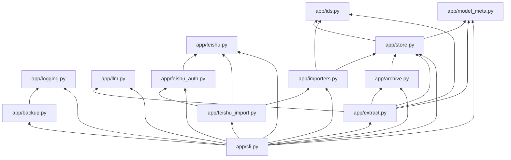

# 模块与接口（个人成长档案系统 V1.0）

## 0 文档说明

- **基准**：本文件以 `app/*.py` 的**实际代码**为准逐模块读写而成，不引用规划稿、不描述未实现的接口。文中每条结论都给出 `路径:行号`，行号对应撰写时的代码版本。
- **校验方式**：文中涉及模型规模、表数、索引数、测试条数的数字，全部来自实跑 `python tools/check_all.py`（9 步质量闸门）的输出，闸门定义见 `tools/check_all.py:427`（`main`）与各 `step_*` 函数（第 8 步是并发代理在撰写期间新增的「代码索引新鲜度」检查）。
- **撰写时的实测结果**：实体 50 / 字段 1024 / 枚举 57 / 规则 66 / 覆盖项 69（`tools/check_all.py:136` `step_model`）；建表 50 张、索引 228 个（`tools/check_all.py:237` `step_ddl`）；`app/` 无第三方依赖（`tools/check_all.py:321` `step_dependencies`）。
- **测试条数**：`tests/` 共 8 个文件、133 个 `test_*` 用例（`tools/check_all.py:411` `step_tests` 实测「Ran 133 tests」）。撰写时闸门**未全绿**：第 8 步报「索引已过期」，第 9 步有 4 条失败/错误且全部落在 `tests/test_backup.py`（属并发开发中的中间态，见 §6）。
- **模块清单与规模**（`wc -l` 实测）：`app/__init__.py` 33、`app/ids.py` 43、`app/logging.py` 70、`app/model_meta.py` 203、`app/store.py` 258、`app/llm.py` 251、`app/feishu_import.py` 267、`app/backup.py` 279、`app/feishu.py` 300、`app/feishu_auth.py` 365、`app/archive.py` 503、`app/importers.py` 698、`app/extract.py` 971、`app/cli.py` 1371。
- **分工原则**：`app/` 里只有 `cli.py` 负责「把命令行参数翻译成调用、把返回值打印成人能读的文本」；其余模块是可被测试直接调用的库代码。`app/cli.py` 之外没有任何模块导入 `cli`。

---

## 1 模块总览

| 模块 | 行数 | 一句话职责 | 依赖的同项目模块 | 主要上游调用者 |
| --- | --- | --- | --- | --- |
| `app/ids.py` | 43 | 主键与时间区间的纯函数工具 | 无 | `store`、`importers`、`extract` |
| `app/logging.py` | 70 | 运行诊断日志（不是审计） | 无 | `cli`、`backup` |
| `app/model_meta.py` | 203 | 加载 `schema/model.json`，做字段校验/类型强转/默认值 | 无 | `store`、`archive`、`extract`、`cli` |
| `app/store.py` | 258 | 模型驱动的 DAO：CRUD + 审计留痕 + 乐观锁 + 软删除 | `ids`、`model_meta` | `cli`、`archive`、`extract`、`importers`、`feishu_import`、`backup` |
| `app/llm.py` | 251 | 模型网关客户端与密钥解析（可注入 transport） | 无 | `extract`、`cli` |
| `app/importers.py` | 698 | 原始资料解析（md/txt/docx/zip）与入库 | `ids`、`store`（仅 `ROOT`） | `cli`、`feishu_import` |
| `app/archive.py` | 503 | 档案写入与检索（项目/系统/模块/事项/主题/角色/关联/归并） | `store` | `cli`、`extract` |
| `app/extract.py` | 971 | AI 提取作业与建议审核（Review） | `store`、`model_meta`、`archive`、`llm`、`ids`、`importers` | `cli` |
| `app/feishu.py` | 300 | 飞书开放平台 HTTP 客户端（只读）与凭据解析 | 无 | `feishu_import`、`cli` |
| `app/feishu_auth.py` | 365 | 飞书用户身份 OAuth（授权码换令牌、刷新、落盘） | `feishu`（仅配置类型） | `cli`、`feishu_import` |
| `app/feishu_import.py` | 267 | 飞书资料扫描（scan）与拉取入库（pull） | `feishu`、`feishu_auth`、`importers` | `cli` |
| `app/backup.py` | 279 | 数据库热备份、附件拷贝、备份校验 | `logging` | `cli` |
| `app/cli.py` | 1513 | 命令行入口：参数解析、调用编排、结果打印 | 全部业务模块 | 终端用户 |
| `app/web.py` | 537 | 只读 JSON API 与前端静态托管 | `store`（经 `Api` 构造） | `python -m app.web`、浏览器 |

---

## 2 模块与公开接口

### 2.1 `app/ids.py`

**职责**：把「ID 怎么生成」「时间怎么写」两件小事收敛成纯函数，全仓库唯一来源。

**依赖**：仅标准库（`os`、`uuid`、`datetime`）。

**公开 API**

| 签名 | 返回 | 说明 |
| --- | --- | --- |
| `uuid7() -> str` | 36 位 UUID 字符串 | UUIDv7：48 位毫秒时间戳 + 随机位（`app/ids.py:9`） |
| `now_iso() -> str` | `%Y-%m-%dT%H:%M:%SZ`（UTC） | 全库时间字段统一格式（`app/ids.py:18`） |
| `date_iso(d: date) -> str` | `YYYY-MM-DD` | 日期字段序列化（`app/ids.py:23`） |
| `month_range(year, month) -> (date, date)` | 月中旬首尾日 | 资料期间推断用（`app/ids.py:27`） |
| `quarter_range(year, quarter) -> (date, date)` | 季度首尾日 | 同上（`app/ids.py:33`） |
| `week_range(year, week) -> (date, date)` | ISO 周首尾日 | 同上（`app/ids.py:41`） |

**关键约束**：不抛自定义异常；时间一律 UTC，本地时区只允许出现在展示层。

**上游**：`app/store.py:28`（写 `id`/`created_at`）、`app/importers.py:18`、`app/extract.py`（批次 ID）。

---

### 2.2 `app/logging.py`

**职责**：提供运行诊断日志。模块 docstring 明确「日志只用于运行诊断，不是审计」，且「不记录密钥与原文」（`app/logging.py:2-12`）。

**依赖**：仅标准库（`logging`、`logging.handlers`、`os`）。

**公开 API**

| 签名 | 返回 | 说明 |
| --- | --- | --- |
| `get_logger(name=None) -> logging.Logger` | Logger | 名字自动加 `growth.` 前缀（`app/logging.py:27`） |
| `setup_logging(log_dir=None, level="INFO", to_stderr=False, force=False) -> str` | 日志文件路径 | 幂等：已有 handler 且 `force=False` 时直接返回（`app/logging.py:36`） |
| `LOGGER_NAME = "growth"` | 常量 | 根 logger 名（`app/logging.py:18`） |
| `DEFAULT_LOG_DIR` | `<项目根>/data/logs` | 默认落盘目录（`app/logging.py:19-20`） |

**关键行为约束**

- 轮转策略固定：单文件 2 MB、保留 5 份、UTF-8（`app/logging.py:23-24`、`app/logging.py:56-58`）。
- `logger.propagate = False`，避免输出重复（`app/logging.py:45`）。
- 目录不可写时不中断命令：退回 stderr 并打印「警告：日志文件不可写（%s），仅输出到标准错误」（`app/logging.py:61-63`）；极端情况挂 `NullHandler`（`app/logging.py:68-69`）。

**上游**：`app/cli.py:30`（`main` 里 `setup_logging`）、`app/backup.py:24`。

---

### 2.3 `app/model_meta.py`

**职责**：把生成物 `schema/model.json` 变成可查询的元数据对象，并承担**入库前的唯一一道字段校验**。

**依赖**：仅标准库（`json`、`os`、`re`）。**不依赖 `store`**——元数据层不能被数据访问层反向依赖。

**公开 API**

| 签名 | 返回 | 抛出的异常 |
| --- | --- | --- |
| `Model.load(path=None) -> Model`（classmethod） | 模型对象 | `ModelError`（文件缺失/JSON 损坏）（`app/model_meta.py:42`） |
| `Model(doc)` | — | —（`app/model_meta.py:32`） |
| `model.entity(name)` / `fields(name)` / `field(entity, field)` | 实体或字段定义 | `ModelError`「未知实体：%s（模型中共 %d 个实体）」（`app/model_meta.py:48`、`:54`、`:57`） |
| `model.enum_values(name)` / `enum_label(name, code)` | 枚举成员 / 中文标签 | `ModelError`「未知枚举：%s」（`app/model_meta.py:63`、`:69`） |
| `model.ref_targets(field)` | 目标实体 id 列表 | —（`app/model_meta.py:75`） |
| `model.base_group(entity)` | `"base"` 或其它分组 | —（`app/model_meta.py:83`） |
| `model.validate_values(entity, values, require_all=True) -> dict` | 规范化后的值 | `ModelError`（字段不存在）、`ValidationError`（多个问题一起报）（`app/model_meta.py:87`） |
| `model.defaults_for(entity, values) -> dict` | 补过默认值的值 | —（`app/model_meta.py:201`） |

**关键行为约束**

- 未知字段直接拒绝，不做静默丢弃（`app/model_meta.py:87`）。
- `require_all=True` 时缺必填字段会汇总成多条问题；`problem` 文案形如「缺少必填字段 %s.%s（%s）」（`app/model_meta.py:87`）。
- 类型强转规则：`boolean`→0/1、`integer`/`decimal` 带范围检查、`enum` 必须在枚举内、`date`/`datetime` 必须匹配格式、`json` 传 dict 时 `json.dumps(..., ensure_ascii=False)`、`ref` 必须指向已登记实体（`app/model_meta.py:122`）。
- **默认值的关键一条**：实体含 `review_status` 且调用方没给值时，`origin == "ai_agent"` → `pending`，否则 `confirmed`（`app/model_meta.py:201`）。这就是「AI 写入默认进待审」的实现点。
- 环境变量 `GROWTH_MODEL` 可覆盖模型路径（`app/model_meta.py:42`）。
- 常量：`ROOT`、`MODEL_PATH = schema/model.json`、`AUTO_FIELDS`（`id/created_at/updated_at/revision/deleted_at`）（`app/model_meta.py:13`、`:14`、`:17`）。

**上游**：`app/store.py`（校验与默认值）、`app/archive.py:70`、`app/extract.py`、`app/cli.py:214`（枚举候选值）。

---

### 2.4 `app/store.py`

**职责**：唯一的数据库入口。所有写入都经过它，因此审计留痕、乐观锁、软删除、不可变字段这四件事只需要在这里实现一次。

**依赖**：`app/ids.py`、`app/model_meta.py`（`app/store.py:1-16`）。

**公开 API**

| 签名 | 返回 | 抛出的异常 |
| --- | --- | --- |
| `Store(db_path=None, model=None, actor_type="user")` | — | —（`app/store.py:28`） |
| `Store.init(db_path=None, schema_sql=None) -> str`（classmethod） | 库路径 | —（`app/store.py:40`） |
| `close()` / `commit()` / `rollback()` | — | —（`app/store.py:54`、`:254`、`:249`）；支持 `with` 协议，正常退出 `commit`、异常退出 `rollback`（`app/store.py:57-60`） |
| `get(entity, rid, include_deleted=False) -> Row` | 一行 | `NotFound`「%s 中不存在记录 %s」（`app/store.py:69`） |
| `find_one(entity, **where)` | 一行或 `None` | —（`app/store.py:78`） |
| `list(entity, where=None, limit=100, offset=0, include_deleted=False, order_by=None)` | Row 列表 | —（`app/store.py:85`） |
| `count(entity, where=None, include_deleted=False)` / `stats()` | 计数 / 全实体计数 | —（`app/store.py:106`、`:119`） |
| `query(sql, params=())` | 原始行 | —（只读逃生口，`app/store.py:125`） |
| `insert(entity, values, actor_type=None, write_audit=True, remark=None, proposal_id=None, job_id=None) -> str` | 新记录 id | `ModelError`（校验失败、字段不存在、写入冲突）（`app/store.py:129`） |
| `update(entity, rid, patch, expected_revision=None, actor_type=None, remark=None, proposal_id=None, job_id=None) -> int` | 新 revision | `Conflict`、`ModelError`（imm 字段、只追加表）、`ValidationError`（`app/store.py:162`） |
| `_require_mutable(entity)`（内部；`update`/`soft_delete` 入口先调用） | — | `ModelError`「%s 使用字段组 %s，是只追加表，不支持修改或删除」（`app/store.py:156-160`） |
| `soft_delete(entity, rid, expected_revision=None, ...) -> int` | 新 revision | 同 `update`（`app/store.py:201`） |
| `log_action(entity, rid, action, before=None, after=None, ...)` | — | —（非增删改动作的留痕，`app/store.py:219`） |
| `history(entity, rid, limit=100)` | 审计行列表 | —（`app/store.py:249`） |

**关键行为约束**

- **写操作不自动提交**：`insert`/`update`/`soft_delete` 只执行 SQL 与审计，`commit()` 由调用方决定（`app/store.py:254`）。批量导入因此可以「一部分成功一部分失败后整体回滚」。
- **乐观锁**：`update` 若给了 `expected_revision` 且与库中不一致，抛 `Conflict`；SQL 带 `WHERE id=? AND revision=?`，`rowcount != 1` 也抛 `Conflict`（`app/store.py:162`）。
- **imm（不可变/只允许落一次）**：`patch` 里若含 `imm` 字段且库中该字段**已有非空值**，直接抛 `ModelError`「%s 的字段一旦写入就不可修改：%s」；允许「从空到有值」写一次（`app/store.py:162`）。原始正文、片段原文、引用原文靠这条规则锁死。
- **只追加表禁止改写**：`update`/`soft_delete` 入口先调 `_require_mutable(entity)`；字段组不是 `base`（例如只追加的 `audit_log`）时抛 `ModelError`（`app/store.py:156-160`、`:164`、`:203`）。这条是并发代理在撰写期间补上的，`docs/架构设计.md` §9.3 第 ③ 条（「对只追加实体调 update 抛非领域异常」）因此已失效。
- **留痕**：`insert`/`update`/`soft_delete` 分别写 `audit_log` 的 `create`/`update`/`delete`，payload 用 `json.dumps(..., ensure_ascii=False, default=str)`（`app/store.py:129`、`:162`、`:201`、`:226`）。
- 连接初始化固定开启 `foreign_keys`、WAL、`busy_timeout=5000`（`app/store.py:28`）。
- 常量：`ROOT`、`SCHEMA_SQL = schema/schema.sql`、`DEFAULT_DB = data/growth.db`（`app/store.py:14`、`:15`、`:16`）。
- 已知例外：导入片段批量落库时用 `write_audit=False` 关闭逐条审计（`app/importers.py:503`），这是 ADR-0004 记下的唯一豁免（`docs/技术选型与决策记录.md:102`）。

**上游**：`app/cli.py`（几乎每个命令构造函数时）、`app/archive.py:70`、`app/extract.py:111`、`app/importers.py:395`、`app/feishu_import.py:75`、`app/backup.py:87`。

---

### 2.5 `app/llm.py`

**职责**：把「调用模型网关」隔离成一个可注入、可离线测试的客户端；同时负责从环境变量与 DSH 凭据文件里解析密钥。

**依赖**：仅标准库（`json`、`os`、`urllib`、`time` 等）。**不依赖任何业务模块**。

**公开 API**

| 签名 | 返回 | 抛出的异常 |
| --- | --- | --- |
| `resolve_config(model=None, base_url=None, api_key=None, provider=None, timeout=None, max_tokens=None, profile=None) -> LLMConfig` | 配置 | —（`app/llm.py:144`） |
| `LLMConfig(base_url, model, api_key=None, provider=None, key_source=None, timeout=180, max_tokens=None, profile_config=None)` | — | —（`app/llm.py:59`） |
| `cfg.has_key` / `cfg.masked_key()` / `cfg.describe()` | 布尔 / 掩码 / 说明文本 | `describe()` 明确不含密钥（`app/llm.py:72`、`:75`、`:82`） |
| `LLMClient(config=None, transport=None)` | — | —（`transport` 可注入，测试用；`app/llm.py:181`） |
| `client.chat(messages, max_tokens=None, temperature=None, json_object=False, timeout=None) -> LLMReply` | 回复 | `LLMError`（`app/llm.py:186`） |
| `client.health_check() -> LLMReply` | 连通性回复 | `LLMError`（`app/llm.py:254`） |
| `LLMReply(text, usage=None, model=None, duration_ms=0, finish_reason=None, raw=None)` | — | —；`reply.usage_summary()` 返回 `{input, output, total, cached_input, reasoning_output}`（`app/llm.py:39`、`:48`） |
| `LLMError(message, code="model_error", status=None)` | — | `code` 会落进 `ai_job.error_code`（`app/llm.py:30`） |

**错误码语义**（`app/llm.py:186`）：无密钥 → `invalid_input`；HTTP 401/403 → `invalid_input`；429 → `rate_limited`；408/超时 → `timeout`；返回体不是 JSON → `parse_failed`；结构异常或空正文 → `model_error`/`parse_failed`。

**密钥优先级**（`app/llm.py:144`）：命令行 `--api-key` → `GROWTH_LLM_API_KEY` → `NEORIGIN_API_KEY` → profile 里声明的 `apiKeyEnv`（默认 `NEORIGIN_API_KEY`）→ `~/.dsh/.credentials.yaml` 的 `refs` 段。`base_url` 默认 `https://ai-gateway.neorigin.com.cn/v1`，模型默认 `deepseek-v4-1-flash`，provider 默认 `neorigin`，`max_tokens` 默认 32768（`app/llm.py:23`、`:24`、`:25`、`:27`）；推理型模型会把预算花在推理上，16384 时常出现 `finish_reason=length` 截断，`run()` 遇到截断会用翻倍预算重试一次（上限 65536）。

**上游**：`app/extract.py:111`、`app/cli.py:569`（`ai check`）。

---

### 2.6 `app/importers.py`

**职责**：把一份文件/目录/压缩包变成 `source_document` + `source_fragment`，并保留正文中的字符区间。

**依赖**：`app/ids.py`、`app/store.py`（只为了 `ROOT` 常量，`app/importers.py:19`）、标准库（含 `zipfile` + `xml.etree.ElementTree`，`app/importers.py:16`）。**不依赖 `archive`**——导入阶段只落原始资料，不写档案。

**公开 API**

| 签名 | 返回 | 抛出的异常 |
| --- | --- | --- |
| `parse_file(path) -> (full_text, blocks, meta)` | 三元组 | `ValueError`「暂不支持的文件类型：%s（当前支持 %s）」（`app/importers.py:317`） |
| `parse_text(text, fmt="markdown") -> (full_text, blocks, meta)` | 三元组 | 同上（`app/importers.py:303`） |
| `import_file(store, path, doc_type=None, source_channel="file_upload", duplicate_handling="skip", import_batch_id=None, title=None, archive_attachment=True) -> dict` | 结果 dict | `FileNotFoundError`、`ValueError`（空正文）（`app/importers.py:395`） |
| `import_text(store, title, text, doc_type=None, source_channel="third_party_import", duplicate_handling="skip", import_batch_id=None, period_start=None, period_end=None, external_id=None, external_url=None, external_updated_at=None, fmt="markdown", title_for_infer=None) -> dict` | 结果 dict | `ValueError`（`app/importers.py:513`） |
| `import_path(store, path, recursive=False, batch_label=None, **kwargs) -> dict` | 单文件结果或批次结果 | 单文件失败不抛出，记进批次（`app/importers.py:615`） |
| `extract_archive(path, dest) -> list[str]` | 解出的文件路径 | `ValueError`（非 zip、越界路径、无可用文件）（`app/importers.py:581`） |
| `infer_doc_type(filename) -> str` | 资料类型或 `"other"` | —（`app/importers.py:340`） |
| `infer_period(filename, default_year=None) -> (start, end, precision)` | 期间与精度；文件名没有四位年份且给了 `default_year` 时，按「N月N日」推该日所在 ISO 周、「N月」推整月 | —（`app/importers.py:349`） |
| `count_words(text) -> int` / `detect_language(text) -> str` / `sha256_file(path) -> str` | — | （`app/importers.py:72`、`:79`、`:379`） |

**公开常量**：`SUPPORTED_EXTS`（`.txt/.md/.markdown/.docx`）、`ARCHIVE_EXTS`（`.zip`）、`DOC_TYPE_KEYWORDS`、`MIME_BY_EXT`（`app/importers.py:21`、`:22`、`:24-35`、`:387`）。

**关键行为约束**

- 解析是**两级结构**：`_parse_markdown` / `_parse_docx` 填 `_Sink`，`_finish_parse` 统一补 `order_index`、`text_hash`(sha256)、`parse_confidence`（`app/importers.py:88`、`:238`、`:285`、`:41`）。
- `.docx` 解析**只用标准库**（`zipfile` + `ElementTree`，命名空间 `W_NS`）遍历 `w:p`/`w:tbl` 与标题/列表样式（`app/importers.py:172`、`:174`、`:189`、`:202`、`:219`、`:238`）。全仓库不存在 `python-docx` 依赖。
- 每个片段都写 `char_start`/`char_end`，指向 `source_document.raw_text` 里的位置，保证「原文可回溯、区间可校验」（`app/importers.py:490-503`，校验命令见 `app/cli.py:128`）。
- 判重口径：先看 `external_id`，再看正文 `content_hash`；`duplicate_handling="skip"` 时返回 `duplicate` 结果且不建新版本（`app/importers.py:416`、`:537`）。
- 附件复制到**数据库同目录**的 `attachments/`，文件名 `<hash前12位>_<原文件名>`；`storage_path` 优先存相对 `ROOT` 的路径，跨盘符时退化为绝对路径（`app/importers.py:452`、`:454`、`:459-461`、`:462-474`）。
- 导入完成后把 `source_document.processing_status` 从 `pending` 改成 `extracted`（`app/importers.py:483-478`）。
- 目录导入建 `import_batch`，单文件异常只记 `{"status": "failed", "path", "error"}`，最后统一收尾状态（`app/importers.py:644`、`:657`、`:670`、`:674`）。

**上游**：`app/cli.py:45`（`import`）、`app/feishu_import.py:18`（`import_text`）。

---

### 2.7 `app/archive.py`

**职责**：档案域的服务层——所有「人写的档案记录」都从这里进库，负责把名称解析成 id、把片段挂成来源、把重复记录并掉。

**依赖**：`app/store.py`（`NotFound`）与标准库 `calendar`、`sqlite3`、`datetime`（`app/archive.py:24`）。**不依赖 `extract`、`llm`、`feishu_*`**。

**公开 API**

| 签名 | 返回 | 抛出的异常 |
| --- | --- | --- |
| `Archive(store)` | — | —（`app/archive.py:70`） |
| `create_project(name, fragments=(), **fields)` / `create_system(...)` | 新记录 | `ArchiveError`、`ValidationError`（`app/archive.py:204`、`:201`） |
| `create_module(name, system_id, parent_module_id=None, fragments=(), **fields)` | 新记录 | `ArchiveError`（父模块跨系统）（`app/archive.py:212`） |
| `create_work_item(title, item_type, content, occurred_at=None, date_precision=None, fragments=(), **fields)` | 新记录 | `ArchiveError`（缺时间）（`app/archive.py:238`） |
| `create_theme(name, fragments=(), **fields)` / `add_theme_member(theme_id, member_type, member_id, relation_type="primary", evidence_fragment_id=None, **fields)` | 新记录 / 成员行 | `ArchiveError`（类型非法）（`app/archive.py:254`、`:251`） |
| `create_role_record(target_type, target_id, role, start_date, **fields)` | 新记录 | `ArchiveError`（`app/archive.py:303`） |
| `resolve(entity, value, fields=("name","title","code")) -> str` | 记录 id | `ArchiveError`「找不到 %s：%s（可用 list 子命令查看已有记录）」（`app/archive.py:112`） |
| `ensure_domain(name) -> str` | 领域 id | —（弱分类自动新建，`app/archive.py:129`） |
| `link_fragment(entity_type, entity_id, fragment_id, relation_type="primary_source", field_name=None, match_method="manual", origin="user")` | 关联行 | `ArchiveError`（`app/archive.py:146`） |
| `link_fragments(entity_type, entity_id, fragment_ids, ...)` | 关联行列表 | 同上（`app/archive.py:172`） |
| `provenance(entity_type, entity_id) -> list[dict]` | 来源列表 | —（`app/archive.py:178`） |
| `merge_records(entity, keep_id, drop_ids, note=None, commit=True) -> dict` | 合并报告 | `ArchiveError`（`app/archive.py:342`） |
| `module_tree(system_id)` / `timeline(limit=20, project_id=None, system_id=None, since=None)` / `theme_timeline(theme_id)` / `domain_distribution()` / `overview()` / `trace(entity, rid)` | 读模型 | `ArchiveError`（记录不存在）（`app/archive.py:388`、`:398`、`:429`、`:447`、`:454`、`:483`） |
| `precision_from_period(start, end) -> str` | `unknown/day/week/month/quarter/year` | —（`app/archive.py:40`） |

**关键行为约束**

- 默认 `origin="user"`：服务层代表用户手工录入，AI 写入必须显式传 `origin="ai_agent"`（`app/archive.py:85`）。
- `is_fact=false` 时必须给 `fact_basis`，否则抛「标记为推断（is_fact=false）时必须写明事实依据 fact_basis（数据规则 B6）」（`app/archive.py:85`）。
- 写入后若来源片段同属一份资料，回填 `source_document_id`；随后 **`_insert` 内部 `self.store.commit()`**（`app/archive.py:85`）。因此调用 `Archive` 的代码不需要、也不应该再自行提交。
- 关联片段幂等：完全相同的 `(entity, fragment, relation_type)` 已存在时直接返回原行（`app/archive.py:146`）。
- 主题跨度和日期精度都是**推导值**，由成员/期间聚合而来，手工填了也会被覆盖语义取代（`app/archive.py:281`、`:40`）。
- 归并是「留一份、其余软删、引用全量重指」：插入 `entity_relation(relation_type="merged_into")`、回填 `merged_from_ids`/`consolidation_note`、写 `merge` 审计，异常时整体回滚（`app/archive.py:342`）。

**上游**：`app/cli.py:248`（档案组全部命令）、`app/extract.py:111`（`Review._apply` 复用 `_insert` 与 `merge_records`）。

---

### 2.8 `app/extract.py`

**职责**：把一份资料交给模型提取成**待审核建议**（`change_proposal`），并提供审核层把建议写进正式档案。

**依赖**：`app/store.py`、`app/model_meta.py`、`app/archive.py`、`app/llm.py`、`app/ids.py`、`app/importers.py`（`precision_from_period` 走 archive）（`app/extract.py:1-30`）。

**公开 API**

| 签名 | 返回 | 抛出的异常 |
| --- | --- | --- |
| `render_prompt(template, variables) -> str` | 渲染后的提示词 | `ExtractError`「提示词模板缺少变量：…」（`app/extract.py:71`） |
| `parse_json_reply(text) -> dict` | 模型输出的 dict | `LLMError(code="parse_failed")`（`app/extract.py:89`） |
| `Extraction(store, llm=None, archive=None, model=None)` | — | —（`app/extract.py:111`） |
| `extraction.seed_config() -> dict` | `{"prompt_templates": [...], "workflows": [...]}` | —（`app/extract.py:124`） |
| `extraction.active_template(job_type="document_extract")` / `active_workflow(job_type)` | 模板/工作流行 | `ExtractError`「还没有可用的提示词模板，请先执行：python -m app.cli ai seed」（`app/extract.py:182`、`:190`） |
| `extraction.run(document_id, model=None, max_fragments=None, existing_item_limit=50, temperature=None, max_tokens=None, trigger_type="manual", dry_run=False) -> dict` | 作业结果 dict | `ExtractError`（`app/extract.py:196`） |
| `extraction.jobs(limit=20)` / `job(job_id)` | 作业行 | —（`app/extract.py:591`、`:594`） |
| `extraction.cleanup_stale_jobs(statuses=("running", "queued"), note=None) -> list[str]` | 被标成 `failed` 的作业 id 列表 | —（`app/extract.py:597`） |
| `Review(store, archive=None, extraction=None, model=None)` | — | —（`app/extract.py:622`） |
| `review.list(status=None, job_id=None, batch_id=None, limit=50)` | 建议行列表 | —（`app/extract.py:629`） |
| `review.show(proposal_id) -> dict` | `{proposal, payload, evidences, target, requirements}` | `ExtractError`「找不到建议：%s」（`app/extract.py:647`、`:679`） |
| `review.confirm(proposal_id, overrides=None, note=None, actor_type="user") -> dict` | `{proposal_id, status, entity, applied_entity_id, relinked}` | `ExtractError`（非 pending、字段不全、写入失败）（`app/extract.py:694`） |
| `review.reject(proposal_id, note=None, actor_type="user") -> dict` | `{proposal_id, status: "rejected"}` | `ExtractError`（`app/extract.py:747`） |
| `review.confirm_batch(job_id=None, batch_id=None, note=None, fill_missing=True, limit=2000, actor_type="user") -> dict` | `{total, confirmed, modified, failed, confirmed_ids, modified_ids}`；缺 `occurred_at` 的 `work_item` 用所属资料的期间起点补齐 | —（`app/extract.py:762`） |

**关键行为约束**

- `run()` **先建作业再调用模型**：`ai_job` 以 `status="running"` 落库并立即提交，避免长耗时调用期间库里看不到作业（`app/extract.py:222-238`）。
- `run()` 的**任何失败都会把作业标成 `failed`** 并提交，`error_code` 取 `exc.code`，`ValidationError`/`ModelError` 归为 `parse_failed`，其余 `unknown`；记录失败原因本身失败时回滚且不掩盖原始错误（`app/extract.py:260-278`）。
- `run()` 成功返回 `{job_id, batch_id, proposal_ids, proposal_count, duration_ms, usage, model, coverage, notes}`（`app/extract.py:283-284`）。
- `dry_run=True` 时**不写库、不调模型**，只返回将要发送的 messages 与覆盖情况 `{dry_run, messages, coverage, template_id, workflow_id}`（`app/extract.py:218-220`）。
- 建议写入前一律 `review_status="pending"`（由 `model_meta.defaults_for` 因 `origin="ai_agent"` 自动给出，`app/model_meta.py:201`）；只有 `confirm` 才写正式档案并置 `confirmed`/`modified`（`app/extract.py:694`、`:764`）。
- `confirm` 前会做一次 `require_all=True` 的完整性校验，缺字段时抛「建议内容不完整，无法写入：…（可用 --set 字段=值 补充）」（`app/extract.py:694`）。
- `_apply` 支持 `create`/`update`/`link`/`merge`/`delete`；`split`/`unlink` 抛「暂不支持的建议类型：%s（split / unlink 在后续步骤实现）」（`app/extract.py:764`；错误文案在 `app/extract.py:818`）。
- 覆盖 `--model` 时会**重建整份 LLM 配置**（`resolve_config(model=model, timeout=...)`），因此 `base_url`/`api_key` 的来源可能被重置（`app/extract.py:209-210`）。这是已知缺陷，见 `docs/架构设计.md` §9.3 第 7 条，撰写时仍然存在。
- 进程被强杀时 `ai_job` 会停在 `running`（刻意的兜底）：`cleanup_stale_jobs()` 把它们标成 `failed`（`error_code="unknown"`，`error_message` 记原因），CLI 入口是 `python -m app.cli ai cleanup [--note …]`（`app/extract.py:597-616`、`app/cli.py:618`）。

**上游**：`app/cli.py:552`（`ai seed`）、`:569`（`ai check`）、`:587`（`ai extract`）、`:618`（`ai cleanup`）、`:633`（`ai jobs`）、`:653`（`ai proposals`）、`:671`（`ai show`）、`:722`（`ai confirm`）、`:738`（`ai reject`）。

---

### 2.9 `app/feishu.py`

**职责**：飞书开放平台 HTTP 客户端（只读接口）与凭据解析。

**依赖**：仅标准库（`json`、`os`、`urllib`）。**不依赖业务模块**，因此可以单独离线测试。

**公开 API**

| 签名 | 返回 | 抛出的异常 |
| --- | --- | --- |
| `resolve_feishu_config(app_id=None, app_secret=None, base_url=None, timeout=None, root=None, home=None) -> FeishuConfig` | 配置 | —（`app/feishu.py:93`） |
| `FeishuConfig(app_id=None, app_secret=None, base_url=..., timeout=30, key_source="")` | — | —；`has_key`/`masked_app_id()`/`describe()`（`app/feishu.py:42`、`:51`、`:54`、`:59`） |
| `FeishuClient(config=None, transport=None, as_user=False, user_auth=None)` | — | —（`transport` 可注入，`app/feishu.py:125`） |
| `client.token()` / `utoken()` | tenant / user access token | `FeishuError`（`app/feishu.py:162`、`:175`） |
| `client.request(method, path, params=None, data=None, raw=False)` | 接口返回 `data` | `FeishuError`（HTTP 或业务 code 非 0）（`app/feishu.py:184`） |
| `client.paged(path, key, params=None, limit=200)` | 翻页后的列表 | `FeishuError`（`app/feishu.py:204`） |
| `client.wiki_spaces(limit=50)` / `wiki_nodes(space_id, parent_node_token=None, limit=1000)` / `walk_wiki(spaces=None, limit=1000)` | 列表 | `FeishuError`（`app/feishu.py:215`、`:226`、`:222`） |
| `client.drive_files(folder_token=None, limit=200)` / `walk_drive(folder_token=None, depth=3, limit=1000, _level=0)` | 列表 | `FeishuError`（`app/feishu.py:238`、`:243`） |
| `client.docx_raw_text(document_id)` / `doc_raw_text(doc_token)` / `sheet_text(spreadsheet_token, max_sheets=20)` | 纯文本/markdown 表 | `FeishuError`（`app/feishu.py:254`、`:259`、`:263`） |
| `client.node_text(obj_type, obj_token, title="") -> (text|None, reason|None)` | 文本或原因 | —（`app/feishu.py:290`） |
| `FeishuError(message, code=None, status=None, path=None)` | — | 消息会拼上 code/HTTP/path（`app/feishu.py:23`） |

**关键行为约束**

- 凭据优先级：显式参数 → `FEISHU_APP_ID`/`FEISHU_APP_SECRET` 环境变量 → `~/.dsh/.credentials.yaml` 的 `refs` 段 → 工作区 `config/feishu.json`（`app/feishu.py:93`）。
- tenant token 带缓存，提前 60 秒过期（`app/feishu.py:19`、`:162`）。
- 不支持的云文档类型（`file`/`slides`/`bitable`/`mindnote`/`shortcut`）返回原因文本「暂不支持的类型：%s（请在飞书里导出为 docx/md 后再导入）」，不抛异常（`app/feishu.py:290`）。
- 外部接口只做读操作；本模块没有写飞书的代码路径。

**上游**：`app/feishu_import.py:75`、`app/cli.py:762`（`feishu check`）。

---

### 2.10 `app/feishu_auth.py`

**职责**：用户身份 OAuth —— 生成授权链接、接回调拿 code、换/刷新 token、把 token 写回凭据文件。

**依赖**：`app/feishu.py`（复用配置与 `FeishuError` 语义）、标准库（`http.server`、`urllib`、`shutil`、`webbrowser` 等）。

**公开 API**

| 签名 | 返回 | 抛出的异常 |
| --- | --- | --- |
| `authorize_url(config, redirect_uri=DEFAULT_REDIRECT_URI, scope=None, state=None) -> str` | 授权链接 | `FeishuAuthError`（无凭据）（`app/feishu_auth.py:132`） |
| `exchange_code(config, code, redirect_uri=DEFAULT_REDIRECT_URI, transport=None) -> dict` | token 载荷 | `FeishuAuthError`（`app/feishu_auth.py:188`） |
| `refresh_user_token(config, refresh_token, transport=None) -> dict` | token 载荷 | `FeishuAuthError`（`app/feishu_auth.py:199`） |
| `store_tokens(tokens, home=None, scope=None) -> str` | 凭据文件路径 | `FeishuAuthError`（`app/feishu_auth.py:209`） |
| `load_user_tokens(home=None)` / `clear_user_tokens(home=None)` | 令牌 dict / — | —（`app/feishu_auth.py:108`、`:123`） |
| `check`（`CodeReceiver(port=DEFAULT_PORT, path="/callback", expected_state=None)`）`.wait(timeout=300) -> str` | 授权 code | `FeishuAuthError`「等待授权回调超时（%d 秒）；可用 --no-wait 打印链接后手动粘贴 code。」（`app/feishu_auth.py:228`、`:282`） |
| `UserAuth(config=None, tokens=None, transport=None, home=None)` | — | —；`has_token`/`describe()`/`token()`（`app/feishu_auth.py:304`、`:311`、`:314`、`:330`） |
| `user_info(config, access_token, transport=None) -> dict` | `{name, open_id, email, avatar_url}` | `FeishuAuthError`（`app/feishu_auth.py:345`） |

**关键行为约束**

- 写凭据文件前**先备份**为 `<path>.bak-<时间戳>`，且只改 `refs` 段（`app/feishu_auth.py:68`）。
- `describe()` 只输出有效期与 scope，**不打印令牌原文**（`app/feishu_auth.py:314`）。
- `token()` 过期时自动用 `refresh_token` 续期并重新落盘；无 `refresh_token` 时抛「用户令牌已过期且没有 refresh_token，请重新跑 feishu auth。」（`app/feishu_auth.py:330`）。
- 默认 scope 五项含 `offline_access`（`app/feishu_auth.py:35`）；默认回调 `http://localhost:8765/callback`（`app/feishu_auth.py:33`、`:34`）。
- 回调服务校验 `state`，不匹配即拒绝（`app/feishu_auth.py:228`）。

**上游**：`app/cli.py:858`（`feishu auth`）、`:899`（`feishu whoami`）、`:908`（`feishu logout`）；`app/feishu_import.py:74`（用户身份客户端）。

---

### 2.11 `app/feishu_import.py`

**职责**：把飞书上的文档**扫描成候选清单**，再**拉取正文走标准导入管线**。

**依赖**：`app/feishu.py`、`app/feishu_auth.py`、`app/importers.py`（`app/feishu_import.py:13-19`）。

**公开 API**

| 签名 | 返回 | 抛出的异常 |
| --- | --- | --- |
| `normalize_wiki_node(node) -> dict` / `normalize_drive_item(item) -> dict` | 统一候选结构 | —（`app/feishu_import.py:43`、`:59`） |
| `FeishuSync(store, client=None, config=None, keywords=None, auth="auto", home=None)` | — | `FeishuSyncError`（无凭据、缺用户授权）（`app/feishu_import.py:75`、`:92`） |
| `sync.check() -> dict` | `{app_id, key_source, base_url, auth_mode, user_auth, token_ok, spaces, drive_ok, problems[]}` | `FeishuSyncError`（`app/feishu_import.py:109`） |
| `sync.scan(wiki=True, drive=False, drive_folder=None, drive_depth=3, keywords=None, limit=500, include_unsupported=False) -> list[dict]` | 候选清单（**不写库**） | `FeishuSyncError`（`app/feishu_import.py:148`） |
| `sync.pull(nodes, doc_type=None, duplicate_handling="skip", batch_label=None, fmt="markdown", dry_run=False) -> dict` | `{status, batch_id, total, imported, duplicate, failed, skipped, results[]}` | `FeishuSyncError`（`app/feishu_import.py:182`） |
| `sync.sync(...)` | 扫描 + 拉取的组合 | 同上（`app/feishu_import.py:262`） |

**关键行为约束**

- `auth` 三态：`auto`/`user`/`tenant`；`user` 且没有令牌直接抛「还没有飞书用户授权。请先跑：python -m app.cli feishu auth」（`app/feishu_import.py:75`、`:92`）。
- 拉取走 `import_text`，因此**判重、附件、字符区间、审计口径与本地导入完全一致**（`app/feishu_import.py:182`）。
- 单篇失败不阻断整批；批次计数在收尾统一落库（`app/feishu_import.py:182`）。
- 默认关键词 `("周报", "月报")`，可用 `--match` 覆盖（`app/feishu_import.py:22`）。
- 层级瑕疵：`app/feishu_import.py:18` 从 `importers` 导入 `now_iso`，而该函数实际定义在 `app/ids.py:18`（经 `app/importers.py:18` 再导出）。

**上游**：`app/cli.py:762`（check）、`:784`（spaces）、`:798`（scan）、`:826`（pull）。

---

### 2.12 `app/backup.py`

**职责**：数据库热备份 + 附件目录拷贝 + 备份产物校验，并把每次备份记进 `backup_record`。

**依赖**：`app/logging.py`、标准库（`sqlite3`、`shutil`、`hashlib`）。

**公开 API**

| 签名 | 返回 | 抛出的异常 |
| --- | --- | --- |
| `create_backup(store, out_dir=None, include_attachments=True, label=None, note=None) -> dict` | 备份报告 | `BackupError`（库不存在、目标已存在、`VACUUM INTO` 失败、自检未通过）（`app/backup.py:87`） |
| `verify_database(path, entities=None) -> dict` | `{path, ok, problems, tables, rows}` | —（`app/backup.py:184`） |
| `verify_backup_file(path) -> dict` | 在上面的结果上补 `size_bytes`/`checksum` | —（`app/backup.py:244`） |
| `attachments_dir(db_path) -> str` | 附件目录 | —（`app/backup.py:56`） |
| `sha256_file(path, chunk=1MB) -> str` | 校验和 | —（`app/backup.py:45`） |

**关键行为约束**

- 备份用 SQLite 的 `VACUUM INTO`（热备份，无需停机）（`app/backup.py:108`）。
- 产物文件名 `<库名>-<YYYYmmdd-HHMMSS>.db`，同名已存在直接拒绝（`app/backup.py:98`、`:100`）。
- 附件拷到 `attachments-<stamp>/`，与数据库备份**成对存在**（`app/backup.py:132-135`）。
- **先备份、后记账**：`backup_record` 不含本次备份自身（`app/backup.py:142-157`、docstring `app/backup.py:2-15`）。
- 报告 `{path, checksum, size_bytes, record_count, entity_counts, duration_ms, verification, attachments, backup_record_id}`（`app/backup.py:160-170`）。
- 校验会做 `PRAGMA integrity_check`、逐实体抽样（`VERIFY_SAMPLE_ROWS = 3`）、对照 `model.json` 报「%s 缺列：…」（`app/backup.py:184`、`:30`、`:257`）。
- 恢复**不自动化**：只提供校验，避免误覆盖在用数据（docstring `app/backup.py:2-15`）。

**上游**：`app/cli.py:914`（`backup create/verify/list`）。

---

### 2.13 `app/cli.py`

**职责**：唯一的入口层。做三件事：解析参数、调用业务模块、把结果打印成人能读的文本。

**依赖**：`app/backup.py:21`、`app/logging.py:30`、`app/archive.py`、`app/extract.py`、`app/feishu.py`、`app/feishu_auth.py`、`app/feishu_import.py`、`app/importers.py`、`app/llm.py`、`app/model_meta.py`、`app/store.py`（`app/cli.py:14-32`）。

**公开 API**：`main(argv=None) -> int`（`app/cli.py:1299`）、`build_parser() -> ArgumentParser`（`app/cli.py:971`）。其余 `_xxx` 函数都是子命令处理函数（`app/cli.py:35`–`app/cli.py:969`）。

**关键行为约束**

- 全局参数：`--db`（默认 `Store.DEFAULT_DB`）、`--log-dir`（默认 `data/logs`）、`--verbose`（日志转 stderr 且 DEBUG）（`app/cli.py:973`、`:974`、`:976`）。
- `main` 先 `setup_logging`，再记录「命令：…」，再执行（`app/cli.py:1299-1305`）。
- **两级错误出口**：领域异常（`ArchiveError`/`BackupError`/`ExtractError`/`LLMError`/`ModelError`/`ValidationError`/`Conflict`/`FeishuError`/`FeishuSyncError`/`FeishuAuthError`/`ValueError`/`FileNotFoundError`）→ `log.warning` + stderr 打印「错误：…」+ 退出码 **2**；其它异常 → `log.exception` + stderr 打印「内部错误：…」与「详细堆栈已写入日志（默认 data/logs/app.log）」+ 退出码 **3**；成功 0（`app/cli.py:1306-1318`）。
- CLI 层几乎不直接 `commit`：写入的提交责任在 `Archive`/`Extraction`/`Review`/`FeishuSync`/`create_backup` 内部；唯一例外是 `import` 命令在处理完所有目标后显式提交一次（`app/cli.py:45`）。
- CLI 会使用库的私有方法（如 `arc._require`、`arc._label`）来做展示，这是层内约定，见 `app/cli.py:248`、`:331`。

---

### 2.14 `app/__init__.py`

**职责**：包标记 + 进度说明。撰写期间这条已由并发代理订正：`app/__init__.py:4-14` 是 1–10 步进度表（1–4 ✅、5–9 ⬜、10 ◐「备份与校验已做（app/backup.py），迁移与安全验证待补」）；`app/__init__.py:16` 说明横切模块（logging/backup/feishu*）；`app/__init__.py:17` 指向 `docs/代码索引.md` 与 `.index/index.json`；`app/__init__.py:19-33` 的 `__all__` 已列全 13 个模块（archive、backup、cli、extract、feishu、feishu_auth、feishu_import、ids、importers、llm、logging、model_meta、store）。本文件此前记录的「文案过期、`__all__` 缺模块」两条不一致已不成立。

---

### 2.15 `app/web.py`

**职责**：本地只读 Web 界面（P0+P1）。`Api` 负责查询与聚合，`Handler` 负责路由、JSON 与静态文件，`serve()` 组装 `ThreadingHTTPServer`。

**依赖**：`app/store.py`（每个线程各自一个连接）、标准库 `http.server`/`json`/`urllib.parse`；**不依赖任何第三方包**。

**公开 API**

| 函数/类 | 方法 | 契约 |
| --- | --- | --- |
| `Api(db_path)` | `health()` / `summary(weeks=12)` / `items(params)` / `projects()` / `project(id)` / `documents(params)` / `growth(months=12)` / `trend(params)` / `mix()` / `heatmap(weeks=26)` / `proposals(params)` / `goals()` / `profile()` / `market(city)` / `capabilities()` / `capability(id)` | 返回可直接 `json.dumps` 的 dict；只读，不写库 |
| `Handler` | `do_GET()` | `/api/*` 走 Api，其余按 `dist` 找文件，未命中回退 `index.html` |
| `serve(db_path, host="127.0.0.1", port=8765, dist=DEFAULT_DIST)` | — | 启动服务，只监听本机 |
| `main(argv=None)` | — | `--db`/`--host`/`--port`/`--dist` |

**关键行为**

- SQLite 连接按线程缓存（`threading.local()`），解决 `ThreadingHTTPServer` 下「连接跨线程使用」异常。
- 全部响应 `Cache-Control: no-store`；404/500 返回 JSON；静态文件按扩展名给 `Content-Type`。
- `goals()` 返回**已持久化的 `growth_goal`**（`persisted: true`，含 days_left/进度/达成标准）+ **由真实数据推导的建议**（缺领域、单条记录项目、能力词典未建）；建议不写库。
- `profile()` 读取 `user_profile`，把列名 `current_company`/`location_city` 改名为 `company`/`city` 给前端。
- 路径穿越防护：静态文件解析后必须仍在 `dist` 目录内，否则 404。

---

### 2.17 `app/roles.py`

岗位工作链路与推断规则：`PLAYBOOKS`（产品经理/设计师/研发/测试/运营/通用）、`playbook(role)`、
`implied_stages(text, role)`、`chain_text(role)`、`role_of(store)`、`MILESTONES`、`INFERRED_STRENGTH=2`。
补全结果计入本人能力（`is_fact=1`，`fact_basis` 注明按岗位常规环节补全，强度上限 2）。

### 2.16 `app/capability.py`

**职责**：能力词典（4 分类 / 10 项，`builtin`）与能力证据链路。第 5 步的写入方。

**依赖**：`app/store.py`、`app/extract.py`（`render_prompt`/`parse_json_reply`）、`app/llm.py`。

**公开 API**

| 函数/类 | 契约 |
| --- | --- |
| `seed(store)` | 幂等建 `capability_category` 与 `capability`（origin=system）；返回 `(新增分类, 新增能力)` |
| `capabilities(store)` | 按分类聚合，带 `evidence_count`、`avg_strength`、`last_evidence_at`、`months`、`recent` |
| `evidence(store, capability_id, limit=200)` | 某能力的证据明细（join 事项与项目，带原文） |
| `CapabilityMapper(store, llm=None)` | `run(limit, batch_size=25, dry_run, temperature, max_tokens)`：分批把事项映射成 `change_proposal`（target=`capability_evidence`），每批提交；503/超时自动重试 4 次 |

**关键行为**

- 证据只能来自已确认的 `work_item`；已经证据化或已有 pending 建议的事项会跳过（`_items()` 三重过滤）。
- 引用必须逐字出现在事项标题或正文里，否则计 `skipped`；`strength` 只接受 1–5，`evidence_type` 只接受四类。
- 建议确认后才写 `capability_evidence`；画像只展示证据数与平均强度，不生成成长总分。

### 2.18 `app/market.py`

**职责**：就业市场样本的入库、薪资解析与分位统计。第 6 步前哨，数据来自 `collector/` 产出的 JSONL。

**公开 API**

| 函数/类 | 契约 |
| --- | --- |
| `parse_salary(text)` | 解析「2.1-2.5万·14薪」「8千-1.5万」「30-60万/年」→ `(min, max, months, period)`；年薪折算月薪，日薪/时薪不折算 |
| `role_family_for(keyword, title)` | 归入 `product/design/engineering/qa/operations/management/other` |
| `ingest(store, path, target_role=None)` | 逐行入库 `job_posting`，按 `(platform, external_id)` 去重；返回 `{created, updated, skipped}` |
| `summary(store, city=None)` | 按 `(role_family, keyword)` 分组：样本数、P25/P50/P75、高频标签、公司 |
| `ingest_cli(store, path, target_role=None)` | CLI 入口，打印入库统计 |

**关键行为**

- 单样本时三个分位都等于区间中值，不制造虚假分布；分位用线性插值。
- `tags` 在库里是 JSON 字符串，读取时用 `_as_list` 还原，避免按字符迭代。

---

---

## 3 命令行接口

入口统一为 `python -m app.cli <命令> [参数]`（`app/cli.py:971` `build_parser`）。全局参数写在子命令**之前**。
Web 界面是独立入口 `python -m app.web`（见 2.15），不挂在 CLI 下。

### 3.1 全局参数

| 参数 | 说明 | 位置 |
| --- | --- | --- |
| `--db PATH` | 数据库路径，默认 `data/growth.db` | `app/cli.py:973` |
| `--log-dir PATH` | 日志目录，默认 `data/logs` | `app/cli.py:974` |
| `--verbose` | 日志同时输出到 stderr，级别 DEBUG | `app/cli.py:976` |

### 3.2 资料组

| 命令 | 关键参数 | 位置 |
| --- | --- | --- |
| `init` | —（建库） | `app/cli.py:980` |
| `import PATH...` | `--type`、`--channel`（默认 `file_upload`）、`--handling {skip,new_version,import_anyway}`（默认 `skip`）、`--recursive`、`--label`、`--year`（文件名没写四位年份时按该年推断期间） | `app/cli.py:1021`，参数 `:1022-1031` |
| `periods` | `--year`（必填）、`--dry-run`（只预览不改库） | `app/cli.py:1033`，参数 `:1034-1037` |
| `docs` | `--limit`（默认 50）、`--type` | `app/cli.py:993`，参数 `:994-995` |
| `show DOCUMENT_ID` | — | `app/cli.py:998` |
| `fragments DOCUMENT_ID` | `--limit`（默认 50）、`--offset`（默认 0） | `app/cli.py:1002`，参数 `:1003-1005` |
| `verify DOCUMENT_ID` | —（校验字符区间与正文哈希） | `app/cli.py:1008` |
| `audit` | `--entity`、`--id`、`--limit`（默认 50） | `app/cli.py:1012`，参数 `:1013-1015` |
| `stats` | — | `app/cli.py:1018` |
| `trace ENTITY ENTITY_ID` | — | `app/cli.py:1021`，参数 `:1022-1023` |

### 3.3 档案组

| 命令 | 关键参数 | 位置 |
| --- | --- | --- |
| `project {add,list,show,merge,intro}` | `add`：`--type`/`--role`/`--status`/`--start`/`--end`/`--domain`/`--importance`/`--representative`/`--alias`/`--background`/`--goal`/`--scope`/`--contribution`/`--outcome`；`merge`：`--keep`/`--drop`/`--note`；`intro`：`--all`/`--force`/`--model`/`--dry-run`；通用 `--limit`（默认 50） | `app/cli.py:1034`，参数 `:1035-1055` |
| `system {add,list,merge}` | 同上，外加 `--code`、`--description` | `app/cli.py:1059`，参数 `:1060-1076` |
| `module {add,list,tree}` | `--system`、`--parent`、`--type`、`--role`、`--code`、`--alias`、`--description`、`--start`、`--limit`（默认 100） | `app/cli.py:1080`，参数 `:1081-1091` |
| `item {add,list,show}` | `--type`、`--content`、`--date`、`--precision`、`--role`、`--project`、`--system`、`--module`、`--domain`、`--complexity`、`--complexity-basis`、`--routine`、`--hours`、`--background`、`--process`、`--result`、`--limit`（默认 30） | `app/cli.py:1095`，参数 `:1096-1116` |
| `theme {add,list,show,member,merge}` | `--type`/`--status`/`--project`/`--domain`/`--description`；`member`：`--item`/`--case`/`--doc`；`merge`：`--keep`/`--drop`/`--note` | `app/cli.py:1120`，参数 `:1121-1135` |
| `role {add,list}` | 位置参数 `{project,system,module}` 与目标 ID；`--role`/`--start`/`--end`/`--scope`/`--contribution`/`--reason`/`--ongoing`/`--primary` | `app/cli.py:1139`，参数 `:1140-1152` |
| `link ENTITY ID` | `--from FRAGMENT_ID`（可重复，必填）、`--relation`（默认 `primary_source`） | `app/cli.py:1155`，参数 `:1156-1160` |
| `overview` | — | `app/cli.py:1164` |

档案组通用的片段参数由 `add_fragments()` 统一定义：`--from`（append）、`--fact {true,false}`、`--basis`（`app/cli.py:1027`，参数 `:1028-1032`）。

### 3.4 AI 组

| 命令 | 关键参数 | 位置 |
| --- | --- | --- |
| `ai seed` | —（把 `prompts/*.json` 灌成提示词模板与工作流） | `app/cli.py:1170` |
| `ai check` | `--model` | `app/cli.py:1173`，参数 `:1174` |
| `ai extract DOCUMENT_ID` | `--model`、`--max-fragments`、`--temperature`、`--max-tokens`（默认 32768）、`--trigger`（默认 `manual`）、`--dry-run`、`--approve`（提取后立即批量确认）、`--note` | `app/cli.py:1223`，参数 `:1224-1235` |
| `ai jobs` | `--limit`（默认 20） | `app/cli.py:1188`，参数 `:1189` |
| `ai cleanup` | `--note`（写进 `error_message` 的说明） | `app/cli.py:1192`，参数 `:1193` |
| `ai proposals` | `--status`（默认 `pending`）、`--job`、`--limit`（默认 50） | `app/cli.py:1196`，参数 `:1197-1199` |
| `ai show PROPOSAL_ID` | — | `app/cli.py:1203` |
| `ai confirm PROPOSAL_ID` | `--set 字段=值`（可重复）、`--note` | `app/cli.py:1207`，参数 `:1208-1211` |
| `ai reject PROPOSAL_ID` | `--note` | `app/cli.py:1214`，参数 `:1215-1216` |

### 3.5 目标与身份组

| 命令 | 关键参数 | 位置 |
| --- | --- | --- |
| `goal add "名称"` | `--type`（capability/experience/output/completeness/habit/other）、`--status`（默认 active）、`--start`（默认今天）、`--end`、`--precision`（默认 month）、`--progress`（默认 0）、`--criteria`、`--measure`、`--note`、`--description`、`--project`、`--domain` | `app/cli.py:1311`，实现 `:534` |
| `goal list` | `--status` | `app/cli.py:1315`，实现 `:534` |
| `goal show ID` / `goal update ID` | `--progress`、`--status`、`--note` 等；`achieved` 自动置 100，`abandoned` 必须带 `--note` | `app/cli.py:1319`/`:1323`，实现 `:534` |
| `profile show` / `profile set` | `--name`、`--title`、`--company`、`--industry`、`--summary`、`--target`、`--city`、`--start`、`--set` | `app/cli.py:1330`，实现 `:605` |

两者都写 `origin=user`；`goal` 写库后显式 `store.commit()`（`close()` 不提交），这是踩过的坑。

### 3.6 能力组

| 命令 | 关键参数 | 位置 |
| --- | --- | --- |
| `capability seed` | 建内置词典（4 分类 / 10 能力），幂等 | `app/cli.py:1418`，实现 `:645` |
| `capability list` | 词典 + 证据数 / 平均强度 | 同上 |
| `capability profile` | 按分类汇总覆盖率 | 同上 |
| `capability evidence CODE` | `--limit`（默认 100）；列出证据与原文引用 | 同上 |
| `capability infer` | `--limit`、`--role`、`--dry-run`；按岗位链路补出隐含环节，产出计入本人能力的 pending 建议 |
| `capability map` | `--limit`、`--batch`（默认 25）、`--dry-run`、`--max-tokens`、`--model`；产出 pending 证据建议 | 同上 |

标注作业产出的建议在 `复盘` 页或 `ai proposals` 里确认；批量确认用 `ai confirm --job <作业ID>`（内部走 `Review.confirm_batch`）。

### 3.6b 市场组

| 命令 | 说明 |
| --- | --- |
| `market ingest <jsonl> [--role 名称] [--snapshot]` | 把采集器产出的岗位样本入库（去重），`--snapshot` 同时记一条周快照 |
| `market summary [--city 城市]` | 打印各方向样本数与薪资分位 |
| `market roles` | 列出目标岗位 |
| `market role-add --name 名称 [--family product] [--city 杭州] [--keywords "AI产品经理,AI 产品"]` | 新增目标岗位 |

### 3.7 飞书组

| 命令 | 关键参数 | 位置 |
| --- | --- | --- |
| `feishu check` | `--match`、`--auth {auto,user,tenant}`（默认 `auto`） | `app/cli.py:1222`，参数 `:1223-1224` |
| `feishu spaces` | `--auth` | `app/cli.py:1228`，参数 `:1229` |
| `feishu scan` | `--source {wiki,drive,both}`（默认 `wiki`）、`--folder`、`--depth`（默认 3）、`--match`、`--limit`（默认 500）、`--auth` | `app/cli.py:1232`，参数 `:1233-1239` |
| `feishu pull` | 同 `scan`，外加 `--type`、`--handling`、`--label`、`--dry-run` | `app/cli.py:1242`，参数 `:1243-1255` |
| `feishu auth` | `--redirect-uri`、`--scope`（可重复）、`--state`（默认 `growth-archive`）、`--port`、`--timeout`（默认 300）、`--no-wait`、`--code` | `app/cli.py:1258`，参数 `:1259-1268` |
| `feishu whoami` | — | `app/cli.py:1271` |
| `feishu logout` | —（清除用户令牌，不动应用凭据） | `app/cli.py:1274` |

### 3.8 备份组

| 命令 | 关键参数 | 位置 |
| --- | --- | --- |
| `backup create` | `--out`（默认 `backup/`）、`--no-attachments`、`--label`、`--note` | `app/cli.py:1280`，参数 `:1281-1285` |
| `backup verify PATH` | — | `app/cli.py:1288`，参数 `:1289` |
| `backup list` | `--limit`（默认 20） | `app/cli.py:1292`，参数 `:1293` |

### 3.9 退出码与输出约定

- `0`：成功；`2`：领域错误（stderr 一行「错误：…」）；`3`：未预期异常（stderr「内部错误：…」+ 提示堆栈已写入日志）（`app/cli.py:1306-1318`）。
- 正常结果走 stdout；错误只走 stderr；不向用户打印 traceback。

---

## 4 模块依赖图

### 4.1 依赖方向（Mermaid）

箭头方向 = 「左边 import 右边」。自下而上是底层到顶层：`ids`/`model_meta`/`logging`/`llm`/`feishu` 无内部依赖；`store` 以上述元数据为基；`importers`/`archive` 各自只压 `store`；`feishu_import` 是 `feishu*` 与 `importers` 的汇合点；`extract` 是唯一同时依赖 `archive` 与 `llm` 的模块；`cli` 依赖全部。

### 4.2 允许与不允许的依赖方向

**必须保持**

1. **`cli` 只能被运行，不能被导入**：`app/` 里除 `app/cli.py` 外没有任何模块 `import cli`；`app/cli.py` 是唯一的参数解析与打印层。
2. **`model_meta` 不依赖 `store`**：元数据是 `store` 的输入，反向依赖会形成环。实测 `app/model_meta.py` 只 import 标准库。
3. **`store` 不依赖任何业务模块**：`app/store.py:1-16` 只 import `ids`、`model_meta` 与标准库。
4. **`ids` 是纯工具**：不 import 任何同项目模块。
5. **`llm` 与 `feishu` 保持可注入、无业务依赖**：`app/llm.py`、`app/feishu.py` 只 import 标准库，外部依赖通过构造函数参数注入（`transport`），这是离线测试的前提（`app/llm.py:181`、`app/feishu.py:125`）。
6. **导入层不写档案**：`importers` 不 import `archive`/`extract`——原始资料入库与档案写入是两件事。
7. **只有 `cli` 依赖 `backup`/`logging`**：这两个模块是被动工具，不被业务层反向依赖。

**不允许**

- `model_meta`/`ids`/`llm`/`feishu` → 任何其它同项目模块（除 `feishu_auth → feishu` 这一对）。
- `store` → `archive`/`extract`/`importers`/`feishu_*`/`cli`。
- `archive` → `cli`/`extract`/`feishu_*`/`llm`。`archive` 只做档案事务，不认识模型与飞书。
- `importers` → `archive`/`extract`。
- 任何模块 → `cli`。

**已知越界/瑕疵**（不影响功能，但违反上面的分层意图）

- `app/importers.py:19` 为拿 `ROOT` 常量而 import `app.store`，使导入层与技术栈层耦合。更干净的做法是把 `ROOT` 下沉到 `ids` 或独立的 `config` 常量模块。
- `app/feishu_import.py:18` 从 `importers` 导入 `now_iso`，而它实际属于 `app/ids.py:18`，属于跨层再导出。
- 以上两条**不会被质量闸门拦住**：`tools/check_all.py:321`（`step_dependencies`）只校验「`app/` 内不出现第三方依赖」（ADR-0001），不校验包内层次方向。层方向目前靠评审与本文件约束。

---

## 5 数据流契约

本节列出跨模块传递的**数据结构字段名**。改动这些键名属于接口变更，必须同时改调用方与用例。

### 5.1 解析层：`parse_file()` / `parse_text()`

返回三元组 `(full_text, blocks, meta)`（`app/importers.py:317`、`:303`）：

- `full_text`：整份文档的连续文本，落进 `source_document.raw_text`；片段区间就是它上面的下标。
- `blocks`：`list[dict]`，每项键为 `fragment_type`、`text`、`heading_path`、`heading_level`、`page_no`、`char_start`、`char_end`、`anchor_selector`，解析完成后由 `_finish_parse` 补 `order_index`、`text_hash`、`parse_confidence`（`app/importers.py:285`、`:490-503`）。
- `meta`：`{"word_count", "language", "char_count"}`（`app/importers.py:285`）。

### 5.2 导入层：`import_file()` / `import_text()` / `import_path()`

- `import_file()` 成功 → `{"status": "imported", "document_id", "content_hash", "title", "doc_type", "version_no", "fragment_count", "word_count", "period_start", "period_end", "attachment_id"}`（`app/importers.py:480-484`）。
- `import_file()` 判重命中 → `{"status": "duplicate", "document_id", "content_hash", "title", "fragment_count", "version_no"}`（`app/importers.py:416`）。
- `import_text()` 返回同构结果，另含 `external_id` 与 `url`（`app/importers.py:574`）。
- `import_path()` 目录 → `{"status": "batch", "batch_id", "file_count", "imported", "duplicate", "failed", "results"}`；单文件失败项为 `{"status": "failed", "path", "error"}`（`app/importers.py:674`、`:657`）。
- 期间与精度：`infer_period(filename, default_year=None)` 给出 `(period_start, period_end, date_precision)`（`app/importers.py:349`）；文件名没有四位年份时（飞书导出的「工作周报（10月10）」这类），用 `import --year 2026` 或 `periods --year 2026` 补全。AI 提取在资料没写时间时用它兜底（`app/extract.py:245-247`）。

### 5.3 档案层：`archive.*`

- `_insert()` 返回**整条记录**（`Row`），调用方据此拿 `id`、`revision`。
- `provenance(entity_type, entity_id)` → `list[dict]`，键：`link`、`fragment_id`、`fragment_type`、`heading_path`、`text`、`quote_text`、`relation_type`、`document_id`、`document_title`、`document_type`、`period_start`、`period_end`（`app/archive.py:178`）。
- `timeline(limit, project_id, system_id, since)` → 每项 `{id, title, item_type, occurred_at, date_precision, my_role, is_routine, project, system, review_status}`（`app/archive.py:398`）。
- `theme_timeline(theme_id)` → `{theme, items, cases, documents}`（`app/archive.py:429`）。
- `overview()` → `{counts{project, business_system, function_module, work_item, work_theme, role_record, source_document, source_fragment}, representative_projects[], recent_items[], domains[], pending_reviews, item_span{first, last}}`（`app/archive.py:454`）。
- `trace(entity, rid)` → `{entity, record, provenance, relations[{direction, relation_type, other_type, other_id, other_label}], history}`（`app/archive.py:483`）。
- `merge_records(...)` → `{entity, kept, merged, repointed, dropped_links}`（`app/archive.py:342`）。

### 5.4 AI 层：`Extraction.run()` → 建议 → `Review`

- `run()` 成功 → `{job_id, batch_id, proposal_ids, proposal_count, duration_ms, usage, model, coverage, notes}`；`coverage` = `{total, used, document_title, doc_type}`（`app/extract.py:283-286`、`:296`）。
- `run(dry_run=True)` → `{dry_run, messages, coverage, template_id, workflow_id}`（`app/extract.py:218-220`）。
- 建议落库结构：`change_proposal` 的 `target_entity_type` + `proposed_payload`（JSON）；审核层读出的 payload 键名直接对应模型字段名（`app/extract.py:420`）。
- `Review.show(proposal_id)` → `{proposal, payload, evidences, target, requirements}`（`app/extract.py:647`）：`evidences` 每项补 `document_title`、`heading_path`、`fragment_text`；`requirements` 是「确认前还缺的必填项」（`app/extract.py:553`）。
- `Review.confirm(...)` → `{proposal_id, status, entity, applied_entity_id, relinked}`；`status` 为 `confirmed` 或 `modified`（传了 `--set` 时）；`relinked` 是同一批次里被顺带回填外键的建议数（`app/extract.py:694`、`:853`）。
- `Review.reject(...)` → `{proposal_id, status: "rejected"}`（`app/extract.py:747`）。
- `Review.list(status=None, job_id=None, batch_id=None, limit=50)` 返回建议行；`status=None` 表示不过滤（`app/extract.py:629`）。

### 5.5 飞书与备份

- `FeishuSync.check()` → `{app_id, key_source, base_url, auth_mode, user_auth, token_ok, spaces, drive_ok, problems[]}`（`app/feishu_import.py:109`）。
- `normalize_wiki_node()` → `{source, title, obj_type, token, node_token, url, updated_at, space, raw}`；`normalize_drive_item()` 同构但 `node_token`/`space` 为 `None`（`app/feishu_import.py:43`、`:59`）。
- `FeishuSync.pull()` → `{status, batch_id, total, imported, duplicate, failed, skipped, results[]}`（`app/feishu_import.py:182`）。
- `create_backup()` → `{path, checksum, size_bytes, record_count, entity_counts, duration_ms, verification, attachments, backup_record_id}`（`app/backup.py:160-170`）。
- `verify_database()` / `verify_backup_file()` → `{path, ok, problems, tables, rows}`（另加 `size_bytes`/`checksum`）（`app/backup.py:184`、`:244`）。

---

## 6 附：撰写时发现的接口级不一致

以下按「撰写时仍然成立」为准，已修复的条目保留说明以便对照。

1. **`split` / `unlink` 建议未实现**（有意为之）：`_apply` 只支持 `create`/`update`/`link`/`merge`/`delete`，其余抛 `ExtractError`（`app/extract.py:764`、报错文案 `app/extract.py:818`）。
2. **覆盖 `--model` 会重建整份 LLM 配置**，可能重置 `base_url` 与密钥来源（`app/extract.py:209-210`）。
3. **跨层再导出**：`app/feishu_import.py:18` 从 `importers` 取 `now_iso`（实际定义在 `app/ids.py:18`）。
4. **分层瑕疵**：`app/importers.py:19` 为 `ROOT` 常量依赖 `app.store`，违反「导入层不依赖数据访问层」的分层意图。
5. **`data/logs/` 未被版本库忽略**：`.gitignore:6` 只写 `data/*.log`（不匹配目录 `data/logs/app.log`），而日志默认目录正是 `data/logs`（`app/logging.py:19`）；`git status --porcelain` 实测出现 `?? data/logs/`，`tools/check_all.py:370` 的个人数据正则也拦不住它。
6. **撰写期间闸门未全绿**：第 8 步「代码索引新鲜度」报索引过期（并发修改所致，重跑 `python tools/index_code.py build --changed` 即可）；第 9 步 133 条用例中有 4 条失败/错误，全部在 `tests/test_backup.py`（`:150` 断言 `entity_counts` 是 `dict`，`:183` 断言 4 个片段却只解析出 2 个）。
7. **撰写期间被并发代理修好、因此本文件不再列为不一致的条目**：`app/__init__.py` 的过期文案与 `__all__`（见 §2.14）、`app/cli.py` 的 `trace` 提示语（现全 `app/` 只剩 `app/archive.py:17` 一处「后续步骤」措辞）、`app/store.py` 新增 `_require_mutable` 使「只追加表」的改写被拒（见 §2.4）。
